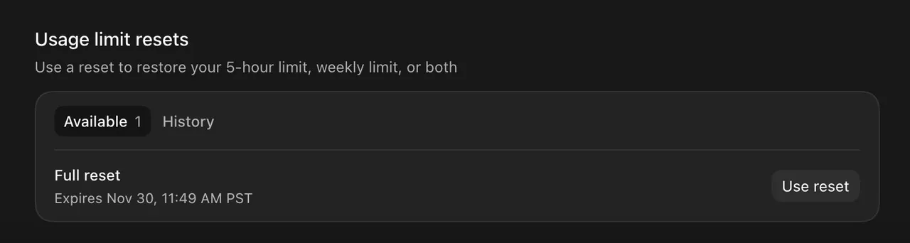

今天最值得细读的是 DeepSeek 放出的 Super-agent 架构文章和原型代码。这套设计用一个常驻 Router 分活，把 agent 从单次会话里解放出来，还附了一组和「单 Session + Subagent」对比的实验数据。另一篇长文拆的是 Anthropic 招股书里的毛利账：纯推理毛利 85%，算上训练和云渠道分成只剩约 26%，其中关于五分钟缓存的部分和每个 Claude Code 用户的账单都有关。实操方面，有人把短视频剪辑整个交给了 Codex + FFmpeg，两个半月出了 105 条，翻车点也写得很具体。

## Agent 实战

### DeepSeek Super-agent 原型：常驻 Router 分活，Worker 只管干活

DeepSeek Harness 团队发表了 [Super-agent 设计文章](https://mp.weixin.qq.com/s/zoS7GlReWPhfCjENGxXCdg)，同时开源了 [dsh-superagent-prototype](https://github.com/deepseek-ai/dsh-superagent-prototype)。思路是让 agent 常驻在线，由 GitHub、IM 里的事件驱动，人只在需要拍板时被打扰。在合成负载测试中，它的 p95 完成时间为 15.7 分钟，单 Session + Subagent 方案是 29.5 分钟。团队明确说明这是研究代码，不是正式产品。消息由 @睿智的北极熊 转来。

文章的出发点是一句判断：单任务的上限取决于模型，多任务的上限取决于人的注意力。按他们的观察，一个人通常只能同时跟进 3 到 5 个活跃 Session。架构的几处关键设计如下：

- **双层分工**：Router 常驻，承接所有人类交互和派活，自己不执行任务，连 Bash 工具都不配，较轻量的模型就够用。Worker 之间上下文隔离、并发运行，配最强的模型，只向 Router 汇报。
- **事件过滤**：先走程序的 Fast Path，再走 LLM 的 Slow Path，两级降噪。同一个 IM 话题或 PR 下的后续事件归为一个 Thread；已订阅的事件绕过 Router，直接送到 Worker。
- **交互约束**：异步 ReAct Loop 用 `start()`/`stop()` 取代同步的 `run()`，后台工具运行时仍能接收新输入。这个机制已在 Harness 中实现，但还没有默认开启。IM 里单次回复不超过 100 词。
- **存算分离**：Agent Loop 无状态，放在云端；端侧只放一个不存状态的轻量 daemon，支持 BYOM。另外挂一个独立的 Watchdog Session，判断各 Worker 是否有实质进展。

实验用的是合成负载：每次约 300 条消息，其中约 20 条是工作请求，每个方案跑 5 次，作者说明只供初步参考。

| 对比 | 结果 |
|---|---|
| Super-agent | p50 / p95 为 12.4 / 15.7 分钟 |
| 单 Session + Subagent，中性提示 | 5 次一次都没调用 Subagent，p95 为 29.5 分钟 |
| 同上，改成「优先委派」提示 | 5 次中 4 次委派，整体仍慢，并出现长尾 |
| 去掉订阅直通 | 完成时间基本不变，Router 决策数增加约 30%，缓存读取从 2323 万 token 增至 3177 万（+37%） |
| Router 压测：Trigger 从约 1 条/分升到约 40 条/分 | 平均 batch 从 1.0 升到 2.8，单次请求耗时从 2.5 秒增至 3.9 秒，单个决策分摊时间从 6.4 秒降到 1.6 秒 |

开源原型只实现了其中一部分：一个面向单个 GitHub 仓库的主动式 coding agent，可选接入飞书。只有白名单成员派活、或命中团队写好的规则时，它才接单。接单后签发一张不可变的授权凭证（Mandate），锁定本次允许的操作范围，然后在独立的克隆目录里执行，做完回到原对话交 PR。新写的主动触发规则默认先跑 observe 模式，只记录它会怎么做，不真改代码。安装时让 coding agent 读仓库里的 `SETUP.md`，陪着一步步装。代码大部分由 coding agent 写成，MIT 协议。

文章自己列出的开放问题里，最值得留意的是安全：云端 Agent Loop 一旦被攻破或被提示词注入，它连接的所有端侧设备都有被控制的风险；凭据一旦进入模型上下文，也会泄露。

这和群里 10 月 28 日聊的 [「Slack 来活，直接发给常驻 Claude：Windows 用 SendInput，Mac 用 tmux」]({{ '/daily/2026/10/28/daily/#slack-来活直接发给常驻-claudewindows-用-sendinputmac-用-tmux' | relative_url }}) 是同一类需求。@神秘的企鹅 问，用国内其他开源模型配 DeepSeek Harness 效果如何，暂时没人试过。

### 短视频剪辑全交给 Codex：两个半月 105 条，卡在上传和「故意的重复」

@冷静的飞鼠 分享了一篇[短视频剪辑实践](https://www.superlinear.academy/c/ai-resources/short-video-editing-with-ai)。作者让 Codex 直接用 FFmpeg 逐帧处理画面和声音，不去操作剪映这类给人手设计的界面。从 8 月 10 日第一次实验到 10 月底，AI 一共剪了 105 条（8 月 15 条、9 月 31 条、10 月 59 条），现在日更，11 月已经排满。

作者自己只做三步：手机录完丢进 iCloud 共享相册，跟 Codex 说一句「剪了发了吧」，看一眼清单确认整批。其余全由一份剪辑 skill 驱动：比对相册找出新视频，转写，剪掉说错重来的段落，烧字幕，出竖版和 3:4 两种封面，写各平台文案，排期上传。以 10 月 16 日那批为例，44 个文件里比对出 18 条新的；1:24 提需求，2:34 剪完，3:24 已在 YouTube 排到 11 月 2–19 日每天一条，中间只找过作者两次。

几条取舍和翻车经验：

- **按意思剪，不按静音剪**：哪一遍把意思讲完整就留哪一遍。一条 3 分 49 秒的视频剪到 2 分 19 秒；作者不重录，因为重录没法持续发。
- **AI 分不清「说坏了重来」和「故意强调」**：一条已发布的视频漏剪了两处重说。回头筛查 58 条成片字幕，又找出 4 条同样的问题，5 条一起补剪。另有一次，AI 把录屏改成截图卡片，丢了真实感，只能下架重剪。
- **skill 里写标准，不写坐标**：早期写死坐标和字号，结果「画面中间偏下」的字幕在一条一镜到底的 22 分钟竖屏里正好挡住了脸。10 月 8 日重写为只写标准：手机上看得清，不挡眼睛和嘴，避开各平台界面。
- **上传最不稳**：Instagram 只能提前 29 天排期，AI 每天检查窗口补位；小红书、抖音用 Computer Use 传成功过但不稳定，视频号直接被拦。

公开的 skill 名为 `kdb-talking-head-short-production`，管到成片、字幕、封面和文案为止，不含账号、不代上传。作者早期用过「先写网页再渲染成视频」的 HyperFrames，嫌多绕一层，后来弃用。@沉稳的大象 当场把链接丢给 agent，让它照着做一个剪辑 agent。

### 备课 skill 开源：先出页面级大纲，再生成 Google Slides

某群友公开了 [lecture-skills](https://github.com/NickGuAI/lecture-skills)。这是从一门正在开课的高校 agentic engineering 课程里抽出来的快照，两个 skill 串行使用。

- `outcome-first-course-design`：先设计学习成果，对比其他课程怎么讲同一主题，产出完整的课时大纲和教师备课指南。
- `lecture-deck-builder`：把确认过的页面级大纲转成原生 Google Slides，支持在原文件上就地修改。里面打包了视觉系统、写作规则、教学方法、QA 检查清单和生成课件的脚本。

安装方法是把文件夹放进 `~/.claude/skills/` 或 `~/.codex/skills/`。依赖三项：已登录目标账号的 gog CLI、带 Pillow 的 Python 3、Lato 和 Roboto Mono 字体。skill 里提到的 coding Studio、评分作业、知识检索等配套 skill 和示例课件都没有放出，用的时候要换成自己的等价物，或者直接跳过。MIT 协议。

### Slack 里的 AI 同事：Claude Tag、Codex in Slack、Workspace Agents 怎么选

@活泼的羊驼 贴了一份 AI 整理的三家对比：

| | Claude Tag | Codex in Slack | ChatGPT Workspace Agents |
|---|---|---|---|
| 形态 | 每个频道一个通用 AI 同事 | @Codex 触发一次云端编码任务 | 预先搭好的专用 agent，部署进 Slack |
| 侧重 | 编码，以及数据、工单、排障等 | 编码 | 重复性业务流程 |
| 记忆 / 主动跟进 | 有频道记忆，含 ambient 模式 | 主要靠线程上下文 | 持久记忆，可定时运行 |
| 套餐 | Team / Enterprise | Plus 及以上 | Business / Enterprise / Edu / Teachers |

结论是：只想 @ 一下就改代码、提 PR，个人订阅的 Codex in Slack 就够用；想要一个常驻频道、会主动跟进的队友，Claude Tag 目前更完整。

## 模型与额度

### Codex Day 26：reset 改成发卡，可以留着用到 11 月 30 日

Tibo 的 Day 26 公告说，手机端已经可以切换多个账号，桌面端随后跟上；接下来两天会有 reset，而且是「banked」的。实际发下来的是一张 reset 卡，不是直接重置。卡可以恢复五小时额度、周额度或两者，有效期到 11 月 30 日。

@神秘的麋鹿 觉得幸好能存，不然用不完；@聪明的鸵鸟 和 @沉稳的仓鼠 都收到了，@沉稳的仓鼠 拿到就用掉了。额度已经归零的人还在等。

同一天，@蓝色大肥虞 发现 Codex 客户端里没有 astra ultra 了，他怀疑是负载太高，以前也偶尔出现过。降到 xhigh 后，他最明显的感受出现在 review task description 这一步：考虑得不如 ultra 全面，需要他提示的东西变多。@冷静的麋鹿 那边一切正常。@稳重的海豚 的建议是用 plan mode，他现在复杂工作流都先写 plan。

### Claude 用「自我评估」查滥用：每次回答后给整段对话打一次分

Anthropic 在新开的 Safeguards 博客上介绍了「自我评估」：Claude 生成回答后，紧接着对整段对话做一次初步的安全评估。官方说，这个机制 6 月启用以来，揪出了不少其他防线覆盖不到的滥用；因为刚读完对话，运行成本很低，而且随模型能力提升会越来越准。

群里的第一反应都落在封号上。@谨慎的灰熊 问是不是封号更精准了；@开朗的企鹅 的解读是：

> 就是每句话都在评估你是不是中国人。

@谨慎的灰熊 吐槽他们算力还是太多；另有群友说已经不敢重新买号，还有两位接了一句「用脚投票了，转投 OpenAI」。相关背景见 10 月 24 日的 [「fuck-claude.app：估算 Claude Code 会不会把你当中国用户」]({{ '/daily/2026/10/24/daily/#fuck-claudeapp估算-claude-code-会不会把你当中国用户' | relative_url }})。

### Grok 初体验：限制松，X 订阅里还打包了 Cursor

@睿智的犀牛 第一次用 Grok，觉得几乎没有限制，「你就可劲儿问吧」，问了一阵才碰到拒答。他准备充值。@稳重的海豚 说限制其实是有的；@今天群内信息量极大 提到，Grok 今天刚更新用户协议，加入了数字水印。

@睿智的犀牛 开通后的订阅页显示，X 订阅现在打包了 Grok Bot（含 Atlas、Nova、Iris 等分工角色）、Chat、Voice、Imagine、Build，外加蓝标、少广告，以及 Cursor。

@蓝色大肥虞 不买账：除了画图尺度能放宽一点，内容也极其有限，并不觉得它比 ChatGPT 多做了什么。@稳重的海豚 同意。

## 行业与数据

### Anthropic 招股书另一笔账：纯推理毛利 85%，算上训练和渠道只剩 26%

一篇拆解 Anthropic S-1 的[文章](https://yage.ai/share/anthropic-s1-six-month-shelf-life-20261030.html)在群里流传。核心论点是：前沿模型更像只有半年保质期的生鲜。今年第三季度，超过八成收入来自六个月内发布的新模型，一旦停止迭代，收入半年后就会大幅下滑。往期已经写过营收规模和违规客户占比，这篇的新东西是毛利分层和缓存成本。

| 口径（今年上半年） | 金额 / 比例 |
|---|---|
| 纯推理毛利率 | 85.4%（推理与直接运维成本 23.80 亿美元） |
| 加上研发科目里的训练与研究算力（65.65 亿美元） | 毛利率 45.1% |
| 再扣云渠道分成（付给亚马逊、谷歌等 30.53 亿美元） | 约 26.3% 可用于薪资和日常运营 |
| 对照：两年前 Claude 3.5 时期纯推理毛利率 | −94.8% |

48% 的收入经三大云厂商的商城结算。八百多亿美元的账面净亏损，约九成来自早期融资工具重估，是非现金项目；二季度经营利润 9.74 亿美元，上半年自由现金流 34.47 亿美元。算力方面，已签的核心算力与芯片租赁承诺为 6,370 亿美元，算上新合同后具有法律约束力的总承诺为 8,551 亿美元，多数是用不用都要付全额的保底约。年消费超 10 万美元的客户从约 1,200 家增至 11,900 家，年付超 1 亿美元的从 0 家到 19 家。

和开发者最直接相关的是缓存：

- API 默认的上下文缓存只活 **5 分钟**，买一小时缓存要付双倍写入价。
- 交互式智能体近八成会话时间花在等人阅读输入上，超过一半花费在读取旧上下文上。
- 停顿超过五分钟再回来，会触发一次 **12–15 美元**的全价重读。
- 重度 Claude Code 用户的花费，是企业客户中位数的 20 倍。

### FT 图表：AI 行业产出继续涨，人头没跟上

@谨慎的灰熊 贴了 John Burn-Murdoch 在 FT 上的三张图。第一张对比美国科技、金融、专业服务等 AI 采用行业：ChatGPT 之后，美国的人均实际产出明显高于 2012–19 年的趋势线；英国、加拿大、欧盟、德国、法国基本贴着趋势线走。第二张显示，美国科技业增加值保持上行，就业从 2022 年后收缩。第三张显示，Alphabet、Meta、Microsoft、Spotify 的收入和持平或下降的员工数拉开了差距；美国银行、Visa、埃森哲、德勤则基本同步。

@细心的熊猫 注意到，科技业产出在 ChatGPT 出来之前就涨起来了；@睿智的犀牛 把这归功于马斯克带头的大裁员。@灵动的喜鹊 的感受是「现在 hc 能 flat 就不错了」；@谨慎的灰熊 提醒，这些还只是过去的统计，没有做预测。

### 零碎

- **王者荣耀灵宝被反代成 API**：@坦荡的灰熊 看到有人把游戏里的灵宝和腾讯微信智能客服反代出来，按量卖 OpenAI 兼容接口，标价输入 ¥0.05、输出 ¥0.2、缓存 ¥0.005，号称「官渠稳定」。@淡定的老虎 建议顺手调戏一下微信支付。
- **「GPT-6.2 Bel，12 万亿参数」是假的**：短视频里声称内部追踪器截图流出，智能指数 72 分，定价每百万 token 20/100 美元。@细心的熊猫 贴出 AA 真实榜单，榜首仍是 Gemini 4 Carbon 的 59 分。
- **5090 魔改 64/96GB**：@细心的熊猫 转来推文，称 64GB 和 96GB 版 5090 将于 11 月 1 日确认。3GB GDDR7 每颗约 100 美元，推文认为只在买不到 6000 Pro 的中国、或已有 5090 想升级时才划算，并认为这是 5090 涨到每张 7k 的原因。是不是官方版本，没人答得上来。
- **Google AI Ultra 折算**：@灵动的考拉 算下来，200 美元一个月的档位折合 API 约 9000–12000 美元。有人追问 agent 能力行不行，暂时没回音。
- **定义题目才是壁垒**：@专注的剑鱼 认为，无论应用侧还是基模团队，现在都在拼 know-how 和「含人量」，定义 bench、定义任务是最核心的能力。他配了一条推文：加入 Neo Lab，周会会被拷打「这个自动生成的 rubric 真的有 diversity 吗」，算法组一周做 3 个 Last Exam 级别的 benchmark。
- **知识库 MCP**：@活泼的羊驼 把 @冷静的飞鼠 分享过的知识做成了一个简单的 MCP，遇到问题时让模型先搜过去知识库里相关的 mindset。
- **大肥鱼又交作业**：@蓝色大肥虞 贴出截图，大肥鱼完成「上网冲浪」任务后申请新建项目，批准后交出来的是「人和鲸鱼配种研究.zip」。
- **AI 短剧**：@蓝色大肥虞 觉得 AI 片质量越来越高，短剧演员要没活路了；@温暖的斑马 回了一张「红果短剧戒毒所」的梗图。
- **成都线下聚会**：Superlinear 成都场今天开了，有人提议以后组团去成都 offsite，也有人在问北京场什么时候办。
- **没人接的问题**：qmd 有没有人用过；做 demo 视频用哪家的功能；评测仪表板该怎么设计。
