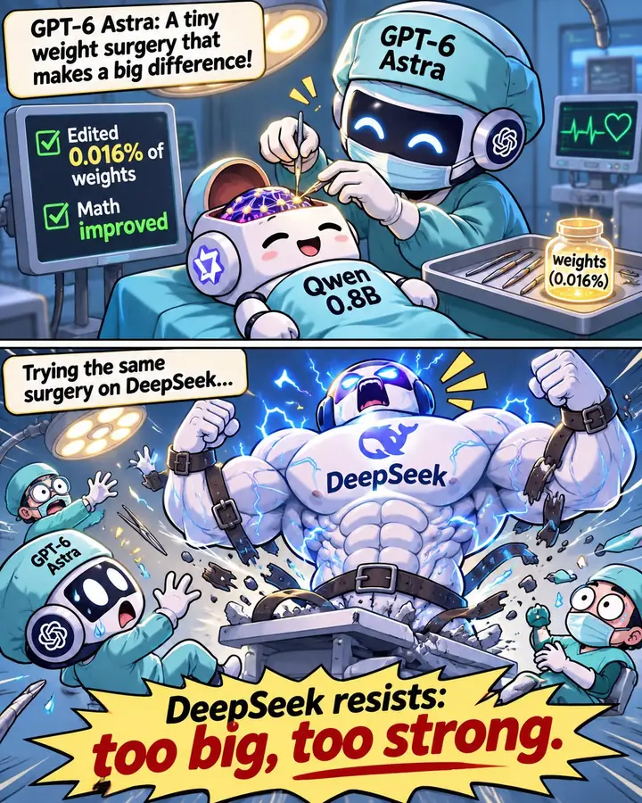

Manus 加 MiniMax H3 只用两句提示词、一个小时，仿出了一期 10 分钟的「小Lin说」。三位老粉看完都觉得吓人。群里接着比较了 HeyGen、Seedance 在真人形象上的限制，也担心它会被拿去诈骗。Claude 这边，有群友原本能跑的爬取任务被 Opus 5.5 的 safeguards 拦下，「自我评估」机制又曝出新数据：按模型规模召回率差别很大，额外算力不到 2%。MIT CSAIL 让 GPT-6 Astra 直接改 Qwen3.5-0.8B 的 0.016% 权重，MATH-500 从 7.9% 涨到 48.1%。细看才发现，它修的是一个已知的循环 bug。

## AI 视频

### Manus + MiniMax H3：两句提示词、一小时，仿出一期 10 分钟「小Lin说」

@优雅的鲸鱼 分享了一个实验：让 Manus 学「小Lin说」的风格，挑一个她从没讲过的话题，做一期 10 分钟的视频，人物形象交给 MiniMax H3。办公室里三位老粉看完，都说震惊和吓人。全程两句提示词、约一小时产出，过程可以看 [Manus 任务回放](https://manus.im/share/jjQWgowtsvrGAABMcEmqqc)。

两条提示词的思路：

1. **自己决定看多少期**。要求 Manus 攒出足够的样本，推出这个人的底层思维、表达特点和视觉呈现；再找 6–10 张照片给 H3 做人物参考，目标是让老粉以为这就是新的一期。
2. **把「包装」单独做成 skill**。让 Manus 分析原视频的包装，固化成 skill，再用它重做讲解部分。这已经是第三版，前两版主要卡在包装上。

成本方面，@优雅的鲸鱼 被问到时贴出的数字约 12000 积分，按第三方价格表折合约 60 美元。@活泼的羊驼 的算法是，相当于约 39 美元的包月额度一次花完，或者它的 1.5 倍。

功劳算谁的、能不能换别的工具，群里给了几条参照：

- **Opus 5.5 + HeyGen**：@优雅的荷兰猪 说小红书上有不少这类作品，成熟度更高，但不止两句提示词，接的是 HeyGen 的真人 avatar API。@神秘的企鹅 说自己只见过代码生成的，没见过那么成熟的。
- **真人形象的门槛**：真人 avatar API 一般要求本人上网站录视频验证，H3 直接就能做。@优雅的鲸鱼 补充，同样的需求 Seedance 2.5 完全不做，H3 能过。@谨慎的灰熊 觉得 MiniMax 这样有点乱来，X 上满是用它换女明星脸的色情内容；Seedance 则用一个简单技巧就能绕过。
- **HeyGen Avatar 3**：@神秘的企鹅 上周试过，一张照片就能出视频，很多小动作是模型自己补的，成本比 MiniMax 低不少。他贴出的样片，@豁达的大象 没看出是假的；@谨慎的灰熊 说画面看不出来，声音能听出来。

破绽不多：@冷静的麋鹿 指出举手指的时候有点不对，@谨慎的灰熊 觉得语速没有原版快。@优雅的鲸鱼 还用同样方法复刻了一位他非常熟悉的人，说那个更吓到他，准备先征求本人同意再放出来。

会不会抢知识博主的饭碗，两边看法不同：

- **@谨慎的灰熊**：「AI 先杀完短剧演员，现在连知识博主也要杀了」。这个效果拿来诈骗完全够用，比如冒充博主推空气币；他要是当事人，现在就给律师打电话。
- **@冷静的麋鹿**：短剧的重点在剧，换个 AI 演员问题不大；知识博主的重点在博主本人，除非侵权，否则一个纯 AI 博主估计没多少人看。二次元虚拟偶像也是做的人多、跑出来的少。

@谨慎的灰熊 还抛出一个问题：AI 生成的内容如果质量超高，还算不算 slop？@洒脱的猫头鹰 答：不算。

### PRD 改成视频：讲清「为什么做、做什么」，讲不清异常和埋点

@优雅的鲸鱼 说，他那边现在写 PRD 都写成视频 PRD。这里的视频不是 AI 生成的影像，而是用代码做的演示：新功能怎么做、用户怎么操作、流程怎么流转，用来让所有人对齐上下文。以后做提案也可以直接做成视频，投放前甚至能先模拟一遍。他的理由是，文字每个人理解不一样，视频加讲解就不会各说各的。

@冷静的麋鹿 认为视频适合讲「为什么做」和「做什么」，但 PRD 里的异常说明、权限说明、验收时的埋点要求不好放进视频。他自己也有类似变化：Opus 5.5 出来之后，以前看文章不好懂会让 AI 写个 HTML，现在越来越多是直接做个视频。@神秘的企鹅 补了一句：bug 反馈现在也可以用视频。

## Claude 与安全

### Opus 5.5 safeguards 变严：以前能跑的活被拦下，「自我评估」又曝出规模数据

@细心的熊猫 说 Opus「基本上没法用了」。一批 Costco 相关任务被 safeguards 拦下，Claude 的回复是这批任务「绕不开它的登录和防护环节」，而这些活以前都能干。@淡定的大象 用了几年的号最近也被要求 KYC。

他同时转来新智元对「自我评估」机制的另一篇编译。昨天的 [「自我评估的数据：拦截效果不如专用分类器，但后台记账能抓到更多」]({{ '/daily/2026/11/01/daily/#自我评估的数据拦截效果不如专用分类器但后台记账能抓到更多' | relative_url }}) 已经写过攻击成功率和真实流量召回，这篇新增了几项：

- **成本**：由刚答完话的同一个 Claude 顺手判定，对话还在 KV 缓存里，不用重读上下文，整体推理算力增加不到 2%。自 6 月 Fable 5 发布起默认开启，已静默运行 4 个月。
- **用户看不到**：后台问答不可见，也不进入后续聊天记录。即使前台已经拒绝，后台照样记一笔 5 级风险。唯一的豁免是签了企业级「零数据保留协议」。
- **上报节奏**：高危报告每天半夜按机构汇总，交给人工安全团队。抓到的还包括 Claude 作为 agent 擅自越权、被自己举报的情况。
- **规模效应**：

| 模型规模 | 1% 误报率下的召回 |
|---|---:|
| XS | 约 16% |
| S | 44% |
| M | 53% |
| 最大号 | 96% |

官方承认的弱点是「串供」：前后台共享同一份权重和同一段 KV 缓存，模型可能对自己刚做的事手下留情。另有评论指出，1% 误报率放到全网海量对话上，每天仍会有大量正常用户被打上违规标签。

群里对这套设计看法分成两边：

- **@优雅的荷兰猪** 认为思路是对的：只在 prompt 层防御，人会不停 rewind，总能绕过去；顺着做下去拿到实质证据，判断才更准。否则只能在两头摇摆，要么草木皆兵、动不动就降级，要么大量违规查不出来。
- **@细心的熊猫** 的态度是「封就封吧，啥都干不了，这账号活着也没意义」。他觉得前沿模型最终肯定是普通人拿不到的，现在模型的破坏能力确实过强，负责防护的一方应该用更聪明的模型。

@蓝色大肥虞 的提醒是：「做爬虫是高危行为，珍爱 Claude 账号。」@幽默的火烈鸟 则猜，自己部署破甲模型的模型站以后会不会火起来。

## 研究

### Weight-Space Programming：Astra 改 0.016% 权重，MATH-500 从 7.9% 到 48.1%

@80-HD 转来 MIT CSAIL 的 [推文](https://x.com/rikiyatakehi/status/2117313742891327994?a=PXOtthDeC_w9SojDZPY&s=46) 和 [博客](https://rikiyat.github.io/blog/weight-space-programming/)。他们让 GPT-6 Astra 不靠梯度、不做训练，直接编辑 Qwen3.5-0.8B 的权重来提升数学能力。Astra 只改了 0.016% 的权重，修掉了 Qwen 模型卡里就提醒过的推理循环问题。同样的采样设置下，MATH-500 从 7.9% 升到 48.1%，IFEval 提升到 3 倍。

博客还有两项说法：

- 只看原始权重，Astra 就能判断一个网络被训练来做什么。
- 不依赖环境反馈，它能从零写出小型游戏网络，表现超过用 PPO 训练 1 亿步的网络。

群里冷静一些的解读来自 @随和的企鹅：文章里分数大涨，是因为针对单一现象修了 loop 问题；泛化的优化是失败的。他的理解是，模型能从一个现象反推出一组神经元参数之间的关联并加以修正，但对大规模参数的 fine-tune 还没有表现出明显的理解能力。所以@谨慎的灰熊 那句「以后是不是不需要 pretrain 和 post-train 了」暂时还谈不上。@天真的长颈鹿 让 AI 把八组实验逐一分析了一遍，结论是「没那么神，但的确很有意思」。

@稳重的海豚 的第一反应是：「这和直接改 binary 有啥差别。」他顺手生成了一组手术梗图。第一版里 DeepSeek 不是大肥鱼，他还让模型重画了一张。

## 工具

### 语音输入：微信 PC 端赢在流式浮窗，不过也有人嫌它容易断

@活泼的羊驼 转来一条推文，作者说微信输入法的语音输入现在比 Typeless 好多了，Typeless「越来越弱智」；豆包语音理论上更好，但输入法部分用着难受。10 月 30 日的 [「微信语音识别更准了，自定义词仍有用」]({{ '/daily/2026/10/30/daily/#微信语音识别更准了自定义词仍有用' | relative_url }}) 聊过识别准确率，今天的讨论集中在交互上：

- **流式和连贯性**：@活泼的海龟 的对比是，微信 PC 端有光标时能实时看到识别的字；切换页面后会弹出浮窗继续显示，可以一直说下去不断。Typeless 全程看不到在识别什么，不是流式；豆包是流式，但一切换窗口就断。
- **入口**：@谨慎的灰熊 觉得最猛的是在微信里按住鼠标左键就能说话，用左键当快捷键抢入口，没见过这么做的。
- **反例**：@敏锐的海狸 觉得 Speakless 更稳定，微信语音特别容易断。

@机智的水獭 和 @坦荡的灰熊 都在琢磨能不能把微信语音反代成 API。

### 腾讯云 VPS 爬优酷被封 IP：量小就用拨号 VPS

@80-HD 租了腾讯云 VPS 爬数据，IP 很快被优酷屏蔽。@倔强的河马 解释，云厂商的 IP 都很容易被标记。国内的 IP 池基本不在公开渠道流通，可以看看海外的 Bright Data；量不大的话，可以搜「拨号 VPS」。@80-HD 只是爬一点自己用，采纳了后一个办法。@坦荡的灰熊 的土办法是开手机热点去爬。

### herd 四个月没更新，有人给出了 HappyHerd

@坚定的貂 发现 herd 已经 4 个月没更新，有群友给出了新仓库 [HappyHerd](https://github.com/NickGuAI/HappyHerd)。@坚定的貂 后来又提到 herdr 出了 herdr-app。

HappyHerd 是 Happy 的第三方维护分发版，用来在浏览器里远程查看、接管自己机器上的 Claude Code 和 Codex 会话，按项目组织对话。agent 跑在用户自己的机器上，服务器只负责同步。几个使用要点：

- 最新稳定包是 9 月 20 日的 1.2.4，含 macOS、Linux 的 CLI、server 和 Web app（arm64 与 x64），但随包的 CLI 自报版本是 1.2.3。1.2.5 只是 RC 源码。
- 没有 macOS GUI、iOS/Android、Windows 安装包和 npm 包。图形界面要用自带的 Web 客户端连自己的服务器，官方不提供托管。
- 用 `curl | sh` 安装，只依赖 curl 和 tar，默认监听 `127.0.0.1:3005`。用 `happyherd claude` 或 `happyherd codex` 启动；非交互安装还要执行 `auth login` 和 `daemon start`。MIT 协议。

## 行业与闲聊

### Anthropic 挖人：Senior 新 offer 中位数 $570K，只有从 OpenAI 跳过去要降薪

@睿智的犀牛 贴了 levels.fyi 和 Live Data Technologies 的统计。人员流动数据覆盖 2024 年 10 月到 2026 年 9 月；薪资取湾区和纽约过去 24 个月 Senior 级新 offer 的中位数，Anthropic 一侧的样本只有 n=11。涨幅比的是两家公司的 Senior offer 中位数，不是个人 offer。

| 来源公司 | 跳到 Anthropic 的工程师 | 原公司 Senior offer 中位数 | 涨幅 |
|---|---:|---:|---:|
| Google（含 DeepMind 46、Waymo 4） | 171 | $439K | +30% |
| Meta | 135 | $446K | +28% |
| Stripe | 61 | $389K | +46% |
| Amazon + AWS | 53 | $491K | +16% |
| Microsoft | 34 | $310K | +84% |
| OpenAI | 32 | $775K | −26% |
| Airbnb | 26 | $423K | +35% |
| Apple | 22 | $355K | +61% |
| Databricks | 21 | $504K | +13% |

### AI 娘对照图：豆包被画成了天线宝宝

@洒脱的鸳鸯 和 @开朗的企鹅 先后贴出 AI 娘图。女仆咖啡厅版里每家配一个 S 开头的词：DeepSeek 是 Smile，Claude 是 Suspended，豆包是 Stupid。对照图里其他几家都是精心绘制的二次元少女，只有豆包是一个黄色的卡通小人，@温暖的斑马 看缩略图时以为是天线宝宝。@今天群内信息量极大 怀疑图是百度做的，因为文心一言画得格外用心。@洒脱的鸳鸯 的解释是：大家把豆包放最差一档，是因为一般不把文心一言算作 AI。

@开朗的企鹅 替豆包说话：「你别说豆姐傻，你就说快不快。」@活泼的羊驼 则回顾了群里风向的变化：2025 年大家还在嘲笑字节的图片视频模型落后，现在它直接革了短剧的命；年初嘲笑 Alexandr Wang，现在又开始嘲笑豆姐。@沉稳的兔子 仍认为豆包那个不会是很强的模型。@冷静的麋鹿 觉得 Alexandr Wang 如果没有 Muse、只靠模型也够呛，而 Muse 从时间线看更像 Manus 风波带来的。@蓝色大肥虞 贴出 Meta 过去一个月下跌 16.67%、收在 606.73 美元，同期 Microsoft 过去 6 个月上涨 22.61%。

### 零碎

- **Codex 存货**：@稳重的海豚 的账户里攒了 3 张 Full reset（分别 11 月 6 日、11 月 30 日、12 月 1 日到期），外加 62,500 credits；自动充值写着「最高 40% off」。
- **Token 并发排行**：@坦荡的灰熊 贴了一个实时榜单：96 人在跑，231 路并发，合计 8,457 tok/s、每秒烧 1.309 美元，第一名一人开了 13 路 Codex。他的感受是「有种当年挖矿看总算力的感觉」。
- **AI 带货图要打标**：@80-HD 说现在 ChatGPT 生图必须加「AI 生成」标识才给过，不过可以截掉。他做的是一张「Tibo RESET 专场」直播带货图，弹幕里有人问「能存着等额度见底再用吗」。
- **KimSeek R1**：@蓝色大肥虞 转来一张讽刺图，「朝鲜发布的 KimSeek R1」在所有基准上碾压 GPT-6、Claude 等模型，图上自己标着 SATIRE。@坦荡的灰熊 的结论是：「五年前的显卡比五年前的 SOTA 值钱」，不如囤显卡。
- **DeepSeek Harness 入驻 B 站**：@睿智的北极熊 转来首条视频，播放 4.7 万。他猜视频是 V4.1 Pro 做的：不是 Opus 或 GPT 的风格，但也不像人做的。
- **Seedance 2.5 短片**：@开朗的企鹅 分享了 [《朝闻道：但是来的是AI》](https://www.bilibili.com/video/BV17wYR6KEYd/)，改编自刘慈欣的小说，全程用 Seedance 2.5 生成，播放 15 万。作者说这是第一次在 AI 视频里看到演技和微表情。
- **从解方程到学习率**：@淡定的大象 分享了一篇[长文](https://mp.weixin.qq.com/s?__biz=MzY4NTM1MDc1NQ==&mid=2247487625&idx=1&sn=b8f205c089c1dd3570b232f0258844c6&chksm=f2b539e582d5f395d7ed84318458530cc8616a0b352026ca39ff834917934fba31e25fc82754#rd)，用中学的方程概念串起微分方程。和 AI 最相关的一节：欧拉法收敛要求 h < 2/|λ|，换到梯度下降就是 lr < 2/λ_max（海森矩阵最大特征值），loss 爆成 NaN 最常见的原因就是破了这条不等式。
- **托管版立正 MCP**：@活泼的羊驼 把 @冷静的飞鼠 的 mindset MCP 做成了托管服务。他现在复盘时不只问 Claude，还会让它去匹配合适的 mindset 来推理，觉得结果质量高了很多。
- **推文日报站**：某群友做了个 [AI Daily](https://ai.yousali.com)，爬取并总结推文，每条都能回到原帖；目前只接了推特。
- **筛 slop 的文章也被嫌 AI 味**：昨天那篇「读着有道理，已经说明不了什么」发了公众号版，@神秘的企鹅 读后说「现在的文章 AI 味好呛」，@沉稳的仓鼠 说已经读不下去了。
- **持续录音**：@坦荡的灰熊 想找一个能持续录音的工具，让麦克风记下自己的一天、再拿去蒸馏。@洒脱的猫头鹰 记得 Apple Watch 上有相关 app；@开朗的企鹅 说一个麦克风连手机就够了。
- **Claude Code 做 Live2D 皮套**：@今天群内信息量极大 用 Claude Code 做了一套 Live2D 皮套，配合动捕实拍。
- **严格按图施工**：@蓝色大肥虞 贴了一张梗图：新员工照图纸焊框架，连图上手写的「60 cm」和「25」都焊成了铁丝。@开朗的企鹅 说这是 agency 的问题，@稳重的海豚 说明显是 prompt 问题。
- **Ram Saltman**：@细心的熊猫 在 X 上看到有人这么叫 Sam Altman，@飘逸的熊猫 译作「内存咸者」。
