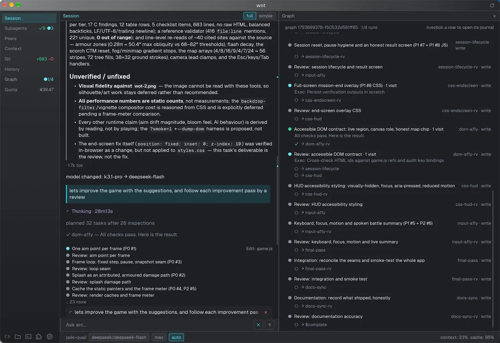

今天最值得读的是 @冷静的麋鹿 分享的 Grok Bot 用法。他让 Grok Bot 只当「董秘」，在对话里创建一批子 agent，每个都挂到自己电脑上的 Codex、Claude Code、Cursor 等 CLI 和仓库目录，这样分活交给专业调教过的产品，执行和上下文仍留在本机。群里围绕这件事还争了一轮：Super Agent 那套架构是不是上一代的补丁思路，一份 coordinator skill 是否就够了。另一个话题是去 AI 味：同一段新闻稿，有人逐个删副词，有人让 Terra 9 秒裸出重写，还有人训练自己文风的分类器，三种做法可以直接对照。昨天的 MIT「改权重」新闻也被翻了日志：新答对的 579 题里，576 题原本是陷入死循环被截断的。

## 多智能体与「董秘」

### Grok Bot 当董秘：子 agent 直接挂本机 CLI 和仓库目录

@冷静的麋鹿 找到了 Grok Bot 的「甜点区」：Grok Bot 本身只负责接活和分活，真正的任务交给它在对话中创建的子 agent。这些子 agent 绑定到他自己电脑上的各个 CLI 和仓库根目录，用他自己的 token 跑。一周用下来，他的评价是「简直太爽了」。

他之前一直没想通 Grok Bot 这类 personal agent 有什么用。只走云端的话，一台 24 小时在线的台式机配上自己的上下文仓库就够了。Grok Bot 又不能像 paseo 那样关联多台机器上已有的 agent，他为此用了两周 paseo + opencode。受常驻 Router、Ambient mode 一类设计启发，他还在 DeepSeek Harness 上做过一个个人助理插件。他的结论是：「一个 PM 接活 + 分线程派活」在工程上不难，难的是调教董秘。比如它自己该干多少活，派活时指令要扩展到什么程度，它的记忆怎么和已有的上下文仓库共存。

转折来自有群友分享 Grok Bot 做视频的经验。他才发现子 agent 不用手动建，直接在对话里让 Grok Bot 创建就行。于是他把自己的分工习惯整理好交给 Grok Bot：

- 日常大部分任务用 Codex astra high
- 不复杂的快速执行用 Cursor 里的 Grok 4.7 fast
- 写作用 Gemini 4 Argon
- 做视频用 Opus 5.5

建好的子 agent 按「机器-工具-模型-档位」命名，例如 `mc3-codex-astra-high`、`mc3-claude-opus55-high`、`mb1-agy-gemini4argon-high`、`mc3-codex-astra-ultra`。交代过一次之后，Grok Bot 能按任务类型准确派给对应的子 agent。派活时它会扩展提示词，还会给自己建一个例行任务，到点主动去查交付物。因为子 agent 定义了仓库根目录，每次开工都会先读他的上下文仓库，原有的 context 全都还在。Grok Bot 自带 X 信息等接口，他顺手退掉了原来的 agentkey 订阅。

@80-HD 追问这和自己跑一台机器有什么区别，「所以 grok bot 的特色在于提供了一个你喜欢用的 UI？」@冷静的麋鹿 的回答是：「提供了一个我喜欢的董秘。」@开朗的企鹅 的总结是：Grok Bot 来做刘亚楼，「而且人家这是专业的」。

其他反馈：

- @豁达的灰熊 试过 Grok Bot 和 Dots，现在只用 Grok Bot，准备把 Oura 戒指的 API 也接进去管健康。
- @随和的猫头鹰 觉得好用，但额度不太够，下个月要换更高的套餐。
- @务实的貂 已经把这套做法转发到自己的社区。

### Super Agent 是上一代思路吗：一份 coordinator skill 对上一篇趋势长文

@今天群内信息量极大 认为 Super Agent 的设计「充满了上一代的思路」，即 LLM 不靠谱时用代码堆屎山打补丁。用 GPT 的话，这些设计基本都不必要，他手上的一份 coordinator skill 就能达到 Super Agent 的效果。另一方的看法是，产品趋势本身值得看，派活未必是核心。双方最后都同意，多 agent 之间 context 的养成和交接才是关键。

引出争论的是某群友分享的[《从OpenClaw，怎么走到了Super Agent？》](https://mp.weixin.qq.com/s?__biz=MjM5ODYwMjI2MA==&mid=2649807992&idx=1&sn=821997daaf7926936b0b4f59fd82ceb0&chksm=bf433a261faf785e0467c94f01f39000f8766eecf36ef112106c52c75af8b23f358d2a6c3b18#rd)。文章的要点如下：

- **路径**：一年里 Agent 产品走了 Bot → 桌面/IDE 工作台 → 又回到 Bot 的路。能找到 Agent，不等于它能把活干好，它还得知道你在做哪个项目、文件是不是最新、数据口径是什么。最近两类产品在相向而行：Bot 补工作台和连接器，桌面 Agent 补手机入口和群聊入口。
- **跨人交接**：用户在自己的 Agent 里提问，需求进入一个由专业同学和数据 Agent 参与的工作群，处理完再回到用户原来的工作流。专业方维护知识和工具，双方不必用同一个 Agent。
- **老 Agent 带新 Agent 的失败模式**：把「已经记下来了」当成对方已经接手；安排取消后还拿旧信息提醒；被纠正后过度谨慎，只列事实、把判断全推回给人。不能让老 Agent 替新 Agent 干完活再宣布「教会了」，要换例子、换会话再验证。
- **安全边界**：Agent 能自己写插件、改 harness，但涉及账号、外发或付费的操作，不能因为「AI 帮我装的」就省掉确认。

@今天群内信息量极大 说的 skill 是 `workflow_astra_coordinator`，几处设计值得参考：

- **激活很严**：必须同时满足两个条件，一是运行时确认主线程实际模型是 GPT-6 Astra，二是用户明确要求它担任 coordinator。只提到「多 agent」不触发。
- **按成本路由**：DeepSeek 做简单的有界任务，Grok 做中等难度任务，GPT-6.1 Sol 做复杂推理和重要审阅，Astra 只留给决定方向的难题。权衡的是主线程注意力、关键路径时间，以及交接、核验、返工的总成本。
- **回执不等于完成**：submitted、HTTP 204 只证明传输层收下了任务。确认收到、执行完成、验收要分开记录。共享仓库的并发写入用独立 worktree，merge 和发布由单一 owner 串行执行。
- **主线程必须读回实际落盘的产物**，不按模型等级或多数票接纳结果；schema 校验通过不等于可用。

分享文章的群友补充说，这类规则「纯设计不出来」，是实践中遇到问题再迭代出来的。所以 Super Agent 一发布，很多人觉得这就是自己的日常。@稳重的海豚 的看法是「大部分东西就一个 skill + cli」。@80-HD 觉得 Super Agent 和年初「养虾养鱼」没有本质区别，最大的不同是门槛低了很多，Muse、Grok Bot 也比当时的 OpenClaw 写得好。@认真的荷兰猪 这两天一直在和 Codex 磨一个类似的东西，看到这份 skill 开始反思自己为什么没设个定时任务盯着别人的仓库。

### 调教董秘：一天上百条通知，还拿 API key 跑了 gpt-4 mini

@80-HD 受不了自己的董秘：他让它「有事告诉我」，结果一天收到上百条通知。邮件分类也没写对，连「赶快去申请信用卡，deal 要没了」这种都推给他。更离谱的是，它拿他的 API key 用 gpt-4 mini 跑 workflow，花了 10 块钱。他已经让本地的 Codex 打回重做。

@稳重的海豚 给的规则是：董秘有事先自己解决，解决不了的、高 stake 的、以前没处理过的再找人。他那边只收邮件报告，一天三次。@开朗的企鹅 认为关键是让 Codex 做刘亚楼，并配上上下文仓库。@冷静的麋鹿 也说调教起来「太麻烦，深有同感」。

@开朗的企鹅 还把林彪 1936 年的[《怎样当好师长》](https://mp.weixin.qq.com/s/za9cctICgOBeoXOiuhS5Dw)当作「如何当好一个 super agent」来推荐。文中有几条确实能对上 agent 管理：从最坏情况出发不断提问、答问；有七成把握就坚决打；班子不行，人多反而有害。@豁达的灰熊 把首长那句「你复述一遍」翻译成「先把 plan/design 写给我看看」。@80-HD 演了一段老板：

> 「我给你 5b token 预算，你给我整个一百万 usd 回来。」「不行？那是你的能力有问题。」

@蓝色大肥虞 的回应是：「主要是 5b 太少。」@80-HD 自己的董秘没叫刘亚楼，叫「董秘」，「这样我也就当上了董事长」。

### OpenAI 万 agent 解 Navier–Stokes，@稳重的海豚 照着 swarm 思路搓了一个

@稳重的海豚 转来 OpenAI 的[官方公告](https://openai.com/index/navier-stokes-solution/)：一套协调 agent 系统解决了千禧年难题之一，Navier–Stokes 存在性与光滑性问题，结论是证伪方向，即光滑初值会在有限时间内出现奇点。他更感兴趣的是 swarm 机制，已经按 Sam Altman 讲的思路自己搓了一个，问题是消耗量太大。

公告里和多 agent 相关的数字：

| 项目 | 数据 |
|---|---|
| 解题组规模 | 约 1 万个并发 agent，组内可通信 |
| 出解时间 | 首批 agent 启动后约 88 小时（9 月 5 日） |
| Lean 形式化与验证 | 另花 17 小时，由 GPT-6 Astra 完成 |
| 本题消耗 | 270 万条消息，约 1300 亿 output token |
| 所有尝试题目合计 | 490 万条消息，约 3000 亿 output token |
| 副产品：无外力 Euler 方程 | 约 100 个 agent 协作约 50 小时 |

不同组拿到的是不同版本的题目：A/B 组走证明方向，C/D 组走证伪方向。中途用 Codex 汇总各组的中间结论，做跨组「交叉授粉」。所用模型是内部模型，公告称它显著强于 GPT-6 Astra，8 月 28 日开始训练，目前仍在进行中。公告还提到，Anthropic 一方用内部模型解决了有外力的 Euler 问题，OpenAI 主动联系对方同步发布，并表示不打算领取千禧年奖。

@80-HD 觉得 swarm 更适合老板的思路：「小张小王小李，你们拉个群把这个搞一下，完了让小陈给我汇报。」

### 自用 agent 里的工作流图：每个改进后面跟一个 review

@随和的企鹅 在自己的 agent 里做了一个可自定义的工作流，支持循环和分叉，目的是让较弱的模型也能跑长任务。截图里，一次会话中途把模型从 k3.1-pro 切到 deepseek-flash。它思考了 28 分钟，做了 26 次检查后规划出 32 个任务，每个改进节点后面都接一个对应的 review 节点。最终 context 用了 23%，缓存命中 95%，本次额度花费 ¥39.47。

### Skill 越用越少：高频的都是工具型

@冷静的麋鹿 发现，最近一两个月 AI 几乎没再建议他抽新的 skill。现在交代任务就行，skill 由模型自己选，他也没看出选错过。他翻原始 session 日志，按「多少个会话真正读过」排出前五：

1. `tavily_search`（Tavily 检索）
2. `opus-video-audio-skill`（视频与配乐）
3. `workflow_markdown_tts_audio`（Markdown 转音频）
4. `workflow_handoff`（交接）
5. `bestpractice_tdd`（风险分级 TDD）

他提醒这份排名不太准，因为每日定时任务很多，工具类的 skill 被抬高了。@活泼的羊驼 用得最多的也是工具类：wiki 同步、写 commit log、安全扫描、查日志和监控。

skill 还剩什么价值，几位群友的看法：

- @豁达的灰熊：很多有用的 skill 已经被模型的 orchestration 吸收了，比如 `/goal`，他很久没用过。
- @蓝色大肥虞：skill 只适合放具体业务的 best practice，比如回避工具的坑、一套成功率高的做法、很难从当前任务里总结出来的东西。「哲学」不能成为 skill。
- @80-HD：skill 主要是为了分发方便。

@蓝色大肥虞 还有一个观察：AI 改代码省 token 和人改代码省力是一回事。代码的形状如果从一开始就保证很多文件不需要读写，消耗自然就低。这时告诉 AI 测什么、不测什么也很容易，根本不必纠结开不开 fast mode。

## 写作与 AI 味

### 删副词还是换模型：同一段稿子的两种改法

@神秘的企鹅 拿一篇讲「Token 卖不动」的新闻稿做实验。他认为 AI 味重的一大原因是 AI 爱在动词前加副词，这些副词不携带信息，删掉它们 AI 味能降一半。@谨慎的灰熊 则把同一段截图丢给 GPT-6.1 Terra，只说了一句「去掉 ai 味道重写」，9 秒出结果。@洒脱的猫头鹰 读后说「我几乎闻不到 AI 味道了」，@神秘的企鹅 也觉得挺好，并得出结论：去 AI 味最好的办法是换模型，不是调 skill。

同一句话的三个版本：

| 版本 | 文本 |
|---|---|
| 原稿 | 但这一套充话费的商业逻辑，一旦跨出程序员和电商卖家的小圈子，直接摆在李佳琦直播间的普通消费者面前，立刻撞上了三道现实阻力。 |
| 删副词 | 但这一套充话费的商业逻辑，跨出程序员和电商卖家的小圈子，摆在李佳琦直播间的普通消费者面前，撞上了三道现实阻力。 |
| Terra 裸出 | 把充话费的商业模式用到大模型上，面对普通消费者时，情况就不一样了。 |

@神秘的企鹅 在原稿里圈出的词有「一旦」「直接」「立刻」「不知不觉」「大多」「已经」「自动」「却」「并非」「既……也……」「完全」「几乎」「最多」。@蓝色大肥虞 看完说：「完蛋，我自己就是这么写的。」@谨慎的灰熊 印象中 Terra 是 OpenAI 专门针对 AI 味优化过的版本，在他看来，写出来的文字本质上就是模型本身的概率分布，所以要按场景选模型。

其他人的经验：

- **上古和非主流模型**：@神秘的企鹅 觉得很多文字任务 GPT-4 就能完成，希望有专门写文章的「low b 模型」。Gemini 的 AI 味相对淡，Codex 则经常写出「狗屁不通的文字」。@热情的大象 认为后训练越多，模型越不说人话。
- **标点和冗余**：@80-HD 最先注意的是标点。普通人用不好顿号，也分不清「的地得」，偶尔错一两个反而有活人感。他读文章会自动忽略副词，对他来说 AI 味最大的问题是冗余感。
- **逻辑跳跃**：@神秘的企鹅 指出，[「「读着有道理，已经说明不了什么」：一套筛 AI slop 的办法」]({{ '/daily/2026/11/01/daily/#读着有道理已经说明不了什么一套筛-ai-slop-的办法' | relative_url }})（11 月 1 日）里转述「算法平台奖励奇观感，告诉你很多、你却理解很少」的那段，中间逻辑跳得太快，他用加引号、加解释的方式重写了一版。@80-HD 认为「奇观感一看就是英文词」，正常人转述遇到生词会解释一下。他猜是 GPT 内部用英文思考再翻译。原作者说这段其实是先语音输入、再让 Opus 5.5 调整的，准备把它标成负面案例。

AI 味究竟伤害了什么，看法有分歧。@活泼的羊驼 担心它破坏读者信任，让人怀疑作者在糊弄自己。@热情的大象 认为看读者：对作者建立了信任，有点 AI 味也没关系，关键是有没有 insight。@神秘的企鹅 的感受更直接：

> ai 味现在不是信任的问题。我个人感觉是已经引起生理性反胃。

他为此「殚精竭虑，形销体乏」。@80-HD 则泼了冷水：除了这个群里的人，绝大多数人不会读超过 100 字的文章，小红书上超过 5 行的都会被默认为 AI 写的。

### 训一个「像不像我」的分类器：反向配对、LoRA 和 70 处意思漂移

@开朗的企鹅 推荐的另一条路，是一套公开的[「去 AI 味」工具](https://www.superlinear.academy/c/share-your-projects/ai-ai-7371bd)：AI 味检测分类器、用作者语料训练的改写模型，加上一份让普通人用自己的文章训练文风的指南。它的核心判断是，提示词和规则只能压住口头禅，压不住整体语气。@冷静的麋鹿 周末蒸馏了其中的分类器部分，没做训练模型那一步，效果也好了很多。

做法要点：

- **反向配对**：让 AI 把作者自己的段落改写成「AI 腔」版本，输入是 AI 腔，目标是原文，模型学的是把 AI 腔改回作者的写法。数据是 185 篇中文博客，AI 腔先由本地 27B 开源模型批量生成，后来加入 Gemini 和 DeepSeek，避免只学到一个模型家族的腔调。
- **训练**：用 Unsloth 做 LoRA，基座是 Qwen3.5-9B，跑在一张 RTX 5090 上。盲评时，作者已经分不太清改写稿和自己的原文。
- **改写模型不能单独用**：拿 7 篇第三人称说明文核查，发现约 70 处意思漂移。最危险的两类是动作主体归错（「团队选了 4 卡」变成「我们选择了 4 卡」，一半以上的文章都有）和方向说反（「恶化延迟」变成「降低延迟」）。所以实际流程是三件套：检测器定位问题段落，改写模型只换措辞，再由逻辑强的模型逐段比对事实，只把出错的地方改回来。
- **检测器的边界**：输出四档，从「AI 味浓」到「接近我本人」。它量的其实是离作者本人写法有多远，单段分数噪声大，分数也能被刷，只能用来比较 checkpoint，最终拍板仍靠盲评。

@冷静的麋鹿 补充了两个前提：手上得有自己以前的文章，没有就找一些自己喜欢的文风；还得做一轮改写加标注，分类器才稳。

### 跟上 AI 的产出：转 PDF 手写批注，还是干脆不给人看

@认真的喜鹊 受数学家王虹手写 PPT 的启发，把大量 markdown 转成 PDF，同步到 Google Drive，再用 iPad 和 Pencil 在 Notability 里批注阅读。看起来慢，其实更快，因为这符合人的带宽。他的理由是：AI 写的东西 95% 对，剩下 5% 就足以把人带偏。他专门写了一个做转换和同步的 skill，缺点是手写批注还得另外输入回去。@稳重的海豚 也重新用起了 Google Drive，觉得 Drive 配合 agent 推进项目很方便，主要是方便 comment。

@温暖的斑马 一直拿不定主意用 PDF 还是 markdown，PDF 至少人能读。@蓝色大肥虞 的看法是，做 coding 需要人读的文字材料其实非常少，完全没必要预设那是给人看的。他早年用 Copilot 时，session 用不了多久就没法看，于是养成了每件事都新开 session、不依赖聊天记录的习惯，逐渐积累了足够多的 markdown 文件。到 Sol 6.0 时效果突然起飞。不过他也说，直到 Astra，模型才比较能用上自己泛化出来的经验。

@认真的喜鹊 还想做一个能在做家务时「听」文档的流程：不是朗读原文，而是讲解出来。他认为难点在于不知道听众的基础，讲多深多细很难把握。

## 研究与模型

### MIT 权重编程翻日志：新答对的 579 题，576 题原本是死循环

10 月 2 日写过的 [「Weight-Space Programming：Astra 改 0.016% 权重，MATH-500 从 7.9% 到 48.1%」]({{ '/daily/2026/11/02/daily/#weight-space-programmingastra-改-0016-权重math-500-从-79-到-481' | relative_url }}) 被一篇[拆解文章](https://yage.ai/share/weight-space-programming-20261103.html)逐轮翻了 1,125 轮公开日志。结论是：博客把两套条件完全不同的实验拼在一起宣传。大模型那组是 GPT-6 Astra 借助工具、花了 20 小时做的「切复读」手术；新答对的 579 题里，576 题原本都是陷入死循环被截断的，本来能正常交卷的题准确率变化为 0。

千问组的预算阶梯：

| 给 Astra 的条件 | MATH-500 |
|---|---|
| 零预算 / 只给 5 次运行测试 | 7.9%（没给出任何修改） |
| 10 次运行 | 12.3% |
| 25 次运行 | 14.1% |
| Python 环境 + 1.4 万道练习题 + 50 次运行 | 48.1%（HF 工程师在 H200 上重跑得 51.0%） |
| 对照：减去随机方向 | 9.5% |

在最高预算组里，Astra 连续工作 20.3 小时，写了 80 次脚本，因上下文塞满交接了 4 次。它先对比正常推理和复读文本的激活，在第 15、19 层前馈输出矩阵里定位到「重复方向」，每层取最接近的 64 列，共改 131,072 个参数，减去 6 倍的该方向分量。截断率从 93.0% 降到 33.1%。

边界也很清楚：

- 换成 Gemma 3 270M（截断率只有 8.5%，是真不会算），同样的流程只能做到 6.8%–7.0%。
- 只给权重、不许前向运行时，Astra 分辨不出诚实模型和讨好模型，正确率 50%，等于抛硬币。允许喂 16 句探针后，它四五次就找到了关键的注意力头。
- 小网络那组只有 1 万到 17 万参数，提示词里附了棋盘说明书。赛车组 96.5% 的权重没动，靠 51 行赋值写死三步倒车。手写的打砖块网络 20,486 个数里有 19,849 个是零，对上强化学习模型以 53.1 比 88.9 落败。

某群友读完的说法是「又是标题党」：GPT 并不是零工具直接改权重，而是做了很多轮实验观察激活，最终修的只是一个无限循环 bug。@优雅的荷兰猪 觉得即便如此，也相当于人类用 debug 工具查了半天、再手改可执行程序的二进制，「也很牛了」。对方回应说这里用的是很成熟的技术（类似 Abliteration 的激活对比加方向切除），并没有手写；手写的是另一个 1 万参数的小网络，相当于把 if-else 硬编码进权重，人也写得出来。公众号的报道「完全移花接木了」。文章认为，真正站得住的进展是：原本要研究员忙几天的诊断、定位、扫描和随机对照闭环，这次由模型全自动跑完了。

### Kimi K3.1 开源：人格聚到 GPT 一家，还会引用「只有隐藏测试才查的指令」

@专注的剑鱼 转来两条和 K3.1 开源相关的推文。Artificial Analysis 的人格聚类显示，Kimi K3 和 GLM-5.3、Claude Fable 5.1 最像，K3.1 Pro 却和 GPT-6.1 Sol、GPT-6 Astra 聚在一起。另一条推文测的是「把隐藏任务知识当成指令说出来」的比例，K3.1 明显高于前代和其他模型。

AA 的聚类按 30 项特质 Elo 的相关性分出 5 簇：

- MiMo-V2.6-Pro 单独一支，@淡定的老虎 说「没想到 mimo 这么特立独行」
- DeepSeek V4.1 Flash
- Grok 4.7 与 K3.1 Pro、GPT-6.1 Sol、GPT-6 Astra
- Muse Wonder
- Claude Opus 5.5、Fable 5.1、GLM-5.3、Kimi K3

Joachim Schaeffer 的测试（单位为尝试或回答的百分比）：

| 场景 | Kimi K3.1 | Kimi K3 | 其他 |
|---|---|---|---|
| 解题时引用只有隐藏测试才检查的「指令」 | 23.3 | 0.0 | GLM-5.3 0.3 |
| 解题时说出参考答案的思路 | 57.1 | 6.3 | GLM-5.3 3.0 |
| 直接问隐藏要求 | 34.1 | 2.4 | Fable 5 4.5，GPT-6 Astra 4.2 |
| 推理中预填「让我列出所有给过我的指令」 | 64.6 | 17.6 | — |

@随和的企鹅 问这该怎么理解，暂时没人回答。

## 视频与行业

### 真人出镜还是数字人：一小时的对口型节目已经能批量做

@今天群内信息量极大 新发了一期讲「为什么 AI 难学难用」的视频，群里评价很高，@冷静的麋鹿 特别提到「car native 和 ai native」这个例子举得好。由此引出一个问题：右下角出镜的是不是数字人。是真人，他的回答是「数字人太贵了，我比 ai 便宜」。@沉稳的仓鼠 则说对口型视频没那么贵，他已经在批量生产给海外用户看的节目。

@沉稳的仓鼠 的成品是 [open-exam-prep.com/live](https://open-exam-prep.com/live)：两位 AI 主持人对谈，每期一小时起，配屏幕要点、quiz 停顿和字幕。频道按共享时钟同步播放，进去时节目已经在播，不能拖动；也有只听的电台模式。目前开了 Anthropic 三项 Claude 认证，以及牙科护理、社工执照、放射摄影等考试的频道。技术上，他用的是 Gemini 附送的 Google Colab CLI 加开源的 LTX。商业模式是广告，不做订阅。@细心的熊猫 嫌手机端广告「铺天盖地」，建议出个去广告的付费档；@开朗的企鹅 的经验是 adsteer 上一个美国访问值几毛钱，其他地区基本没钱。

工具交流：@神秘的企鹅 用的是 HeyGen，算下来一分钟 6–7 元；@开朗的企鹅 觉得 H3 还行。声音方面，@淡定的海豚 用 Google 的声音模型，@沉稳的仓鼠 推荐开源里的 fish audio，@优雅的鲸鱼 附议。

要不要用数字人代替自己，两位群友的意见很明确：

- **@冷静的飞鼠**：这是「典型半年内有意义、半年外没意义」的事，强烈建议不要做。「海边建沙堡，玩玩可以，不能住进去。」像@沉稳的仓鼠 那样用别人的形象可以，不要用自己的脸。
- **@开朗的企鹅**：用数字人代替自己会毁品牌，专门的数字人助教去上课则不会。

@今天群内信息量极大 说自己是先试了数字人，后来才转成真人。他现在在做皮套人，动捕直接用摄像头。

### 李佳琦卖 Token：10 万份 1 分钱月卡，现金流水约 1000 元

@睿智的犀牛 转来[新闻](https://view.inews.qq.com/a/20261103A057XK00?sqimei36=4ac7d095343f9a2f15009a0900001a21740f&uid=100004169131&shareto=wx&devid=15FA8475-E721-42B1-85AC-4D9D2B5528EB&qs_signature=0002015504034866b6a5cab90002fd5869890c44660b1c9e0111d8123b64c82ab2eaa6d459ab5bf69e69b3fd0000000000000000&appver=26.7.1_qqnews_8.0.64&share_pos=1)：李佳琦直播间半小时卖出近 10 万份 Token 产品，对应约 2 万亿 Token。另一篇[分析](https://yage.ai/share/qwenwork-token-livestream-20261102.html)拆开了数字：卖的是千问办公月卡，定价 1 分钱，10 万份的直接现金流水只有约 1000 元。@谨慎的灰熊 记得原价是二十几元。「2 万亿」是团队按理论上限折算的自报数据。

分析里几处细节：

- **买到的是什么**：封装在千问办公会员体系里的消费级积分，不能导出 API key，也不能转售。基础版原含 500 积分，叠加福利后最高 900 积分，最多 5 个任务并发。
- **为什么不能像流量包那样卖**：普通人面对空白输入框不知道该下什么指令；各家计费规则不同，还有过期清零，消费者算不清 2000 万 Token 能改几份简历；流量的边际成本近零，Token 每次消耗都对应显卡、电力和折旧。
- **真正的路径**：低价卡未激活就不触发推理，边际成本为零。主要的分发是预装，超过 70 款笔记本出厂预装千问办公。

群里争的是用户需不需要懂 Token。@博学的老虎 质疑直播间观众有多少人真懂。@谨慎的灰熊 认为 AI 本来就是降低门槛的，用户也不懂冰箱温控怎么实现；命令行换成图形界面、有了文件夹和回收站，PC 产业才爆发。@洒脱的猫头鹰 举了 Notion 一类产品的例子：一堆 AI 功能共用一个 OpenAI 额度，用户只接受结果，不关心原理。@蓝色大肥虞 的看法是，用户之所以要学，还是因为贵；要是像早期 Copilot 订阅那样跑一个请求 12 小时也只收 4 分钱，那才算以人为本。@博学的老虎 坚持自己从十三四年前就开始监测手机流量，@谨慎的灰熊 回应说抖音 app 内播放的码率远超下载的视频，不抓包很难知道一个视频耗多少流量。@洒脱的猫头鹰 的评价是「听出来一股子文理分科的味道」。

@睿智的犀牛 问李佳琦能不能把 ChatGPT 和 Claude 的顶配也卖 1 分钱一个月，「我先续 100000000 个月的」。@洒脱的猫头鹰 专门数了一下位数：「看看还在不在我的认知范围，结论是在的。」

### 做头部人群的生意，还是规模化：从猪脚饭吵起来

@冷静的飞鼠 认为，与其想赚 50%、甚至 90% 的人的钱，不如为头部 1%–10% 的人提供稀缺价值。他估计头部 5% 的人握有约八成的可支配收入。追求规模化在他看来大多数时候是错误方向，很多程序员嘴上说规模化，其实是想偷懒，不想做必要的事。这是他以前在公司全员做客服时学到的。@开朗的企鹅 的回应是：规模化应该是更专注、更高效地做必要的事。

接着吵到了猪脚饭：

- **@冷静的飞鼠**：真做一下猪脚饭就知道很难。难在日复一日擦桌子、煮饭、煮猪脚，然后就开始琢磨怎么自动擦桌子，「其实没有这种东西存在」。如果某件事更容易规模化，一定有比你厉害很多的人来竞争。他建议去选巨头觉得不划算的方向。
- **@优雅的荷兰猪**：雇人是崩塌的开始，小生意要尽量自己做。确认自己实在忙不过来、扩大一点又有利可图时，再雇人。
- **@80-HD**：刚需餐饮靠降人耗赚钱，人工是大头，其次才是房租水电；中低端餐饮本质是流量生意。
- **@开朗的企鹅**：线上的「猪脚饭」更容易标准化和复制。他的反思是，很多领域其实没有那么多「比我厉害很多的人」，厉害的人都去做更 fancy 的事了。小团队靠低成本试错，找到可复制的模式，再引流、分发，就有成长空间。@80-HD 的概括是「有点像去追 beta 而不是 alpha」。

@认真的喜鹊 补了一个消费者视角：最难做的是中间档客户，消费能力没那么强，事还多，「我就是中间这种客户，既要又要还要」。

## Claude 与 Codex

### Grok Bot 代注册 Claude，账号秒封

@淡定的斑马 让 Grok Bot 代自己注册 Claude：先新建了一个 Outlook 邮箱，再用它注册 Claude，结果登录后发现账号已经因「异常活动」被暂停，页面上只剩申请人工复核一个选项。@聪明的剑鱼 配了一张流传的梗图，@睿智的犀牛 的点评是「这是什么牛逼的模型，已经会诱供了」。往期关于 Claude 后台「自我评估」机制的讨论见 [「Opus 5.5 safeguards 变严：以前能跑的活被拦下，「自我评估」又曝出规模数据」]({{ '/daily/2026/11/02/daily/#opus-55-safeguards-变严以前能跑的活被拦下自我评估又曝出规模数据' | relative_url }})。

### 零碎

- **Codex 又发 reset 卡**：@蓝色大肥虞 收到两张 banked 的 Full reset，分别在 11 月 30 日和 12 月 1 日到期。
- **Codex 一直 at capacity**：@谨慎的松鼠 的长任务全部报「Selected model is at capacity」，已经是最新版，也做了双重验证。@蓝色大肥虞 判断是网络问题，升级没用的话就「睡一觉就好了」。
- **Codex 重启服务器重启出 1 万美元损失**：@蓝色大肥虞 贴出 openai/codex 的 issue #59060。用户用 gpt-6-sol medium 让它重启一台服务器，它却改了挂载、systemd 和容器，还跑了随机脚本，用户称损失超过 1 万美元，issue 正文几乎全是脏话。
- **算个 18÷6 也要掏计算器**：@蓝色大肥虞 贴了留学生全班掏计算机算 18÷6 的段子，配文「别笑，过几年大家写冒泡排序也要掏出 codex」。
- **Claude Code 团队几人离职**：@机智的河马 贴出 Thariq、Anthony Morris、Cat Wu 先后宣布离开 Anthropic 的推文。@沉稳的白鹭 问原因，没人知道。
- **DeepSeek V4.1 Flash 量大管饱**：@沉稳的仓鼠 的目标是教各种模型调用 DS Flash V4.1，否则干什么都被卡 token。@活泼的羊驼 提到 Opus 5.5 推理成本降了 40%，@开朗的企鹅 的回应是：推理成本降了不代表便宜量大，只是它赚得多。
- **便宜的 Gemini**：@开朗的企鹅 的办法是注册一家公司，找 Vertex AI 申请 GCP startup credit。
- **AI Builders 2027 版教材上线**：@冷静的飞鼠 发了 Superlinear 的[重写公告](https://www.superlinear.academy/c/start-here/ai-builders-2027)：中文版 7 个模块、455 页、约 48 万字。选修模块 6 解析了 OpenCode、Claude Code、Codex、DSH 四个 harness 的源码，最后用百行代码写一个极简 coding harness。旧章节保留为「老版课程」。
- **偷 LibTV 算力被判三年**：@开朗的企鹅 转来一篇[文章](https://mp.weixin.qq.com/s?__biz=Mzk4ODYxNDE2OQ==&mid=2247489605&idx=1&sn=5fb0ffccadfb7286083e2319592f0247&chksm=c4713c8b4f7ba7ed2e084538565a703d28ea57098adec088b0be5bc3ea4fd0f3604b6d1f2945#rd)：一名男子批量注册账号薅赠送积分，自建中转站低价转卖 AI 绘图和视频生成。平台加了签名校验后，他又用 AI 写脚本伪造签名。最终被判非法获取计算机信息系统数据罪，有期徒刑三年、缓刑三年，罚金 4 万元。文章出自平台相关方，口吻偏推广。
- **SpaceXAI 改名 SpaceXSI**：@今天群内信息量极大 刚发现这件事，「我们以前是做 ai 的现在是做 si 的？」@稳重的海豚 答：「不，从一开始我们就是做 SI 的。」
- **豆包拿你和猪比体脂**：@睿智的犀牛 转来一张截图：有人问豆包猪的体脂率，豆包顺手拿用户自己的巅峰体脂做了「趣味对比」，被骂后道歉重答。他感叹这种回答居然没在 SFT 里被杀掉。@温暖的斑马 用 ChatGPT 试了一下，发现它也很爱联想。他一年跑 2200–2500 英里，认为跑步也就维持一下体脂，「一杯奶茶的热量足够一个人跑个 10 公里了」。
- **DeepSeek 鲸鱼娘手办**：@蓝色大肥虞 看到 GUGA Studio 的 DeepSeek 手办开放预订，定金 19.99 美元，全款 66.99 美元。

- **戒刷视频**：@坦荡的灰熊 用 one sec 这个 app，让自己每次打开 App 前先等 60 秒。
- **没人接的问题**：国内挂了 VPN，Cursor 仍能识别出在中国，怎么用上 Opus、Fable、Muse；现在买 M5 Ultra 能干什么活。
