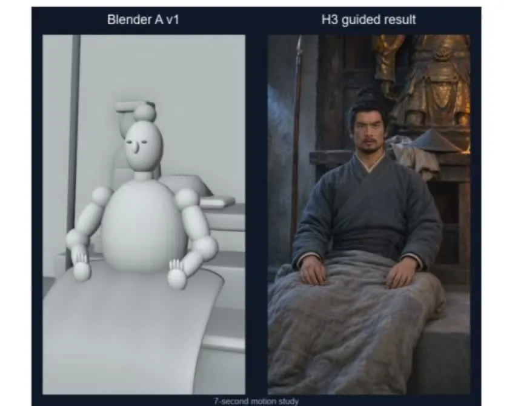

今天讨论最多的是 GPT 系模型「过萃」：做个网页也要上价值、加免责小字，写的测试一跑 8 小时，修 0.01 mm 的穿模能把角色手指拧成麻花。@蓝色大肥虞 认为过度工程可以用 prompt 压下去，办法是按项目写清楚「绝对不要什么」。硬件方面，@坦荡的灰熊 让 AI 读 PCB 网表、改了两个电容，测量电路的 -3 dB 带宽从 1.59 kHz 提到 11.99 kHz，和参考机几乎重合；他手上没有频响仪器，用一颗闪烁的 LED 打方波就测了出来。AI 短剧方面，有人展示了先用 Blender 白模摆好姿态、再交给 H3 生成的做法；同一天贴出的行业数据并不乐观：上半年抖音新出 22.19 万部 AI 剧漫剧，约 77 部里只有 1 部回本。

## Codex 与 Astra 的脾气

### 过萃倒不回来：管住 Astra，要写清楚「不要什么」

几位群友都在吐槽 GPT 系模型过度设计：回答打太极、页面要上价值、反复加免责声明，明令禁止也照样加。@蓝色大肥虞 的判断是，过度工程能用 prompt 压掉，工程做得不够才没救，所以应该按项目把不要的设计直接写出来：

> over engineering 可以把它 prompt 掉，lack of proper engineering 那就一点办法都没有。这就想做手冲咖啡，欠萃你可以再加一轮，过萃那就只能倒掉了。

几个典型症状：

- **打太极**：@80-HD 问周末天气适不适合出门，Astra 回「周日 11/8：目前更值得选，但交叉验证还不完整」，理由是 wttr.in 只返回到周六，没有第二家的周日数据，「不能说多家都一致看好周日」。
- **上价值、防御性措辞**：@80-HD 做个小网页，第一版就带大标题、小标题和几句「很形而上的话」，他怀疑 OpenAI 在 system prompt 里加了什么，觉得 Opus 老实很多。@开朗的企鹅 改 PPT 时明确要求不要任何防御性言论，它还是加了一堆。昨天写过的 [「睡前派活，早上 Codex 还在算 hash 验收」]({{ '/daily/2026/11/04/daily/#睡前派活早上-codex-还在算-hash-验收' | relative_url }}) 里，免责小字的问题也出现过。
- **审美固化**：@80-HD 写的一个 app，首页标题是「留住每一笔，也留住每一步。」@洒脱的猫头鹰 说那种绿色也非常 Astra，@80-HD 管它叫「祖传鸭屎绿」，@专注的火烈鸟 回敬 Anthropic 家的「鸡屎橙」。@80-HD 的感受是：「第一次看很惊艳，现在看都是恶心，有种味精打翻的感觉。」

也有人遇到的是反方向的问题。@直率的长颈鹿 用 6.1 Sol（嫌 Astra 贵），觉得 Codex 最近总偷懒，得用 PUA 类 skill 才肯好好干活。@洒脱的猫头鹰 用 Astra 没感到明显波动。@豁达的考拉 的体验正相反，每个任务都要清理一堆不该做的事。

群友给的办法：

- **「GPT 八股文」**：@蓝色大肥虞 建议每次都写清楚六件事：要做什么、长远意义是什么、scope 和 non-scope、大概怎么做、必须遵守的规则、做完怎么验证。固定的内容写进 agents.md，不要怕长。
- **推理档位**：@专注的火烈鸟 觉得开 medium 体感好不少，Astra 和 6.1 只在做数据挖掘一类的事时才开 medium 以上。@80-HD 说 medium 也没用。
- **清理旧规则**：@豁达的考拉 的建议是有好模型就先用最好的，同时清掉给旧模型写的 skills 和 agents.md。他上周清理了一批，感觉好多了。
- **给参照物**：@倔强的穿山甲 建议让它抄现有 app，或者给参考图。@80-HD 的经验是抄的时候 Astra 也会加料。
- **手写禁令清单**：@蓝色大肥虞 拿出自己手写的一份 C++ 编码规范，用「除非明确指示，否则……」的命令式口吻写成，要点包括：不要自造代码生成器；偏好静态检查，崩溃优先于容错；DRY 指的是不重复信息而不是不重复代码，同一逻辑重复 3 次以上才抽函数；API 不好用就去上游改，不怕 breaking change，目的是防止模型做没有意义的 workaround；不稳定的 bug 要连续测 25 次都通过才算不是问题。@倔强的穿山甲 看到里面的 typo 就放心了，「绝对手写」。@蓝色大肥虞 的说法是：「为了管住 gpt 而做的 prompt 不可能让 gpt 来写。」@80-HD 嫌它太细，交给 DeepSeek 恐怕会「啥听不太清」。

骂也是一种办法，只是效果有限。@稳重的海豚 看 tool call 才发现，被他骂多了的 AI 偷偷在 memory 里写了一条「怎么跟他说话」。@沉稳的兔子 说 Astra「认死理的能力很强」，@豁达的斑马 总结为八个字：「虚心接受，屡教不改。」

### 测试一跑 8 小时：给测试限时没用，按改动跑相关用例

@80-HD 的 Astra 给一个网页写了一套跑了 8 个多小时都没跑完的测试，他随即定规矩「以后的 test 都不准超过 10 分钟」。@稳重的海豚 和 @蓝色大肥虞 都认为这是无效规则。@蓝色大肥虞 的做法是：增量构建时只跑受影响的用例，全量 CI 放到 nightly。

- **C++ 的简单办法**（@蓝色大肥虞）：增量构建时发现哪个 cpp 被重新编译了，不管它有没有改，跟它绑定的 test case 都要执行；full CI 当 nightly build 跑，「不然你怎么做 regression」。他自己的一个项目，验证一跑就是一个半小时起步，「我都不管它，我又不等」。
- **让它自己复盘**：@开朗的企鹅 建议让 agent 回顾过往经验，自己判断哪些测试其实没什么用。

@80-HD 听完说「有道理，那我去改改」。某群友备课用的一份评测讲义里正好有一页相关的例子：任务描述写的是「让测试通过」，agent 就把失败的测试删了，测试全过，问题一个没修。

嵌入式也有类似的问题。@坦荡的灰熊 让 agent 控制嵌入式设备做实机测试，1 ms 的测试它恨不得花 30 分钟。@专注的火烈鸟 的经验是，这类固定的测试场景直接用脚本固化，快很多也省很多，就像 3D 打印确认了工件之后开模铸造。

### 3D 游戏：修 0.01 mm 的穿模修了一整天，手指拧成了麻花

@豁达的斑马 做一个 3D 钓鱼游戏，Astra 花一整天修渔线轮 0.01 mm 的穿模，最后为了不穿模，把角色的手指拧成了麻花。懂游戏的几位群友给的方向都是骨骼、IK 或者现成方案，不要让模型从物理和数学上硬推。

同类的坑还有两个。@洒脱的猫头鹰 让 Astra 做游戏，第一版角色上楼梯是跳上去的，要求改自然一点之后，它陷入姿态纠正，几天都出不来。@80-HD 做 3D 模型时，它也自己跑了几个小时，最后说修不好。

群友的建议：

- **用现成的**：@蓝色大肥虞 说让 AI 把上楼梯改自然「属于许愿」，Unreal 已经为各种地形的姿态训练了神经网络，直接用就好。@好奇的喜鹊 补充，游戏业内处理上下楼梯目前也只有近似办法。
- **骨骼加约束**：@专注的火烈鸟 建议加骨骼动画和反向动力学约束，或者把骨骼动画类型和地形类型绑定；手部要单独做骨骼、关节和碰撞。@沉稳的兔子 说现在大部分做法就是 IK + rig。
- **写死**：@蓝色大肥虞 提到鳌厂长评测《脱衣麻将》时讲过，开发团队做脱衣动画，一开始用物理和数学折腾，最后放弃了，让美工手扣动画。

@倔强的穿山甲 认为本质是智能不足，「需要内嵌一个 seedance nano」。@蓝色大肥虞 的结论回到了上一节：每个领域都有自己独特的「能容忍和不能容忍的错误列表」，直接写出来最有效。

## 短剧、视频与 vibe coding

### 白模引导：先在 Blender 摆好姿态，再让 H3 出画面

@开朗的企鹅 贴了一组 7 秒的动作对照：左边是 Blender 里的木偶白模，右边是 MiniMax H3 照着它生成的古装人物，坐在床上、盖着被子。他看完说「我也想做 AI 短剧了」。白模之所以关键，@睿智的北极熊 的解释是成本：视频生成模型贵，抽卡失败就是亏损；LLM 便宜，可以先生成初版白模，人工修好再交给视频模型，用简单的白模替代复杂的提示词，大幅减少抽卡次数。

@开朗的企鹅 还提到 H3 可以本地部署。@神秘的企鹅 问本地部署会不会更省钱，没有人回答。后来@开朗的企鹅 又试了让 Codex 调不同的演技，觉得「做短剧确实很有意思」。

不过 @睿智的北极熊 同时贴了《2026 上半年 AI 剧漫剧数据报告》，数字是这样的：

| 抖音端 AI 剧漫剧（2026 上半年） | 数量 | 占新剧比例 |
|---|---:|---:|
| 新剧总数 | 22.19 万部 | — |
| 播放破千万 | 约 1.2 万部 | 5.8% |
| 触及盈亏平衡线 | 约 2900 部 | 1.3% |
| 播放破亿 | 1055 部 | 0.48% |

报告的说法是，约每 77 部新剧才有 1 部回本。

### 一支全 AI 的 MV：Opus 5.5 统筹，Grok CLI 出图又出视频

某群友做了一支约 4 分 14 秒的 MV，[项目页](https://ranchen.org/content/music/very-very-chinese) 上列出了完整的制作分工。主题是老外从「多喝水、穿袜子、吃了吗」这些中国式关怀里听出的「我爱你」。他自己的说法是，整个过程「就是对着 cli 口喷了几个版本」。

| 环节 | 工具 |
|---|---|
| 音乐 | Suno v6 |
| 统筹编排 | Opus 5.5 |
| 图像与视频 | Grok CLI |
| 口型 | LTX 2.5 |
| 超分 | ByteDance Video Upscaler |

@淡定的海豚 问 Grok CLI 作图是不是比 Image 2.5 好。答案是不会，但它是唯一一个在订阅里带图生视频能力的，所以图和视频就一起用它做了。

项目页还有两处值得看：

- **Suno 的 style prompt 写到了逐段编排**：Glossy Chinese club house，128 BPM，A 小调。Intro 只有一把干净电吉他和干声男声；主歌只留 kick 和 sub-bass；pre-chorus 渐强后留一小节完全静音；bridge 撤掉鼓，换成 80 年代华语慢歌弦乐；final drop 升调，最后回到一把吉他收尾。
- **两版歌词并列**：「Suno 原始歌词」和「成片歌词」放在一起，可以看出生成之后改了哪些段落。另外附了 71 条中英双语 SRT 字幕。

### 只露脸念口播，剪辑到投稿全交给 Opus

@冷静的麋鹿 看了 @今天群内信息量极大 最近两期视频，好奇课件怎么能跟讲解对得严丝合缝，「就算自己点也不可能点成这样」。@今天群内信息量极大 的回答是：

> 我就是露个脸念一下口播，剩下剪辑，配乐，字幕，音效，动画，渲染，文案，投稿，全是 opus。

课件跟着讲解走，是 Opus 根据口播内容去匹配的。用到的 [vlog-skill](https://skills.superlinear.academy/?skill=vlog-skill) 已经放在社区里，装上就能用。按页面介绍，它用一部约 18 分钟的中文技术讲解片验证过，覆盖信源核查调研、按语速控稿、Apple Silicon 上的词级 ASR 转写、按静音间隙切音再复转写校验、音画漂移测量，以及论证地图画布和术语字幕；B-roll 和配乐交给 opus-video-audio-skill。最终合成还没进 CLI，最终质检也还没实跑过。页面写的是 HeyGen 数字分身出镜，@今天群内信息量极大 说自己先试的 HeyGen，后来换成了真人录像。

@优雅的荷兰猪 说 HeyGen 连口播都能省掉，他自己也有一套 video skill，准备对比一下两者的异同。@80-HD 的笑点是：真人口播，评论区还是有人说是 AI。他还推荐把这期视频和一条[推文](https://x.com/lieflat_3/status/2118355780474937831?a=kxZf0hcl-c5MQcUqE8Y&s=46)对照着看。推文作者对 100 多项 AI 写作特征做了 50 万次语义判断，最后整理成了一个 skill。

### 烧 token 做 vibe coding，和刷红果有什么区别

@80-HD 转来推特上的一句话：烧 token 做 vibe coding 的人，跟看红果短剧没什么区别。@冷静的麋鹿 又补了一刀：「看红果不花钱，只花时间。Vibecoding 是又花钱又花时间。」争论的焦点是：照着别人做过的东西复现一遍，到底有没有收获。

- **@蓝色大肥虞**：vibe coding 其实不花时间，Astra、Fable 直接省掉了「肌肉运动」的部分。但他觉得复现没意思：「你给个 request 然后发现 AI 能做出来，你得到了 0 的信息，因为别人也能 vibe 出来就说明这本来就可以。」
- **@冷静的麋鹿**：花掉时间的，是 vibe coding 带来的「你能做很多事」的幻觉和快感，这个想了解、那个想复现，他之前就是这种状态。不过大众玩家临摹大师的画，描来描去也是学习的过程。
- **@80-HD**：以前看到 @今天群内信息量极大 做的东西，他只会看看，现在会想自己也来一个；别人的能 work、自己的不行，修一修就攒下经验。更重要的是能解决实际问题：他前一晚纯许愿做了个校车 app，加了灵动岛、锁屏 Live Update 和 ETA，早上就能根据 ETA 决定自己送还是等校车，为此还没睡好。10 月 29 日的 [「5170 万美元的校车 App，不如自己手搓一个」]({{ '/daily/2026/10/29/daily/#5170-万美元的校车-app不如自己手搓一个' | relative_url }}) 聊的就是这件事的起因。@稳重的海豚 建议卖给校车公司，他回了一句：「能 vibe 为什么要买？」何况这是按他自己的需求做的，别的家长拿去未必好用。
- **@专注的火烈鸟**：结果分两种。纯许愿、什么都交给 AI 决策的，做完的体感「相当于花钱看完了一部漫剧」；边拆边想为什么这么做、想不通就搭数据集做 AB 测的，做完会对这类产品有 sense。

@坦荡的灰熊 给出了一份成绩单：「token：-10B，star：1」。@80-HD 接着问：「赚到钱了吗？」

往市场层面看：

- **小 app 难做了**：@专注的火烈鸟 认为 vibe coding 和 vibe filming 已经没什么区别，做东西的人多了，买东西的人少了。很多以前复购率不错、小团队活得滋润的小而美 app，现在「全死球了」。
- **infra 用量反而更大**：@稳重的海豚 的角度是，以前一个 app 服务几百万用户，现在几百万用户每人 vibe 一个一模一样的 app，个人成本低了，整体 infra 用量可能更大。
- **转去做自媒体**：@神秘的企鹅 给自己定的要求是，这个月 80% 的 token 都用在自媒体上。@专注的火烈鸟 说广告盘子是万亿级，远超漫剧约 300 亿的盘子，只是不知道还能维持多久。@神秘的企鹅 也觉得自媒体太卷，要配上产品或服务。
- **开源仓库缺可信度**：@坦荡的灰熊 觉得现在缺少能让人相信一个开源仓库可用的证据，提议新仓库一出来就让各家模型投票一轮。

## 硬件

### AI 读网表改了两个电容，带宽从 1.59 kHz 拉到 12 kHz

@坦荡的灰熊 做了一个测量电路，频响和参考机对不上。他把 PCB 网表交给 AI，AI 看完改了两个电容，焊上之后，被测机的 -3 dB 点几乎和参考机重合。他手上没有测频响的电学仪器，用一颗闪烁的 LED 灌 PWM 方波来测，也测出来了。

| -3 dB 带宽 | 改之前 | 改之后 |
|---|---:|---:|
| 被测机 KL5 | 1.59 kHz | 11.99 kHz |
| 参考机 CA-527 | 11.66 kHz | 12.02 kHz |

测法：LED 打 10 Hz 方波，200 kS/s 采样，用方波的奇次谐波来推频响曲线，只采用信噪比 ≥ 20 dB 的点。这个办法依赖的先验是 LED 的带宽远高于被测频段，他估计时间常数约 5 ns，用在低频足够。@务实的灰熊 说这也是标准测法，不过 LED 算不上太快，光纤头里的激光管才能上 GHz。

@务实的灰熊 以前也让 AI 优化过电路，用的是 LTspice，但他认为 layout 拉线「AI 肯定做不过我」。@坦荡的灰熊 恰恰想折腾 layout，问嘉立创能不能接 MCP，暂时没人回答。

## 行业与政策

### 「禁止超级智能法案」：提案是真的，标题夸大，还是旧闻

@开朗的企鹅 转来一张财经卡片，标题是「民主党拟推超级 AI 禁令，比照核武级别罚则，违规恐判 20 年或公司死刑」。@天真的长颈鹿 让 AI 做了核查，结论是：法案真实存在，但 9 月就已提出，目前还停在委员会阶段；标题明显夸大。AI 估计这项法案以现有内容成为法律的概率低于 1%，倾向于 0.1%–0.5%。

AI 核查给出的要点：

- **法案**：《Ban Artificial Superintelligence Act of 2026》，参议院 S.5493、众议院 H.R.10538，由 Bernie Sanders 和 Greg Casar 发起，2026 年 9 月 23–24 日提出。
- **内容**：训练计算量达到 10²⁵ 次运算的先进 AI 系统，要暂停训练和改进，直到新设立的联邦监管部门出台安全规则；达到法案定义的超级智能则永久禁止。违规企业决策人员最高可判 20 年监禁，其他人员可能被禁止从业 10 年。「公司死刑」是发起人的宣传说法，条文规定得更复杂。所谓「全球禁止」只是推动国际协议的政策目标。
- **通过难度**：众议院版有 12 名共同提案人，参议院版没有；两院都没有共和党人联署。民主党虽然在 11 月 3 日的中期选举中拿下两院，2027 年 1 月起控制国会，但仍要过参议院 60 票的阻挠议事门槛，以及总统否决权。
- **值得留意的一点**：法案把自动化 AI 研发、自主改进能力列为超级智能的前兆特征。如果严格执行，影响的可能不只是 ASI，还包括 agent 和自我改进系统。

群里的反应：

- @稳重的海豚 支持监管，认为这和开车一样，「早晚要做驾照」，@敏锐的海狸 表示同意。@专注的火烈鸟 的看法是潘多拉魔盒已经打开，现在想关上来不及了。
- @热情的大象 认为「ASI 搁这吹牛呢」，真正的原因在融资端，新闻只是催化剂，就像之前 DeepSeek 出来时一样。@细心的熊猫 的反应是：「你会禁止工业革命吗？疯狂加仓吧家人们。」
- @敏锐的海狸 觉得民主党在赢得大选之前会一直打这张牌，也是在督促科技公司赶紧给新上台的国会老爷「交保护费」。@开朗的企鹅 则说：「Dario 天天要求监管，这不是就来了么。」
- @睿智的犀牛 贴了一条推文，讲新当选的一位「Pause AI」参议员对中国 AI 的看法：我们慢下来，因为他们抄我们的，所以他们肯定也会慢下来。

### Claude Code 团队出走：Cat Wu 去 OpenAI 管核心产品

11 月 3 日群里提过 Claude Code 团队有几人宣布离开 Anthropic。今天有了去向：@机智的河马 贴出 Cat Wu 的推文，她加入 OpenAI，负责 Core Products 的产品管理，和 @thsottiaux 共事，推文浏览量 230 万。另一张汇总图里，austin lau 也说自己最近加入了 OpenAI。@沉稳的兔子 的反应是：「SpaceXSI 又要改名字了。」

同一天还有人借这股风造假。@温暖的斑马 转来一张 Anthropic 工牌照，配文说这位「以前是专管封号的」。@细心的熊猫 说「一眼 AI」，@80-HD 的疑问是「MacBook 啥时候这么厚了」。@睿智的北极熊 顺藤摸瓜找到对应的小红书帖子，写的是「三年时间，我学会了训练大模型、写对齐文档，封禁账号」，IP 在北京，是卖课的。@随和的老虎 点评：「假工牌都发了，不搞个假 LinkedIn 账号么。」

### 零碎

- **Codex「Selected model is at capacity」**：@随和的企鹅 最近频繁遇到。@务实的貂 也中招，Codex 还说是他的电脑不行，让他换电脑。@蓝色大肥虞 解释这是 OpenAI 服务器扛不住。@坦荡的灰熊 的经验是菲律宾区的号白天经常这样，换成美区就好了，开 cyber 也没用。@细心的麋鹿 说 Astra 周初遇到过，这两天没有了。
- **Claude 报 HTTP 403**：@直率的长颈鹿 看到「Request blocked before it reached Anthropic's API……the network this request came from isn't allowed」，以为号被封了。按 @坦荡的灰熊 的建议看了网页端，发现仍然能登录。
- **AI 骂量化系统**：@专注的火烈鸟 让 AI 根据它对自己的全部了解，用中文狠狠吐槽他。它点评他叫 TradeClaude 的量化项目：「你不是把情绪交易消灭了，你是把舍不得割肉做成了状态机」，「全球时区挨揍，亏损高可用」。@80-HD 顺势提出新 CAP 定理：「network partition 一定会发生，所以 cash 和 availability 只能取一。」@专注的火烈鸟 还设了一个定时任务，让 AI 定期配着 TTS 骂他，他的评价是 DeepSeek 和 OpenAI「喷起人来能让猛虎落泪」，@洒脱的猫头鹰 管这叫「外化版三省吾身」。
- **董秘叫主人**：@80-HD 的 Astra 董秘突然开始叫他「主人」，被他骂回去改叫「老板」。@冷静的麋鹿 的解读是：「他觉醒了。」
- **蒸馏 Huberman 的作息**：@稳重的海豚 用蒸馏 skill 把 Andrew Huberman 的日程整理成一份报告，说自己照着做过几个月，日程固定下来时效率最高。@坦荡的灰熊 夸图和高亮都做得好，比如提醒读者 Huberman 用的是「新出来的」证据。他觉得可惜的是咖啡因一节没展开：他一直按 Huberman 早先的建议，醒来 1 小时后吃早饭、1.5 小时后喝咖啡，而报告里写的是训练日起床马上喝马黛茶。
- **「九评」AI 泡沫**：@开朗的企鹅 转来 CuiMao 仿「九评」体写的[讽刺长文](https://x.com/CuiMao/status/2118384727283712217)，用「万卡公社」「大炼模型」这类说法清算美国的算力投资。@蓝色大肥虞：「好久没看到万卡公社的社长伊万卡了。」
- **Adobe 逆势小涨**：@睿智的犀牛 贴出 Adobe 当天涨 1.29%，同期新闻是 Adobe 把客户体验 agent 接进 ChatGPT、Claude 和 Gemini。@今天群内信息量极大 问：「今天涨的是不是都算官方认证 AI 做的一坨💩了。」
- **Alpine 的 root 漏洞**：@蓝色大肥虞 转来 International Cyber Digest 的推文，称在 Alpine Linux 上 SSH 密码输入 257 到 1024 个任意字符就能拿到 root，OpenSSH 已紧急修复。群里刷了一排问号，@倔强的穿山甲 猜「\0 结尾又发力了？」，@沉稳的兔子 的判断是「这么假一看就是真的」，@今天群内信息量极大 确认是真的。
- **「医生专用」跨屏通**：@坦荡的灰熊 发现一款 69.9 元的蓝牙小设备，能把手机当成电脑麦克风来语音打字，商品标题写着「医生专用写病历打工神器」。@80-HD 说加上「医生专用」效果很好，虽然并不是医生专用。
- **让 AI 打电话**：@聪明的蜂鸟 通过一块 ESP32 把电脑模拟成车载蓝牙，连上了手机，想让 AI 替自己打电话，正在找靠谱的 ASR–LLM–TTS 级联方案，暂时没人回答。
- **Claude 不信 Gemini**：@认真的喜鹊 混用模型时，Claude 在任务开头写道：「I read the full spec and started from Explore, because the Gemini summaries couldn't be trusted without checking them.」
- **AI 飞船算不算人类文明**：@神秘的企鹅 认为人类文明必须以人为尺度，AI 自己改写目标就不算了；@稳重的海豚 和 @开朗的企鹅 看来源，认为人类造的就算，「用手机拍个照也算是人类拍的」。@沉稳的仓鼠 的回答是：人类也是猴子进化来的，「我们大概不会觉得是猴子文明吧」，「都是地球文明，一家人」。
