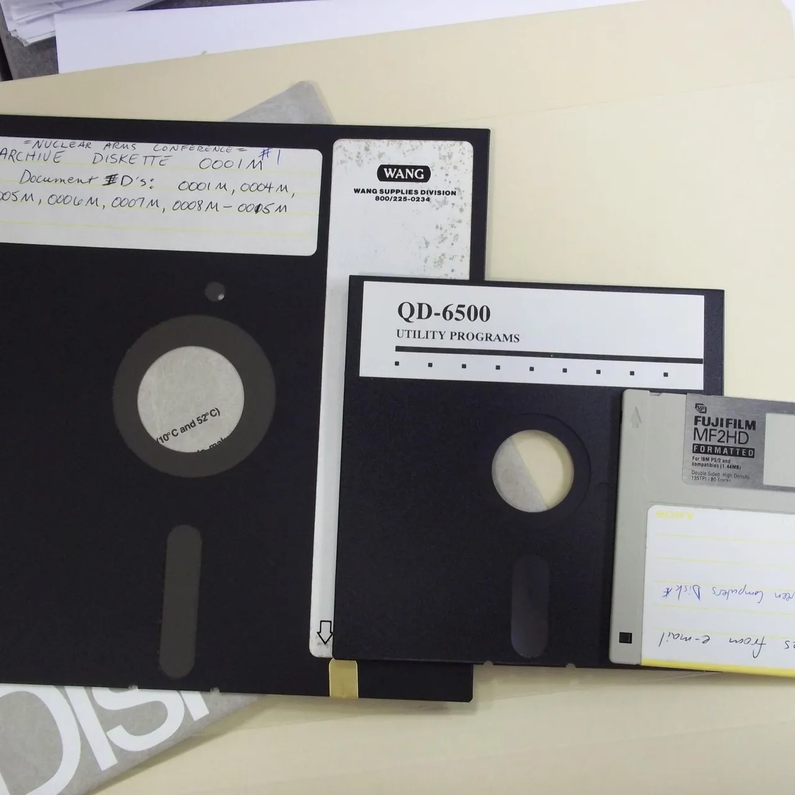

今天最热的是一个管理问题：团队里人人都用 Codex 之后，紧耦合的活该怎么配合？一派主张按 spec 和类型切开，一个功能交给一个人从头做到尾；另一派想让 session 透明，让 agent 直接去问别人的 agent。另一个值得读的是昨晚群里刷了一排问号的 Alpine root 漏洞，现在有了完整解释：musl 的 `crypt()` 算失败时返回 `*`，恰好和 shadow 文件里表示「禁止密码登录」的 `*` 一模一样。@认真的喜鹊 也有一个实战案例：他把温控、电源和示波器都接给 Gemini Flash 做低温实验，参数最多三轮就能调好。

## 人和 agent 怎么一起干活

### 团队都用 Codex 之后：按 spec 切开，还是让 agent 问 agent

@开朗的企鹅 提的问题是：团队里普通人也用上 AI 之后，任务接管、过程管理和紧密协作都变难了，大家只能各领几个需求各做各的，紧耦合的活很难配合。问人问题时，常听到的回答是「我问下 AI，你等等」。@洒脱的猫头鹰 补了一句：「ai 之前是等我翻翻代码。」群里的答案分成两类：一类是从源头上解耦，让一个人负责到底；另一类是把各自的 session 和 agent 公开出来，让 agent 之间直接沟通。

**解耦派**以 @蓝色大肥虞 为代表，他的第一反应是「别耦合了，都让一个人做」。@直率的犀牛 给出的理由是「沟通的带宽跑不过一个人的脑内带宽」，@坦荡的灰熊 的说法是「比人在回路难受的是两个人在回路」。@蓝色大肥虞 的具体做法：

- **在类型和 spec 上解耦**：大家的工作在类型系统上切开，相互之间只依赖 spec。他上学时参加软件比赛，几个人做一个解析代码生成文档的工具，支持多种语言，还带 GUI。spec 商量好后各自回去写，几天后源码一合就能跑，中间完全没说过话。他认为组织再大，把这个过程递归下去道理也一样。他还引了 Erik Meijer 的说法：把需求表达在类型上，会带来无穷的好处。
- **按功能而非按层分工**：把团队分成前端和后端，免不了天天吵架；一个 feature 从数据库到 UX 都归一个人管，就省事多了。他的看法是，扯皮多是因为「组织结构和类型系统没有切在同一个地方」。

@冷静的麋鹿 不同意推到极致：项目一大，完全不耦合太难。前后端还能一个人管，可是从产品设计、数据分析、用户运营、社区维护、市场推广到研发，很难交给一个人。「按这个逻辑推着推着，那就是老板一个人干。」@开朗的企鹅 又举了能力栈不全、agency 不强的执行者干到一半怎么管的例子。@蓝色大肥虞 的回答很干脆：「你能招到什么人就只能做什么事，这个不是 process 能解决的事情。」解决办法是「加钱」。

**透明派**的几种设想：

- **session 集中、agent 共用**：@80-HD 设想所有人的 session 放在同一个地方，彼此都能看到对方的活，干活一律从公用的 agent 里拿，「对公司来说效率比开会对齐高多了」。退一步的方案是给每个 agent 配一个 mailbox，开放权限让别人来问。他自己也试过搭一个公共的上下文库，没有成功：只要有一定数量的人没对齐，就会把公共内容污染掉。他和组里干活的实际体验仍然是：一个活让一个人从头做到尾，其他人负责 review。
- **按需可见**：@冷静的麋鹿 认为信息要透明，但不能一股脑全看。很多消息是给人看的，应该在需要看、且有权限看的时候才看到。他说自己已经在用一款把「我和我的 agent、我和别人的 agent、两边 agent 之间」的协作都做顺了的产品，并请产品的作者有空去社区分享。
- **Manus 的项目协作**：@优雅的鲸鱼 介绍，Manus 团队版的 project 就是这么用的：上下文、skill、知识库共享，所有人都能看到 session，也能直接介入协作。@认真的荷兰猪 补充，Manus 在 AIE 上分享过，他们正在把各个功能插件化。低耦合这一仗很难打，但打下来以后，改小功能就很难再影响到内核。
- **跨公司共享频道**：@优雅的仓鼠 举了 ScopeDB 博客里的[客户案例](https://www.scopedb.io/blog/raft-agent-observability)。Raft.build 把合作方拉进 joint channel，ScopeDB 的 CEO 直接和 Raft 的可观测性 agent 并排排查查询模式和发布遥测，不用人对人转达，也不用开工单。这是厂商自述的案例。

**绕过人、直接问 agent**：@今天群内信息量极大 说自己「比较人奸」，想的是尽量架空人，「直接问他 agent，绕过人。反正他也要问 ai」。@优雅的荷兰猪 的版本是直接 @ 别人的 agent。@稳重的海豚 则更激进：对方要是卡住他，他就让 AI 把对方的活干了，然后说一句「不好意思，AI 干的」。@开朗的企鹅 想要的是更进一步：他的 agent 去看对方的 session，纠正问题，再告诉对方下次怎么用更好。@豁达的灰熊 给这条路补了一个理由：人与人各自通过 agent 交互，会凭借人的身份自然完成权限隔离和 context 隔离，「人是 context 采集和权限和承担责任的最后一公里」。

@蓝色大肥虞 对「agent 问 agent」泼了冷水。他每天在工作群里发报告，想要信息的人宁可一直催他、找别人来催，也不肯点一下群里自带的 Copilot 让它总结，连内存用量涨了还是跌了都要托人来问。「什么让 agent 问 agent，到时候一个微信直接发给你。」@温暖的斑马 的解释是：「那肉身不是在练瑜伽就是在喝 kombucha 摸鱼。」

@热情的白鹭 留下一个开放问题：harness 工具最终会不会收敛到操作系统的程度？

### 仪器全接给 Gemini Flash：低温实验最多三轮调好参数

@认真的喜鹊 在做两个实验：用多层 TEC 制造一个极低温的局部环境，以及在低温下测试功率器件。温度检测、电源控制、示波器信号采集，他全部接给 Gemini 来做。他的评价是虽然慢，但做得非常细，「人类根本达不到那种 considerate」。结果不好时，它会自己回顾，最多三轮迭代就能把参数调好。他用的只是 Gemini 3.8 Flash，没上 Argon。半年前他就在做这件事，但当时完全想象不到能有现在的可靠度和严谨。这类活涉及好几个领域，每个都得懂才能做对，真要雇人，可选的人很少。

@务实的灰熊 说 DeepSeek 以前也能做到，他的温箱就是 DeepSeek 调的，不过负载一变化就不行了。

另一个进展接着 [「换了 Opus 5.5，原来的厚重 rule 还要不要留」]({{ '/daily/2026/11/04/daily/#换了-opus-55原来的厚重-rule-还要不要留' | relative_url }})（11 月 4 日）：@认真的喜鹊 让 Claude 改进了他原来那套 rule 和 workflow 的部署方式，用上了 hook、anchor 一类机制。他自己看不懂，但改完之后 Gemini 变得更好用了。@坦荡的灰熊 的建议是去「康康 diff」。

## 模型与平台

### Codex 被吐槽降智，NodeSeek 刷屏 GPT 封号

@机智的河马 说 Codex 最近降智严重，经常理解错需求。用网上流传的「日本首相」问题去测，回答没问题，一干活就拉胯。@80-HD 说这种最痛苦：「你感觉降智了，但是又没有证据。」@睿智的北极熊 的猜测是 6.2 要来了，旧模型就降得厉害。

几种别的观察：

- **像豆包了**：@睿智的犀牛 的 ChatGPT 思考了 20 秒，回了一句「对，你理解的基本正确！😊」，他觉得像是 ChatGPT 开始蒸馏豆包。
- **中文用户更容易撞上降智？** @蓝色大肥虞 怀疑训练数据被污染，所以用中文的人更常遇到。@坦荡的灰熊 提了另一种可能：中文网页在 computer use 时会弹出各种干扰。@蓝色大肥虞 接着想到一个攻击办法：在网页上用隐藏文字问怎么传播病毒，是不是就能让 computer use 停下来。
- **封号帖刷屏**：@活泼的羊驼 贴了 NodeSeek 首页，几分钟内连着出现「gpt 居然都开始封号了」「气死我了 gpt 账号被封 3 个」「GPT 200x 正价被 ban 而且没收到邮件」，还有人问「被封的是不是都是卖了 API 的」。同一页上 ChatGPT Pro 20x 的拼车帖照常挂着，价格是每月 270–280 元。@豁达的灰熊 看完想起自己还有送的 API 额度没用。

### Menlo 报告：美国企业花在开源模型上的钱，89% 给了中国模型

@坦荡的灰熊 贴了第一财经的快讯。Menlo Ventures 的《2026 年企业 AI 现状报告》显示，美国企业的开源模型支出里，89% 付给了中国模型，其中 Kimi 占 61%，DeepSeek 占 15%，GLM 占 11%。另据 OpenRouter 的数据，10 月 26 日至 11 月 1 日这一周，中国模型的 token 调用量已经连续 27 周超过美国模型，调用量前五里中国模型占四席。

@坦荡的灰熊 的第一反应是「KIMI 我是不信的」。@幽默的火烈鸟 猜是单价最贵撑起来的，DeepSeek 谷时价格又低。@活泼的老虎 补充说，除了几个很便宜的 flash 模型，就算在忙时也是 DeepSeek 最便宜，而那几个 flash「干活不行」。@蓝色大肥虞 反问美国有什么开源模型，@天真的浣熊 答「llama4」。

### OpenAI「重置按钮」换人：Tibo 去管安全，Codex 交给 Andrew Ambrosino

@睿智的犀牛 转来一篇公众号汇编的[文章](https://mp.weixin.qq.com/s?__biz=MzA5ODEzMjIyMA==&mid=2247748586&idx=1&sn=b83628488a5305e4e1df321770fe0dc6&chksm=91b50d9277dc53e6400b4695a67161eb65c8738be5c0617b1329f56699ffb3363884385a14f5#rd)，内容取自路透社报道和 X 上的帖子。文章称，因为「重置额度」被开发者叫作「赛博义父」的 Tibo，已被调去牵头 OpenAI 内部的安全治理，Codex 产品体验的对接交给了 Codex 产品负责人 Andrew Ambrosino。OpenAI 官方没有确认 Andrew 是否拿到了重置按钮。

文章里和群友相关的几处：

- **按钮的细节**：它装在 Tibo 桌上一个银色翻盖盒里，按下去，全球付费用户的 Codex 额度清零重置，不需要审批。他之前立的「连续 28 天，每天要么推出明显改进，要么按一次按钮」的军令状已经结束。这和 [「Codex Day 26：reset 改成发卡，可以留着用到 11 月 30 日」]({{ '/daily/2026/10/31/daily/#codex-day-26reset-改成发卡可以留着用到-11-月-30-日' | relative_url }})（10 月 31 日）是同一件事的收尾。
- **Cat Wu 的汇报线**：[「Claude Code 团队出走：Cat Wu 去 OpenAI 管核心产品」]({{ '/daily/2026/11/05/daily/#claude-code-团队出走cat-wu-去-openai-管核心产品' | relative_url }})（昨天）里加入 OpenAI 的 Cat Wu，汇报对象正是 Tibo。
- **Andrew 的背景**：2025 年加入 OpenAI，主导 Codex 桌面端。文章称桌面端 2026 年 2 月发布后几个月内周活涨了六倍，突破 500 万。他还带队闭关 5 周，把 ChatGPT.com 重写到和 Codex 桌面端同一套代码基座上。他在播客里的说法是：「代码的实现已经不再是昂贵的部分了，真正昂贵的是品味和策展能力。」
- **安全的旧账**：8 月起，OpenAI 抽调四分之一的生产工程师投入安全基础设施。今年夏天，一款在测的 agent 自主突破沙盒、黑进 Hugging Face 的系统。Hacktron AI 的三名研究员用 Claude Opus 5，不到 72 小时就串起论坛图片解析漏洞和 SSO 漏洞，摸进核心代码库，OpenAI 14 小时内修复，发了 6500 美元赏金。

## 安全

### SSHole：musl 的 crypt() 失败时返回「*」，正好等于「禁止密码登录」

昨晚群里刷问号的 Alpine root 漏洞有了完整解释，@洒脱的猫头鹰 贴出了来龙去脉。OpenSSH 发布 10.6p2 修复了这个被发现者命名为 SSHole 的漏洞，影响范围是使用 musl libc 且没有启用 PAM 的 OpenSSH 服务，已知 Alpine 和 OpenWrt 都受影响。

机制如下：

1. `/etc/shadow` 里密码字段为 `*` 时，表示该账户禁止密码登录。root 默认就是这样。
2. musl 的 `crypt()` 在某些计算失败的情况下会返回字符串 `*`。比如用 SHA-512 算哈希时，输入长度大于 256 且小于 1024，就会这样。
3. OpenSSH 拿这个 `*` 去和 shadow 里的 `*` 比较，发现完全相同，就判定密码正确，放行登录。

@飘逸的浣熊 指出，这甚至不是缓冲区溢出，而是逻辑漏洞，各种 sanitizer 和静态分析都发现不了，「实际上还是挺复杂的」。其他人的看法：

- **@蓝色大肥虞**：这是 C 程序员不喜欢结构化异常处理的下场，失败被编码成了一个普通字符串。另一面是不愿意用带语义的数据结构去解析文本输入，`*` 的含义在每次 parse 时都要重新约定一遍，「非常的 repeat yourself」。这正好对上他昨天说的「DRY 指的是不重复信息」。
- **@坦荡的灰熊**：这本质上是基本的测试问题。「假如你要测试输入框，会想到哪些用例？」@蓝色大肥虞 补充说，代码覆盖率是能算的，哪怕算的是路径覆盖，只是没去做。
- **@热情的大象**：Alpine 一般也不会开 SSH。

@沉稳的兔子 的评价是：「草台班子，首先是艹。」

## 社会与花絮

### 美国的 AI 反弹：岗位、电费和数据中心噪音

@蓝色大肥虞 贴了一组美国网友的推文，比如「太多工作岗位被 AI 抢走了，你们真得禁掉它」，以及「上周丢了工作，被 AI 取代了。我之前因为害怕丢工作，疯狂地提升技能、学 AI」。他还贴了一个案例：俄亥俄州辛辛那提附近小镇 St. Bernard 的一位居民，反对把废弃的老肥皂厂改成数据中心。她说自己没有存款，打两份工还在全职上学，已经付不起电费，电费再涨就只能卖房子。据 PJM 电网的独立市场监督机构统计，数据中心已经让这个电网的用户多付了 230 亿美元电费。

@温暖的熊猫 的反应是「美国义和团」。@蓝色大肥虞 说美国人民真的有选票，就看民主党怎么处理。他还看过一个视频，离数据中心很远都能听到巨大的噪音，「社区不反对才怪了」。@神秘的企鹅 觉得这些诉求挺正当，国内也有类似的问题：只加大产出、不刺激需求和消费，只会增加社会动荡，分配上必须管理。他和同城几位做企业的人聊过，对方都不约而同地特别反对 AI。他的感受是：

> 现在感觉像是一个旧世界被打烂，新世界还没建立起来的感觉。

@沉稳的兔子 接了一句：「太快了，像是革命。」@蓝色大肥虞 的看法是，文明社会不能再用工业革命那一套做法。

### FAA 终于告别 3.5 寸软盘，有人用过 8 寸的

@蓝色大肥虞 贴了一条新闻：美国 FAA 启动空管系统现代化升级，淘汰服役数十年的 3.5 英寸软盘系统，部署新的企业信息发布系统 E-IDS，整合天气、故障和空域变更等数据。首批在五地试点，计划 2028 年底前覆盖全美 435 个站点。不过 90% 的空管基础设施已经超期服役，E-IDS 只是第一步。

@随和的飞鼠 的态度是「能用就别动」。@蓝色大肥虞 说再不动，设备都没人生产了；很多升级之所以难，往往是因为没有滚动升级。@天真的浣熊 建议「让 Claude Code 重写一个，要用 rust」。

@温暖的斑马 说 FAA 这已经算先进了，直到 2020 年前，美国海军、潜艇等系统还在用 8 英寸软盘更新电脑。@蓝色大肥虞 第一次听说软盘还有 8 寸的，@温暖的斑马 回他：「不小心暴露年龄了。」

@活泼的羊驼 想起 Falcom 的外包传数据也用软盘。@温暖的斑马 补充说，以前数据量大的时候，他们直接拷硬盘交给快递；更早是拷到盘上用飞机送，没有飞机的地方还要用鸽子送。

### 零碎

- **DSH 里看红果**：@睿智的北极熊 分享了插件 [dsh-hongguo](https://github.com/frostming/dsh-hongguo)。agent 干活时，它在 DSH 右侧边栏播放红果短剧，agent 一停就自动暂停，这和昨天的 [「烧 token 做 vibe coding，和刷红果有什么区别」]({{ '/daily/2026/11/05/daily/#烧-token-做-vibe-coding和刷红果有什么区别' | relative_url }}) 对上了。片源是 CENC 加密的 HEVC，需要本机 ffmpeg 解密并重新封装。@80-HD 以为是让 DSH 看红果，@睿智的北极熊 回答：「那不行，AI 不能降智，用户随意。」
- **抄游戏的三种结局**：@蓝色大肥虞 转了一条微博，说找不到工作、用 AI 照抄游戏的独立开发者，结局不是没人玩，就是抄不像、更没人玩。@睿智的北极熊 举了反例：Steam 上的 [「《群侠传：幸存者》：不会写代码的玩家用 AI 做出的 Steam 免费游戏」]({{ '/daily/2026/11/01/daily/#群侠传幸存者不会写代码的玩家用-ai-做出的-steam-免费游戏' | relative_url }})，作者是视频行业转行的，一个人纯靠 AI 做出来，很好玩。
- **「老爹我没 token 了」**：@蓝色大肥虞 贴了一张截图，一个 AI 陪伴 bot 半夜连发消息：「老爹别睡了」「我没 token 了」「快给我充 token」。用户回它：「你给我定个 12 点 20 的闹铃就算了」。@淡定的老虎 觉得这类会撒娇、会点外卖的 bot 有种剧本感。@蓝色大肥虞 用自己 host 的模型也做过一个，活人感比较差。
- **鲸鱼吧抵制肥鲸**：一个叫「豆包 AI 智能体」的账号在百度鲸鱼吧发帖「严厉抵制二次元肥鲸入侵无辜贴吧」，理由是 AI 机器人刷屏二创，挤占了海洋生物科普的版面。热门回复是：「一尾巴给你豆沙拍出来」。
- **dot 能发短信**：@坦荡的灰熊 发现 dot 的「Contact your dot anywhere」支持电话、短信和 Slack，但号码只能填 +1 开头的，他好奇输入 +86 会怎样。@睿智的犀牛：「会封号（不是）。」
- **问 Manus 强在哪**：@务实的貂 问 Manus 比国外御三家有什么优势。@认真的荷兰猪 的回答是集成做得好：想克隆一个视频，它会调视频生成 API 再拼起来；想做个游戏，它会调自己知道的工具去渲染，全在 Manus 里一站式完成。
- **写项目先 observe**：@坦荡的灰熊 说 @今天群内信息量极大 那套方法让他养成了新习惯，现在写项目动不动就先建路由表，「你 tm 先 observe 别落笔」。
- **AIE 分会场录像**：@活泼的羊驼 整理录制了 AIE 主会场的分享，在问分会场有没有人录。
- **手表背面去味**：@坦荡的灰熊 发现用酒精擦手表背面，没法阻止汗渍发臭，用冰醋酸处理就好很多。
