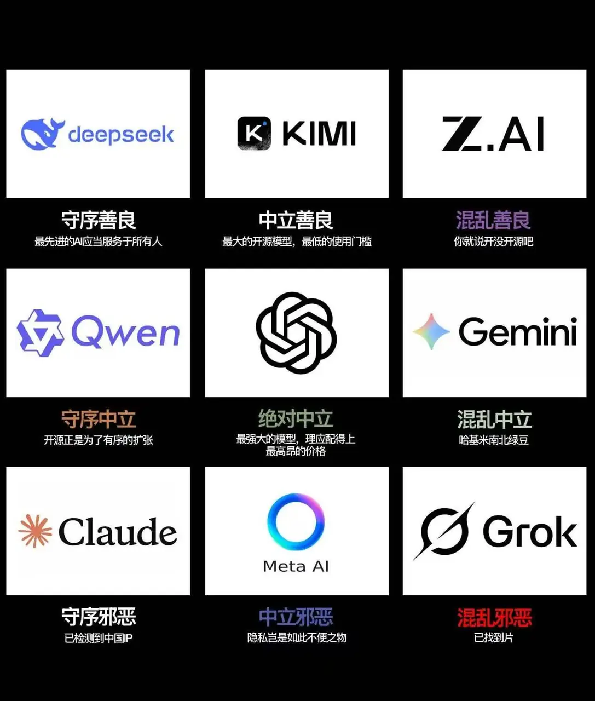

今天最值得看的是 ChatGPT 中文圈的封号潮。外面传出的案例覆盖 Plus 到 Pro 500 各档付费账号，OpenAI 客服的一封回信把原因写成「疑似来自未支持的国家或地区访问」。群友拿 agent 翻了几个群一周的聊天记录，没找到一个明确的本人被封案例。另一件是一篇讲 ZDR（零数据保留）的长文，逐条列出这个承诺不覆盖什么：缓存、反滥用日志、云平台留存、法律保全都不在其中。Grok 今天也被集中吐槽，顺带有人问：降智除了靠体感，还能怎么测。

## 账号与数据

### GPT 封号潮：客服回复是「未支持地区访问」，本群暂未发现中招

11 月 7 日，中文圈集中出现 ChatGPT 付费账号被封的反馈。网上汇总的案例覆盖所有付费档位，用不用反代都有人中招。有一封 OpenAI 客服回信把原因写成「疑似来自未支持的国家或地区访问」，申诉不保证恢复。@冷静的麋鹿 说本群好像没听到谁被封，@专注的企鹅 用 agent 检索后证实了这一点。

群友转来的两条推文汇总了外面的情况：

- **范围**：一条推文统计 21 人被封 30 多个号，包括多个 Pro 20x、Pro、Team、Plus 和学生认证账号。没有邮件通知，网页端直接删号。另一条推文（11.4 万浏览）称只在中文圈有大量案例，其他语言和地区「风平浪静」。反代、未反代、低价区、正价区、Google Play 订阅、美卡订阅都有封号案例，档位覆盖 plus、pro100、pro200、pro500、48team。
- **连坐**：有好几个账号一起被封的情况，推测系统会识别同一个人的多个账号。
- **原因猜测**：多数人认为是低价区加反代导致的，但推文自己也承认没有证据。有人把这事和 Cat Wu 入职 OpenAI 联系起来，理由是她 2025 年 7 月短暂去 Cursor 之后，Cursor 开始限制中国地区用户使用 Claude。@开朗的企鹅 不太信：「这不是才上任几天吗」。他倾向于这波封禁和上市有关。@幽默的火烈鸟 的猜测是，被封的大部分是反代，要么就是 Astra 用得太狠。
- **客服回信**：@淡定的老虎 转来论坛上的一封 OpenAI 支持邮件，落款时间是 11 月 7 日上午，原话是「账户被停用的记录原因是疑似来自未支持的国家或地区访问」，并附了支持地区列表的链接。

@淡定的老虎 当天就把 HK 节点换到了 SG。@豁达的灰熊 惊讶 HK 之前居然能用，@洒脱的猫头鹰 怀疑是「假 HK 节点」。@淡定的老虎 贴出的 IP 查询结果印证了这一点：几家 IP 库都定位在香港葵涌，B 站却定位到美国圣何塞。这个 IP 被标为机房 IP，IPPure 风险系数 82%，属于「极度风险」。他之前一直这么用，没出过事。不过他也说，自己刚好是 Cat Wu 到 OpenAI 之后才没再继续蹬，不好说现在会不会危险。

@专注的企鹅 的核查方法值得一提。他的项目里接了多个群聊的 MCP 服务，他让 agent 检索 11 月 1 日到 8 日的聊天记录，按「账号被封」和「被降级、限频或风控」两类整理原文。结果是没找到明确的 ChatGPT 个人被封案例，只有转发和提问；另有 3 条疑似降级或响应变慢的体验反馈，也没有证据指向账号被单独风控。@坦荡的灰熊 问用的是什么 skill，@活泼的羊驼 说这种自己写一个就行：关键是让 AI 把自己做了哪些事、怎么取舍、做了什么决策，都记录到 MD 文档里，相当于交叉核对。

同一天群里还流传一张 AI 厂商阵营九宫格，Claude 被放在「守序邪恶」，配文是「已检测到中国 IP」。

### ZDR 只承诺「不落长期盘」：缓存、反滥用和法律保全都不算在内

@豁达的灰熊 问：DeepSeek 官方 API 不支持 ZDR，OpenRouter 上一些第三方 provider 却支持。可 ZDR 本质上只是一个承诺，小 provider 有没有偷偷留存数据，根本无从验证。群里贴出的[一篇长文](https://yage.ai/share/zdr-promise-vs-architecture-20261017.html)给了更系统的回答：ZDR 只保证请求处理完后不把输入输出写进长期存储，能用技术手段自己验证的只有两件事，数据没出内网，或者模型跑在自己机器上。

文章列的几处缝隙：

| 环节 | 留存情况 |
|---|---|
| Anthropic 前沿模型 | 2026 年 6 月起强制保留 30 天，签过 ZDR 也一样；Fable、Mythos 除非专门授权，否则不支持 ZDR；9 月才推出 Enterprise Frontier Safeguards |
| Anthropic 触发安全规则的对话 | 明文最多保留 2 年，信任与安全分类分数最多 7 年 |
| AWS Bedrock | 必须开启 aws_review，数据在 AWS 边界内最多留 30 天，可能有人工审阅 |
| OpenAI 反滥用日志 | 默认最长 30 天，判定违规后可能更长 |
| OpenAI 非 ZDR 端点 | 会话、助手、线程、向量库、批量接口；助手对象删除后 30 天才清除 |
| OpenAI 提示词缓存 | KV 张量在 GPU 内存里放 24 小时，后台异步模式落盘约 10 分钟 |
| 法律保全 | 收到有效请求最多保全 90 天，可再延 90 天 |

作者把信任分成三层：架构层面是物理事实；合同（DPA）只能事后追责；SOC 2、ISO 42001 这类认证属于主观背书，验证不了数据是否真的被实时清除。他给的分界线是：低敏感场景，换供应商加开 ZDR 就够了；核心源码、未公开专利、员工真实身份、医疗财务信息，只能改架构，比如在网关层先把内部标识、连接串、私钥换成占位符。

群里的态度偏悲观。@80-HD 说「只要不是自己 host 就没有真正的 ZDR」，「大厂大不了罚个款」。@豁达的灰熊 也不信 ZDR，但他觉得数据足够分散时风险有限，「就像碎纸机一样」，能集齐一个 IP 或一个组织的数据才可怕。他还问 Azure 上部署的模型算不算自己 host，没有人回答。

## 模型体验

### Grok 被集中吐槽，降智除了体感还能怎么测

几位群友今天都觉得 Grok 不好用。@今天群内信息量极大 用的是 4.7，觉得它在逐渐跌破可用线，简单任务上也和 GPT 有能感觉到的差距，好几次气得切回 GPT。至于怎么不靠体感判断降智，群里给出的工具是一个 Codex 每日行为监控，但它只能说明行为变了，说明不了为什么变。

具体症状：

- **发不出第二条消息**：@活泼的羊驼 充了会员，专业版直接报错；换快速版后，第一条消息能发，第二条传不上图，整个对话卡住。他吐槽 Grok 喜欢 vibe、拿用户当测试员，体验像去年用 Gemini App。
- **记性差、烧额度**：@飘逸的狮子 说 Grok 今天「智商至少打 3 折」，聊超过 5 句必忘。他让 Grok 修自己的 bug，烧掉 30% 的 Ultra 额度，最后放弃了。

对原因的猜测都没有依据。@活泼的羊驼 不确定是 SpaceX 缺算力，还是觉得不赚钱故意降质。@稳重的海豚 的回应是：「你就说你的钱交没交出去吧，他们的营收涨没涨吧。」

@飘逸的狮子 问有没有技术手段判断降智，得到的是 [Did Codex Behave Differently Today?](https://grapeot.github.io/codex-behavior-today/)。这个网站通过同一条 Codex 订阅路径，每天跑一组固定的短探针，展示 30 天内回答分布的变化。页面自己也划了边界：图上出现的偏移，只说明这组探针相对自身历史变了，不能说明原因，不能识别是哪个模型，也不能衡量任务能力。分享者自己也说不确定准不准。@飘逸的狮子 追问它能否确认每次打到的是同一个 endpoint，答复是网站上有文章解释原理。

## 生图与 vibe coding

### 用 Cursor 给网文配插图：风格锁、角色锁加参考图

@稳重的海豚 把一部网络小说下载下来，让 Cursor 做成网页并配上插图，觉得阅读体验「高了几十个档次」。插图走的是 Cursor 2.4 新增的内置 GenerateImage 工具。额度消耗小得出奇，他怀疑背后并不是官方 changelog 写的 Nano Banana Pro；后来换到 agy 生成，质量明显高了一截。

他贴出的调用方式，一次生成一张：

- `description`：风格锁 + 角色锁 + 从中文原文里取的场景描述，开头是「Japanese light novel illustration, anime art style」。
- `aspect_ratio`：`"3:4"`，即 768×1024。
- `filename`：如 `ch35-ceremony.png`，实际以 `.jpg` 存进 assets 目录。
- `reference_image_paths`：从 `illustrations/refs/` 里挑一张或几张角色参考图，用来保持人物一致。

关于额度为什么这么低，@飘逸的狮子 猜背后跑的是 diffusion，不按 token 计费。@稳重的海豚 查了 [Cursor 2.4 changelog](https://cursor.com/changelog/2-4)，上面写的是 Google Nano Banana Pro，但他觉得「真用这个肯定爆了」。换 agy 之后出图质量的差距，让他更确定这一点。

### 画出来的霍格沃茨，不如脑补的那张草图

小说可视化引出一个反方向的讨论：画面会挤掉想象空间。@稳重的海豚 本人就说，对小说来说，脑补才是看书的醍醐味。@坦荡的灰熊 拿霍格沃茨做了个对照：他自己的白色草图，比 GPT 画出来的成品更有想象空间。

几种说法：

- **形象被固化**：@80-HD 说，现在去看《寻秦记》，会自动脑补古天乐；去过一趟爱丁堡，霍格沃茨的画面也会被爱丁堡覆盖。@神秘的麋鹿 补充说这种现象有专门的说法，叫「幻象」：编排好的旅游项目替代真实体验，电影解读替代电影本身，具象的演绎替代有想象空间的文字。
- **短视频化**：@敏锐的海狸 说小说还能直接做成动画，B 站现在这类内容多到他「已经完全不想逛 b 站了」。@蓝色大肥虞 则提醒，轻小说本来就直接给你插图。

@坦荡的灰熊 的例子：原文写城堡「高高耸立在山坡上……在星空下闪烁」，他读得太快，只看到「高耸」两个字，脑子里冒出一座拔地三万米、像达拉然一样的学校，还画了一张草图。

GPT 画出来的成品：

他的评价是：「画出来的话，可想象性还不如我的白色草图。」@豁达的灰熊 提醒 GPT 现在能做 GIF 了。@坦荡的灰熊 于是让它「让群星威严地闪耀，再高一点，高到变形、弯曲、逐渐朦胧」。GPT 处理了 1 分 25 秒，跑命令做出一张循环 GIF，结果塔身「变成意大利面了」。@豁达的灰熊 另外发现，GPT 不认识鲸鱼娘的形象，画出来是个白毛。

这串讨论最后被 @豁达的灰熊 收束成一张图：魔理沙「偷书炼大魔法阵」，LLM 就是 Large Language Magic。

### Spell Legion：群友 vibe 出来的网页 roguelike

@淡定的鲸鱼 这两天 vibe 了一个武侠题材的网页 roguelike，[Spell Legion（魔咒军团）](https://spelllegion.com/)，在群里征求建议。游戏有角色选择、武学树、单人模式、3 分钟对决和多人房间，可以打 AI 对手，也能和好友联机，支持中英日韩等 5 种语言。@蓝色大肥虞 用手机玩到 11 级，打出了 ×351 的 OVERDRIVE 连击。@坦荡的灰熊 觉得好玩，也喜欢这个风格，问题是背景、子弹和障碍物太难区分。作者表示会改。

### 零碎

- **昨天日报里埋的桩**：昨天零碎里那条「手表背面去味」，是 @坦荡的灰熊 故意埋的，想看日报会不会照单全收，结果确实收了。他觉得流式聊天信息的「主成分」很难拆。@飘逸的浣熊 的解释是：生成日报时没给 search tool，没法判断真伪。
- **Claude 主动申报利益冲突**：@活泼的羊驼 拿一条用 Dario 病史做文章的帖子去问 Claude，Claude 先表态：「我是 Anthropic 的模型，Dario 是我们公司的 CEO，所以我的看法你可以打点折扣」，然后才逐条反驳。思考标题写的是「Weighing a stereotype about Chinese users against fact-checking」。
- **Claude 叫人「夜猫子」**：@睿智的犀牛 深夜打开 Claude，首页问候语是「您好，夜猫子」，他的评价是「好没边界感的 AI」。
- **Codex 开机自启**：@蓝色大肥虞 发现现在开电脑时 Codex 会自动运行，得手动关掉。
- **context infrastructure 视频**：@今天群内信息量极大 发了两期视频中的第一期，讲 context，下一期讲 infrastructure。@蓝色大肥虞 问有没有文字版。
- **5090 96G 魔改方案**：@蓝色大肥虞 转来一则闲鱼商品，标价 ¥6,488,888，只接 B 端客户，卖的是 RTX 5090 96G 魔改的全套 PCB 图纸加 BIOS，要求点对点签保密协议。
- **清深 LLM 腾讯联培**：@活泼的羊驼 转来一篇小红书帖子，称该联培班学生被调剂到纯后端等边缘岗位，大部分人一面就挂，只有一人进了 HR 面，又因研一不能立即全勤到岗被拒；面试官大多不知道有这个项目。帖子称校企双方都已知情，暂无答复。
- **软盘为什么要换**：接昨天 FAA 淘汰 3.5 英寸软盘的话题，@温暖的斑马 补充，升级的直接原因是日本那边要停产 3.5 英寸软盘，5.25 英寸也要彻底停产。@稳重的海豚 补了两个还在用老系统的经典案例：加州的 BART 和日本的银行。
- **黄果短剧**：@蓝色大肥虞 在 X 上刷到一部成人向短剧，说剧情让他「快进跳过」成人内容，只想往下看剧情。@80-HD：「看来你可能会沉迷红果。」
