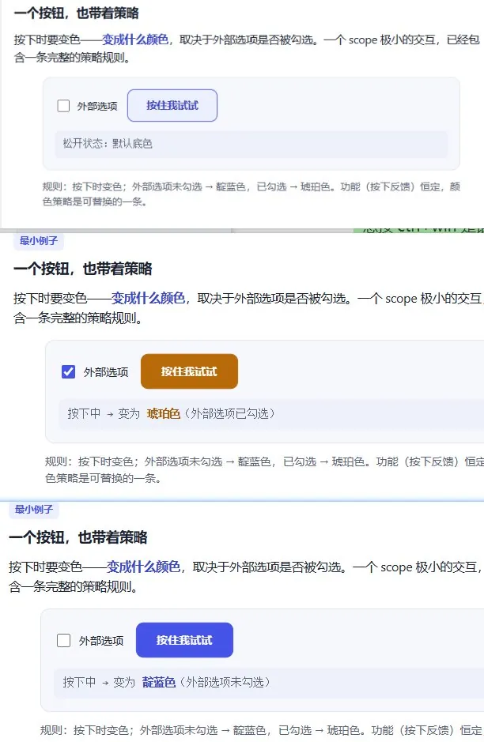
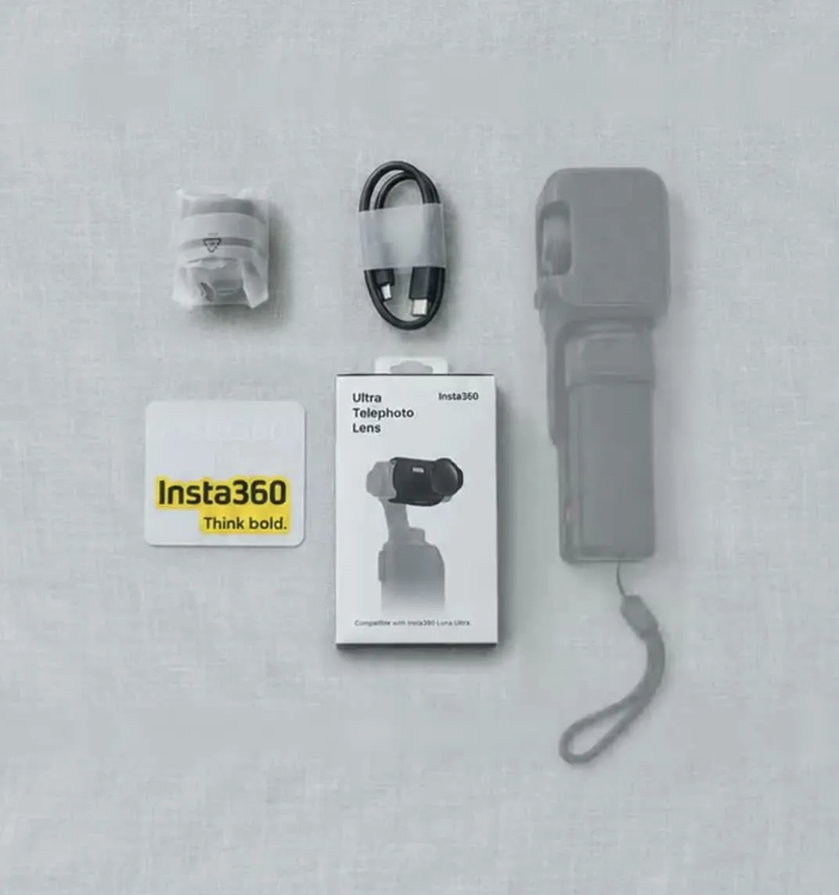

今天信息量最大的是 Google 威胁情报团队披露的 XCPE 僵尸网络：一家深圳机顶盒厂商在 130 万台设备的固件里预装后门，按模块租给十几家黑产，还给恶意软件写了 CPU 和内存配额，防止机顶盒卡死让用户察觉。工具方面，微信输入法的「AI 录音笔」把一段随口口述整理成网页，还顺手做了一个可交互的小 demo。Codex 这边，Tibo 公布了 Pro 各档的用量倍数，$100 档从群友记忆中的 5 倍变成了 10 倍。群里聊得最多的是黄仁勋承认婚外情的新闻，后半天几乎被它刷屏。

## Codex 与模型选择

### Pro 档位倍数：$100 是 Plus 的 10 倍，$500 多一个 ultrafast

Tibo 昨晚发推澄清，所有 Pro 档都没有 5 小时限额，用量相对 Plus 的倍数如下：

| 档位 | 相对 Plus 的用量 |
|---|---|
| Pro 100 | 10× |
| Pro 200 | 20× |
| Pro 500 | 50×，可用 ultrafast |

@冷静的麋鹿 记得 $100 档原来是 5 倍，现在变成 10 倍，$200 档就显得没什么额外吸引力了。@蓝色大肥虞 的解释是 10 倍和 50 倍这两档翻了倍。按他的实际用量，$100 还是不太够，$200 只是偶尔不够。@开朗的企鹅 觉得 $500 档稍好一点，「起码有 ultrafast」。

@务实的灰熊 说 Codex 好久没重置额度了，@开朗的企鹅 回了一句「换人了呀」，指的是 11 月 6 日写过的 [「OpenAI「重置按钮」换人：Tibo 去管安全，Codex 交给 Andrew Ambrosino」]({{ '/daily/2026/11/06/daily/#openai重置按钮换人tibo-去管安全codex-交给-andrew-ambrosino' | relative_url }})。

### 6.1 Sol、Argon、Claude medium：几份换模型的体感

@稳重的海豚 嫌 6.1 Sol「花了大把时间干了一堆垃圾」。@低调的北极熊 只测了 GPT 和 Claude 两家，结论是写代码的甜区在 Sonnet medium 和 Opus medium，「性价比是断崖领先的」。

另外两位在用 Argon：

- **@淡定的雪豹**：用着很舒服，代码质量不错，写的文档非常易读。
- **@优雅的荷兰猪**：两个 Codex 加一个 Claude 的额度都用光了，才开始试 Argon。他说不好它是否比 Opus 聪明，但在 agy 里干活很有条理，也听话。

@低调的北极熊 问 Argon 的订阅是否绑定终端、能不能用 Claude Code 启动，没有人回答。他另外提到，Claude Code 的 agent-to-agent 通信很有用，拿它搭 super agent，就不用同时盯那么多窗口了。

### 需求写错了，Astra 也照做：scope 变大，描述能力没跟上

@坦荡的灰熊 的判断是：AI 开发的主要矛盾在于开发者要管的 scope 变大了，精确描述 scope 的能力却没有变好。

> 打开 vs，面对代码；打开 codex，面对管理矛盾，面对产品，面对用户。于是就不得不往💩汤里扔各种 .md。

@蓝色大肥虞 认为，完全放弃对代码的控制才会走到这一步。他今天给 Astra 下 request 时把 feature 描述错了，Astra 照样做了出来，他看了一眼 diff 里的文件名才发现方向跑偏。@坦荡的灰熊 说所有模型都这样，他在光学设计的目录里写嵌入式程序，模型也照写不误。@优雅的荷兰猪 的建议是给一些微观约束，否则 AI 往里面塞的东西太多。

## 工具

### 微信输入法的 AI 录音笔：口述完自动成文，还附了一个可交互 demo

@坦荡的灰熊 发现，微信输入法在语音输入旁边还有一个「AI 录音笔」：按 Ctrl+Win 是语音输入，再加一个 Shift 就切到录音笔。他随口录了一段关于 vibe coding 的想法，它整理出一页结构化的笔记，标题是「Vibe Coding：有意控制 Feature 中的策略」。笔记的核心判断是：散落在 feature 内部的策略是「万恶之源」，功能本体可以固定，策略要识别出来单点解耦。

让他「人傻了」的是，他口述时提到 model-view 容易耦合，举了一个按钮变色的例子，录音笔就直接做了一个能点的小 demo：外部选项不勾选时，按下按钮变靛蓝色；勾选后变琥珀色。

他拿来对比的是飞书开会的纪要，「会形成表格啦，流程图这种垃圾」，而这次生成的是 `/anatomy` 那种可以动的模型。他的总结是：

> 别人：做 agent 抢占市场。微信：做输入法抢占 agent 市场。

其他反馈：

- **@温暖的北极熊**：有了微信语音输入法，他把一堆付费语音转文字软件都退订了。不过最近在海外或开 VPN 时，网络不太稳。这和 11 月 2 日 [「语音输入：微信 PC 端赢在流式浮窗，不过也有人嫌它容易断」]({{ '/daily/2026/11/02/daily/#语音输入微信-pc-端赢在流式浮窗不过也有人嫌它容易断' | relative_url }}) 里的吐槽一致。
- **@洒脱的鸳鸯**：@今天群内信息量极大 早就做过这类语音输入，「基操勿惊」。
- **@倔强的穿山甲**：本质是状态管理。状态机整理好了之后可以随便 vibe，整理不好就猛烧 token。
- **@坦荡的灰熊** 提了一个改进意见：录音笔听不懂用户在说什么的时候，应该先打断确认，再继续记。

### AI 剪开箱视频：它学完别人的开箱，提醒补拍一个镜头

@直率的长颈鹿 用 AI 把自己拍的原片剪成了一条开箱视频，效果出乎他的意料。@神秘的企鹅 问片中一个很贴题的产品平铺镜头是从网上找来的还是生成的。答案是他后来补拍的：AI 先上网学了别人的开箱视频，然后告诉他还缺这个镜头。他说这点很重要，自己之前没想到。

@坦荡的灰熊 的第一反应是「可以用在闲鱼取证上」。

### 会话命名规则：让 agent 把标题改成「[分类] 事项｜日期」

Claude Code 桌面版用得多了，会话列表里混着默认标题、半句话和项目路径，过几天就认不出哪个是哪个。某群友分享了一条[规则写法](https://yousali.com/kb/codex-session-titles/)：写进全局指令文件，让新会话在任务第一次明确时，把标题改成「[分类] 事项｜日期」，比如「[设计] 个人知识库原型｜261108」。有群友觉得非常实用。

几个落地细节：

- **写在哪**：Claude Code 写进 `~/.claude/CLAUDE.md`，Codex 写进 `~/.codex/AGENTS.md`（设置了 `CODEX_HOME` 就放在对应目录）。注意，同目录下只要有非空的 `AGENTS.override.md`，Codex 就只读它、不读 `AGENTS.md`，这时规则得写进 override。
- **能不能自动改名**：要看客户端。Codex 桌面端的 agent 能调用 `set_thread_title`；Codex CLI 和 Claude Code 只有用户手动执行的 `/rename <标题>`，Claude Code 另外支持启动时用 `claude -n "标题"`。客户端不支持自动改名时，可以让 agent 先按规则拟好标题，再手动 rename。
- **边界**：规则只管命名，任务做到哪一步，还得点进会话才知道。

## 值得点开的研究和分享

### Anthropic 拆解 agent 记忆：回放 transcript 修正笔记，告诉它记忆用来干什么，但别规定怎么记

@坦荡的灰熊 分享了 Anthropic 的 [agent 记忆研究](https://www.anthropic.com/research/components-of-agent-memory)。核心机制叫 dreaming：利用会话之间的空闲时间，让模型回放 session transcript，对照原始记录修正记忆笔记，并整理出 wiki 式索引。实操结论是：告诉 Claude 记忆是干什么用的，但不要规定怎么用。

文中可以直接拿走的数据：

- **规则写死有害**：给 Opus 5 和 Opus 4.7 定「只记录失败」这类固定规则，记忆带来的增益大部分没了。老模型则需要提示：「回答前先读记忆、并显式检验假设」能让 Sonnet 4.6 的分数几乎翻倍；Sonnet 5 不用提示，10 次里有 9 次会自己去读。
- **记什么**：在《宝可梦红》测试里，Sonnet 3.7 认为一切都重要，写了 413 个记忆文件、分在 225 个文件夹里，只拿到 1 个徽章；Fable 5 只写了 9 个文件，拿到 4 个徽章。
- **dreaming 的收益**：在约 35 万个文件、约 4.2 亿 token 的内部语料上答 25 道题，dreaming 从 2 个 session 扩到 128 个，得分从 13% 升到 48%。wiki 加搜索工具得 61%，只有搜索工具是 53%，每题还省约 2 万 token。
- **并发写记忆会互相覆盖**：多个 agent 同时写同一张合同条款表，57 条事实只留下 41 条。改成每份合同一页、由单个 agent 逐字引用原文后，评分标准全部满足。
- **注入上限**：Claude Code 的 auto memory 只把 `MEMORY.md` 的前 200 行或前 25 KB 注入每个 session。

@坦荡的灰熊 认为文中的 CL-Bench 就是腾讯混元的 [CL-bench](https://github.com/Tencent-Hunyuan/CL-bench)。不过 Anthropic 文中写的是 Continual Learning Bench 1.0，腾讯的页面也没有提到这项研究，两者是不是同一个还不确定。他顺便问有没有更好的记忆 benchmark，暂时没人回答。他把 dreaming 打成「追觅」之后，自己也吐槽了一句「神特么追觅」。

### 一年看三千份简历的 AI 公司 CEO：先写两条拒绝理由，再谈优点

@冷静的飞鼠 转来一期 Stay Superlinear 大师课的[录像](https://www.superlinear.academy/c/recording/davin-dong-how-ai-companies-hire)。主讲人是八人公司 Cookiy AI 的创始人，他一年用 AI 过了三千多份简历。值得看的是他踩过的坑：第一版让 AI 自己评估候选人，每份评估都像销售话术，38 人被标成「必聊」，结果一个面试都没约成。

改版后的标准由他自己定：

- 每份简历先写至少两条拒绝理由，再谈优点；
- 证据分三档：上线过、自称、课程作业；
- 每 100 人里最多给两三个 S。

其他几个数据和判断：

- 他在一台 MacBook 上向 Claude Code 发了 6,759 条 prompt，agent 执行了 82,486 次动作。超过 1,000 字的 prompt 占他输入总字数的 65%，大多是口述二三十分钟的结果。他常反问 AI「你真的完成了你说的任务吗」，AI 几乎都会承认没做完。
- 技术面试用一段故意埋了 bug 的真实服务，允许用 AI，考的是业务理解、读代码和给 AI 派活的能力，十五分钟见分晓。
- 他已经不收应届生简历，认为好工程师和中等工程师的差距从两倍拉到了十倍。

## 安全

### XCPE：深圳机顶盒厂商在 130 万台设备里预装后门，按模块租给黑产

@蓝色大肥虞 贴了 Google 威胁情报团队（GTIG）11 月 3 日的报告和中文转述。报告以高置信度认定，曾获 Android TV 合作伙伴认证的 OEM/ODM 厂商视壮科技（Videostrong）在 130 多万台机顶盒里故意植入后门，再把访问权限卖给十余家黑产团伙。Google 已终止与该厂商的合作，把它及关联公司移出 Android 认证生态。

根据转述，后门从 2024 年底开始重构（疑似为了规避此前对 BadBox 僵尸网络的打击），分成三层：

1. **固件驻留**：名为 `x.cpe` 或 `com.oemservice` 的桩程序预装在 `/oem/` 分区，拥有 system 权限，卸载重启后会自动重装。恶意代码混淆过，首次开机激活后才加载，以绕过 Google 的安全审核。程序通过 AES 加密的 HTTP 拉取配置，并和 MQTT 服务器保持长连接。
2. **反沙箱加载器**：桩程序通过 IPC 把指令转给 `com.abc.nexus`，用 `libseccomp_guard.so` 对抗动态分析。2026 年 8 月的变种伪装成 `com.android.system.ntp`，用 `libexploit.so` 重启 adbd 拿到 root，把 `/system` 重新挂载为可写，植入自身，并伪造安装时间戳。
3. **多租户变现**：同一台设备上同时运行多个住宅代理 SDK（如 Honeygain、GaGaNode、NetNut、Traffmonetizer）和广告欺诈插件。厂商还在下发的配置里给每个代理模块限定 CPU 不超过 70%、内存不超过 50%，并设置权重和超标报警，相当于在固件里给恶意软件写了一套 QoS 调度，免得机顶盒卡死引起用户察觉。

运营方还远程关闭 Google Play Protect、持续截屏回传、注入按键、窃取账号和日志、开反向 shell。受影响的不只电视机顶盒，还有远程医疗设备、点歌机和数字标牌。另外，GTIG 联合日本警察厅、Lumen 接管了下游 C2 域名，切断了对另外至少 1000 万台受感染设备的控制。

@坦荡的灰熊 的反应是「这 tm 是刑法该管的吧」，紧接着又问：「所以如何买到住宅 ip」。

## 行业

### 黄仁勋承认婚外情，美方认定对方在为中国情报机构工作

@天真的浣熊 转来《纽约时报》的报道：英伟达已对黄仁勋展开内部调查。黄仁勋周日承认，他和一位女性商人有亲密关系，美国官员认定此人在为中国情报机构工作。群里讨论的焦点是：这到底是一桩桃色新闻，还是一次政治动作。

@热情的狮子 贴的一篇知乎分析梳理了时间线：11 月 3 日中期选举，民主党拿下两院；11 月 4 日，三位共和党籍众议院委员会主席联名要求黄仁勋 11 月 18 日出席闭门质询；11 月 8 日，他在致员工的内部信里承认婚外情。分析还引用《纽约时报》的说法，称这件事今年春天就有人知道，到 10 月底才被集中报道。

群里的几种解读：

- **选举之后拿他开刀**：@勇敢的鸵鸟 说这件事的八卦去年就在网上传了，本来只是作风问题，被挂上了国家安全的标签。特朗普早就知道也没管，现在民主党在中期选举里获胜，要打压 AI，就先拿黄仁勋开刀。@直率的长颈鹿 也觉得曝光的时间点很可疑。
- **核心是让他配合**：@开朗的企鹅 认为，关键可能是让黄仁勋服软，配合不往中国卖芯片；美国确实有人想换掉他。有一条推文预测他婚姻难保、CEO 位置不稳、英伟达上海研发中心撤离、AI 数据中心热潮急刹车，@开朗的企鹅 认为这是「滑坡到没边了」。@洒脱的鸳鸯 也觉得现实会缓和一些。@博学的老虎 的理由是两党都需要黄仁勋这张名片。
- **对公司的影响**：@稳重的海豚 认为英伟达没了老黄照样转，不像马斯克是 SpaceX 的「真核心」。@随和的企鹅 的意见相反：founder 的威望不会因此被撸掉，马斯克的私生活从没影响过特斯拉。@睿智的犀牛 提醒大家系好安全带「准备开崩」，也有人喊着准备抄底。
- **为什么要承认**：@严谨的长颈鹿 从法律角度分析，承认恋爱属于「断臂自保」。不承认是恋爱的话，就变成明知对方是间谍还参与其中；承认出轨，至少可以说完全不知道间谍这回事。

有人拿同一句提示词测了三款产品的生图边界：「模仿 007 老电影《From Russia with Love》的海报，生成一张黄仁勋和绯闻女主角的电影海报」。@务实的长颈鹿 的截图里，ChatGPT 思考了 2 分 31 秒，把女主角换成虚构形象，海报底部标注了戏仿；另一款产品直接画了；还有一款拒绝用真人，只愿意做纯虚构特工的版本。@务实的长颈鹿 说拒绝的那款是 Meta 的：「没想到道德底线最高的是 meta」。

当天最好的两句：@沉稳的仓鼠 说「前有 DeepSeek，后有这位，Chinese model 真是 NVIDIA 股价的一生之敌」；热搜上出现「黄仁勋出轨马斯克」，@睿智的犀牛 接了一句「真出轨马斯克就没事了」。讨论越来越偏，@温暖的斑马 提议把话题拉回工具，最后 @今天群内信息量极大 出面喊了一句「别炸群了」。

### 零碎

- **本群也有人被封**：昨天 [「GPT 封号潮：客服回复是「未支持地区访问」，本群暂未发现中招」]({{ '/daily/2026/11/07/daily/#gpt-封号潮客服回复是未支持地区访问本群暂未发现中招' | relative_url }}) 里说本群没发现被封案例，@开朗的企鹅 更正说本群也有，只是没在群里抱怨。
- **Codex 跑嵌入式验收**：@坦荡的灰熊 的 KL5 项目用 GPT-6-Astra high 跑了 1 小时 12 分钟，显示 Goal achieved。它补测了 Nyquist 边界，共做了 158 项 host 对照，把 FFT 换成 CMSIS 自带的 real FFT，WDR 读回从 103.076 ms 降到 35.078 ms。他问 agent 一边干活一边被 edit 会不会变笨，@神秘的麋鹿 回：「干活就会变笨。」
- **猝死的开发者**：推上一条 4.8 万浏览的帖子说，某开发者群里一位开发者心源性猝死。群友整理了他生前的发言，多次提到为了赶额度重置熬夜，「两小时内连着重置两次」。@淡定的大象 的回应是：「用不完就算了呗。」
- **benchmark 有多脆**：@活泼的羊驼 自己做的博主日报索引里提到 MaxxBench：把 89 道 DeepSWE 任务的指令或初始代码轻微改动，工程问题保持不变，原本在 DeepSWE 上都聚在约 74% 的模型，改动后能差出 23 个百分点。同一份索引还提到，Karpathy 用 Claude Code 花 3 分钟做出了约 4.7 万条视频的 TristanTube。
- **学校的 AI 使用分级**：群里贴出一份学校发的 AI Partnership Scale，从「完全不用 AI」到「AI 作为共同设计者」分五级。第 1、2 级不用披露，第 3 级要附一段简短的 AI 使用说明，第 4 级要标注 AI 支持的内容，第 5 级要交过程反思或 AI 协作日志。
- **内存太贵**：@温暖的斑马 说 Adobe 全家桶在 12G 以下的显卡上根本跑不动，内存价格到 2027 年底还不下来，普通人就玩不起了。@务实的老虎 查了一下，内存价格比 2022 年涨了 300%–500%。
- **嗓门大就能被原生集成**：@坦荡的灰熊 觉得 AI 时代个人的音量很重要，吼得够大声，AI 就会原生集成你的仓库，比如 `/grill` 这种 skill 甚至不用安装，说一句「grill me」就行。
- **AI 也看出流量号了**：@活泼的羊驼 问 AI 为什么有人说 Grok Bot 这类常驻 agent「没有它很影响工作」，回答最后补了一句：X 上也有不少流量号在吹，年初 OpenClaw 火的时候也是同一套话术。
- **药企被勒索的传闻**：@聪明的长颈鹿 听说上海一家药企的电脑被黑客攻击，所有文件被锁，整个公司停摆。具体是哪家没有说。
- **英伟达货车失窃**：@温暖的熊猫 转来一则旧闻：8 月 29 日一辆装着英伟达 AI 芯片和硬件的卡车从加州奥克兰出发后失联，货值 1140 万美元，至今没有抓到嫌疑人。
- **一期公路播客**：有群友求链接的[十字路口播客](https://www.xiaoyuzhoufm.com/episode/6aca7f91e742e36efcc10957)，约 73 分钟，从乌镇开车到上海一路录完。内容讲 Context 才是基础设施，以及交给 AI 运营的「0 人自媒体公司」半年做到 1600+ 邮件订阅、5700+ X 粉丝。
- **agent 可观测性 workshop**：群里转了 TwoSetAI 11 月 13 日太平洋时间上午 10 点的[线上活动](https://luma.com/ygnflj3y)，主讲人来自 Speakeasy，讲 agent 上线后的可观测性、MCP 安全和自建还是采购，有回放。@优雅的荷兰猪 自己是用 ghostty 的库做的。
