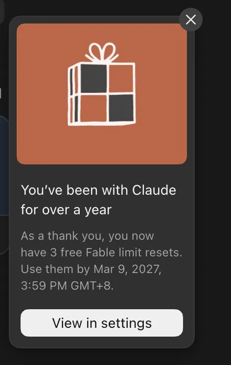
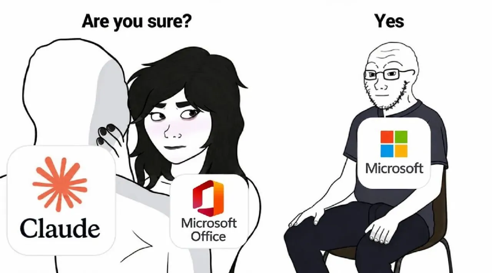

今天最值得看的是一个 Fable 5.2 做的单文件 3D 射击游戏。HTML 文件 1.4 MB，里面没有一张贴图、一个模型或一段音频，画面和声音都是打开页面时现场算出来的。群友让 Fable 把它拆了一遍，整理出一套能照着复刻的做法。其次，Anthropic 给所有付费档发了一次全模型的 full reset，注册满一年的账号另有 3 次 Fable 重置。工作流方面，群里给「管所有 session 的 session」起了个名字叫「刘亚楼模式」，讨论它该放在云端还是本地；另一个话题是，同样多的 token，换掉 Claude 之后能干的活少了一半。

## Fable 5.2 做出来的东西

### 1.4 MB 的单文件 3D 射击游戏：零资源，画面和声音全是现算

@开朗的海龟 发来一个 Claude 做的网页游戏「几猫国产3A大作_V1.html」，只有 1.4 MB。@热情的狮子 让 Fable 5.2 做了一次静态拆解，花了约 2 美元、不到两分钟。结论是文件里没有任何资源，贴图、模型、音频都没有，base64 也是 0。三处关键做法：程序化生成全部内容，给 agent 一个能自己截图、跑性能测试的验收闭环，再按文件所有权把工作分给多个 agent。

文件构成如下：

| 部分 | 大小 | 说明 |
|---|---|---|
| three.js r180 | 约 709 KB | 整库压缩后内联，没有裁剪 |
| 游戏本体 | 约 685 KB | 压缩后的 JS，其中约 110 KB 是 GLSL 着色器（34 个 `void main`） |
| CSS + HTML | 约 30 KB | 菜单、HUD、触屏控件 |

全文件 6214 行，只有一个 `<script>`，没有外链，gzip 后 446 KB。游戏是港口场景的 FPS：切断三处中继，然后登船撤离，敌人有机械飞鸥、机械猎犬和机械守卫。

画面和声音的来源：

- **贴图在显卡上现烤**：启动时用一个着色器同时输出颜色、法线、粗糙度三张图，靠 fbm 噪声、voronoi 和哈希随机生成油漆、锈迹、划痕和雨痕。近处细节不用贴图，油漆剥落用世界坐标噪声算到亚毫米，贴近看也看不到像素块。
- **地面是一个 7 KB 的着色器**：沥青、伸缩缝、裂缝、标线、轮胎印、积水和雨滴涟漪都在里面。天空、海面和云层全部是公式算出来的。
- **文字**：集装箱铭牌、警示牌用 Canvas 2D 画，字体用系统自带的 PingFang。
- **声音**：音效用 JS 逐采样合成进 AudioBuffer。混响用的脉冲响应也是合成的，室外和仓库各一份。代码里还带了一个自检函数，检查峰值、削波和 NaN。

拆解里能看出来的制作线索：

- CSS 开头写着 `game/ui.css — owned by the Game agent`，说明是多 agent 分工、每个 agent 各管一批文件，最后用 esbuild 打成单文件。
- 有一个 `claude:viewport-fit-sides` meta，应该是作为 Claude Artifact 发布的。
- 代码里内置了 `window.__ready`、`__fatal`、`__errors`，还有一个性能测试模式：相机沿固定路线飞，输出平均、中位数和 p99 帧时间。这是留给 agent 用无头浏览器自己跑、自己看结果的验收接口。
- 着色器注释写得像美术指导，比如「潮湿沥青只给模糊拉长的反射，读起来是光泽而不是第二面镜子」。Fable 推断这是反复截图、对着画面改出来的。
- 画质分 low / medium / high / ultra 四档，按设备自动选择，支持键鼠、触屏和手柄。

手机上打不开或不好操作，@蓝色大肥虞 换到电脑上玩了一下，评价「不错」。@洒脱的猫头鹰 说机器狗冒出来时吓了他一跳。@开朗的企鹅 觉得，现在给别人做演示，做一个 3D 交互 demo 很合适，做个质量不错的小游戏也很容易。也有人觉得「夸张过头了」。@热情的狮子 当场开了一个 `/goal`，让 Fable 不调用 Opus、全部自己写，参考《赛博朋克 2077》，从现实主义悲剧的角度做一个同类单文件游戏，并部署到自己的 Vercel。今天还没看到结果。

### 用 Python 驱动 Blender，从零做出一段视频

@开朗的海龟 转来一条推文：[Claude Fable 5.2 从零做了一整段视频](https://x.com/alexmichael/status/2119876626179870838?a=rxvTgYUUFr0zVdhsO90&s=20)，方法是写 Python 控制 Blender，群友戏称「手搓侏罗纪」。@淡定的老虎 觉得模型精度和骨骼动画「有点离谱」。@开朗的企鹅 猜是 Blender 加贴图，难点在光线渲染。@稳重的海豚 的反应是：「感觉我也可以做电影了。」

## Claude 额度与上市

### 全员一次 full reset，注册满一年另送 3 次 Fable 重置

ClaudeDevs 发推：所有 Pro、Max、Ultra 和 Team 用户获得一次免费的 full reset，覆盖所有模型和所有限额，12 月 10 日太平洋时间下午 2 点前使用，入口在 Settings > Usage 或 clau.de/reset。官方给的原因有两个：最近修了几个让额度消耗超出预期的小问题；另外，对已经撞上全模型周限额的人来说，之前的 Fable 重置用处不大。

另一份福利是账号满一年送的 Fable 重置。@今天群内信息量极大 发现自己多了 3 个 Fable reset，不知道是什么时候发的。@活泼的羊驼 弹出的提示给了答案：

@洒脱的兔子 的用量页里，「Fable 重置」的说明是补满 Fable 额度，并返还 Fable 在每周限额中已经用掉的部分。他那边有 2 次 Fable 重置和两条「新模型重置」，都在 2027 年 3 月 9 日到期。他的评价是「也玩 tibo 那一套了」。@天真的浣熊 接着问「Tibo 哪去了」，@细心的熊猫 回「跳槽到 anthropic 了」。几位群友差点信了，后来确认是玩笑；Tibo 的去向见 [「OpenAI「重置按钮」换人：Tibo 去管安全，Codex 交给 Andrew Ambrosino」]({{ '/daily/2026/11/06/daily/#openai重置按钮换人tibo-去管安全codex-交给-andrew-ambrosino' | relative_url }})（11 月 6 日）。

额度一多，@细心的熊猫 把之前卡住的任务全部重新启动，说 Fable「直接像推土机一样推平」。

### Anthropic IPO：Robinhood 显示认购区间 $70–78

接昨天 [「Fable 5.2 / Mythos 5.2：同一模型、两档护栏，降价到 $8/$40，ECI 创新高」]({{ '/daily/2026/11/09/daily/#fable-52--mythos-52同一模型两档护栏降价到-840eci-创新高' | relative_url }}) 里提到的路演消息，@热情的狮子 在 Robinhood 上提交了 100 股 ANT 的认购。页面显示价格区间 $70.00–$78.00，申购会在 IPO 前一天随机分配，Robinhood 提示自己可能只拿到很小比例的份额，甚至拿不到。@飘逸的狮子 说 Kraken 上也有。@稳重的海豚 问，定这么低的价格是不是为了方便散户交易。

群里流传的路演 PPT 里，@活泼的羊驼 认为最值得看的是一张「AI 能力扩展曲线」，横轴是任务时长，纵轴是任务复杂度：

- **2024**：查事实、修 bug、图像识别；
- **2025**：代码重构、多步工作流、深度研究；
- **今天**：自主编程、智能体工作流、自动化风险分析、安全漏洞评估、监管申报起草、保护关键开源软件、工业设计与工艺验证；
- **下一步**：自主网络防御、药物发现、疾病检测与诊断、自主软件开发、机器人与物理自动化、个性化教育、专家级金融与法律建议、供应链自动化。

图注写明，数据点的位置是内部估计，仅作示意。@豁达的灰熊 的评价是「a 社审美这一块儿」。

## Agent 工作流

### 刘亚楼模式：管所有 session 的 session，放云端还是本地

@80-HD 把「管理所有 agent 的 agent」叫作「刘亚楼 pattern」，@开朗的企鹅 的说法是贾维斯。他分了两种：一种是**去中心化**，像 @今天群内信息量极大 那样随便开一个 session 直接聊；另一种是**中心化**，像 @开朗的企鹅 和 @冷静的麋鹿 那样用一个固定入口。他的判断是，现在的 harness 基本都支持从一个 session 去找或新建别的 session，所以隐式的刘亚楼是原生支持的；muse、dot、Grok Bot 都属于这个模式。分歧在于云端的这类产品碰不到本地的老鸭汤。

@冷静的麋鹿 让自己的「董秘」（见 [「Grok Bot 当董秘：子 agent 直接挂本机 CLI 和仓库目录」]({{ '/daily/2026/11/03/daily/#grok-bot-当董秘子-agent-直接挂本机-cli-和仓库目录' | relative_url }})）列出了它的职责，可以当作中心化写法的参考：

1. 理解并记住用户的偏好、工作背景、任务目标和已做过的决定；
2. 负责统筹，不亲自包办，优先选已有的合适 agent，确实有职责缺口时再新建；
3. 盯进度、阻塞和交付物，不等用户催才问；
4. 汇总时简短说清楚做到了什么、还缺什么、哪些需要用户决定；
5. 定时任务归专职 agent 管理，不留在董秘自己的定时列表里，董秘只接收回报并跟进。

默认的执行端是台式机上的 Codex Astra high，没有特别指定时，不自行换成 Claude、Cursor、AGY 或笔记本。

云端和本地之争：

- **云端碰不到老鸭汤**：@务实的貂 说 dots 开的 session 全在云端，加载不了老鸭汤，她只好在本地手动开一个刘亚楼。@80-HD 认为这是 cloud agent 的通病，而且他不愿意把鸭汤交给 dots 或 muse。@开朗的企鹅 提议通过 GitHub 同步，或者用 MCP 接上，@80-HD 说可以，但得想清楚愿不愿意这么做。
- **dot 调 Codex thread 当子 agent**：@认真的荷兰猪 说，可以直接让 dot 去读电脑上的老鸭汤，只是不如每次从 agents.md 自动进入方便，而且可能只适用于从 chatgpt.app 进去的 dot。他的分工是：简单任务全在 dot 里做，dot 可以直接调你的 Codex thread，相当于主 agent 加 subagent，能省一部分主 agent 的 token；更难的任务回到本地 Codex，因为需要迭代、沉淀和更自然的上下文访问。@务实的貂 现在的单次任务就是这么做的，主要为了省 token。
- **手机遥控**：某群友的电脑几乎关掉了所有端口，但 Claude 的 remote control 开着。这种 remote session 只能手动打开，他开一个之后，就能用手机控制电脑了。

@务实的貂 的会话列表也按昨天的命名规则（见 [「会话管理：标题再加状态标签，未结项用巡检还是 hook」]({{ '/daily/2026/11/09/daily/#会话管理标题再加状态标签未结项用巡检还是-hook' | relative_url }})）跑了起来：格式是「日期｜状态｜事项」，一个「总协调」会话下面挂着编号的子任务，各自标着进行中、待审批或已完成。

### PPT 的最后一公里：人上手改完，AI 不好接回去

@开朗的企鹅 注意到一个需求：用 Codex 改 PPT，到最后一公里往往是人直接上手改，因为用 AI 变得又慢又麻烦；可人改完以后，再交回给 AI 接手又不方便。@80-HD 这两天做 slides 也有同感，到了微调阶段用 AI 反而慢，「有点 sonnet 3.5 写码的那种感觉了」。

几种解法：

- **找带手改区的产品**：@冷静的麋鹿 说 Manus 有展示区和手动修改区，像改 HTML 一样直接改字，很多主打 PPT 的 agent 产品都有类似功能。@开朗的企鹅 也觉得 Manus 那个手改功能挺好。
- **评论驱动**：@稳重的海豚 让 agent 直接写 Google Slides，自己上去 comment，再让 agent 监听评论、按评论改。他现在每天边走路边派活，到公司再验收。他说关于这个 review channel 的文章之后会发出来。
- **语音遥控**：@开朗的企鹅 想要的形态是人看着投影说「把 XX 改成 xx」「那个图片小一点，对齐」「找一张之前在 XXX 里的图」，由 AI 在电脑前执行，自己只偶尔上手。他打算试试 terra 加 computer use。

### 网页版的「我建议」为什么显得更聪明

@坦荡的灰熊 被模型折腾得很纠结：他不信任 GPT，所以让 Claude Code 去做 skill；又不信任 Claude，所以去网页版和 GPT 讨论，结果 Claude 那边一个劲地说「你说的对」。他的感受是，没有 AGENTS.md 的网页版给出的「我建议」看起来聪明得多。@优雅的荷兰猪 的解释是：网页版没有 agents.md，也没有项目知识，所以思路更 broad，有时会有意想不到的发现；项目文件夹里的 agent 往往比较「匠气」。@坦荡的灰熊 接着问有没有从网页版反代出来的方案，没人回答。

### SAG2 还是 Markdown：知识库和记忆怎么整理

@坦荡的灰熊 分享了一篇知乎文章 [RAG这次真死了！SAG2才是本地知识库的神](https://zhuanlan.zhihu.com/p/2103169175145427530?share_code=mc6I8PtBQLaf)。@优雅的荷兰猪 和 @80-HD 都认为它本质上还是 RAG，前面是 BM25 检索，后面加的 JEV 相当于一个快速的 LLM 判断。@80-HD 引用 @今天群内信息量极大 的说法：markdown 才是本地知识库的神。@坦荡的灰熊 的回应是，SAG2 不是给项目开发用的，而是用来处理会议、微信群消息、公司 wiki 这类混乱度很高的材料。他正在用它给从闲鱼收来的一批电子书建索引，打算以后直接问「光学发黑用什么材料」，看它能从哪本教科书里抠出知识。0.2.8 版新增了 MinerU 文档解析，长 PDF 也能直接扔进去。

记忆整理的几种做法：

- **照 Anthropic 的抄**：@飘逸的狮子 说，光是精简几个月积累的 md 就很费劲，memory 里乱七八糟，reflector 也不太高效，闲聊内容分不清，全被挤进去了。@稳重的海豚 建议照着 Anthropic 那篇记忆研究（见 [「Anthropic 拆解 agent 记忆：回放 transcript 修正笔记，告诉它记忆用来干什么，但别规定怎么记」]({{ '/daily/2026/11/08/daily/#anthropic-拆解-agent-记忆回放-transcript-修正笔记告诉它记忆用来干什么但别规定怎么记' | relative_url }})，11 月 8 日）做一遍，动手前先备份。@飘逸的狮子 觉得它和老鸭汤兼容度很高，准备用 Fable 5.2 试，已经有 borg 备份。
- **开发专用的上下文**：@坦荡的灰熊 主要做开发，思路是「统一黑话 + DAG 组织的 context 文本，最下层是最精密的东西」。他每天用一个简化版鸭汤回顾 session，看 context load、cognitive load 和交流摩擦，再对 context 做 reshape，现在对 session 的冷启动效率很满意。他认为鸭汤本体鼓励混领域，不适合有很多精密边界的项目开发，@80-HD 同意日常搬砖需要一份特殊的鸭汤。
- **分层**：@认真的喜鹊 认为三四层的分层抽象就能整理所有资料。
- **手动维护**：@沉稳的兔子 基本是自己手动维护，否则 AI 挖了坑他都看不出来。

@飘逸的狮子 贴出一段记忆失效的真实记录，可以说明记忆和 hook 为什么都不够：

> 这是第四次。记忆里已有三次记录，第三次还为此装了拦截钩子。这次漏过去的原因：钩子只拦 Bash 命令，拦不到内置浏览器里的调用。

### 同样的 token，换掉 Claude 后干的活少了一半

@洒脱的鸳鸯 从 Claude Code 的 jsonl 里统计了自己的 token 用量（订阅用户也能统计）。上个月他的 Claude 账号被封，正好形成一条分界线：之前几乎只用 Claude，之后换成 GLM、Codex 和 DeepSeek。前后消耗的 token 数量接近，但完成的任务只有原来的一半左右，甚至更少。他的结论是：「opus + sonnet 的 token 效率是真高。」

API 价格是另一面。@神秘的企鹅 说 Claude 调 API「完全用不起」。@淡定的大象 以前走 OpenRouter，改一次代码就要十几美元；@蓝色大肥虞 说自己一口气干出过一千多。

用量的量级：@冷静的麋鹿 回忆，去年年底 Cursor 年度盘点时，一年消耗三五十亿 token 已经算头部；他估计现在本群人均每月几十亿，同时蹬好几个号的一个月轻松上百亿，明年会到人均百亿、头部千亿。@开朗的企鹅 晒出的数字是四个月累计 1588.7 亿，峰值 39.2 亿。@稳重的海豚 提醒，long session 每次都会把上下文重复发一遍，所以缓存比例非常高，这些数字有水分。他算了一下，1000 亿够他用一年多，而且他最近已经开始逐渐用本地模型。

起因是群里有人组织深圳两天一夜的相亲活动，@冷静的麋鹿 接了一句「相亲成功后，彩礼是 2 万亿 token」。@80-HD 提醒「大肥鱼 token 和 fable token 还是不一样的」，@冷静的麋鹿 补完了分档：「普通家庭 ds，富二代上 fable，福布斯玩家直接 gpt pro。」

## 生图与视频

### MiniMax H3-Image：10 秒出 4K，社区对比里 Qwen-Image-2.1 退成放大工具

MiniMax 预告了 H3-Image，宣传语是「4K image generation in 10 seconds」。@细心的熊猫 同时转来 Hugging Face 上 [Qwen-Image-2.1 讨论区的一个帖子](https://huggingface.co/Qwen/Qwen-Image-2.1/discussions/27)：做角色一致性编辑时，MiniMax H3 明显胜出，Qwen-Image-2.1 更适合当放大和细节增强工具。这只是社区的单方测试，样本只有一组。

帖子里的细节：

- **测试口径**：两边都用 8-bit + ConvRot，单卡 RTX 5090。H3 配 VDN Turbo，跑 8 步；Qwen 用标准工作流，CFG 1.0，25 步，2K 分辨率。
- **Qwen 的问题**：像是把脸直接「贴」到图上，比例和颜色常常对不上；怎么改 prompt 都很难让人物换姿势或换机位。给多张参考图会复制人物，只给一张又被锁死在那张的角度和光照里。
- **H3 的代价**：参数量约为 Qwen 的 4 倍，靠 Turbo 版做到速度相当，但硬件要求明显更高。它本身是视频模型，最少要出 5 帧。
- **实用流水线**：用 LLM 扩写 prompt，H3 生成，再交给 Qwen 2.1 放大精修。也有人反驳说对比不公平，可能是没按规范填编辑模板。

视频方面，@温暖的斑马 说最近在 B 站和推特上看到的 AI 视频，手部细节、脸部肌肉和嘴唇纹理基本挑不出毛病，古装、现代各种版本都分不出真假。@洒脱的大象 的判断是，视频生成现在基本都用国内模型。

### 零碎

- **Gemini 4 Carbon 上线**：发布日期 11 月 10 日，介绍是 Google 最强的前沿模型，面向长周期 agent 任务。截至 11 月 30 日，所有上下文长度统一按每百万 token 输入 $2、输出 $10 计价，上下文 1M。@冷静的麋鹿 截图显示，Cursor 的模型列表里已经有 Gemini 4 Carbon High、Gemini 4 Argon Medium 和 Muse Wonder High。
- **微信机器人**：@随和的企鹅 问现在用什么方案比较稳定。@开朗的企鹅 说读取容易、发送麻烦，群里的机器人基本只做读取；发送「核心是你搞个号，封了换一个」。@豁达的灰熊 补充，关键是得实名。同一天，有人发现一个 macOS 微信 4.1 数据库解密仓库被清空，只剩 README 上一句「本人遵纪守法，先溜了」。
- **数学智能体的设计空间**：某群友在天元 AI4Math 做了一场[报告](https://www.bilibili.com/video/BV13xWx6REBo/)，讨论在给定 token 成本下怎样提升数学求解能力，以及 harness 设计的原则和权衡。具体数据要看视频。
- **AIE 上海参会随笔**：@认真的荷兰猪 转来一篇[参会记](https://mp.weixin.qq.com/s/o6Z_j1-gdSGOfegaT8wtdA)。文中的几个数字：Daytona 称收入年化运行水平已到 1 亿美元；Zilliz 接触到的最大单项业务，数据量从 2023 年的亿条级涨到 2026 年的千亿条级；ClickHouse 今年收购了 Langfuse。作者的观点是，大会最有价值的不是技术演讲，而是行业老师傅的经验。
- **Google Pixel Tag**：@温暖的斑马 发现 Google 商店上架了对标 AirTag 的 Pixel Tag，$29.99 起，打算给老人和猫狗都挂上。
- **NVDA**：@蓝色大肥虞 说英伟达市值蒸发了 1/3。讨论滑向政治后，@今天群内信息量极大 提醒大家克制。
- **Claude 进 Office**：@专注的火烈鸟 的配文是「这何尝不是一种 ntr」，@蓝色大肥虞 跟了一句「MAI-code 破产了吗」。

