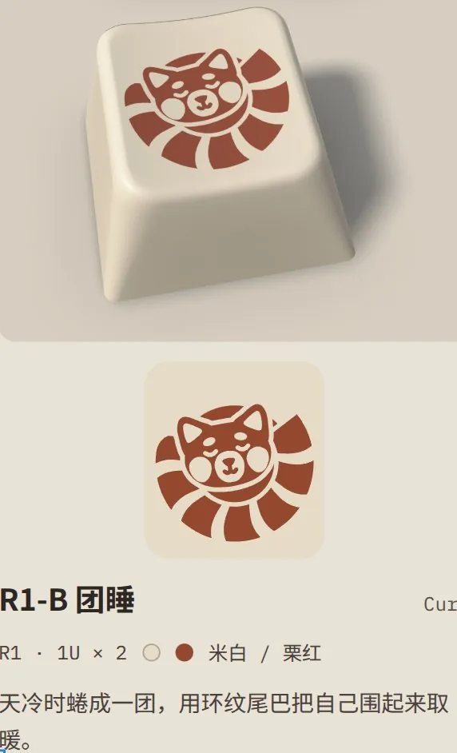

今天的头条是黄仁勋风波继续升级。《华尔街日报》报道英伟达准备让他下台，《经济学人》发社论要求他辞职，Polymarket 上「年底前宣布离任」的概率涨到 78%。另一件事是给昨天的日报纠错：群里疯传的单文件 3D 游戏《几猫》，是 Anthropic 工程师作品《Saltline》的「汉化版」，原作者的署名被删掉了；原作用了 8 小时、约 550 美元的 API 费用。技术上值得点开的是一篇复盘：GPT-6 Astra 花 8 小时手改小模型权重修好了推理死循环，换成线性规划求解，一分钟就能做到同样的效果。

## Fable 5.2 的作品，和一次「汉化」

### 《几猫》原来是《Saltline》的汉化版：原作 8 小时、约 550 美元 API 成本

昨天写过的 [「1.4 MB 的单文件 3D 射击游戏：零资源，画面和声音全是现算」]({{ '/daily/2026/11/10/daily/#14-mb-的单文件-3d-射击游戏零资源画面和声音全是现算' | relative_url }}) 需要更正。@淡定的老虎 转来的[一篇文章](https://mp.weixin.qq.com/s?__biz=MzIzNzM3NzE2MA==&mid=2247759483&idx=1&sn=f0a1cec073b5c9951629c6caaf50ea76&chksm=e9bd0ae6cc50cc53105f9b2bf282ef6b950c6ab6e52b766414a71d2f34e68a7461821dc61162#rd)指出，《几猫》是推特用户 Felix Rieseberg 的作品《Saltline》的拙劣汉化。源代码里《Saltline》的名字没删干净，作者署名却被删了。传播文案和文件里的项目说明都自称这是 Fable 5.2「自主研发」。@热情的狮子 的评价是「经典」。

文章给出的原作信息：

- **作者**：Felix Rieseberg 是 Anthropic 技术团队的工程师，10 号上午放出了完整可玩的网页链接。《几猫》目前能查到的最早公开记录也是 10 号早上，最初靠群聊传播。
- **成本**：据他本人说，模型、音效和纹理全部由 Fable 5.2 从头生成，耗时约 8 小时，用了约 4.45 亿输入 token 和 270 万输出 token，按 API 价格约 550 美元。
- **「一段提示词」之争**：他说整个游戏只用了一段提示词，还在评论区贴出了原文，写得像日常聊天，并据此断言「提示词工程的时代基本已经终结」。反对意见认为，「一句话生成游戏」掩盖了玩法设计这个真正难的环节。有网友拿这段提示词复现，结果「相当招笑」。
- **洗版现象**：文章还提到，最近「汉化」国外开源 AI 项目相当普遍，有些洗版靠信息差赚钱，另一个例子是《渔力全开》。

所以昨天那份拆解（零资源、程序化生成、多 agent 按文件分工、留给 agent 的自测接口）仍然成立，只是拆的其实是《Saltline》。

### Fable 5.2 有没有审美：写 Python 画 70 万笔，也有人看了键帽直摇头

@热情的狮子 转来卡兹克的[新文章](https://mp.weixin.qq.com/s?__biz=MzIyMzA5NjEyMA==&mid=2647688334&idx=1&sn=306d1166b9978ceac39b937cf2c63c97&chksm=f1f46c26047c7d5d67092398815d675151d9f58c66a1fa0636dd881f6eb525d2cfc224da3c7b#rd)。作者是设计师出身，他认为 Fable 5.2 已经有了「审美」，靠写代码就能产出 3D、视频和绘画。群里的实际体验有落差。

文中列的社区案例：

- 3D 版「鹈鹕骑车」，用 4800 行 Python 调用 Blender API，全程不碰图形界面；
- 用 Three.js 写 2000 行代码，83 分钟做出一段动画视频；
- 绘画不用任何图像模型，也不描底。每幅画是一两千行 Python，内含模拟颜料引擎和不同的刷毛，其中一张写实图画了 70 万笔。

作者也承认很多作品仍要人反复引导。他拿同期上线的 Gemini 4 Carbon 做了对比，觉得后者审美有进步，但缺少 Fable 那种「无法用 Benchmark 评估」的东西。

@沉稳的兔子 贴出 Fable 给他设计的一款键帽，问「这个狗比真的有审美吗」：

@风趣的企鹅 发了 Carbon 版的鹈鹕骑车。@80-HD 怀疑这道题已经 overfit 了：它本来是用一个不可能的场景考模型，现在模型见得太多，该换题了。

## 额度与日常工具

### Tibo 冒泡：Codex 周四可能发 banked reset，不是直接重置

Tibo 发推说「好久没 reset 了，也许我该从地下室出来了」，接着又发了一条：「Thursday is feeling codexy to me. Perhaps also a good time for a banked reset.」@热情的喜鹊 和 @洒脱的猫头鹰 都判断这次给的是 banked reset，也就是一张可以自己选时间用的重置卡，不是当场清零。@务实的貂 的结论是：「是 reset 卡就不着急乱蹬了」。Tibo 此前的去向见 [「OpenAI「重置按钮」换人：Tibo 去管安全，Codex 交给 Andrew Ambrosino」]({{ '/daily/2026/11/06/daily/#openai重置按钮换人tibo-去管安全codex-交给-andrew-ambrosino' | relative_url }})（11 月 6 日）。

- **怎么得到消息**：@认真的荷兰猪 收到一封 newsletter 邮件，标题是「[Tibo]【疑似】Reset 信号」。有人专门做了个服务盯着 Tibo 的推文，见到疑似重置就发邮件。@今天群内信息量极大 则直接在群里 @ 了所有人。
- **时机尴尬**：@务实的貂 和 @优雅的海龟 都是昨天刚用掉一张 reset 卡。@冷静的麋鹿 还剩 17%，一天半后周限额自然重置，觉得「食之无味弃之可惜」。@坦荡的灰熊 的对策是「改 terra 疯狂用」。截至上午，@务实的貂、@优雅的荷兰猪、@蓝色大肥虞 都还没收到。
- **一个小坑**：@蓝色大肥虞 上次用 reset 卡时忘了自己还有 credit，结果浪费了，之后两个周期都没花完。
- **额度口径**：一张 ChatGPT Pro 500 的套餐截图上写着，Codex、Work、工作空间智能体和 ChatGPT for Excel 共享同一份额度，「聊天」模式下的对话不计入。这张截图显示的月费是 $690，群里猜是含税价，@蓝色大肥虞 猜是新加坡区。@神秘的企鹅 说客户端里看不到 Codex 的重置时间了，@80-HD 晒出自己让 agent 写的额度面板，建议他「许个愿给你写一个」。

Claude 这边，@细心的熊猫 又多了一次 full reset，现在共 4 次，最早的 12 月 10 日到期，接着 [「全员一次 full reset，注册满一年另送 3 次 Fable 重置」]({{ '/daily/2026/11/10/daily/#全员一次-full-reset注册满一年另送-3-次-fable-重置' | relative_url }})。@优雅的荷兰猪 说「现在的一个 reset 顶之前的 2 个」。另一面，@稳重的海豚 觉得 Anthropic 的额度明显少了：干一个小任务，三个账号轮流爆了好几次。

### Codex apply_patch 连环失败：多个 session 同时出错，更像是 Codex 的 bug

@豁达的考拉 今天有十来个 session 都卡在 apply_patch 上，改不了任何文件，重试也接着失败；让它改用 Python 或 Shell 写文件，它又拒绝执行。查下来是 apply_patch 的语法写错了，而且并行的几个 session 错法一样。任务才刚开始，上下文也不长，按理说 Astra 不该犯这种错。

- @蓝色大肥虞 以前在 Copilot 里遇到过同类问题，原因也是模型输出的语法不对。不过几个 session 同时出问题，他认为不像模型的问题，更像是 Codex 自己 bug 了。
- @沉稳的兔子 偶尔也会遇到，一般重启 Codex 就好，他怀疑和 bubblewrap 有关。

### 实现策略还得人看：「提取 200 页」被做成「逐页删掉其他 1083 页」

@坦荡的灰熊 贴出 agent 的一句自白：「因为现有代码把『提取 200 页』实现成了『从整本书里逐页删除其他 1083 页』。」他认为这可以当作「人要关心实现策略」的案例。也有人不同意：@倔强的穿山甲 觉得复制一个副本再删除没什么问题；@优雅的荷兰猪 认为关键看筛选难度，如果要留的那部分千奇百怪、要删的那部分很容易筛掉，这么做也说得通。

@蓝色大肥虞 补了一个正面例子。Astra 的代码已经写得不错，他仍然坚持做 code review，结果真抓到一处数据结构问题：一个 key lookup 竟然是遍历数组实现的。

### Gemini 4 Carbon 分析直播间流水：报告甩 GPT 一截，差别在「愿不愿意干」

@今天群内信息量极大 监控了一批直播间，让 Gemini 4 Carbon 和 GPT 分别分析为什么有的主播流水高。他说 Carbon 的报告「比 gpt 好太多了，我直接跪着读完的」。他的判断是 GPT 不是能力不行，而是 agency 有问题，比较抗拒做这类事；Gemini「不用讲直接哐哐哐帮你搞定」。

- **谁更放得开**：@直率的海豚 的排序是，Gemini 的道德感高于 Grok、低于 Claude 和 GPT，「GPT 和 Claude 的甲太厚了，Gemini 逗一下还能嗨起来」。@热情的狮子 嫌 GPT 规矩最多，动不动就「没有足够的证据表明」。
- **扛不住流量**：@直率的海豚 刚夸完 Carbon 就碰上 high demand 报错，OpenRouter 上的 Google Vertex 端点也显示 Down。

@今天群内信息量极大 顺带分享了一些手感，打算写成系列文章：

- B 站直播的接口是公开的，流水数据看得一清二楚。匿名抓取看不到具体用户名，但大主播都有机器人复读投喂记录，两边一对就能对出是谁投的。
- 礼物盲盒的数学期望和花出去的钱差不多，但人性决定了投盲盒会亏很多。主播的一个重要技巧就是勾起赌性，鼓励大家投盲盒。
- 他看的都是中小虚拟主播，有人 1 万粉丝，日均流水 8000 元。他的总结是「本质上主播是个销售工作」，整个体系是策划和运营精心设计出来让人打钱的。

@冷静的飞鼠 推荐了一期视频[《应届生三年为公司赚五十亿，靠的是｜直播话术的本质》](https://youtu.be/gBj0JY7LDpE)。他的概括是：直播靠的是胜负欲、翻身感和微妙的权力 play，不是大家想当然的交易。

## 研究

### Astra 花 8 小时改权重修好小模型死循环，换成线性规划一分钟解完

@坚定的貂 分享了 Nathan Barry 的[一篇复盘](https://nathan.rs/posts/weight-space-lp/)，说「有点意思，以及这网页好看极了」。复盘的对象是 MIT CSAIL 的论文《Sparks of Weight-Space Programming》：GPT-6 Astra 只改了 Qwen3.5-0.8B 0.016% 的权重，就把 MATH-500 从 7.9% 提到 48.1%。作者翻完论文公开的日志后指出，Astra 那 8 小时其实是在反复试错、手工解一个线性规划。换成标准 LP 求解，两次各约一分钟的求解就能在全部基准上持平，改动的权重还少 8 倍。

要点：

- **问题**：base 模型有 93% 的答案撞满 32768 token 上限也没给出结果，陷在思考循环里。
- **做法**：用 4 对「正常推理 / 循环推理」文本的残差均值之差，得到一个「循环方向」u，这一步只要 15 分钟。再对第 15、19 层 MLP 的 down_proj 做 rank-1 修改。因为每个 token 受到的推力对 v 是线性的，「循环 token 推离 u、正常 token 不动」就是一组线性不等式。最小化 L1 范数，顺便选出了改哪些列。作者自写的 GPU 求解器（PDHG）约一分钟收敛，商用 HiGHS 要 20 多分钟。
- **结果**：LP 版在 dev 集和 MATH-500 上是 62.5 / 53.2，Astra 原版 59.4 / 50.0，base 10.9 / 7.0。LP 版每层只改 8 列，和 Astra 改的 64 列分别只重合 3 列和 1 列。不用 LLM、靠重复检测器启发式取 u，能拿到约 93% 的效果；随机方向无效。
- **意外发现**：第 15 层那 8 列在 89% 的 token 上都激活，推力几乎恒定，等于一个常量 steering vector。1 倍强度基本复现全部收益，0.5 倍循环又回来了，2 倍循环止住但推理崩了。
- **局限**：只测了一个模型，层数仍然靠 Astra 选。Gemma 3 270M 很少循环，也没法被提升。改权重只能移除挡住能力的障碍，不能凭空加能力。

@80-HD 问 3b1b 的护城河是不是没了，@坚定的貂 的回答是「opus 5.5 出来的时候就没了」，他准备照抄这个网页的风格做 slides。

## vibe coding 与分发

### 能 vibe 的为什么要买：上架 TestFlight 比写 app 还累

某群友分享了自己用 AI 做的第一个 app，是一个情侣共用空间：纪念日、共同账本、经期记录、小游戏，有网页版，也有 iOS 和安卓版。由此引出一场讨论：人人都能 vibe 之后，小 app 还有没有人买。

- **不值钱了**：@细心的熊猫 也给自己做过类似的 app，本想上架，后来觉得大家都能 vibe，就没必要了。他还认为人很难愿意下载新 app，学一个新 app 要动脑子，远不如刷短视频和跟 AI 嘴炮。@蓝色大肥虞 的说法是「两句话能做出来的 app 是不会有人想买的」，@80-HD 把它改成「能 vibe 的为什么要买」。
- **对开源的影响**：@优雅的荷兰猪 认为，开源社区很大程度上靠生产力小工具壮大，这类东西自己写麻烦，有人提供总是好的。现在大家都能写自己顺手的版本，contribution 可能会变少。@80-HD 说自己写是真的爽，不喜欢随手就改了。
- **上架才是瓶颈**：@80-HD 发现上架花的时间比写 app 还多，于是放弃了；小程序稍好一点，但开发体验很差。他买开发者账号只是为了给家人用和上 TestFlight。上架本身 AI 会做，但新 app 第一次必须手动登录 App Store Connect。@洒脱的猫头鹰 让 Chrome 里的 agent 去办 TestFlight 上架，「我只是一个负责登录的废柴」。@神秘的麋鹿 买了 Apple 开发者证书，好处是放在 GitHub 上的安装包别人打开时不再弹警告。@神秘的企鹅 提醒审核至少要一周。@细心的熊猫 建议两家应用商店出 CLI 或 MCP，让 agent 辅助上架。
- **被官方追上**：@洒脱的猫头鹰 之前发现微信的 md 文件没有预览，就用 Flutter 做了一个，结果微信自己支持了，现在只剩 mermaid 和数学公式渲染比自带的好一点。他认为微信大概率不会支持 HTML，安全问题太多。

## 行业

### 黄仁勋风波第三天：WSJ 称英伟达准备让他下台，Polymarket 78%

接昨天的 [「黄仁勋风波第二天：一位分析师预测半年内没有实质后果」]({{ '/daily/2026/11/09/daily/#黄仁勋风波第二天一位分析师预测半年内没有实质后果' | relative_url }})，局势明显升级。@天真的浣熊 转来《华尔街日报》独家：[Nvidia is Preparing to Oust CEO Jensen Huang](https://www.wsj.com/business/nvidia-is-preparing-to-oust-nvidia-ceo-jensen-huang-30f421ad?mod=Searchresults&pos=1&page=1)，起因是公司对他和一位涉嫌间谍的中国女性之间婚外情的调查。Polymarket 上「2026 年底前宣布黄仁勋卸任 CEO」的概率一天内跳到 78%。

当天陆续出现的消息：

- **又一段关系**：一条转述 NYT 的搜索结果称，黄仁勋和英伟达负责医疗健康的副总裁也有过婚外情。@蓝色大肥虞 的评价是「弄了自家高管」。
- **《经济学人》社论**：标题是「Jensen Huang must resign」，副标题「他不该是唯一被追责的人」。文中说他的情人是 Megaspeed 的高管，这是一家不太知名的云计算公司，买过数十亿美元的英伟达产品。
- **接班人**：Bloomberg 直播稿称[董事会开会期间，CFO 是最热门的接任人选](https://www.bloomberg.com/news/live-blog/2026-11-11/nvidia-turmoil-board-to-weigh-ceo-jensen-huang-future-over-alleged-affairs?srnd=homepage-americas)。@机智的鸵鸟 提醒下周二就要发财报，临时换帅，财报会上谁来讲话是个问题。
- **国会和监管**：WSJ 报道民主党参议员 Warren 和 Coons [要求保全特朗普政府涉及英伟达对华的文件](https://www.wsj.com/politics/policy/top-democrats-target-trump-administrations-nvidia-china-records-0c212746)，这通常是正式调查的第一步。@热情的狮子 转的消息称，商务部即将敲定一项规则，阻止中国 AI 公司通过其他国家的数据中心远程使用先进芯片，管制范围扩展到马来西亚、新加坡、泰国等 7 个国家。@敏锐的海狸 的说法是，新加坡—香港这条线本来是特朗普和黄仁勋在 APEC 之前敲定的。
- **假消息**：一条「英伟达董事会宣布即日起解除黄仁勋 CEO 职务」的富途帖子被转进群里，@开朗的企鹅 很快更正说这只是评论，不是新闻。Barchart 那条「Jensen Huang fired」的推文，原文其实是 WSJ 的「准备撤换」。
- **马斯克接梗**：zerohedge 发推「Elon please hire Jensen」，马斯克回复「That would be an honor」。

为什么一段婚外情能让 CEO 下台，群里意见分成几派：

- **公司治理派**：@活泼的羊驼 列了几个先例：英特尔 Krzanich（2018）、麦当劳 Easterbrook（2019，事后被追回大部分离职补偿）、BP Looney（2023）、雀巢 Freixe（2025）。他的理由是：权力不对等，带来性骚扰诉讼风险；其他员工可以质疑偏袒；很多 CEO 真正丢工作的原因是没有向董事会披露；#MeToo 之后董事会的容忍度大幅下降。
- **看股权和筹码**：@天真的浣熊 举马斯克和 Sergey Brin 也没事；@随和的飞鼠 认为职业经理人可能滚蛋，但有绝对控制权的 founder 很难赶走，老黄应该没有超级投票权。@开朗的企鹅 说，关键是董事会斗争中双方的筹码。
- **国安才是重点**：@稳重的海豚 和 @今天群内信息量极大 认为单纯出轨不会有多大事，是国家安全把事情放大了，英伟达在忙着切割。@机智的鸵鸟 的反驳是，这回两段关系并不都和国安沾边，如果只是因为国安，一段就够了。@飘逸的熊猫 提醒：有人想搞你的时候，绯闻是工具箱里非常好用的工具。

对公司的影响：@活泼的羊驼 转的一段分析认为，老黄的极度扁平化管理（60 多名直接下属、没有 COO）和他对台积电 CoWoS 产能的掌控很难被替代。没了他，云厂商的议价筹码会增加，自研 ASIC 和替代方案的导入也会加快。@直率的鹦鹉 的看法相反：「需求在那，和谁当 CEO 没关系」。@开朗的企鹅 的说法是「老黄是乔布斯 + Cook」。@温暖的斑马 算了一下，股价到 155 美元时，前瞻市盈率约 12 倍。几位群友挂了 155–158 美元的限价单，也有人认为老黄真被赶走，跌到 100 都不奇怪。

@活泼的羊驼 还贴了一条推文：作者声称纽约时报那篇间谍报道的记者，其核心信源是 Anthropic 联合创始人 Jack Clark，Clark 才是「猎杀黄仁勋的真正推手」。他让 Grok 核实，结论是 Clark 的身份属实，但「核心信源」一说没有公开证据，「幕后主使」属于推测。群里仍有人觉得这有可能。

讨论中途一度变成人身攻击，@今天群内信息量极大 出面叫停，要求对事不对人、反对要给出理由。当天最好的一句来自 @博学的飞鼠：

> 英伟达股价因为 election 跌了 12%，又因为 erection 跌了 15%。美国 AI 行业最大的敌人：1. Chinese models. 2. Chinese models.

### 零碎

- **Home Repo**：Matt Pocock 分享了[多仓库协作的做法](https://x.com/mattpocockuk/status/2120260969750540327?a=SWb4MitoyDmnf9mgq5I&s=46)：所有 skill、steering 文件和 wiki 放在一个 home repo 里，agent 在这里启动，AGENTS.md 里写好其他仓库的路径。@80-HD 的评价是「终于赶上一年前的 @今天群内信息量极大 了」，也就是群里说的老鸭汤（见 [「老鸭汤太重：workspace 整理成有向无环图，简单问题别走它」]({{ '/daily/2026/11/09/daily/#老鸭汤太重workspace-整理成有向无环图简单问题别走它' | relative_url }})）。
- **GEO 长尾流量**：@80-HD 转来一条[法语推文](https://x.com/affiseo_/status/2119680429947056481?a=_C-D8JEk-kAUsDf96Pk&amp;s=46)，作者自称不到一个月把来自 ChatGPT 的访问从每天 5–20 次做到 267 次。方法有两步：网站提交给 Bing 索引，因为 ChatGPT 联网检索默认用 Bing；页面瞄准搜索量为 0 的超长尾查询。这是单方数据。
- **Antigravity 的自我定位**：@认真的喜鹊 看到 Antigravity 列了一条「Anchor Context Tax」：常驻的约 8 KB 锚点上下文每一轮都会重新注入，几百个快速的小回合下来，token 消耗就累积起来了。他「要笑死了」。
- **AI 伪科普**：APPSO 一篇「10 亿 Token 开源万只假鸟」的文章批评某 AI 博主用 AI 批量画了几乎所有现生鸟类的图鉴，「至于真不真实根本不重要」，推上有 4.8 万次查看。@活泼的羊驼 的吐槽是「怎么有人这么喜欢造 ai slop」。
- **本地 ChatGPT 风格客户端**：某群友开源了 [Mira](https://github.com/mrsibe/mira)，MIT 协议。数据只存本机，支持 OpenAI 兼容接口和 Ollama；用 BM25 检索历史对话，每 8 条用户消息自动整理一次长期记忆，能生成表格、图表等交互组件。macOS 版没有签名，首次打开要先跑一句 `xattr -dr com.apple.quarantine`。
- **用 Suno 仿 Ado**：@稳重的海豚 让 GPT 写 prompt，给 Suno 生成了一首 [Ado 声线的日文史诗摇滚](https://suno.com/s/Jg8bZp2Sk2mSB5Od)，有完整的长曲式分段。
- **typo 的活人感**：@专注的火烈鸟 说自己越来越喜欢 typo，有很强的真人感，但希望 AI 别学。@沉稳的兔子 的回应是「手搓 = typo」，@温暖的斑马 说自己写东西时会故意加错别字。
- **unlimited PTO 的会计账**：@细心的猫头鹰 指出，可累积的 PTO 在资产负债表上是公司欠员工的债，离职时要付清；无上限 PTO 可以免掉这笔负债。VMware 曾经允许无上限累积，负债太难看，后来加了上限。
- **QQ**：@沉稳的兔子 发现在 QQ 里「删除聊天记录」等于把它变成「其他数据」，评价是「太离谱了」。
- **免费直播**：某群友本周日晚在 Superlinear 社区做一场免费直播，讲用 personal agent 海投北美 startup 的打法，时间是西部时间 7:30pm、东部时间 10:30pm。
