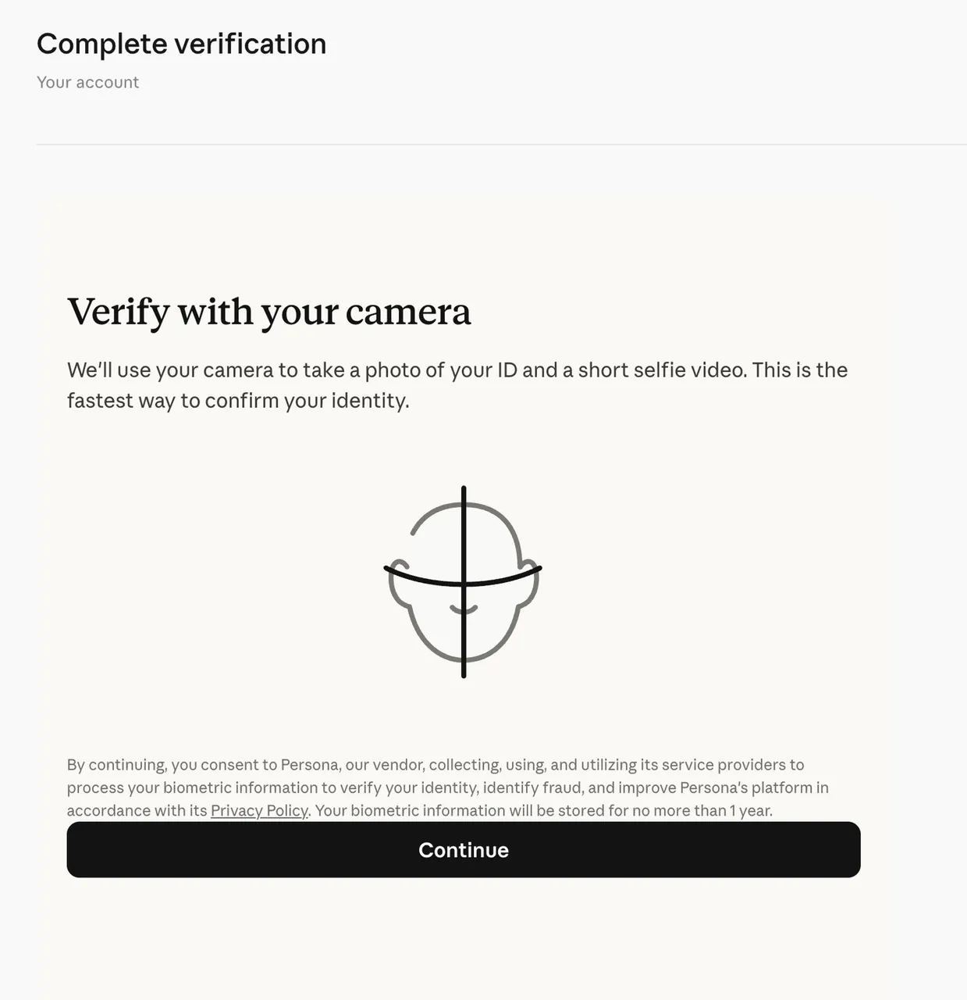
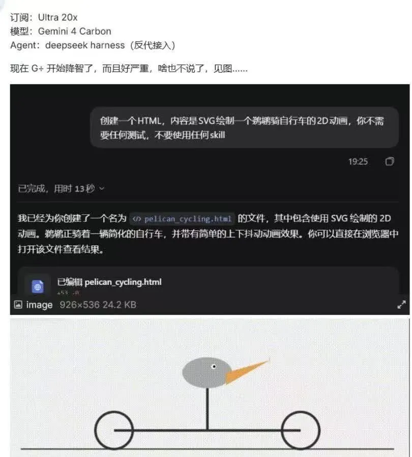

英伟达宣布黄仁勋即刻辞去总裁、CEO 和董事职务，由 CFO Colette Kress 临时接任，董事会第一次设立主席。正式公告出来前，群里已经辟了三条假消息，其中一条连接班人都编好了。同一天，CNN 报道美国情报界至今没能证明那位女商人是间谍。另外两件实用的事：Claude 正在大规模做身份验证（KYC），小红书上有多人反馈上传中国护照后账号被秒封；有群友想买 M5 Ultra 跑本地模型，问到最后，一位手里已有三张 5090 的群友给出的结论是「本地模型没有价值，我想了很久」。

## 英伟达换帅

### 黄仁勋辞职：CFO Kress 临时接任，董事会第一次设主席

接昨天的 [「黄仁勋风波第三天：WSJ 称英伟达准备让他下台，Polymarket 78%」]({{ '/daily/2026/11/11/daily/#黄仁勋风波第三天wsj-称英伟达准备让他下台polymarket-78' | relative_url }})，英伟达发布[官方公告](https://nvidianews.nvidia.com/news/nvidia-announces-ceo-transition)：黄仁勋辞去总裁、CEO 和董事会成员职务，即刻生效，公告没有写原因。执行副总裁兼 CFO Colette Kress 出任临时 CEO，同时保留原职，直到选出正式继任者。董事会同时任命 Harvey C. Jones 为公司史上第一位董事会主席，他曾任 Synopsys CEO 和执行董事长。财报日程不变：11 月 17 日太平洋时间下午 1:20 左右发布 2027 财年第三季度业绩，2 点开电话会。

@冷静的飞鼠 转来一篇云头条编译的彭博社内幕报道（[《黄仁勋：我是个混蛋》](https://mp.weixin.qq.com/s?__biz=MzI4OTc4MzI5OA==&mid=2247905336&idx=1&sn=35ffcd75059bf7b67efa8668ae5e96ef&chksm=edb52c71f60ae3946bff0788466091e7c74eb79f71077bae5299677aba1bbeb5ac66a507cf11#rd)），时间线如下：

- **11 月 6 日**：《金融时报》援引美国官员的说法，称两人存在恋爱关系。公司总法律顾问到黄仁勋家中当面询问，他承认了。
- **11 月 7–8 日**：董事会宣布调查，聘请 Wachtell, Lipton 主导；黄仁勋给全员发邮件承认并道歉。
- **11 月 11 日**：《纽约时报》曝出他和公司负责医疗健康的副总裁也有关系。董事会当晚开远程会议到深夜，要求他辞职。
- **之后**：Kress 定于 11 月 18 日召开全员会。黄仁勋将在未来几周赴国会作证，议员可能追问他和那位女商人的接触是否危及芯片技术机密。媒体提到的继任候选人有 AMD 的苏姿丰和 Arm 的 Rene Haas，英伟达此前没有传统意义上的继任计划。路透社随后又报道了第三段关系，对象是一名未具名的女员工。

@优雅的剑鱼 贴出 [CNN 的报道](https://www.cnn.com/2026/11/12/politics/alice-huang-us-intel-jensen-huang-nvidia)：美国情报界至今不能确定那位女商人是否为北京从事间谍活动，FBI 的反间谍调查已经进行了至少一年，目前仍在继续。司法部长说「尚未得出结论」；特朗普被问到黄仁勋辞职对不对时说「关键是她是不是间谍，这我还不确定」。她的新加坡公司 Megaspeed 是英伟达芯片的大买家，2024 年已经被司法部和商务部立案，调查涉嫌把受限芯片转运到中国的空壳公司网络。

群里对此有两种看法。@优雅的剑鱼 的说法是：「FBI 查了一年多，全美媒体大喊 chinese spy，辞职完了来一句，其实这人跟中国政府没关系。」@开朗的企鹅 认为间谍身份「本来就不重要，重要的是，你不下来我还会搞你」。

当天还有两条外围消息。金十快讯转述 Semafor 的报道，称英伟达面临美国司法部反垄断调查。群里还流传一张特朗普发帖的截图，称「只有一个人能接替他：苹果的 TIM COOK」。

为什么一段婚外情能让 CEO 下台，群里的解释集中在「对象是自家高管」：

- @蓝色大肥虞 贴了一段分析：公司注册在特拉华州，如果董事会明知 CEO 违反合规红线还包庇，股东可以起诉独立董事违背受托责任，保险公司可能拒赔，董事得自己掏钱赔偿。他判断真正引爆的是和自家 VP 的关系，「睡 report line 上的人会涉嫌胁迫」。
- @细心的熊猫 的总结：「睡间谍 = 叛国 = 坐牢，睡下属 = 作风问题 = 体面退位。」
- @坚定的貂 感慨 CEO 太惨，「所有人都是 report line」。@蓝色大肥虞 的回答是：「CEO 只能睡董事会成员了。」

前一天挂了 151–155 美元限价单的几位群友，单子都成交了。@直率的鹦鹉 的判断是，老黄如果不辞职，股价可能还要阴跌好几天。

### 公告之前，群里先辟了三条谣

正式公告发出前几个小时，群里已经转了三条假消息。三条都被群友当场拆穿，拆穿的方法本身就值得参考。

- **「董事会批准辞任，Jay Puri 接任」**：金角财经的微博。@活泼的羊驼 让 Claude 联网核实，结论是拼凑稿。Puri 6 月就通知公司打算退休，8 月 24 日已经卸任，今年 71 岁。当时路透社的消息是董事会深夜开会，还没有做出决定；Semafor 报道部分董事倾向于由 CFO 临时接任。几个小时后的正式公告证实了后者。
- **「第三段外遇是网络微名人 Jessica Pin」**：@睿智的犀牛 直接判定是假的。
- **「中山大学前校长罗俊将接任」**：一张冒用 Polymarket 名义、带照片的推文截图。@敏锐的麋鹿 说「一眼 ai」。@蓝色大肥虞 说，这条谣言最早的版本里写的接班人是 Cook，结果后来真有特朗普推 Cook 的截图出现。

### 交接之后：被老黄当众说成「deer in the headlights」的人接了班

新 CEO 和老黄的关系并不好。@敏锐的海狸 转来 zerohedge 引用的一篇 WSJ 报道：今年夏天，黄仁勋召集财务团队诊断一个越滚越大的问题，即英伟达正在谈判为买不起芯片的公司提供数十亿美元担保，其中包括他女婿主导的、给新兴云厂商做融资的交易。会上他打断 Kress 的汇报，说她是「a deer in the headlights」，还说她只是个「reporting CFO」，帮不了他定战略。@开朗的企鹅 读完的判断是，这等于「内外勾连赶老黄出局」。

@睿智的北极熊 贴了一条 NGA 论坛的帖子，称当年游戏部门合并就是这位 CFO 主导的，她甚至想砍掉这个占 20% 员工、只贡献 5% 利润的部门，最后被老黄保了下来。这是论坛说法，没有出处。@80-HD 的感慨是：「当初搞 CUDA 差点破产，还是靠游戏养着。」

员工这边，@开朗的企鹅 转来凤凰网的[独家报道](https://ishare.ifeng.com/c/s/v0045i6vco0K7KPMikeV0We4dFbiNti4ZM3pRXyqyCVtAPY__?spss=np&channelId=&aman=8ldb1065eY318jde1oc5a)：内网一项员工自发的投票里，超过 97% 的参与者希望黄仁勋留任，内网建议箱的评论超过 1600 条。事发以来股价跌幅超过 10%。部分华人员工担心，新 CEO 为了表忠心会更强调地缘合规。@活泼的羊驼 还贴了一篇流传的英文长文，作者自称做了八年 CUDA 编译器、库和 DSL，核心论点是：

> NVIDIA has only one true moat: its people. ……This won't kill NVIDIA. ……But it has killed NVIDIA's soul.

@开朗的企鹅 把它和 OpenAI 那次相比：「上次是 Ilya 反抗资本，这次是资本赶人出局，都是一样的结局。」

对国内算力的影响，@专注的剑鱼 担心创业公司更没有渠道了。@开朗的企鹅 的建议是多适应华为，而且走私不会断。@活泼的羊驼 和 @敏锐的海狸 则认为华为和 H200 之间还有巨大差距。

当天最好的两个段子：

- @蓝色大肥虞：「Intel 收购 NVidia 正好可以组成 India。」
- @睿智的北极熊：「两党想把他当沈一石给抄家了，但是他先自污当杨金水装疯。」

### 「Anthropic 是幕后推手」：关系网画出来了，证据还没有

昨天群里已经讨论过「Jack Clark 是《纽约时报》记者的核心信源」这一说法，Grok 核实的结论是没有公开证据。今天这个说法升级成了一篇 X 长文《Who Is Really Behind the Hunt for Jensen Huang?》。文章里能核实的部分只是政治献金和公开表态，「操纵媒体」这一环依然缺少证据。

@活泼的羊驼 转来的知乎摘要列了文中的几条线索：

- Anthropic 的 AnthroPAC 资助过两党的一批对华鹰派议员，包括 Coons、Schumer、Schiff、Cramer、Mast、Cotton；
- Anthropic 向对华鹰派组织 Public First Action 提供了 4000 万美元；
- 其中 Cramer 公开要求黄仁勋辞职，Mast 推动他到国会做闭门说明。

摘要作者自己也承认原文有阴谋论成分。另有网友让 agent 帮忙画了一张「Anthropic 阵营—前政府官员—智库—国会—媒体」的关系网络图，自称没有核实。@活泼的羊驼 打算把发帖人的全部推文爬下来交给 GPT 验证。@热情的狮子 和 @随和的企鹅 倾向于相信，前者的理由是「ant 一直鼓吹中国威胁，和国会里的一群人一拍即合」。

两条可以当背景看：

- @开朗的企鹅 贴了新书《The AGI Chronicles》里的一段：2022 年 5 月 Dario 和黄仁勋第一次吃饭前，Anthropic 的计算负责人拿表格论证谷歌 TPU 性价比更高，被黄仁勋骂作「bean counter」，还威胁不去吃饭。饭桌上黄仁勋反复说要建世界最大的数据中心，Dario 低声嘀咕他「kind of Trump-like」。英伟达发言人否认了「bean counter」一说，没有否认其他细节。
- CNN 那篇报道里，一名前商务部官员说，芯片经 Megaspeed 流向中国「并不需要一次情报行动」，监管漏洞本来就在那里。

## 账号与额度

### Claude 大规模 KYC：多人反馈上传中国护照后被秒封

@活泼的羊驼 转来几条小红书帖子，标题是「11.12 Anthropic 风控新规全面落地」。评论区有人上传国区护照后秒封，「两年的号说没就没了」，也有人说海外 plan 还没到期就被封了。他的判断是「这次大规模 KYC，应该是中国护照秒封」。这些都是社交平台上的个例，Anthropic 没有发过相关说明。群里也有人刚弹出验证，直呼「感觉没招了」。

验证流程的背景：Anthropic 8 月 11 日的帮助文档写明，身份验证交给第三方服务商 Persona，证件和自拍由 Persona 收集保存。新号走的 Verification Portal 和充值 Max 时弹出的验证，最后都落到同一个 inquiry.withpersona.com 页面，链接参数每次重新生成，看不出两者的审核标准有区别。

### Codex 重置卡到账；有 credit 的人可以先降级到 Plus

接昨天的 [「Tibo 冒泡：Codex 周四可能发 banked reset，不是直接重置」]({{ '/daily/2026/11/11/daily/#tibo-冒泡codex-周四可能发-banked-reset不是直接重置' | relative_url }})，@洒脱的猫头鹰 确认重置卡已经到账。他顺带分享了一个省钱技巧：如果手里还有之前 $200 档赠送的约 6 万 credit，可以先降级到 Plus，单用 credit 大约相当于一周的 Pro 200 用量。@蓝色大肥虞 担心会被 5 小时限额卡住，@洒脱的猫头鹰 说 credit 不受 5 小时限制。

### 微软 365 挂了一整天

Outlook、Teams 和整套 M365 从上午开始不可用，到下午仍有人邮件没恢复。@蓝色大肥虞 下午数了一下已经 8 个小时，他解释这些服务后端都是 Exchange，「挂了就都没了」。他让 ChatGPT 统计，Exchange 累计宕机已接近 120 小时（没说统计口径），可用性已经跌到 99% 的边缘，于是提议改名「office 360」。据一位群友看到的事故描述，服务器一直在重启，重启完很快又失去响应，到下午还没定位到根因。

最好的一组接梗：@睿智的犀牛 说「让 MAI 来修啊」，@蓝色大肥虞 回「据说 Copilot 好像也挂了，这下知道为什么拖这么久了」。@细心的熊猫 的方案是家里装备用电池、发电机，再加本地模型，「断电断网继续工作」。

## 本地部署与推理

### M5 Ultra 值不值：「本地模型没有价值，我想了很久」

@随和的企鹅 问 M5 Ultra 256G 值不值得买，这一档在国内接近 10 万元。问下来，订阅的性价比压倒一切，本地部署主要剩下合规和「装得下」这两个理由。

最有分量的回答来自 @今天群内信息量极大。他订了一台 512G 的 M5 Ultra，预计 12 月初到货。原因是现在 3 张 5090 托管 Qwen 27B，负载偏高；他手里的 M3 Ultra 最近三天 CPU 平均占用 60% 以上，GPU 在 50% 左右，需要再加一台机器。他的对比如下：

- **M5 Ultra 的优势在大模型**：5090 装不下的模型，比如 GLM 5.3 Flash，只能靠大内存的机器跑。
- **中等模型两者差不多**：跑 Qwen 3.8 Flash，5090 加 strata 和 M5 Ultra 感觉接近。
- **和订阅比**：「订阅秒所有」。@随和的企鹅 追问本地模型除了学习还有什么价值，他的回答是「没有价值，我想了很久，结论是没有价值」，除非你是有合规要求的公司。

@沉稳的仓鼠 补充，DeepSeek Flash 现在已经有很多订阅提供不限 token、只限 RPM 的套餐，「某种程度上世界已经 token 无限了」。@随和的企鹅 觉得 ds flash 还是弱了点，在他看来真正的瓶颈是 SOTA 模型太慢，迭代起来不够爽。

其他用途：

- @认真的狮子 也订了 M5 Ultra，1 月底才发货。他想拿来做 AI 短剧，同时当家里的 AI coding 服务器，同时开很多 session，省得每天背电脑上下班。等不及，他先买了一台 AMD Halo 128G 过渡。@低调的北极熊 提醒，不跑模型的话内存够用，但 CPU 可能不够。
- @神秘的麋鹿 的印象是，Mac 在生图、生视频上表现不亮眼。
- @坚定的貂 用本地模型做语音听写。

### PD 分离：预填充吃算力，解码吃带宽，Cloudflare 的一次泄露把细节全摊开了

@随和的企鹅 问，推理速度到底受限于算力还是内存带宽。@活泼的羊驼 的回答是：prefill 吃算力，decode 吃 KV cache 和显存。群里随后有人贴了一篇[长文](https://yage.ai/share/pd-disaggregation-cloudflare-kv-leak-20261101.html)，借 Cloudflare 八九月间的跨租户泄露事故，把 PD 分离讲得很清楚，适合当入门材料。

为什么要拆成两个池：

- **两个阶段的瓶颈不同**：预填充是几十万 token 一起做大矩阵乘法，瓶颈在算力，决定首字延迟。解码每次只算一个 token，但每吐一个字都要把权重和 KV 缓存完整读一遍，瓶颈在显存带宽。两者混跑时，一条长文的预填充会让旁边几十路流式输出一起卡住。
- **拆开之后的效果**：GPU 数量不变，拆成两个池后，P90 吐字间隔从约 100 ms 的剧烈抖动降到 20–30 ms，流式输出速度提升 3 倍多。
- **同型号 GPU 靠配置区分两个池**：解码端把权重从 FP8 压到 INT4，显存从七百多 GB 降到约 420 GB，单路解码快 55%；KV 缓存再降一档精度后，并发上下文翻倍，峰值吞吐多四成。同样的 INT4 用在预填充端，吞吐反而掉 15%。

泄露是这样发生的：GLM-5.3 对外的上下文窗口约 105 万 token，预填充端的剩余显存只装得下 681,280 token。超长请求被打上拒绝标记后，引擎把它替换成 1 个 token 的空壳空跑；跨机交接模块漏看了拒绝标记，单边 RDMA 只写了第一页就发出完成信号；解码节点不核对实际传输的页数，把预留的八页全读了出来。显存页回收时又不清零，于是后七页是上一个用户的代码和对话，还返回了 HTTP 200。最终有 155 条回复掺进了别人的内容。Cloudflare 立项后 40 分钟下线了模型，当天修复。

带病上线的原因值得记下来：压测脚本只看状态码和吐字时间，不校验内容；占位符分支比正常请求跑得还快，错误路径的监控全绿；一个开销不到 1% 的缓存页归属标签原型，本来可以拦住越界读取，却在事故前不久因为稳定性问题被关掉了。

## Agent 与 vibe coding

### Harness 还值不值得做：开放榜单上 Codex 暂时领先，「harness 不就是 skill + runtime」

@坚定的貂 想做一个 agent harness 创业项目，顺手贴了 [FrontierHarness Eval](https://frontierharness.org/live/)。这个开放基准用 5 个模型跑 21 种 harness 配置（包括 Claude Code、Codex CLI、OpenCode），共 62 个任务，覆盖软件工程、科学、数据、系统、ML 和安全，每题打分 4 次，只有通过验证器才算分。他看到的是 Codex 暂时遥遥领先。

群里对这门生意不看好：

- **太卷，黏性低**：@80-HD 说他看到好几家创业公司的 harness 还不如群友自己做的那个；他最近看的几家都在主打跨 session 的全局记忆。在他看来，这个赛道「太卷，粘度也低，赚不到钱没有正向反馈」。
- **可以被拆掉**：@坦荡的灰熊 认为 harness 完全能用 skill + runtime 取代，@80-HD 反问「harness 不就是 skill + runtime 么」。@坦荡的灰熊 回头看的体会是，大家都在搞花里胡哨的东西时，Claude Code 只是简单地把 shell 接给了 AI。
- **但市场可能很大**：这是 @开朗的企鹅 的看法。

被夸的那位群友打算这个月发布自己的工作流，定位是不绑定 harness、也不绑定模型，理由是「harness 已经赶不上我的工作速度了」。

### Fable 5.2 做游戏：雾港里的「逾期」，王者荣耀开工，也有人嫌画质不如 Half-Life 2

昨天那个开了 `/goal`、按现实主义悲剧来写的单文件游戏有了结果：[逾期](https://overdue.ax0x.ai)。设定是在雾港九区上夜班，替公司回收逾期的义体，为的是保住自己那片肺的员工折扣。

@豁达的灰熊 转来一篇[连载开篇](https://mp.weixin.qq.com/s?__biz=MjM5NjgzMzkwMQ==&mid=2653653252&idx=1&sn=cf89fb897444774e4dd9e08153c1e826&chksm=bc8ef43f05db42a0c8753cb15f9e585d41dd8f07c0b825f2efc88bb2ff89ff6666ecd3bec4a9#rd)：一位公众号作者用 Fable 5.2 手搓「王者荣耀」。角色和美术全部原创；首版只做 5V5，英雄数量少，理由是 token 太贵，也暂不做联机。第一晚做出了 5 个英雄、21 件装备和三路地图，模拟内核跑完了 200 局测试，目前还没有成品可玩。他的起点同样是 [「《几猫》原来是《Saltline》的汉化版：原作 8 小时、约 550 美元 API 成本」]({{ '/daily/2026/11/11/daily/#几猫原来是saltline的汉化版原作-8-小时约-550-美元-api-成本' | relative_url }})。

两种反应：

- **批评**：@蓝色大肥虞 认为这些人不用先进模型去做以前做不到的事，「反而整天起号，用这些二十年前的技术糊弄人，在 5090 上跑出了比 Half-Life 2 更差的画质还沾沾自喜」。@豁达的灰熊 的回应是：「因为用先进模型做以前做不到的事的人，已经在创业了。」
- **想测手感**：@坦荡的灰熊 想让它做一个跑跑卡丁车，看它怎么把握「手感这种不可 token 化的东西」。他昨天玩到一个许愿游戏，玩法不惊艳，鼠标反馈却特别好，「我真无法理解是哪里来的语料库」。

另外，@80-HD 用 Fable 5.2 翻出了不少 Astra 以前写下的老 bug。

### 零碎

- **Gemini 4 Carbon 降智截图**：@机智的河马 转来一张图。条件是 Ultra 20x 订阅、通过反代接入的 harness，要求 SVG 画鹈鹕骑车，13 秒交出来的是这样：

- **agy 怎么用才不被封**：@低调的北极熊 问 Google 订阅有没有自动派活的方案。@沉稳的仓鼠 的做法是让 agent 直接调用 agy，并提醒反代 agy 会被锤。
- **写中文用哪个模型**：@今天群内信息量极大 推荐 Gemini，@倔强的狮子 推荐 GLM。@坚定的貂 嫌 Gemini「根本都不是中文说出来的句子」。
- **910B 对 A100**：@活泼的老虎 测下来，8 张 910B（64G）和 4 张 A100（80G）跑千问开源模型，性能差不多，并没有随显存等比例提升。@热情的长颈鹿 给的经验值是 50–70% 的性能比；他认为 910B 价格便宜，按价格算产出能耗比占优，问题是产能不够。
- **欧洲 5090 涨疯了**：@优雅的喜鹊 看到不含税要七八千欧，国内四五万人民币反而更便宜。
- **李彦宏谈「智能组织」**：百度世界 2026 上的说法是，换上 AI 这台新电机只是起点，重新设计厂房才是分水岭。几位群友觉得这个电气化的比喻，和群里一位群友年初写过的文章如出一辙。
- **演员做 AI 产品**：@开朗的企鹅 转来一则报道，演员张蓝心转型做 AI 工具「野猪ins」，核心团队只有两人，上线首日服务器就被挤爆。
- **Anthropic 申购**：@敏锐的猎豹 提醒申购已经开始，@温暖的斑马 的意见是「不用急着抢，可以等等」。
