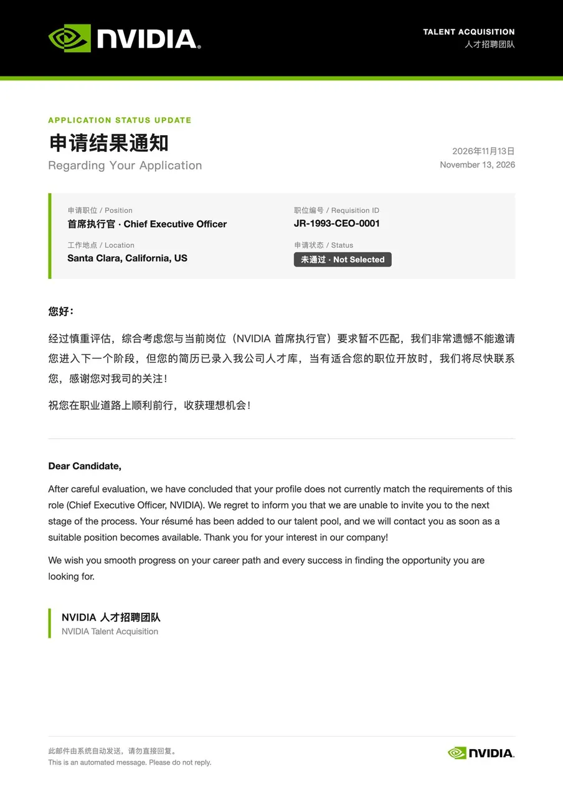
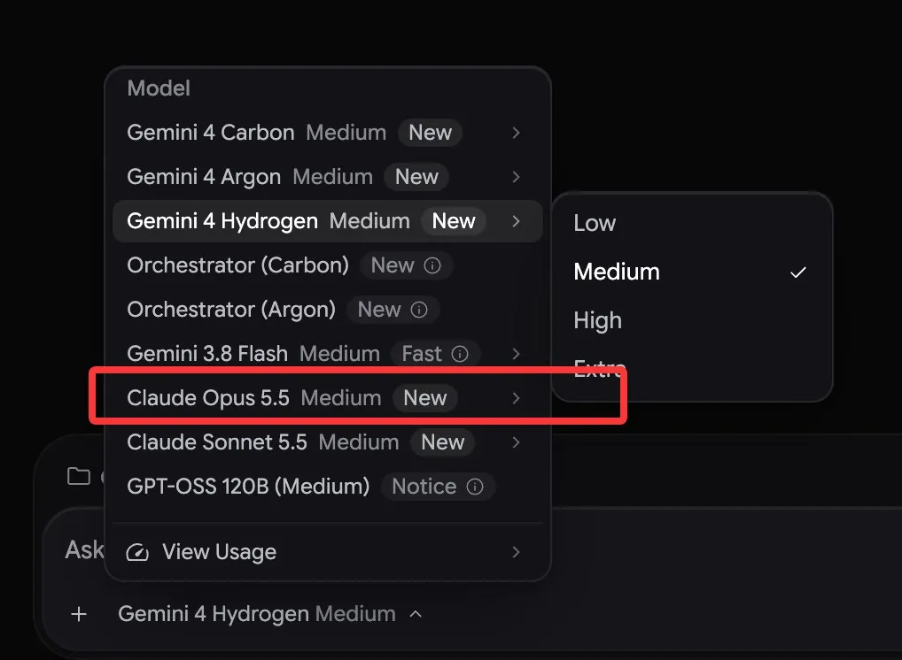

英伟达换帅的第二天，「Stand with Jensen」公开信的签名已超过七千人，马斯克也签了；同时流传的「员工联名信」被判定是假的。群里贴出一篇分析，从季报签字责任和一股一票的制度，解释董事会为什么三天内就和黄仁勋切割。13 号是黑色星期五：微软 365 前后宕了 26 小时，复盘写得很细；美国 FAA 随后宣布全国停飞；Claude 也出了一次登录故障。模型方面，几位群友把写作和梳理复杂问题的活从 Claude 转给了 Gemini 4 Carbon，有人顺带摸清了 Google 账号被识别成中国区的问题怎么解决。

## 英伟达换帅之后

### 「Stand with Jensen」：公开信七千多人签名，「员工联名信」是假的

接昨天的 [「黄仁勋辞职：CFO Kress 临时接任，董事会第一次设主席」]({{ '/daily/2026/11/12/daily/#黄仁勋辞职cfo-kress-临时接任董事会第一次设主席' | relative_url }})。一个名为 [Stand with Jensen](https://standwithjensen.com/#sign) 的网站开始征集签名。它自称是英伟达现任、前任员工和股东发起的独立行动，和公司无关，诉求是感谢黄仁勋，并要求董事会公开说明换帅过程。群里截图时，公开签名者已有 7,181 人，排在前面的有马斯克、Replit 的 Amjad Masad、Marc Andreessen、Garry Tan、Gavin Baker 和 Cohere 的 Aidan Gomez。

- **马斯克**：有人发推说，英伟达员工想让黄仁勋回来，就该从「NVIDIA is nothing without its people」开始，集体辞职。马斯克在下面回复「A petition is underway to reinstate Jensen and I'm signing it too」。
- **机构股东**：Altimeter 和 Atreides 也以股东身份联名致信董事会，截图很小，具体诉求看不清。
- **假的员工联名信**：一条推文称「数百名英伟达员工」签署内部信，要求董事会辞职、让黄仁勋复职，否则就集体去马斯克那边加入 SpaceX Terafab。@睿智的犀牛 和 @活泼的羊驼 当场判定是假的，@灵动的喜鹊 认为是照着 2023 年 OpenAI 员工公开信改的。@坚定的大象 说信是假的，但有内部朋友称超过半数员工希望他回来。这和昨天凤凰网报道的内网投票（97% 支持留任）方向一致。

当天最好的一个比喻来自 @灵动的喜鹊 转的论坛帖：「为啥乔帮主被按了个私通马夫人的名头就被夺权了啊？」热评是：「没办法，谁让他不是宋人。」

### 为什么非辞不可：季报签字、一股一票，和一家没有 COO 的公司

@今天群内信息量极大 认为黄仁勋回不来，原因在法律而不是舆论。英伟达很集权：没有 COO，几十名高管直接向黄仁勋汇报，有的 EVP 没有独立的预算审核权。发财报时，公司要承诺「没有重大管理疏忽」，这完全取决于黄仁勋本人是否可信。和汇报线上的人有关系属于利益冲突，高管如果签了字、事后查出问题，可能要个人赔偿甚至坐牢。如果不签字，就只能推迟发财报，有公司因此跌过 60%。所以董事会只能切割。

群里贴出的一篇长文（[四万亿美元帝国三天易主](https://yage.ai/share/nvidia-transition-credit-repricing-20261113.html)）把这条线展开了。文章大量依赖匿名信源和媒体转述，全文由 AI 生成：

- **外部绯闻能扛，内部的不行**：11 月 8 日他承认与 Alice Huang 的关系时，董事会还只是请人做独立调查。之后曝出他和直接分管的医疗健康副总裁也有关系，触发麦当劳判例：当年麦当劳董事会轻信前 CEO「只有一段恋情」，被股东告上特拉华州法院。文章还称，他从去年底起在内部质询中一直否认，并背着董事会私雇危机公关。
- **没有还手的筹码**：一股一票，他只持有约 3.6%，10 名独立董事过半数就能免职。公司高管都没有离职补偿协议，他名下约 1.08 亿美元未归属的股票会作废，还可能触发薪酬追回。主动辞职换来的是体面切割。
- **政治线**：辞职当天，国会两院发出四道传唤令，众议院闭门作证定在 12 月 1 日。

也有人不买账：

- @开朗的企鹅 觉得这类分析更像是给已经发生的事找解释。他还问，按理说应该开全体股东大会，现在的决定看起来最符合的是董事和高管的利益，而不是股东的。
- @随和的企鹅 的看法是，法律只是大框架，真到 battle 起来全是人的问题，董事会里大概本来就有人看他不爽。
- @睿智的犀牛 指出，从头到尾全是「知情人士透露」，没有一条实锤，再看消息放出的频率和节点，「要说这不是安排好的，鬼都不信」。
- @优雅的荷兰猪 的拆法是：只有 Alice Huang 这一件，调查拖几年也能扛；加上和公司高管的利益冲突，就成了内外交困。

### 下游比英伟达跌得狠：一份「算力抽贷」推演

换帅当天英伟达只跌了 4.34%，AMD 和博通都涨了 5.5% 以上，下游的 CoreWeave 跌 6.86%，超微电脑跌 11.30%。上面那篇长文的解释是：英伟达已经近似 AI 行业的「中央银行」，换成一位管了多年账的 CFO 掌舵，市场开始给算力信贷收紧定价。文章自己也承认，这目前只是华尔街的推演。

文中的数字：

| 项目 | 数字 |
|---|---|
| 参股 | 约 608 亿美元，200 多家非上市初创加十余家上市公司 |
| 二季度股权和并购现金 | 相当于当季经营现金流的 112% |
| 应收账款 | 半年升到 631 亿美元，七成集中在前五大客户，账期最长放宽到 1 年 |
| 表外及投资承诺 | 5305 亿美元，其中 1645 亿是替下游扛的租约担保和算力包销，包括替 OpenAI 德州数据中心担保的 20 年、1050 亿美元租约 |
| CoreWeave | 469 亿美元高息债务，单季净利息支出是营业利润的 4.1 倍 |

@开朗的企鹅 一开始怀疑 WSJ 那篇「deer in the headlights」报道写反了，以为是黄仁勋在质疑 CFO 对 neocloud 偿付能力的判断。@今天群内信息量极大 翻了全文：是 Kress 一直在追问怎么挑交易、怎么给担保估值、怎么算回报，还在幕后试图约束今年 1 月刚升副总裁的黄仁勋女婿。也就是说，是她在挑战黄的决策。@活泼的羊驼 提醒，这种明显捧最终受益者的报道，在这个时间点出来，可信度要打折扣。

## 黑色星期五

### 微软 365 宕机 26 小时：一次配置变更，一场重连风暴

昨天写过 [「微软 365 挂了一整天」]({{ '/daily/2026/11/12/daily/#微软-365-挂了一整天' | relative_url }})，最终的时长是 26 小时以上，属于微软办公云历史上最长的宕机之一。群里贴的一篇[复盘长文](https://yage.ai/share/microsoft-365-outage-20261113.html)讲清了它为什么这么难修。微软在结案通报里专门说明，这次故障和 AI 智能体无关。

- **起因**：早前一次网络扩容埋下了潜伏缺陷，周四下午的一次常规网络配置变更触发了它。服务器上负责入场安全核验的程序算力过载、冻死，自动巡检只是如实把没响应的机器踢出队列。
- **为什么拖这么久**：团队头两小时误判为外部流量洪峰，之后又怀疑是巡检误报。重启后真正的死锁是重连风暴：几亿台设备每秒自动重连，建立连接时的核验比维持连接贵成百上千倍。凌晨想撤销错误配置，过了一个半小时才发现撤销指令推不到卡死的后端；前端路由找不到活着的后端，反复问路，又加剧了拥堵。最后靠限制重连流量、给上游认证组件打补丁、逐台断网重启再慢慢放量才恢复。亚太最先恢复，因为当地已是周五傍晚，排队的设备少。
- **为什么牵连这么广**：日历、通讯录、待办和群组关系都存在用户邮箱的隐藏文件夹里，所以 Teams 新建频道、Power BI 导出带保密标签的 PDF、带加密锁的 Windows 365 云电脑全都受影响。Downdetector 收到 74 个国家和地区的报错，单 Outlook 的并发报告峰值就有 13.1 万条。英国 NHS 约 150 万医护人员断了邮件，英格兰银行、FCA 和泛欧交易所改成电话报送。
- **AI 助手为什么一起失明**：企业合规不允许模型厂商长期保存公司邮件和日程，每次提问都要临时回源微软邮箱取数。Copilot、Claude、ChatGPT 的微软连接器因此一起报错。文章的提醒是：多买几家 AI 并没有分散风险，它们都插在同一个邮箱底座上。

两份流传的「内部视角」：

- 一条 Blind 匿名帖称，连续两年只喊「更快发 AI 功能」，懂老系统的资深工程师在裁员和离职中走光了，以前 45 分钟的回滚现在要拖五个小时。这是匿名说法，无法核实。
- 一条 Reddit 上自称「M365 Principal SRE」的回复显然是段子：break-glass 管理员账号的密码存在受影响租户的 OneNote 里；开了 Sev A 工单，支持团队让他们跑 `sfc /scannow` 再截个图；授权回滚要开 Teams 会，组织者卡在等候室，唯一能放他进来的人 6 月被裁了；根因最终认定为「客户配置错误」。

同一时段，Claude 也出了登录故障。状态页显示 claude.ai 为 Major Outage，Console 和 Claude Code 部分中断，API 正常，原因是用户认证出了问题。几位群友被要求重新登录，或者遇到 `403 Attention Required! | Cloudflare`，第一反应都是要被封号了。这和微软故障是否有关，状态页没有说。

### FAA 全美停飞：先怀疑新上的 AI，查下来是陆空通话

周五 13 号，美国 FAA 先宣布芝加哥奥黑尔机场停飞，半小时内扩大到全国，要求所有待起飞航班留在地面。据新浪财经快讯，FAA 把原因定为「空中交通管制频率问题」；国土安全部表示没有网络攻击的迹象；FBI 在查一次软件更新是不是起因。国家气象局的通信系统同时出了故障，两者有没有关系尚不清楚。这是 2023 年 1 月 NOTAM 系统故障之后，美国第一次全国停飞。

- **AI 背锅说**：@80-HD 转来 Trung Phan 的[推文](https://x.com/trungtphan/status/2121358127333597322?a=WtXZXU_4K2_XN0GI2bg&s=12)，他猜停飞和前一天刚开始推行的 8.75 亿美元 AI 工具 SMART 有关。@今天群内信息量极大 查了一下，SMART 管的是航路，而且只提供建议；这次挂的是陆空通话的无线电网络，至少表面上关系不大。
- **恢复**：据 WSJ，傍晚部分 FAA 设施的通信陆续恢复。@温暖的斑马 听完 FAA 的发布会，觉得发言人逻辑不清、忙着甩锅，好消息是飞机开始慢慢起飞了。@80-HD 发现 Kalshi 上有一个[「FAA 何时宣布解除停飞」的预测市场](https://kalshi.com/markets/kxfaagroundstoplift/when-will-the-faa-announce-the-ground-stop-is-lifted/kxfaagroundstoplift-13nov26)，「可能看这个就行了」。
- **被困的群友**：几位群友正赶上，有人改签到当晚的红眼航班，有人直接改到第二天。@80-HD 说他的 manager 上周开会时就提过「下周五刚好是 13 号」。

@随和的飞鼠 问，这和 [「FAA 终于告别 3.5 寸软盘，有人用过 8 寸的」]({{ '/daily/2026/11/06/daily/#faa-终于告别-35-寸软盘有人用过-8-寸的' | relative_url }})（11 月 6 日）那条新闻有没有关系。@沉稳的兔子 的总结是「系统能跑就不要动」，@80-HD 补了一句：「同时周五不要 deploy 到 prod。」

## 模型与账号

### Gemini 4 Carbon 写东西更「说人话」，Opus 5.5 胜在快

几位群友这两天把写作和梳理复杂问题的活交给了 Gemini 4 Carbon。共同的感受是它写得清楚、读着不累。GPT 的问题是处处免责，Opus 5.5 写代码快，但串不起复杂的结构。这些都是个人体感，没有人拿出测评。

- **GPT 太会免责**：@淡定的海豚 拿自己的报告对比，Gemini 在流畅度和清晰度上明显高出 GPT 一截。@今天群内信息量极大 说 GPT 写的文章「完全不能看，每次讲两句话就要自己打一下嘴巴」，@务实的貂 昨天也刚为这个骂过它。@谨慎的灰熊 建议换 Terra；@开朗的企鹅 猜用 medium 会好一点，xhigh 和 max 把「defensimaxxing」也拉满了。
- **Opus 串不起结构**：@活泼的羊驼 处理涉及第一性原理的复杂推理时，体感排序是 Claude < GPT < Gemini。他举的例子是分析台积电为什么不可替代：Opus 能搜资料、做核对，理出来的却是「一堆片汤话」，串联的知识点超过二三十个就不行了。Gemini 也达不到领域专家那种一次点出两三个核心的水平，但能把事情理清楚。@敏锐的海狸 的例子是整理多方会议和聊天、排优先级：Astra 至少会考虑谁说的话更重要，Opus 经常把不同优先级的事和不同人的话混在一起。
- **怎么分工**：@机智的水獭 让 Claude 当 orchestrator，干活和最后整理给他看的部分交给 Gemini。他也觉得 Opus 比前几周差了，现在主要用它做调度、写代码，以及 oncall 时快速出结论，因为它「真快」。@80-HD 让 Fable 5.2 指导 Opus 修了两天 bug，效果还可以。
- **Carbon 的短板**：慢。@活泼的羊驼 有一篇文章从前一天午夜跑到第二天晚上。@淡定的雪豹 觉得 Carbon 不那么活泼，@低调的北极熊 体感还差一档（用的是 medium）。@活泼的羊驼 转来一条小红书评论：Gemini「自信但谄媚」，Argon 激情提出观点，GPT 全部驳回说不够严谨，Argon 立刻说你说的都对，然后全改了。

反对的声音：@沉稳的兔子 说 Opus 5.5「说人话」，而且已经基本不犯大错，够用了。@蓝色大肥虞 不同意有「够用」这回事：他几年前留下的一句话 TODO，现在还得扩写 100 倍才能让 AI 顺利干，「什么时候它能从 repo 的历史记录猜出那一句话的意思，那就够用了」。另一条路线来自 @冷静的白鹭：他现在就用 DeepSeek，把问题拆到初中生都能干的粒度。@蓝色大肥虞 嫌太累，还是喜欢一把梭；@冷静的白鹭 的回答是「一把梭没有参与感」。

### Google 账号被识别成中国：提交申请改成新加坡后，Antigravity 能用了

@活泼的羊驼 的 Claude 号被封后，想把 Gemini 会员捡起来，但用一个新加坡区的 Google 账号登录 Antigravity，一直提示所在地区不支持。他换了三四轮 VPN、试过全局路由和 Tunnel 模式都不行。最后把截图丢给 ChatGPT，ChatGPT 搜到 Google 有一个帮助页面能看账号关联的国家/地区。他打开一看，显示的是中国，尽管手机号、银行卡、住址和付款都是新加坡的。提交更改申请后，下班前 Google 回信，把关联地区从中国改成了新加坡。

- **为什么会被「送中」**：@热情的大象 说 Google 的 AI 服务不只看 IP 属地，一些 IP 被机场用得太多，也会被识别成中国。他买的 Fitbit 手环，AI Coach 一开始也用不了，换成日本家宽 IP 才好。
- **价格**：新加坡区 Ultra 分两档，5 倍 Pro 用量加 20 TB 存储是 SGD 139.99/月，20 倍加 30 TB 是 SGD 289.98/月。@稳重的海豚 那边 20 倍档是 $199.99/月。@活泼的羊驼 注意到，Antigravity、Flow 和 AI Credits 都是全家共享额度。
- **Antigravity 里的 Opus**：模型列表里有 Claude Opus 5.5 和 Sonnet 5.5，不怕被 Anthropic 封。但 @冷静的麋鹿 说「分分钟干光，肉眼可见的额度往下掉」，@低调的北极熊 估计也就 10 分钟。@认真的喜鹊 补充，Antigravity 的 harness 本身也很差。

### Claude 风控续集：Bedrock 也受限，IPO 排除中国内地和香港机构，CVP 在放水

接昨天的 [「Claude 大规模 KYC：多人反馈上传中国护照后被秒封」]({{ '/daily/2026/11/12/daily/#claude-大规模-kyc多人反馈上传中国护照后被秒封' | relative_url }})，又有群友刚刚弹出了 KYC。这轮收紧不只在订阅端：@淡定的喜鹊 发现 Bedrock 上的 Opus 这两天也大面积用不了，@天真的麋鹿 说前一天开始的地区风控把 Bedrock 也包括进去了。@聪明的剑鱼 转来彭博社的独家推送：Anthropic 的 IPO 将排除总部在中国内地和香港的机构投资者。

一条反方向的消息：@细心的熊猫 收到邮件，他的 Pro/Max 账号获批了 Cyber Verification Program 的 Defense Access，不需要任何设置就已经开通。他的说法是「大家快去申请 CVP，目前大放水」。

关于怎么绕开风控，群里流传一条推文，建议「直接在海外支持地区雇个真人」，还附了布隆迪月薪约 133 元人民币的表。群友的拆解是：这本质上还是 VPS 的路子（@优雅的荷兰猪），付款还得用当地的卡，而支付本身也有 KYC（@优雅的喜鹊、@开朗的企鹅）。@神秘的企鹅 担心中文和使用行为会被探测，@优雅的喜鹊 和 @优雅的荷兰猪 都说自己一直用中文，@优雅的喜鹊 的号已经用了两年。@蓝色大肥虞 的说法是，伪装得再好，一看做的东西全跑在国内，「肯定是美国分公司」。

### 本地模型的价值，又找到两条：越狱边界和家庭隐私

昨天 @今天群内信息量极大 的结论是 [「M5 Ultra 值不值：「本地模型没有价值，我想了很久」」]({{ '/daily/2026/11/12/daily/#m5-ultra-值不值本地模型没有价值我想了很久' | relative_url }})。半夜 @开朗的企鹅 给了两个反例，@随和的企鹅 听完直接「下单！」

- **越狱的边界在厂商手里**：比如想找一本书的 PDF，现在几乎没法用任何在线模型跑出来；网络安全相关的能力将来也可能很难拿到。凡是和合规有关的内容，都可能被禁。
- **有了本地模型，就会拿它干更多事**：他之前想做全家实时监控，以实时理解为基础做一个主动式 agent。涉及全家隐私的东西，确实不想交给云端模型。

@今天群内信息量极大 同意第二条。他看了一下，自己这周用了 29 亿本地 token，还不算语音识别，「但要说这套机器什么时候能回本，也很难说」。

## Agent 工作流

### blackboard 和 superagent + project manager：某群友说开发速度翻了几倍

某群友这周讲课，总结出两个特别好用的多 agent 模式：一个是 blackboard，即给 agent 用的共享留言板；另一个是 superagent 加 project manager。他估计自己现在的开发速度是前两个月的几倍，打算重构完自己的项目后写成文章。他还专门提醒安全问题：这些模型他都测了一遍，GPT 这边 Astra 和 6.1 Terra 比较靠谱，其他的「有点悬」。

这套东西很吃机器。他是在两台 196 GB 内存、96 核的机器上跑的，换到自己那几台 16 到 128 GB 的机器上「就烂多了」。@低调的北极熊 顶配的 M5 MacBook Pro 也经常 CPU 不够，他判断单机每月的产出是有上限的，最后多半要去租云服务器。

@稳重的海豚 晒了自己老鸭汤的体积，结论是「太大了」：

| 加载项 | 大小 |
|---|---|
| Claude Code 自动记忆 MEMORY.md 的加载上限 | 25 KB |
| 他的 L2 + L3 记忆（整份加载） | 39.1 KB |
| 加上 AGENTS.md（27.8 KB）和指南后的完整包 | 77.7 KB，约 1.9 万 token |

图注特意说明，形状上的差别比大小更重要：MEMORY.md 是一份指向其他文件的索引，L2、L3 则是内容本身。他还演示了额度用完后自动切换到另一个账号、继续执行的效果。

### 零碎

- **谷歌 AI 概览收录了「老鸭汤」**：有群友搜「老鸭汤 github」，AI 概览把它解释成长期与 AI 协作中沉淀下来的上下文资产和工作流。另一位群友搜到的版本更离谱：要么是 GitHub 上的程序员做饭指南，要么是比喻「越熬越浓」的屎山代码。@睿智的犀牛 的评价是「真·蒸馏」。
- **NYT 中文网的观点文章**：标题是《黄仁勋因何跌落神坛？傲慢与自负》，群里几位很不满。@开朗的企鹅 说作者是谁不重要，选题本来就是编辑给的。
- **6.2 还没来**：@务实的灰熊 说 GPT-6.2 喊了半天还没出。@活泼的羊驼 觉得 6.1 Sol 做好加固也挺好。
- **Codex 手机版**：@神秘的麋鹿 最近经常在 Codex 手机端完全看不到其他机器上的 task，一条都没有。
- **AIE 上海笔记更新**：上次的 52 场笔记出了[知识地图版](https://yousali.com/events/aie-shanghai-2026/)，按六个专题重排，每节附「旧直觉 → 新前沿」对照表，并标注每条结论的录音来源。几个数字：Agoda 回放生产 MR，去掉全部上下文和保留精写的 AGENTS.md，完成率相同，带上下文反而多花 8%；Techcombank 算出的自租 GPU 临界点约为每月 830 亿 token；OpenClaw 因为 agent 狂加测试，单月测试费一度烧到 127 万美元。
- **数学家是天文学家**：@稳重的海豚 转了北大谢俊逸的一段话：AI 像一支外星舰队，数学家是最先观测到它的天文学家，但这不代表天文学家受到的威胁比别人更大。
- **算命**：@直率的海豚 翻出一年前的面相视频，说黄仁勋「未来两三年恐因个人原因给英伟达带来监管风险」，「被他蒙对了」。@博学的灰熊 让混元排了五年运势：「崩（2026）→ 压 → 稳 → 动 → 了 → 转」。
- **每年省 99 美元**：@细心的熊猫 花了一天重写 Monarch（一款记账订阅），每年省下 $99。
