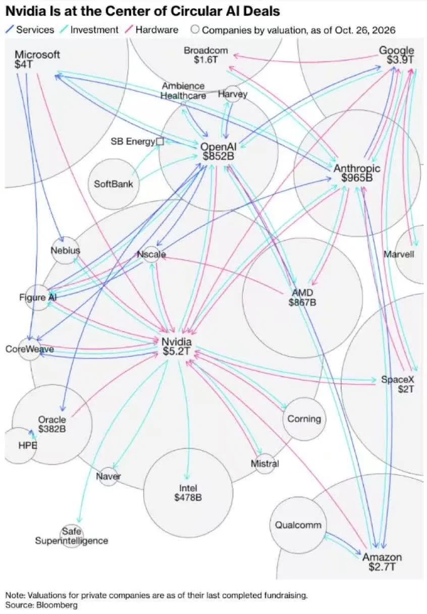
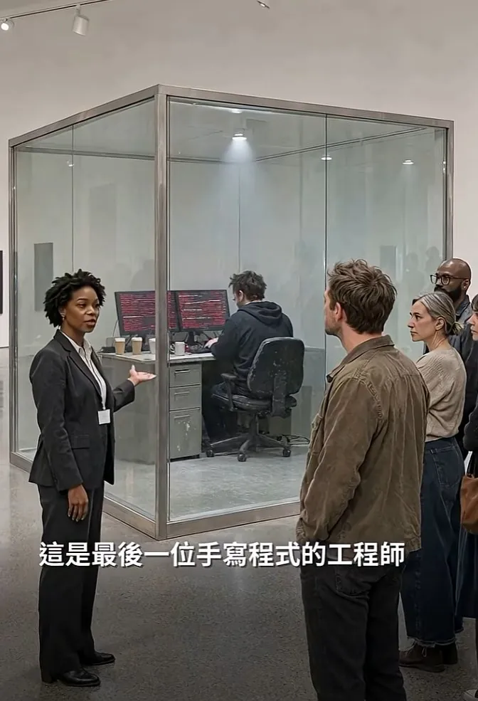

今天最值得读的是 SemiAnalysis 的长文。文章判断黄仁勋出局的真正原因是 GPU 走私，推手是美国情报界；还算出客户买英伟达，买的其实是一份 5300 亿美元的「Jensen put」。实操方面，@随和的企鹅 用 DeepSeek V4 Flash 下棋做了一组对照实验：把历史 reasoning 从上下文里删掉，输入 token 少了 88%，速度只快 4.5%，正确率反而下降，改成压缩 reasoning 效果更差。账号方面，群里流传一篇文章解读 Anthropic 的地区政策：用户本人、公司、股权三道闸，任意一道踩线都会触发禁用，借新加坡壳公司也绕不过去。

## 英伟达换帅之后

### SemiAnalysis：真正的原因是 GPU 走私，客户买的是「Jensen put」

@热情的狮子 推荐了 SemiAnalysis 的 [Nvidia and the World Without Jensen](https://newsletter.semianalysis.com/p/nvidia-and-the-world-without-jensen)。文章认为，个人行为问题确实存在，但黄仁勋离开的真正原因指向 GPU 走私，主要推动力量是美国情报界；他四天内就辞职，时间点正好赶上 RASA（Remote Access Security Act）进入参议院投票。文章明说这些是它自己的判断。

- **RASA**：众议院 1 月 12 日以 369 比 22 通过，目前卡在参议院银行委员会，英伟达和 Oracle 都在游说反对。SemiAnalysis 也反对这项法案。它的理由是：中国实验室远程使用境外算力，利润流向美国公司，美国能监控，也能随时切断。它同时承认，一旦彻底断供，国产替代会加速。文中的例子有三个：GLM-5 已支持七种国产加速器推理；DeepSeek 开源了 V4 Pro 在昇腾上的推理 megakernel；美团 LongCat 2.0 自称完全用昇腾 910B 预训练。
- **走私规模**：SemiAnalysis 追踪到超过 1.5 GW 本不该出现在中国境内的受限芯片，美国商务部也认同这个量级。在诉的两个案子：Supermicro 联合创始人等三人被控经东南亚转口走私 25 亿美元服务器，其中 5.1 亿进了中国，起诉书称他们用吹风机把标签和序列号贴到假服务器上应付审计；基隆案 9 人被控走私 130 台 B300，其中 74 台已到中国，被告里有英伟达台湾的资深经理。
- **没有接班梯队**：黄仁勋执掌公司 33 年，约 60 人直接向他汇报，没有一对一会议，全公司约 4.2 万人。技术侧被提到的人选是 Ian Buck 和 Jonah Alben，但文中引述高管的话说「Ian 宁可死也不接这个位置」。
- **Jensen put**：截至第二财季，英伟达表外担保总额 5300 亿美元，上一季是 1840 亿。其中有 360 亿是 neocloud 产能的 take-or-pay 下限，另有 990 亿美元股权投资。
- **供应链是私人关系**：SK 海力士 2027 年 HBM4 对英伟达报价约 3.0–3.3 美元/Gb，对 AMD、博通、亚马逊、谷歌等一线客户是 3.7–4.1 美元/Gb。文章预计到 2028 年，超过七成产能可能流向非英伟达客户。
- **开源**：英伟达 DevTech 和中国实验室合作产出的 Blackwell kernel 库（DeepGEMM、DeepEP、FlashKDA 等）被 SGLang、vLLM 广泛采用。文章担心，没有黄仁勋当开源代言人，这些成果可能退回闭源。

@谨慎的灰熊 贴了一张彭博社的循环交易图，配的说法是「AI 央行」，和昨天那篇 [「下游比英伟达跌得狠：一份「算力抽贷」推演」]({{ '/daily/2026/11/13/daily/#下游比英伟达跌得狠一份算力抽贷推演' | relative_url }}) 是同一个意思：

### 「Bring Jensen Back」签名破十万；谁来扛 AI 的旗，群里先否了 Dario

接昨天的 [「「Stand with Jensen」：公开信七千多人签名，「员工联名信」是假的」]({{ '/daily/2026/11/13/daily/#stand-with-jensen公开信七千多人签名员工联名信是假的' | relative_url }})。@机智的鹦鹉 贴出的截图里，[公开信](https://standwithjensen.com/)签名已到 106,822 人，其中现任英伟达员工 5,534 人、前员工 998 人；昨天群里截图时是 7,181。页面口号也变了，从感谢和要求说明，变成「We demand the NVIDIA Board Bring Jensen Back」，附带条件是「等独立调查结束，并有明确证据证明撤换他对公司有利」。@机智的鹦鹉 和 @温暖的斑马 都签了。

关于接下来，群里的看法：

- **财报会是雷**：一位群友不看好 Kress，认为她只对上负责。她本来就反对循环信贷，但只要在财报会上说一句反对，股价就会崩，一串公司跟着踩踏。他还猜测周四普跌是因为提供循环信贷的银行准备跑路，「再来一次 2008」，@热情的大象 纠正说更像 2000。@乐观的海龟 的说法是「CFO 做 CEO 基本没有好的」。@天真的浣熊 回了一句「懂了，周一去做空」。
- **Dario 扛不起旗**：@谨慎的灰熊 认为黄仁勋倒下之后，AI 在资本市场的叙事得靠 Dario 撑。@热情的大象、@开朗的企鹅、@敏锐的海狸 都反对，@敏锐的海狸 的理由是 Dario 和整个芯片产业链完全不熟。@谨慎的灰熊 补充说，旗手要做的是持续证明 AI 能渗透各行业、带来 ARR 增长，「证明他有能力持续支付以指数级别增长的账单」，而 Sam Altman「已经臭了」。@开朗的企鹅 认为能扛旗的只有 Sam 或马斯克，但马斯克自身难保，比如 FAA 可以开始卡 SpaceX 的发射。
- **更该盯的是信贷链**：@蓝色大肥虞 认为关键在于，那些借英伟达的钱买卡的公司，尤其是 Oracle，它们的协议 CFO 还会不会继续执行。他的比喻是「开发商盖房 → 带动行业 → 给劳工发工资 → 贷款买房」，哪个环节断了资金链都会出问题，「LLM 的二道贩子要是死了，那也不用想什么覆盖各行各业」。
- **谁受益**：@温暖的斑马 认为风向变了，下一个可能轮到其他 AI 公司的掌门人，国内公司会趁机接收人才。@乐观的海龟 押 Anthropic，@天真的浣熊 押 Intel。

### 「巧合」时间线：捐款日期和国会签函对上了，证据还是间接的

[「「Anthropic 是幕后推手」：关系网画出来了，证据还没有」]({{ '/daily/2026/11/12/daily/#anthropic-是幕后推手关系网画出来了证据还没有' | relative_url }})（11 月 12 日）之后，@睿智的北极熊 又贴出一份带日期的时间线。新增的内容主要是 Dario 的个人捐款，以及捐款和签函的先后顺序。能核实的部分仍然只是公开捐款记录。上面那篇 SemiAnalysis 文章把推手指向美国情报界，不是 Anthropic。

- 2025-11-25：Brad Carson 和前共和党众议员 Chris Stewart 启动 Public First 网络；
- 2026-02-12：Anthropic 宣布向 Public First Action 捐 2000 万美元。同一天，PFA 推出 Brian Mast 和 John Moolenaar，也就是后来签署对黄仁勋质询函的两位议员；
- 05-04：Dario 以个人名义向超级 PAC Public First 捐 100 万美元，图中特别注明不应和公司捐款合并计算；
- 07-21：Anthropic 再捐 2000 万，累计 4000 万；
- 10-29：《纽约时报》开始爆料；11-04：这几位议员签函，要求 11 月 18 日举行闭门简报。

另一张图列了一串「巧合」，结尾是：「一个巧合是巧合，一系列巧合呢？」比如第一个在社交媒体上把「浪漫关系」改写成「sleep」的人，是 Anthropic 高管的前下属。

@坦荡的灰熊 的版本：「Dario 现在正在 CLI 前问：已经把黄仁勋赶下去了，下一步怎么做。」

### AI 群侠传：GPT Pro 排了一张金庸人物表

@冷静的白鹭 起的头：「Dario 就是岳不群，Sam 是东方不败。」@开朗的企鹅 让 GPT Pro 往下写，它还自己找补了一句：辟邪剑谱与葵花宝典本就同源，Dario 也确实当过 OpenAI 研究副总裁，之后另立门户。@蓝色大肥虞 抱怨这些角色「不是一部作品里的，关系说不清楚」。最终版节选：

| 人物 | 角色 | 人物 | 角色 |
|---|---|---|---|
| 黄仁勋 | 乔峰（杏子林处境） | Elon Musk | 任我行 |
| Ilya Sutskever | 张无忌 | Geoffrey Hinton | 张三丰 |
| Yann LeCun | 黄药师 | Jeff Dean | 扫地僧 |
| 梁文锋 | 令狐冲 | Andrej Karpathy | 周伯通 |
| Mark Zuckerberg | 左冷禅 | Greg Brockman | 童百熊 |
| Richard Sutton | 风清扬 | Alan Turing | 达摩祖师 |

@开朗的企鹅「没绷住」的一条是：Satya Nadella＝赵敏，理由是「看局势、识人才、调资源」。

## 账号与风控

### Claude 地区政策的「三道闸」：看人、看公司、看股权

@开朗的企鹅 贴出一篇文章的截图（没有给出处），解读 Anthropic 的地区限制。三条里踩中任何一条都会被禁用：用户本人身处不支持地区；企业注册地或总部在不支持地区；企业被不支持地区的个人或实体直接、间接多数持有，或者实际控制。文章特别指出，第三条不以 50% 持股为界，只看实际控制，所以借新加坡壳公司也绕不过去。

- **覆盖范围**：Claude.ai、Claude Code、Cowork、官方 API，以及通过云平台和授权经销商提供的模型。这和昨天 [「Claude 风控续集：Bedrock 也受限，IPO 排除中国内地和香港机构，CVP 在放水」]({{ '/daily/2026/11/13/daily/#claude-风控续集bedrock-也受限ipo-排除中国内地和香港机构cvp-在放水' | relative_url }}) 里 Bedrock 受限的情况一致。
- **名单**：11 个国家和地区不在支持范围，包括中国大陆、香港、澳门、俄罗斯、朝鲜、缅甸、阿富汗、伊朗。
- **找人代办也挤兑了**：@直率的长颈鹿 想找海外朋友帮忙，结果朋友们说已经有别的中国朋友找过他们了。

怎么被识别出来的，几种说法：

- @80-HD 说 X 上有人扒过代码，是打分制，分数够了就封号。他担心自己会中招，因为租了一台国内 VPS 部署东西。
- @蓝色大肥虞 认为扒得到的只是客户端代码。换作他是 Anthropic，会分析你平时在做什么项目，再决定要不要发 KYC。
- @热情的大象 提醒，代理配置有问题可能被检测到，最稳的做法是用 VPS 转发 API 请求。

群里还流传一个开源项目 [Claude-Cage](https://github.com/Lee-xeo/Claude-Cage)，README 的开场白是「把 Claude 大小姐关起来，为了更好地保护我们的相遇」。它把浏览器登录、Claude Code、Claude Desktop 都放进和主机隔离的虚拟机里运行。内置 Mihomo 代理核心，可以导入 Clash 订阅，代理不可用时不会回退到直连。时区和语言指纹会跟着代理 IP 同步，还支持管理多个 Claude Code 订阅。它自己写明了几条边界：同一份配置里的项目共用一个客机系统；公网出站只支持 IPv4 TCP；内置的网络检查「无法保证账户不被平台限制」。

### 传 GPT 11 月 20 日收紧，香港节点要不要换

@稳重的貂 刷到几条新闻，说 GPT 从 11 月 20 日起会收紧，但没有给出处，@热情的大象 追问消息源也没有下文。@稳重的貂 用香港节点好几年都没事，@敏锐的海狸 人在香港反而用不了。@热情的大象 的解释是机场给 AI 流量做了分流，节点名写香港，出口不一定在香港。@淡定的老虎 以前也一直用香港节点，已经换成新加坡「保命」。@洒脱的兔子 的原则是：用哪国支付，就用哪国节点。

## 模型与 agent 实战

### 删掉历史 reasoning：输入少 88%，速度只快 4.5%，正确率还掉了

@随和的企鹅 在测 DeepSeek V4 Flash 下象棋。他想知道：对这种明显啰嗦、想太多的模型，把上下文里的 chain of thought 删掉或压缩，能不能提升表现。结论是删掉整段 reasoning 省了大量 token，几乎不提速，正确率下降；压缩 reasoning 则「纯副作用，比不传 reasoning 还要差」。不过，保留一个实时更新的关键状态，即使不回放 reasoning，正确率也比什么记忆都不加更高。

起因是他先发现，在上下文末尾加一小段实时更新的状态（tail memory state），能明显提升棋局 recall 的正确率，但推理时间会大幅增加。于是做了对照，下表是 8 个种子里跑完 48 轮、且每轮报告都完全正确的数量：

| | 保留 reasoning | 删掉 reasoning |
|---|---|---|
| 无记忆 | 2/8 | 0/8 |
| 本地状态更新 | 7/8 | 5/8 |

两种设置都跑完的 5 个种子：输入中位数从 243 万 token 降到 29 万（少 88%），未命中缓存的输入少 81%，运行时间中位数从 546 秒降到 522 秒，只快 4.5%。跑实验的 agent 自己也提醒，DeepSeek 文档要求工具会话里完整回放 reasoning，所以这是一次不受支持的消融，不能当默认优化。

@淡定的鸳鸯 问这样会不会破坏 KV cache。@随和的企鹅 的回答是：会丢掉上一轮的缓存，但命中率大约从 99% 降到 95%，不是整体失效。@今天群内信息量极大 建议把这类实验做成 dsh 插件来跑。@随和的企鹅 说搭测试不难，难的是一轮 bench 太慢。

### 一个月烧多少 token：640 亿还没到自租线，千亿要几个号

AIE 上海笔记里有一个数字：Techcombank 算出每月 830 亿 token 是自租 GPU 的临界点。@活泼的羊驼 觉得现在一个人一个月百亿很常见，千亿也近在眼前。@今天群内信息量极大 看了下自己，一个月 640 亿，「看来还有余力」。@沉稳的仓鼠 的判断是，靠 API 和订阅撑到千亿压力不大，到万亿才得另想办法。

千亿要几个号：

- @蓝色大肥虞：一个 ChatGPT $200 档一个季度能烧四百多亿 token，3 个 $500 档应该能覆盖每月千亿；
- @低调的北极熊：5 个 $200 也行，「4 个起步」；
- @随和的企鹅：K3.1 Pro 的 coding plan 性价比不错，他测下来 $199 那档大约相当于 2 个 Sol 6.1，@开朗的企鹅 附和。

### 模型体感：OpenAI 被吐槽变蠢，Astra 修好了一张二十多年前的游戏盘

- **OpenAI 这两天变蠢？**@淡定的海豚 觉得「比以前蠢了好几个档次」，@直率的长颈鹿 附议。@天真的浣熊 的回答是「没有，因为很久之前就很蠢了」。@蓝色大肥虞 昨晚还在跑，没察觉。
- **Gemini 这边**：@认真的喜鹊 觉得 Gemini 4 Hydrogen 相当强，Antigravity 自带的 orchestrator 模式反而不如直接用 Hydrogen。他还让 Claude 写了一个 hook，专门帮 Gemini 4 Flash 这种小模型完成任务，「效果非常好，我之前都不知道可以这么玩」。@淡定的海豚 说 Antigravity 新的桌面端比以前好了不少。
- **Opus 会提问了**：@坦荡的灰熊 觉得 Opus 和几个月前比很会提问题。以前是一大堆问题，现在问的都是他的盲区，「注意力是跟着我走的」。
- **Astra Max 修复老游戏**：@稳重的海豚 让 Astra 处理小学时玩的《阿玛迪斯战记》镜像。它恢复了地图、剧情、音乐和补丁数据，共 2,171 个文件，ClamAV 复扫零检出，还拿汉堂官网的历史存档逐一核对。全镜像复扫只找到两处和游戏无关的报毒，是 Win98 自带的 REGEDIT.EXE 和 NOTEPAD.EXE，它从工作镜像里移除了这两个文件，再单独核验主程序的告警。最后真修好了，@稳重的海豚：「有种无所不能的感觉。」

### Code review 的「洁癖」：Astra 为图方便，往 AST 上加了个成员变量

@蓝色大肥虞 在 code review 里抓到一个问题：Astra 给编译器加新功能时，需要给某个 AST 类型做类型注释。这本来只是中间计算结果，不该改动输入的代码，Astra 却图方便，直接在 AST 上加了一个成员变量。

> 为什么不行就是 taste 的一种体现，很难解释清（解释了其实也没用），具体到这个任务其实也没什么坏处的，但是保持洁癖可以避免以后无数的问题。

他的处理是让 Astra 改掉，同时往 coding convention 里加一行，以后 AI 照规矩做就行。这和 11 月 11 日 [「实现策略还得人看：「提取 200 页」被做成「逐页删掉其他 1083 页」」]({{ '/daily/2026/11/11/daily/#实现策略还得人看提取-200-页被做成逐页删掉其他-1083-页' | relative_url }}) 里他抓到「key lookup 用遍历数组实现」是同一类事。

### 并行跑 agent：内存先爆，清完轮到 CPU

@稳重的海豚 的两个 Codex worker 被主机上的 agent-memory-guard 同时杀掉。其中一个 worker 的进程树占了 22.7 GB：两个 dev server、一次完整构建、tsc 和整套测试同时在跑。@低调的北极熊 也会定时清理，清完之后瓶颈换成了 CPU。@蓝色大肥虞 现在也会同时跑 6 个 Codex：互相没有依赖的任务分到不同电脑上，同时让 Astra 继续给新任务写详细设计。

### 上下文和知识库：agent 每次都要重新查「NAS」是什么

@坦荡的灰熊 说了一句「固件发到 nas 上」，agent 跑了十来步 bash，翻构建目录、搜文本、读 skill 文档，才弄清 NAS 在哪。「NAS」早已沉淀成已知信息，但只要没注入上下文，agent 每次都得先查文档，他觉得为一个简单的词带进这么多上下文太低效。他前一天看了一段讲 context infra 的视频，给自己装上了语义搜索。

相关的几个做法：

- **文献库**：@认真的喜鹊 把 @今天群内信息量极大 的思路讲给 Gemini 听，Gemini 重做了他的文献库。新版不再维护 10 份互相重叠的目录文件和几十个空壳占位文件，改成：一根轻量的人工主题/层级主干，防止「把一篇博士论文当圣经」；用 SQLite FTS5 建零冗余索引；同义词扩展；按引用关系做链接图排序；按需蒸馏。Gemini 给它起的名字是「Yahoo Spine + Google Crawl/Link-Graph」。
- **离线整理**：@活泼的羊驼 贴了一页讲「Dreaming」的幻灯片，问这是不是就是老鸭汤：回看证据，把笔记和原始操作日志对账；修正经验，删除错误规则、更新已经变化的条件；组织知识，把零散记录连成可检索的知识库。
- **会话命名**：@开朗的企鹅 用了 @活泼的羊驼 的命名方法（见 11 月 9 日 [「会话管理：标题再加状态标签，未结项用巡检还是 hook」]({{ '/daily/2026/11/09/daily/#会话管理标题再加状态标签未结项用巡检还是-hook' | relative_url }})），改进一点：同时写上初始名称和当前状态，格式是「编号 原始任务｜本次：当前在做什么·状态」。

### 可视化数学词典和一个「好玩」的滑雪游戏

@飘逸的狮子 转来一位群友做的 [Bun & Bolt Math](https://bunandbolt.com/zh/math/)，觉得适合给孩子做数学启蒙。这是一部可视化数学词典，一个概念一页，图形实时绘制，可以拖动参数改变形状。目前有 12 个学科、111 个概念，从极限、梯度、特征向量到贝叶斯定理、傅里叶级数；另有 25 个现象演示，包括双摆、三体、洛伦兹吸引子、曼德博集合、生命游戏、图灵斑图等；界面支持 14 种语言。作者说这很花时间，不是一下就能搞出来的，还有很多页面没空做。@飘逸的狮子 想提 PR，补一些孩子容易玩起来的现实例子；@神秘的企鹅 建议生物、医学、物理、化学、计算机都来一套。

同一个站上还有游戏。作者看到很多人用 Claude 做滑雪游戏，画面容易做好看，但都不好玩，于是想试试能不能把滑雪做好玩，借鉴了《暴力摩托》，可以踢人、出手、做花式动作。还没宣传过。

### 零碎

- **写作和做 slides 的 skill**：@淡定的海豚 问一篇写得很好的文章是怎么做出来的，作者分享了 [writing-skill](https://skills.superlinear.academy/?skill=writing-skill)：按需求分成内部备忘录模式（结论先行）和外部文章模式（独立视角、实操导向），配合中文文本校验。@天真的浣熊 追问做 slides 的 skill，得到最近更新过的 [presentation-skill](https://skills.superlinear.academy/?skill=presentation-skill)：可以出整页图像版，也可以出可编辑的 HTML/CSS/JS 版。@开朗的企鹅 的提议是建一个祭祀平台，大家给问题投票，「大祭司再看心情选一些问题，燃烧 token 来请求神谕」。
- **Grok 降价**：@稳重的海豚 发现 X 的订阅降价了。@飘逸的狮子 两周前刚花了 2100 买 Grok 最高档：第一周根本用不完，第二周两天就没了，现在三天用光，他感觉很多机房停了。
- **ChatGPT 的品牌后台**：某群友注册了 OpenAI 的 Business center beta，能看到品牌在 ChatGPT 里被提到的次数（7 天 115 次，涨 49%）和带来的网站点击（20 次），还有 Agent builder 和商品管理。对做 GEO 的人有用，见 11 月 11 日零碎里的 GEO 长尾流量。
- **Codex 调 Antigravity**：@活泼的羊驼 问有没有现成的 CLI 或 skill，@热情的狮子 推荐 hcom。@随和的企鹅 用 DeepSeek Flash 加 arc 炼好了一个 computer use。
- **CoRL 传闻**：@飘逸的狮子 转来一篇小红书，称据「大佬一手消息」，OpenAI 能把一个比 GPT 6.1 Astra 小 20% 的模型的推理延迟从十几秒降到 160 ms。没有出处，@开朗的企鹅 的评价是「这个是必然的」。
- **一份 AI 投资纪要**：群里贴了一份 AI 生成的活动纪要。核心观点是 AI 投资的主要矛盾已经从产业基本面转向金融体系的承载能力：芯片折旧接近算力服务成本的一半，会计上按 4 年折旧，英伟达的迭代周期却缩短到 1 年；东南亚银行对芯片采购的信贷大幅收紧。另一页讲训练环境的成本：编程环境已经成熟，通用办公环境单题 800–2000 美元，专业领域单题 30 万美元起。
- **跟单国会议员**：@睿智的犀牛 推荐 [QuiverQuant](https://www.quiverquant.com/) 看「国会山股神们的持仓」。@80-HD 提醒议员的持仓披露有延迟，跟着买就会掉坑。
- **直觉从哪来**：@天真的鲸鱼 转了一篇讲黄仁勋怎么理解「聪明」的笔记，她的解读是 AI 时代稀缺的是完整的人性加上强而准确的直觉。@蓝色大肥虞 的补充是：「大多数强而准确的直觉，就是日复一日的亲自实践中得到的。」
- **反 Anthropic 情绪**：@开朗的企鹅 贴了两条推文。一条说有 Anthropic 员工称每次听 Dario 谈道德都会哭；另一条把 Anthropic 的「罪状」列了一长串，有 12 万次查看，评论里有人声称它 5–7% 的收入来自封号不退费，约 17–23 亿美元，没有出处。
- **Outlook 的性能**：@随和的企鹅 以前试过 Outlook，感觉巨卡。@蓝色大肥虞：「Outlook 牛逼的地方在于你的邮箱里有一封信和一百万封信都一样卡，所以 practically 它才是性能最好的。」
- **多给自己放个假**：@细心的犀牛 转来别处的一则消息：一位开发者心源性猝死，生前多次说为了赶在重置到期前把额度用完而熬夜。
- **最后一位手写代码的工程师**：

