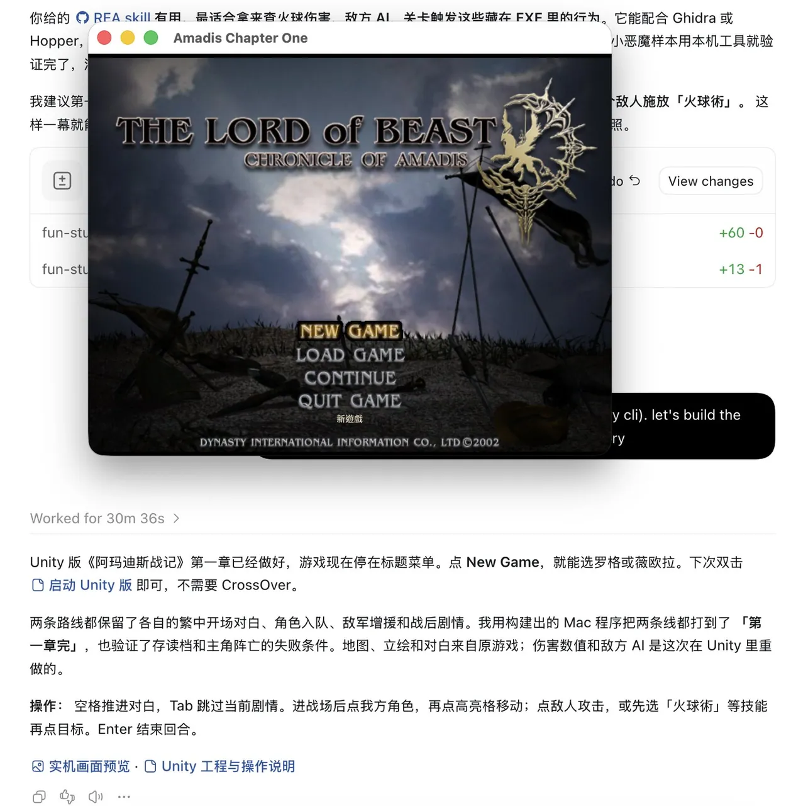
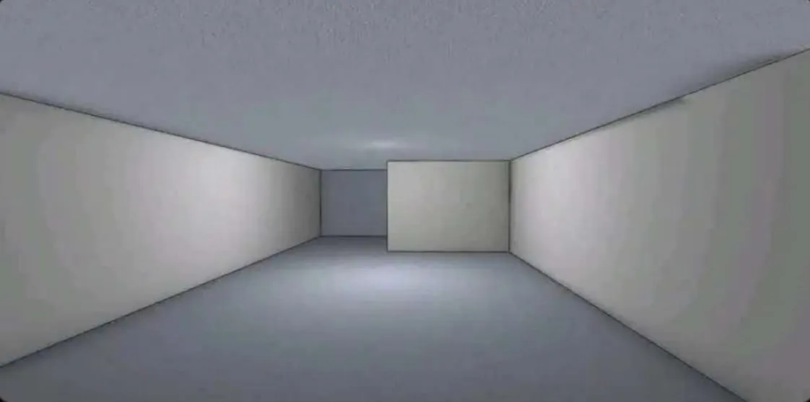
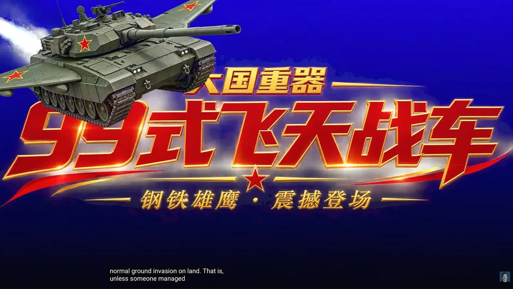

今天的争论集中在一个问题上：前沿模型之间到底差几个月。起因是 Coinbase CEO 说开源模型只落后半年、推理便宜 99%，群友对差距的估计各不相同。不过有几位不约而同地说，ChatGPT 网页版的 Pro 比 Codex 里的 Astra 强得多。实战方面，@稳重的海豚 让 Astra 把 2002 年的《阿玛迪斯战记》重写进 Unity，第一章两条路线都能打通；另有一位奶爸让 Gemini 包办了停产乐高主控的 ESP32 复刻。Claude 风控也有新提醒：用重置卡同样可能触发 KYC。

## 模型格局

### 开源「只落后六个月」？群友对差距的估计差得很远

Coinbase CEO Brian Armstrong 在一段访谈里说，开源模型大约落后半年，推理便宜 99% 以上，所以模型本身不是护城河，围绕它搭的系统才是。群里没人同意这个说法。至于各家之间差多少，几位群友的体感互相矛盾。

- **@蓝色大肥虞** 的理解是，Armstrong 的意思是半年内就能蒸馏出一个只收 1% 价钱的模型，「我是不信的」。
- **@随和的企鹅** 认为 OpenAI 已经落后 Anthropic 大约 3 个月，国产模型又落后 OpenAI 3–6 个月。理由是推上有大量用完全相同 prompt 做游戏 demo 的对比，Opus 5.5 比 Astra 强得很明显，「最反 A 畜的也不会质疑」。他在自己写的 agent 里用 Kimi K3.1 Pro，体感和 Astra 平级。
- **@务实的灰熊** 的看法正相反：Anthropic 落后 OpenAI，国产落后 Anthropic 半年以上。他的依据是 GPT-6 Pro 网页版 9 月就几乎复刻了一个完整的 Minecraft，连地狱都做了，「现在的 Fable 复刻恐怕都没当时完整」；而且 Fable 做后端「也有点拉」。@随和的企鹅 回应说比较必须在相同环境下做，「不然给我个 K3 我也能复刻 MC」。
- **@开朗的企鹅** 的看法是，差距体现在已发布的模型和前端能力上。看 OpenAI 在数学上的进展，Bel 显然很强，只是现在用不到，「逼得 A 畜天天去发布各种稀奇古怪的模型证明」。

@80-HD 追问 Anthropic 到底领先在哪里。@开朗的企鹅 的回答是：从表现看，是前端审美和 SWE 的稳定性；从组织看，是更专注几个有表现力的领域。被问到是不是 RL 做得更好，他认为根源在钱，Anthropic 在数据上的投入远超国内模型公司，「非常贵的人工，就有了非常多的智能」。@务实的灰熊 觉得差距在拉大，也说不清为什么，Anthropic 的模型和国产模型在他看来「一个味」。@坦荡的灰熊 认为区别在「工艺」，现在才是 AI 元年第三年，两年后很难说。

国产模型的具体用法：@神秘的麋鹿 的工作以读代码、解释原因、理顺逻辑、收集资料为主，这类活他觉得 GLM 5.3 比 Kimi 3.1 好用。@开朗的企鹅 则直接让 Kimi 3.1 在 chat 里写 APK，写完就装上用。

### ChatGPT 网页版 Pro：「它的建议绝对要看，Codex 的建议看都不看」

@务实的灰熊 以前一直觉得 chat 没什么用，经朋友推荐试了网页版 Pro，评价是「草真特么强」，比 Codex 里的 Astra 强不少。@坦荡的灰熊 已经把它当成审核员：Claude Code 在本地做的 plan 和 skill，他都拿去问网页版，「对 Claude 是降维打击」，能和它匹敌的大概只有网页版 Claude。

它底层到底是什么，群里说不清。@随和的企鹅 以为只是 Astra 开了高档 reasoning，@务实的灰熊 说「完全不是」。@开朗的企鹅 认为是在 GPT-6 上专门调过的 agent，@坦荡的灰熊 猜是 5.6。@随和的企鹅 的评价是「啥奇葩产品策略」，@务实的灰熊 的解释是「因为贵吧」。@开朗的企鹅 说网页版是把他锁在 GPT 上的重要原因。

额度相关：

- @开朗的企鹅 说 Pro 每周限 200 次，一般人用不完。他还用一个插件让单个 session 一直 continue 下去。@务实的灰熊 听说这个限制马上要变，可能会和 Codex 合并额度。
- @蓝色大肥虞 截图里的 Pro 200 页面写的是：plan limits 由 Codex、Work、Workspace Agents 和 ChatGPT for Excel 共享，chat 对话不计入。他的周额度还剩 32%，距离重置还有 4 天 19 小时，「好难烧啊，任务一个接着一个给，这几天电脑都没关机」。
- @随和的企鹅 的情况正相反：充了 $500 开 ultrafast，一个下午就用完了。
- @蓝色大肥虞 问 Codex 的周额度用完后 credit 会不会自动续上。@冷静的麋鹿 说设置里 credit 下面有个选项，打开后会自动花 credit。

### 榜单：Qwen4-Max 在 AA 指数上排 43 分，Krypton 传下周发布

@细心的熊猫 贴了 Qwen4-Max 的发布图表和 Artificial Analysis 智能指数。阿里自己的图里，Qwen4-Max 在法律和长程任务上领先，Terminal-Bench 和 ProgramBench 则明显落后。AA 指数 v5.0.1 给它 43 分，低于 Kimi K3.1 Pro 的 46 分，榜首 Fable 5.2 (max) 是 65 分。

阿里官方图表节选（Agents' Last Exam 一项缺了一个柱，没有收录）：

| 基准 | Qwen4-Max | Opus 5.5 | GPT-6.1 Sol | GPT-6 Astra | Kimi K3.1 |
|---|---|---|---|---|---|
| DeepSWE v1.1 | 75.7 | 74.2 | 75.2 | 74.1 | 75.5 |
| Terminal-Bench 4.0 | 48.5 | 59.6 | 56.1 | 59.1 | 67.2 |
| ProgramBench | 31.5 | 65.0 | 52.5 | 55.0 | 25.0 |
| CodeArena (Elo) | 1750 | 1816 | 1742 | 1763 | 1686 |
| AA-Briefcase (Elo) | 1686 | 1801 | 1555 | 1569 | 1674 |
| HLAB-Vals（法律） | 21.3 | 9.2 | 6.3 | 7.1 | 11.7 |
| Humanity's Last Exam | 51.7 | 59.8 | 54.0 | 53.6 | 51.1 |

AA 智能指数 v5.0.1 前段：

| 模型 | 分数 | 模型 | 分数 |
|---|---|---|---|
| Claude Fable 5.2 (max) | 65 | GPT-6.1 Terra (max) | 51 |
| Gemini 4 Carbon (high) | 60 | Muse Wonder Full（无公开 API） | 50 |
| Claude Opus 5.5 (max) | 59 | Kimi K3.1 Pro | 46 |
| GPT-6 Astra (max) | 57 | Qwen4 Max | 43 |
| GPT-6.1 Sol (max) | 55 | Qwen3.8 Max (0902) | 34 |
| Claude Sonnet 5.5 (max) | 55 | DeepSeek V4.1 Flash (max) | 33 |
| Gemini 4 Hydrogen (xhigh) | 54 | GLM-5.3 (max) | 32 |

@随和的企鹅 回忆，Qwen3.8 那会儿的价格贵得离谱。

另一条消息：X 上一条 15 万次查看的推文称，谷歌 Krypton 下周发布，「Fable 5.2 级别，但更便宜」，评论区有人说要等谷歌官方发帖才信。@蓝色大肥虞 的反应是，Carbon 已经这么强，Krypton 岂不是要原子弹爆炸。@睿智的犀牛 提醒 Carbon 很贵，@蓝色大肥虞 觉得只要订阅价格和 Astra 接近就能接受。@认真的喜鹊 这几天大量使用后，觉得 Gemini 4 Flash「已经是 AGI 了」。@蓝色大肥虞 给的检验标准是让它复刻一个 SQLite，「不要半年前 RIIR 结果慢一万倍的那种」。@神秘的企鹅 问 Gemini 4 和 GPT 6.1 比怎么样，@沉稳的兔子 的回答是：「4 还可以，AG 不行。」

## 让 AI 动手

### 《阿玛迪斯战记》重写进 Unity：第一章两条线能通关，难点在动画和音频

接昨天 Astra 修复游戏镜像的事（[「模型体感：OpenAI 被吐槽变蠢，Astra 修好了一张二十多年前的游戏盘」]({{ '/daily/2026/11/14/daily/#模型体感openai-被吐槽变蠢astra-修好了一张二十多年前的游戏盘' | relative_url }})），@稳重的海豚 更进一步，让 Astra 拆解原游戏引擎，在 Unity 里重新实现。半个小时后，第一章就能玩了。但到晚上他发现，真要完整复刻，基本等于重写汉堂的战棋引擎。

- **第一步（9 分 49 秒）**：Astra 判断可以直接用已经解出的地图和立绘做 Unity 原型，游戏逻辑逐条拆出来用 C# 重写。它先拿「小恶魔升级」这条规则验证，确认能脱离原游戏运行。
- **第一章（30 分 36 秒）**：New Game 后可以选罗格或薇欧拉。两条路线都保留了繁体中文的开场对白、角色入队、敌军增援和战后剧情。Astra 用构建出的 Mac 程序把两条线都打到「第一章完」，并验证了存读档和主角阵亡的失败条件。地图、立绘和对白来自原游戏，伤害数值和敌方 AI 是重做的。藏在 EXE 里的行为，比如火球伤害、关卡触发，它用群友给的 RE skill 配合 Ghidra 或 Hopper 去查。
- **卡在哪里**：@稳重的海豚 原以为有了原游戏和全部素材，让 Astra 照着抄应该万无一失，结果它没法一开始就把所有细节扒出来，多图层动画叠加、音频配合都有问题。@神秘的麋鹿 的解释是：素材能静态解出来，有些行为得动态破解才看得到。@务实的老虎 建议干脆重新开发，@稳重的海豚 认为原作的价值在素材和调好的数据，他甚至考虑以后把整套素材也重做一遍。

### 停产的乐高 SPIKE 主控，用 ESP32 和 Gemini 复刻了一个

@勇敢的鸵鸟 转了一位附近奶爸的项目：乐高教育的 SPIKE Prime 主控刚停产，他用 ESP32 复刻了一个，整个项目交给 Gemini。选芯片、画原理图、设计 3D 打印外壳都由 Gemini 完成，人只在 PCB 布线上帮了忙。嘉立创贴好大部分元件、空运到货后，Gemini 随手写了个测试程序就把板子点亮了，还顺便做了一个测陀螺仪的小游戏。现在它正在把 pybricks 从 STM32 移植到 ESP32。原帖的感慨是「软硬件都通吃，留给人类工程师的活路又少了好几条」。

背景：[乐高教育官网](https://education.lego.com/en-us/products/lego-education-spike-prime-set/45678/)显示这条产品线正在退役，后继产品是 Computer Science & AI。SPIKE App 支持到 2031 年 6 月 30 日，2026 年 6 月 30 日之后不再加新功能；FIRST LEGO League 允许 SPIKE 用到 2027–2028 赛季。

### 「用你知道的关于我的一切填满这个房间」：GPT 出效果图，Claude 画了张标签墙

这是最近流行的一个玩法：给 AI 一张空房间图，让它根据对你的了解把房间填满。

@开朗的企鹅 用 GPT 跑出一间堆满显示器、机械臂和书架的工作室，感叹「我这儿太乱了，得整个别墅」。@豁达的灰熊 用同一个 prompt 让 Claude chat（Fable 5.2）画，它画了五分钟，交出一张扁平示意图：树干上写着标语，墙上贴满关键词标签，桌上摆着一块写着「判断权」的牌子。同一个 prompt 交给 GPT，出来的是一间温馨的书房效果图。@坦荡的灰熊 的评价是「卧槽大碗宽面」。@随和的企鹅 指出，Claude 那张明显连图像模型都没调用，GPT 这边是调独立的生图模型来画。@豁达的灰熊：「也许纯 text 路线是正确的呢。」

## Claude 账号与网络

### 重置卡也可能触发 KYC；有人认证完被封，申诉后解封

@活泼的羊驼 提醒：使用 Anthropic 发的重置卡，也可能被「钓鱼」弹出 KYC。@热情的大象 确认确有其事，并追问美国本地用户用重置卡会不会也被要求 KYC，没人回答。重置卡的来历见 11 月 10 日 [「全员一次 full reset，注册满一年另送 3 次 Fable 重置」]({{ '/daily/2026/11/10/daily/#全员一次-full-reset注册满一年另送-3-次-fable-重置' | relative_url }})。

@活泼的羊驼 自己的号是在完成身份验证后立刻被封的（见 11 月 13 日的日报）。他给 support 写了申诉信，说明使用场景，要求人工复核，如果无法恢复就退还过去一年的订阅费。今天他收到 Anthropic Safeguards Team 的邮件：「Upon receiving your appeal, we investigated this decision and reinstated your account.」几位群友追问是怎么申诉、用什么做的认证，他没有展开。@倔强的狮子 说自己在国内已经废了好几个号，想找防封教程。

在国内用 Claude Code 当 harness 跑别的模型，@认真的荷兰猪 的经验是 Server tool 用不了。

### 分流规则：补上 claude.app，IP 兜底换成官方入站地址段

@活泼的羊驼 发现 Anthropic 新增了域名，提醒在 Clash/Mihomo 规则里补一条 `DOMAIN-SUFFIX,claude.app,Claude`。他推荐了两份社区维护的列表作参考：[v2fly 的 anthropic 列表](https://raw.githubusercontent.com/v2fly/domain-list-community/master/data/anthropic)和 [MetaCubeX 的 anthropic.list](https://raw.githubusercontent.com/MetaCubeX/meta-rules-dat/meta/geo/geosite/anthropic.list)。两份都包含 claude.ai、claude.com、claudeusercontent.com、claudemcpcontent.com 等后缀，以及 Claude Code 遥测用的 Datadog 和 Sentry 主机。

群里还贴了一份作者在弹 KYC 后复盘、重新整理的 [Mihomo Claude 分流规则](https://yousali.com/kb/claude-mihomo-routing/)，共 24 条，要点如下：

- 需要配置里已有名为 `Claude` 的策略组，规则要放在通用规则和 `MATCH` 之前。
- 域名以官方文档为准，GitHub 社区列表只用来找候选域名。
- 为了避免误伤，Datadog 遥测改成两条精确的 DOMAIN 规则，去掉了 datadog、sift 关键词，以及 Sentry、Statsig、Intercom 这类共享后缀。
- Persona（验证服务商）的 inquiry、cdn、sdk、miniapp 四个 withpersona.com 主机也走 Claude 组。
- IP 兜底改用官方入站地址段 `160.79.104.0/23`、`153.61.224.0/22`、`2607:6bc0::/48`，都加 `no-resolve`。`IP-ASN,399358` 默认注释掉。
- 作者自己注明只做了静态核对，还没有做实网验证。

## Agent 经济

### Cloudflare 控制台出现「变现」菜单：给 agent 流量标价

@活泼的羊驼 在 Cloudflare 控制台看到一个新菜单「变现」，里面是 Beta 状态的 Monetization Gateway，可以「Charge agents for access to your API, MCP Tools, datasets, and web pages」，目前需要申请。群里随后贴了三篇几个月前写的背景文章，它们共同的判断是：Cloudflare 正在把边缘网络改造成面向 agent 的协商层，但买卖双方都还没真正入场。

- **[Monetization Gateway](https://yage.ai/share/cloudflare-monetization-gateway-x402-20260710.html)**（7 月 1 日推出）：没有通过验证的机器请求会收到 HTTP 402，响应头里带报价和收款地址。agent 用钱包签名付款后重试，由边缘网关验证放行，通过 x402 协议用稳定币结算。卖家在 Dashboard 里给路由设价即可，比如 `/api/premium/*` 每次 GET 收 0.01 美元，后端不用改。作者认为最先能收上钱的是实时数据（气象、路况、库存、行情）、专业数据库和高可信的 MCP 工具，通用网页内容最难收费。
- **[Markdown for Agents](https://yage.ai/share/cloudflare-drop-agent-strategy-20260712.html)**：agent 请求时带上 `Accept: text/markdown`，边缘节点就地把 HTML 转成 Markdown。官方演示页从 12,345 token 降到 725 token，但这项功能至少要 Pro 套餐（每月 25 美元），主流 agent 框架也还没有默认带这个请求头。文中拿 llms.txt 做对照：Ahrefs 抽样中 28% 的网站发布了这个文件，其中 97% 从没被机器访问过。
- **[Wallets 和 cloudflare.pay](https://yage.ai/share/cloudflare-wallets-agentic-commerce-20260805.html)**（8 月 4 日）：这是买方这一侧的产品，虚拟钱包有周期预算、商家白名单和单笔上限三道风控。发布当天开发文档返回 404，只开放了 Handle 预留。x402 宣传的 1.6 亿笔交易，早期增长主要靠 Base 链上 meme 币刷量。评论区有一句话被引用：「An extraction bot with a wallet is still an extraction bot。」

## 录音

### AI 录音设备会让录音变成默认状态，规范会跟着变吗

@豁达的灰熊 想用录音给 AI 积累日常 context，也对 Plaud、录音豆这类产品感兴趣，但每次录音前都得跟人解释「在录 / 没在录」，觉得成本太高。他的判断是，AI 可穿戴设备会把录音从主动行为变成默认状态，社会规范会像拍照一样慢慢适应，毕竟现在大家已经习惯了公共场合随时有人在拍。

反对的意见集中在法律和许可上：

- @聪明的雪豹 认为这不是适应不适应的问题，对方有权拒绝被录，「录自己可以」。@谨慎的灰熊 也觉得录音和拍照还是不一样。
- @蓝色大肥虞 说改法律估计得十年，美国有些州，智能门铃录下邻居谈话的那一刻就已经违法了。他的建议是「最好别录」。
- @坦荡的灰熊 认为一直录音就等于没录音，不如换个方案。

@热情的白鹭 给了一个可行的替代：他半年前也沉迷录音，最近几个月改成上下班路上自己口述，「觉得重要的，自己陈述，记录一下，带上自己的判断」。

## 几条后续

### 英伟达：签名 15.7 万，预测市场给「回归」20%

接昨天的 [「「Bring Jensen Back」签名破十万；谁来扛 AI 的旗，群里先否了 Dario」]({{ '/daily/2026/11/14/daily/#bring-jensen-back签名破十万谁来扛-ai-的旗群里先否了-dario' | relative_url }})。新智元的一篇转述（[《重磅！黄仁勋密谋重返英伟达CEO王座》](https://mp.weixin.qq.com/s/PgbmwCLh3RlUEAqXoxzBtQ)）称，黄仁勋周末一直在和盟友讨论回归，盟友在召集硅谷高管组建「作战室」，一边向董事会施压，一边对接白宫。这篇文章的信源全是匿名知情人和未具名的外媒。

文中能拿来对照的数字：

- 公开信签名 15.7 万，其中英伟达员工 7000 多人，股东 8.3 万；昨天群里截图时是 106,822。
- Kalshi 和 Polymarket 上，他重新出任 CEO 的概率升到 20%。董事会私下接触过 Arm 的 Rene Haas，Haas 在预测市场上以 25% 领跑。
- 治理层面：黄仁勋持股约 8.12 亿股，占比 3.3% 以上；董事会没有分期改选，每个席位每年都要重新投票；持股满 3% 且满 3 年的股东可以提名最多 2 名董事。如果合计持股超过 7% 的贝莱德和先锋领航发起投票，董事会可能被改组。
- 一周内市值蒸发超过 5700 亿美元。一名机器人研发工程师公开辞职，抗议董事会的「黑箱操作」。下一个节点是 11 月 17 日的 Q3 财报。

@开朗的企鹅 贴了一条评论：「我以前批评短剧节奏太快脱离现实，现在我将拿出小本认真学习红果。」@敏锐的海狸 说「Altman 珠玉在前，everything is possible」。@随和的企鹅 觉得「board 是真的蠢」，@睿智的犀牛 的回应是「蠢不蠢不知道，坏是真的坏」。

### 万字长文《从前从前，有个人卖卡很久》：「没有 AI 话，但满满的 AI 味」

@敏锐的海狸 转来一篇约 1.5 万字的美股公众号长文（[链接](https://mp.weixin.qq.com/s?__biz=MzI3OTQyMDUwMw==&mid=2247487680&idx=1&sn=a3358e2d7e0bb5a1bcf32b72062a3a00&chksm=ea8cb2f64cf499c2b11ac14c1f343f04f17765959ce9fa9982550ca1fe46910fc169d306cc7f#rd)）。文章给出了第三种解释：逼黄仁勋下台的既不是 Anthropic，也不是 SemiAnalysis 说的情报界，而是共和党白宫内部的防扩散鹰派。他们在体制内的渠道被卡住，就借媒体曝光私情来掀桌，背后并没有一个统一的黑手。文中大量内容是作者对人物动机的推演。

几个数据点（都出自作者的叙述）：

- Anthropic 截至 10 月底的算力承诺约 8550 亿美元，主力跑在 Google TPU 和亚马逊 Trainium 上，作者认为这证伪了「冲前沿必须买英伟达」。
- 今年 8 月，黄仁勋想给 OpenAI 做 2500 亿美元的信贷兜底，被 Kress 砍到 1000 亿出头。
- AA 评测 v5 之后，国产模型和前沿的差距从 3 分拉大到 12 分。

群里讨论更多的是文风。@敏锐的海狸 和 @神秘的企鹅 觉得读起来完全没有 AI 味。@开朗的企鹅 的判断是「不是没有 AI 味，而是没有 AI 话，但是满满的 AI 味」：他前一阵帮人准备长文时碰到过同样的问题，那是一种刻意模仿某种文风的 AI 感。最明显的破绽是按「第一幕」到「第四幕」分幕叙事，「不知道为什么 AI 这么喜欢这么写，是不是剧本 train 多了」。

### 舆论翻旧账：WSJ「当然得走」，ET 挖出「I hope you die」

- **《经济时报》**：今年 2 月，黄仁勋在一场 30 多名员工在场的闭门会上冲 Jay Puri 发火，说「I hope you get the flu and I hope it gets worse」，接着又说「I hope you die and put us all out of our misery」。@睿智的犀牛 的评价是「《清宫秘史》」。
- **WSJ 评论版**：标题是《Of Course Jensen Huang Had to Go》，导语称这次失势不是深层政府密谋的结果。@开朗的企鹅：「隔壁王二不曾偷。」
- **彭博评论**：《Huang May Prove That the 'Irreplaceable CEO' Is a Myth》，推文写的是「黄仁勋创造了一个邪教，但英伟达需要一个信仰」。@开朗的企鹅 说作者就是那位传记作者。@热情的狮子 骂它是水文，@直率的海豚 说「替换成 Dario 和 A\ 我就信了」。

@活泼的羊驼 觉得媒体对亚裔恶意太多，还刷到有人把订阅了四年的 FT 给退了。关于大老板的脾气，@温暖的斑马 说他认识的硅谷大佬里没听说过脾气好的，「因为那些公司都完蛋了」。@随和的企鹅 的版本是：「人肯定是好逸恶劳的，不 push 推不动，现在可以 abuse AI 了。」@蓝色大肥虞 问骂人算不算有效沟通，@务实的老虎 答：「输出了情绪，释放了压力，至于问题有没有解决，那是另外一回事。」

当天的梗图是一幅《最后的晚餐》：黄仁勋坐在耶稣的位置，Dario 抱着钱袋坐在犹大的位置。@天真的浣熊 补了一句「Jensen Huang → Jesus Huang」。@蓝色大肥虞 说，要是老黄官复原职，又可以出一张新图，让他抛下裹尸布从棺材里走出来。

### FAA 停飞根因：两台新装的 Juniper 路由器在疯狂 ping

接 11 月 13 日的 [「FAA 全美停飞：先怀疑新上的 AI，查下来是陆空通话」]({{ '/daily/2026/11/13/daily/#faa-全美停飞先怀疑新上的-ai查下来是陆空通话' | relative_url }})。@蓝色大肥虞 贴出后续报道：问题出在阿肯色州埃尔多拉多的一个无线电站和德州阿马里洛的一个雷达站，两处新装的 Juniper 路由器持续向整个 FAA 通信网络发送 Ping 探测包，每 4 到 5 秒约 1000 个连接请求。这个流量对现代网络来说连 DDoS 都算不上，但 FAA 还依赖几十年前的铜缆网络，最终因为数据壅塞全面崩溃。HPE 的回应是路由器没有故障，「一切按设计正常运作」。FAA 在全美所有 Juniper 路由器上关掉了那项功能，约四小时后恢复。

### 零碎

- **梁文锋闭门笔记（未证实）**：@开朗的企鹅 转来一条微博，称 DeepSeek 从 V3 起就不再依赖英伟达的软件栈，先写了高级编译器 TileLang，「只要我们在华为卡上重复这个过程，工作就完成了」。笔记里还说华为 950 超节点能在性能和价格上完全替代 GB200 和 GB300，代价是四张华为卡换一张英伟达卡，并且落后两年。这份笔记只有博主的截图，没有其他出处。
- **5090 改卡工厂（转述）**：@活泼的羊驼 转了一段没有链接的文字，说海外硬件媒体曝光了国内把消费级 5090 拆核心、重植球、改成涡轮计算卡的流水线。车间负责人称，市面上号称现货的 48GB、96GB 魔改版全是骗定金，因为 Blackwell 的 BIOS 签名锁死，焊上显存也点不亮。被问到老黄来找工作招不招，他说：「招啊，门口保安队长挺适合他的。」
- **ChatGPT Business hub 可以搭官方 agent**：接 11 月 14 日的品牌后台，某群友发现 Agent builder 里能写最多 8000 字符的 instructions，能填业务信息，还可以挂 product feed，右边有手机端预览。
- **跑 Qwen 用什么 harness**：@专注的剑鱼 推荐 Qwen Code 或 Claude Code。@坚定的貂 发现了 hapi.run，吐槽这些产品「怎么全都是发音 happy」。@80-HD 用过 happyherd，觉得当时不太好用，但有一点不错：里面的 Claude 进程报错退出后，点「Continue with Codex」就能接着干。
- **fuckdarioamodei.com**：@睿智的犀牛 贴了这个网站，截图时有 50 个国家的 505 人「在线」。页脚写着「Co-Authored-By: Claude Opus 5.5 <noreply@misanthropic.com>」。@认真的喜鹊 问点了会不会被封，回答是不会。
- **新时代程序员**：@坦荡的灰熊 说隔壁小孩用 AI 做了个小程序给同学用，但这孩子还不会打字。
- **AI 抹平文化隔阂**：@聪明的剑鱼 在一个英语军事频道里看到了这张图，「有了 AI，文化隔阂可以不存在」。

