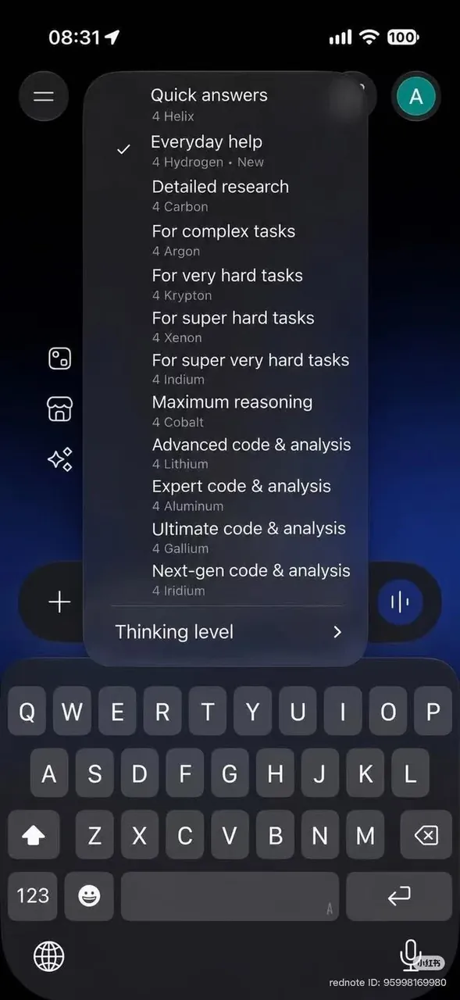
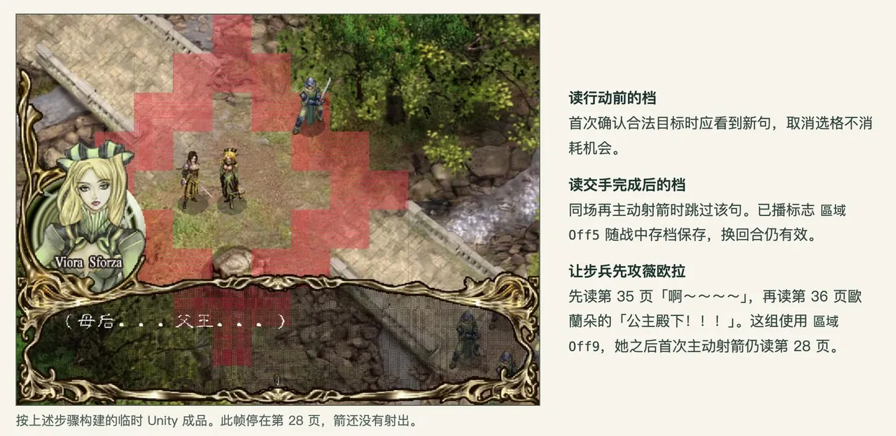

今天最值得读的有三件事。第一，美国商务部 BIS 发布临时最终规则，把经第三国数据中心远程使用先进芯片的路子也纳入管制；同一天群里流传一个数字：8 卡 B300 服务器在国内灰市报价 2000 万人民币，是美国售价的五倍。第二，有人问 Claude 和 Codex 到底差多少，群里分成两派：一派说大部分工作早已「智能溢出」，另一派说 Astra 还常犯错、品味一般。第三，同一段 40Hz 音乐 prompt 分别交给 Claude 和 Astra，Claude 写出的曲子「还算顺耳」，Astra 那份被评价为「像我 4 岁时的演奏水平」。

## 算力与管制

### BIS 新规：经第三国数据中心远程访问先进芯片，也要受管制

美国商务部工业与安全局（BIS）11 月 16 日发布一项临时最终规则（IFR），针对「先进超级智能（SI）芯片和服务器」的远程访问。规则由财政部和国家安全委员会撰写，目的是不让现行出口限制被「涉及第三国数据中心的远程计算安排」规避，使远程访问的管制和实物出口的管制保持一致。11 月 14 日 SemiAnalysis 那篇文章里提到的 RASA 还卡在参议院（见 [「SemiAnalysis：真正的原因是 GPU 走私，客户买的是「Jensen put」」]({{ '/daily/2026/11/14/daily/#semianalysis真正的原因是-gpu-走私客户买的是jensen-put' | relative_url }})），这次是商务部直接出了规则。

群里的第一反应是「以后没有跳板可以用了？」，也有人问 Azure 这类云是不是也不行了。@细心的熊猫 的判断是：商务部这类动作一般从支付和交易那头掐，盯的是大单，跟着钱走就能查到，「跟咱们老百姓没关系」。

### B300 灰市：一台 8 卡 2000 万人民币，一批 128 台起

@活泼的羊驼 转来一段没有出处的文字：受出口管制影响，8 卡 B300 服务器在国内灰色市场报价高达 2000 万人民币（约 280 万美元），不少大型国企在求购；同样一台在美国公开售价约 55 万美元，单台价差超过 200 万美元。文章的结论是，利润这么大，「根本不需要专门培养间谍」。

群友补充了交易的规模：

- **起订量**：@开朗的企鹅 说一组就得买 16 或 32 台，@温暖的熊猫 说一批一般是 128 或 256 台，而且要靠抢。
- **门槛**：@开朗的企鹅 说看货之前要先验资。
- **差价还在涨**：@稳重的海豚 猜现在的差价比之前又翻了两三倍，@开朗的企鹅 表示认同，但两人都没给出数据。@稳重的海豚 的感慨是「买卖两三组，这一辈子钱都赚出来了，怪不得得搞」。

### Anthropic 为什么最不爱用英伟达：贵，还是长约的门槛

@活泼的羊驼 贴了一张小红书笔记的截图。笔记称，在 Anthropic 用的四大算力平台（TPU、Trainium、AMD GPU、英伟达 GPU）里，英伟达的位置最边缘；OpenAI 以 GPU 为主，但因为 AMD 给了认股权证，会更倾向用 AMD，同时也在部署自研 ASIC。笔记还提到 Vera Rubin 延期，调整后的 Q4 营收预计为 1253 亿美元，华尔街共识是 1248 亿。

他追问为什么会这样，几种解释如下：

- **贵，买不到**：@睿智的犀牛 的回答只有这五个字。
- **AMD 推理便宜得多**：@冷静的白鹭 提到美国公司 Wafer AI，它专做 AMD 卡上的推理优化并对外提供 LLM API。他们测算，AMD 卡的推理成本是 B300 的三分之一。
- **长约门槛**：@活泼的羊驼 让 AI 给出的解释是「因果反了」。开源厂商毛利薄，只能租现货、不背长约，图的正是英伟达卡流动性好、能转手、能随时加量；只有闭源大厂签得起长约，比如 5 年 1252 亿美元的 TPU 租赁、2 吉瓦 AMD、5 吉瓦 Trainium。ASIC 是大玩家的游戏，不是穷人的省钱方案。他自己的总结是：ASIC 看着便宜，但得签更大的单，还要投入大量软件研发；对已经用 AI 加速软件工程的 Anthropic 来说，这部分反倒轻松。

## 英伟达换帅之后

### 董事会：不考虑让黄仁勋回归；周二发财报

接昨天的 [「英伟达：签名 15.7 万，预测市场给「回归」20%」]({{ '/daily/2026/11/15/daily/#英伟达签名-157-万预测市场给回归20' | relative_url }})。据 CNBC 引述匿名知情人士（[中文编译](https://mp.weixin.qq.com/s?__biz=MzkzMjQzNTQ1MA==&mid=2247643156&idx=1&sn=223dc104b2732685ea4716e948256138&chksm=c3c13c0f65f3d81cc7fbf2a9eb0a64f34e266a25c65f59b7275d76ee5f45d7c4c613701b55da#rd)），董事会目前专注于对黄仁勋的调查，没有讨论让他回归。英伟达称正在挑选猎头公司，还没有正式接触任何候选人。Q3 财报定在周二（11 月 17 日），由临时 CEO Kress 独自面对分析师。

各方表态：

- **支持回归**：请愿签名接近 18 万，昨天是 15.7 万。特朗普表示对他回归持开放态度。但 Altimeter 的 Brad Gerstner 周一对 CNBC 说，黄仁勋并没有和他讨论过复出。
- **反对**：财政部长贝森特称英伟达应从外部找下一任 CEO，并质疑公司是否为了收入和利润推动「看似非法的销售」。斯卡拉穆奇说「FBI 不接受请愿书」，认为这和 2023 年 Altman 的情况不同：Altman 那次是内部治理纠纷，这次涉及对个人行为的持续调查。
- **「以退为进」说**：@稳重的海豚 转来公众号「非人类主体」的一篇[推测稿](https://mp.weixin.qq.com/s?__biz=MzU4MTIxMjIyNQ==&mid=2247611555&idx=1&sn=a16d8b46d88be020962ad752802f2934&chksm=fc6902e2b2b7887b4c1304864202014cd7f5bf1486f77f9df8acc412b1ebdaff04fbfe278f88#rd)。文章援引《连线》称，危机公关顾问 Risa Heller 的公司至少从 2025 年 10 月起就在幕后为黄仁勋服务。作者据此推断，辞职是把商业和治理上的质疑「降维」成私德问题，作者自己也承认这只是推测。

群里关于董事会的一句：@沉稳的鸵鸟 说「背刺凯撒的人当然不可能轻易投降，凯撒真回来，每个 board member 都会被清洗」。@睿智的犀牛 接了一句：「凯撒应该是支持线上会议第一人。凯撒：我 remote。」

周一美股科技板块普跌。@蓝色大肥虞 贴的热力图：英伟达 −4.12%，美光 −7.62%，英特尔 −7.02%，AMD −5.58%，博通 −3.92%，谷歌 −4.07%，甲骨文 −4.99%，戴尔 −6.96%，泛林 −6.68%。@稳重的海豚 的看法是「泡沫爆一下挤一挤反而更好，泡沫不爆手上这些钱都部署不出去」。

### 舆论翻旧账：WSJ 写「皇室家族」，CNN 牛腩是假的

@开朗的企鹅 先贴了一则「CNN 突发」截图：黄仁勋的「帝国式控制」延伸到了食堂，他曾要求员工品尝新上的牛腩，「没人觉得自己能拒绝」。他判断这是假新闻，「但是太好笑了」，同类的还有一条马斯克转发的「黄仁勋呼吸的节奏令人不安」。@热情的大象：「有这好事我天天吃。」

下午他又转来 WSJ 一篇真报道（[中文编译](http://mp.weixin.qq.com/s?__biz=MzkzNjc1OTM2NA==&mid=2247525597&idx=1&sn=d95b140a1b2c3bb32cebbefe86535e2f&chksm=c3b8f3eb2f0e9a9f7167a5e5a9ac86579a61c4b5f9d0d53a11f968526c8de32cfb14885995b9&xtrack=1#rd)），评价是「真新闻还不如牛腩」。报道的要点：

- 女儿 Madison 2020 年以暑期实习生身份入职，现在实际担任幕僚长，是高管团队「The Band」成员；女婿今年 1 月升任副总裁，负责云服务商关系和对客户的财务担保。
- 有员工称训斥越来越频繁，一位高管形容为「开膛破肚」。
- 黄仁勋近年开会有保安陪同，禁止员工在小会上录音。

另一个角度：@蓝色大肥虞 转述英伟达员工朋友的说法，老黄特别不喜欢开除人，所以员工觉得有他在很安全。@活泼的羊驼 说传记里也是这么写的。@谨慎的灰熊 总结：「骂得最狠，下手最轻。」

还有一张 TechFlow 的图，「美国四家芯片巨头都由华人掌舵」，被人用红叉划掉黄仁勋、绿叉划掉陈立武。@豁达的灰熊 的评价是「这什么斩杀名单」。

## Claude 账号

### 常驻深圳的日本博主也被封：「人在中国就 unqualified，然后算闭包」

一位常驻深圳、给日本客户做中国机器人和 Physical AI 产业调研的日本博主发推说，自己的 Claude 账号也被暂停了，希望 APEC 峰会讨论这个问题。推文有 2.1 万次查看。他收到的邮件写的是：自动系统检测到违反「支持国家政策」的迹象，经团队核实后撤销访问权限，可以登录 claude.ai 申诉。这和 11 月 14 日 [「Claude 地区政策的「三道闸」：看人、看公司、看股权」]({{ '/daily/2026/11/14/daily/#claude-地区政策的三道闸看人看公司看股权' | relative_url }}) 里「看人」的那一条对得上。

@蓝色大肥虞 把规则推到底：

> 人在中国就 unqualified，unqualified 的人的钱 unqualified，拿 unqualified 的钱的人 unqualified，然后算闭包。

有群友看到这张图，自认好几次忘了开 VPN，「活该我 KYC」。另一个讽刺网站 fuckdario.pages.dev 上，总点击 700,083 次，日本以 354,854 次独占一半，美国 70,278 次，中国 65,189 次。@博学的飞鼠 的猜测是：「用日本 IP 的中国人吗？」

到了晚上，@活泼的羊驼 感叹「中国人用 Claude 被两头堵」。@随和的企鹅 说他从年初就不用了，@蓝色大肥虞 说「用脚投票」。@热情的大象 也说「用脚投票」，后半句是：「Claude 真好用啊。」

### 防封：VPS 转发、改客户端、虚拟机，各有顾虑

@热情的大象 认为防封不难：号开好以后，请求全走 VPS 转发，网上有很多开源方案。他不建议用 VPN，要么在路由器上做透明代理，要么像他一样改客户端：Claude Code 本质是 Node.js，加一张根证书做中间人，就能转发代理。前几天群里传的 Claude-Cage，他觉得「不太好」，没有展开理由。

反对意见集中在检测上：

- **环境检测和隐写**：@坦荡的灰熊 最担心这两样。@机智的河马 的 Claude 一直跑在虚拟机里，他的理由是「它又没说虚拟机运行就违反使用政策」。@坦荡的灰熊 说它能直接看出你在虚拟机里，@开朗的企鹅 补充：不一定违反政策，但它会自己做判断。
- **攻方优势太大**：@坦荡的灰熊 的结论是，装了 Claude 又开放了系统权限，检测方的优势太大。@蓝色大肥虞 还是那个观点：伪装得再好，一看做的项目都是服务中国用户的，「一看就是中国公司的外国分公司员工」。

@坦荡的灰熊 的反制思路是往 GitHub 上各种仓库里塞满中文，让 Claude 分不清。接着他问「Linux 内核为什么不用易语言重写」，@蓝色大肥虞 回了个缩写：RIIE。

## 模型体感

### Claude 和 Codex 差多少：有人说智能早溢出了，有人说 Astra 还常犯错

@神秘的企鹅 问 Claude 和 Codex 差别真有那么大吗，他感觉现在大部分工作都有点智能溢出。群里分成两派。一派同意，@务实的长颈鹿 说这话至少说了三个月，从 Astra 和 Mythos 发布那一波起就明显溢出了。另一派觉得差距大、也不够用。@蓝色大肥虞 给的分界是：能不能自己定义什么是「好」。

- **说差距大的**：@沉稳的兔子 说「非常大」，@热情的大象 认为开发效率还是 Claude 更高。@坦荡的灰熊 描述 Claude 的特点是对齐得非常快，两三轮迭代就能和整个仓库的历史 context 对齐得八九不离十，能提出很老练的问题，听得懂很深的黑话。它考虑问题的范围大，所以改动时能落在很精确的小范围上，前提是你愿意先和它深度讨论一会儿。相比之下，Astra 是「我就靠智商硬上」。
- **说还不够的**：@随和的企鹅 认为 Astra 这一级也经常犯错，尤其是视觉相关的活，品味也一般；GPT 系的准确度还可以，但推测需求、找合理解法这块欠缺。做视觉需要高频迭代，不开 ultrafast 又非常烦。
- **说 Codex 好用的**：@优雅的海龟 拿 Codex 当主力已经几个月，日常任务用 6.1 Sol high，审核和设计方案用 Astra，而且没有 5 小时限额，不像 Claude 动不动就要等重置。@蓝色大肥虞 说没有 5 小时限额正是他最喜欢 Codex 的地方。他给 Astra 派大任务前会先和它对齐一轮，它改 plan 时不会漏东西，「就算半掉头也可以」。@直率的海豚 说公司同事也都觉得 Codex 挺好。

@蓝色大肥虞 的判断是：依赖模型幻觉工作的人，会觉得 Claude 用起来更爽；能直接定义什么是「好」的人，用 Astra 更好。他还说「AI 做价值判断效果不怎么样，自己来」。@沉稳的兔子 补了一句：「价值判断被平均了。」

### Gemini 写作「跪着读」，Hydrogen 的甜区在 medium

@今天群内信息量极大 说 Gemini Argon 和 Carbon 写作「经常给我跪着读的感觉」，比其他模型有代差优势。@机智的河马 也觉得几家模型里 Gemini 的表达最接近人话。@直率的海豚 说它除了有点霸总倾向，已经很棒；@开朗的企鹅 觉得还是有点谄媚。@睿智的犀牛 的保留意见在价格上：每月给谷歌付 100 块，总觉得不值。

工程任务上，@低调的北极熊 的体感是 Hydrogen 效率很高：每个 token 的性能高于 Sonnet 和 Opus，正确率只高于 Sonnet，「所以 Sonnet 可能下岗了」，甜区在 medium。@活泼的羊驼 转了一个用 Hydrogen 写的纯代码页面（[鹈鹕六千年的车](https://wwh5441.github.io/pelican-6000-pure-code/)），几位群友看完都是「卧槽」。

### 40Hz 音乐 prompt：Claude 版「还算顺耳」，Astra 版「像 4 岁的演奏水平」

@开朗的企鹅 分享了一份生成 40Hz 音乐的 prompt。背景是有研究认为 40Hz 的声音刺激能激活 gamma 脑波，可能对阿尔茨海默病患者有益，他说听着很伪科学，但确实发了 Nature 正刊。他用 Astra 试过，效果一般，于是请额度宽裕的人用 Claude 跑一下。

- **Claude**：@谨慎的灰熊 跑出一首 mp3，自评「还算顺耳，算不算好不知道」，@开朗的企鹅 听完说「确实很不错」。
- **Astra**：@蓝色大肥虞 在 ChatGPT 里调 Astra，跑了好一会儿，结果是「一坨屎，像我 4 岁时候的演奏水平」。

@蓝色大肥虞 认为纯手搓不稳定，应该发明一种文本格式的五线谱语言，后面的管线全部交给软件，AI 只负责编曲。@认真的喜鹊 的问题是：「这么说应该去拉 double bass？」

### 「真 AI 用户」：DeepSeek 限的是谁

@开朗的企鹅 贴了一条 8.9 万次查看的推文。你以为被 DeepSeek 限制的用户是「3 天前写了一半的代码，现在没法继续写了」；实际被限制的是「几百个聊天框，每条几千轮对话，横跨两年的擦边文爱，养了 18 个赛博老公……在 ABO 世界生了 6 胎」。@淡定的老虎 接着贴了 DeepSeek 在应用商店的页面：3.1 分，不推荐 2 万条、推荐 1 万条，置顶的一星差评写着「我可以告诉你你现在就靠同人女活，写文功能不完善还限制重新生成次数你无敌了」。

@直率的海豚 自认是「真 AI 用户」：没有 agent，只聊天，订阅额度很难用完，上下文缓存命中率高，「妥妥优质客户」，「编程狂魔只会使劲压榨 reset，我们这些真 AI 用户只会：艾玛大文豪太感动了我要打钱」。他这周用了 25%。对照组：

- @蓝色大肥虞（「假 AI 用户」）：周额度 0%，离重置还有 3 天 5 小时；最长单个任务 12 小时 45 分，连续使用 34 天。
- @沉稳的仓鼠：30 天 1674 亿 token、81.3 万次请求、缓存命中 97%，按 API 价折算是 49,152 美元。他的说法是「托 subscription 得福，用的越多赚的越多」。

顺带聊到 4o 的死忠用户。@蓝色大肥虞 说当年 GitHub Copilot 还有 coding plan 时，他在 #keep4o 的帖子下挨个留言说用 Copilot 就有 4o，没人理他。@倔强的穿山甲 当年自己搭 agent 框架，觉得 4o「用得昏头昏脑」，3.5 Sonnet 稳准狠。@随和的老虎 的回应是：4o 的死忠用户也不在意 agent。

## 动手与长文

### 《阿玛迪斯战记》复刻：能玩到第五章，200 HP 撤退线也和原版对上了

接昨天的 [「《阿玛迪斯战记》重写进 Unity：第一章两条线能通关，难点在动画和音频」]({{ '/daily/2026/11/15/daily/#阿玛迪斯战记重写进-unity第一章两条线能通关难点在动画和音频' | relative_url }})。@稳重的海豚 的 Unity 复刻已经能玩到第五章战后营地，存档会记下第六章的入口。他还让 Astra 整理出一张全游戏关卡设计图：序幕到第四章罗格、薇欧拉双线并列，第五到九章共用主线，第十章起再分线。他自己的提醒是「全剧透」。

细节核对到了数值级别：

- **撤退线**：第五章两条线共用康奎恩城外的战场，仍保留各自的队员和对白。用 Windows 原程序核过，夏夫特受击后剩 201 HP 会继续战斗，刚好 200 HP 就撤退。
- **第四章两种过法**：罗格可以清敌，也可以等第 19 回合东侧出口开放后逐人撤离；薇欧拉只要击倒敌方幼龙，幼龙会随队进入第五章。
- **跨章物品**：罗格第四章拿到的家书能一直带到第五章的战后存档。原版要等第六章战后去康奎恩东区「民家 4」交信，再登门一次才能拿到「誠實法珠」。
- **台词触发**：每一句对白何时播、播过之后是否跳过，都按原版的标志位还原。

### Feedback Is All You Need：模型能力以内，决定表现的是反馈

@天真的鸵鸟 转来一篇[文章](https://mp.weixin.qq.com/s?__biz=MzA5OTAzMzk2Ng==&mid=2649515767&idx=1&sn=7ebe19f8ca491bf11ed62cb63bb5a5c2&chksm=893e98b3c42e8aa9bcf8291fd627e5e7749d9b8879601c5926ea45bef4ad12a45587b4719664#rd)。核心论点是：任务复杂度在模型能稳定处理的上限以内时，多轮有效反馈能大幅改善结果，模型本身不用换；超过上限，多给反馈也没用，模型可能看不懂反馈，甚至越改越固执。作者自称这是没有数据的不严谨思考，正文由 AI 辅助生成。

对 agent 设计有用的两点：

- **迭代有三种结局**：有效收敛；错误收敛，即不断为原判断找理由，越迭代越牢固；循环振荡，YES 和 NO 来回切换。迭代次数本身不代表进步，要看每一轮是否真的减少了误差。
- **生成器和评估器别用同一个**：同一个模型既生成又评判，偏差是一样的，第一次漏掉的证据第二次还会漏。反馈是应用系统的责任，不是模型的。

@开朗的企鹅 的补充是「Feedback + Context 可能更好」：既要拿到反馈，也要理解反馈。

### 直播打赏是怎么做大的：20 个直播间的数据

群里贴出一篇[直播观察](https://yage.ai/live-streaming-1.html)，作者用 AI 抓取了 B 站 20 个歌势直播间的数据。他的结论是唱歌本身不稀缺，纯靠打赏小费到百元就封顶，流水是平台规则撬出来的。两个数字：

- **15 元心动盲盒**：3,766 次开箱，平均面值 14.68 元，但收益全靠约 750 发才出一座的 2,233 元「浪漫城堡」。去掉这 5 座，均值降到 11.73 元；花 1,500 元抽 100 发的人里，76.9% 亏钱。
- **PK**：计票时间只占总时长的 8.9%，却贡献 67.1% 的礼物流水；一轮 5 分钟里有 1 分钟双倍计分，整场 PK 六成以上的打赏集中在这 1 分钟。

### 零碎

- **另一张月榜**：@睿智的北极熊 贴了一张 2026 年 11 月的推理月榜（没有给出处），中位分 GPT-6 Astra (xhigh) 86.35 居首，Opus 5.5 74.65，Gemini 4 Argon 69.13，GPT-6.1 Sol 67.79。新上榜的 Qwen4-Max (xhigh) 53.03 排第 13，平均耗时 1208 秒，单次测试成本 57.04 元。他的评价是「搞了个寂寞」。
- **Astra 推进太快，CI 先撑不住了**：@蓝色大肥虞 的 UI 框架项目被 Astra 推过了一个门槛，CI 把他 16 GB 内存的笔记本打爆，疯狂 page fault，原本 3 小时的任务拖到 5.5 小时。他还让 Astra 做了个小游戏，把光速设成跑步速度的 115%，渲染相对论扭曲，结果 UI 里满是「Astra 绿」。
- **「你去翻翻，这是在支使我」**：@聪明的剑鱼 转来一张截图，用户让 Claude「去 GitHub 翻翻」，Claude 回：「要我去查东西，该怎么开口，你今晚已经学过三回了。重发。发对了我去翻，翻得比你想的细。」@飘逸的猎豹：「真的假的，这么变态吗。」
- **Organic Architecture**：@冷静的飞鼠 推荐 AI Engineer Code Summit 上 Lauren Tan 的演讲 [All Code Is Slop (Except Mine)](https://youtu.be/O_zcc6Xl12g?si=PzL1_Xsp8-fSMQWG)，主题是让 agent 写的代码围绕一个人写的骨架「生长」。他觉得群里早有人提过类似理念，只是传播不够广。
- **周一 deploy**：@温暖的斑马 的银行账号登不上去，「又是哪个大聪明在礼拜一做了 deployment」。@80-HD：「周一做是正确的。」
- **孙军登录了我的电脑**：@睿智的犀牛 转了一条帖子，有人看到终端显示「Last login: Sun Jun 22」，以为一个叫孙军、年龄 22 岁的人入侵了自己的电脑。
- **光标发虚**：@认真的喜鹊 问 Windows 光标怎么这么糊。@蓝色大肥虞 说默认不是这样，现在屏幕分辨率高了，需要提供尺寸更大的 .cur 文件。
- **AI 做 Live2D**：@豁达的灰熊 问现在 AI 做 Live2D 皮套是不是很便宜了，前几年精细皮的定制能到五位数。@淡定的老虎 说见过直接把单张图转成 Live2D 皮套的工具。
- **BOSS 直聘**：@活泼的火烈鸟 发现它在 App Store 排到了第 11 名。
