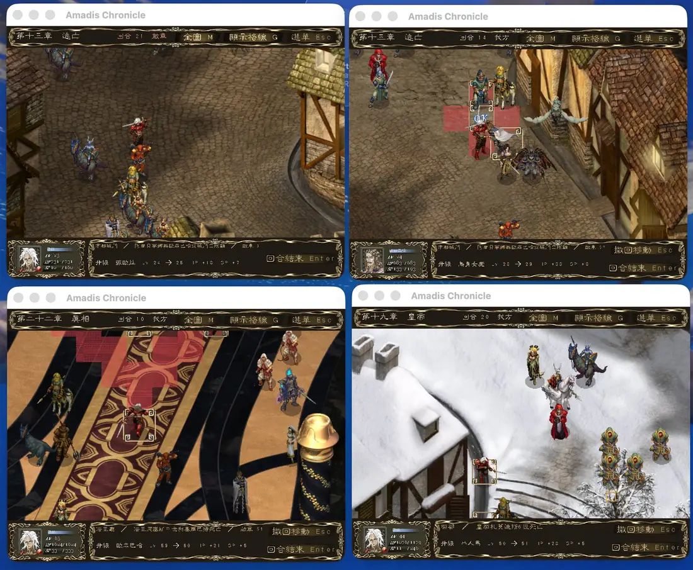
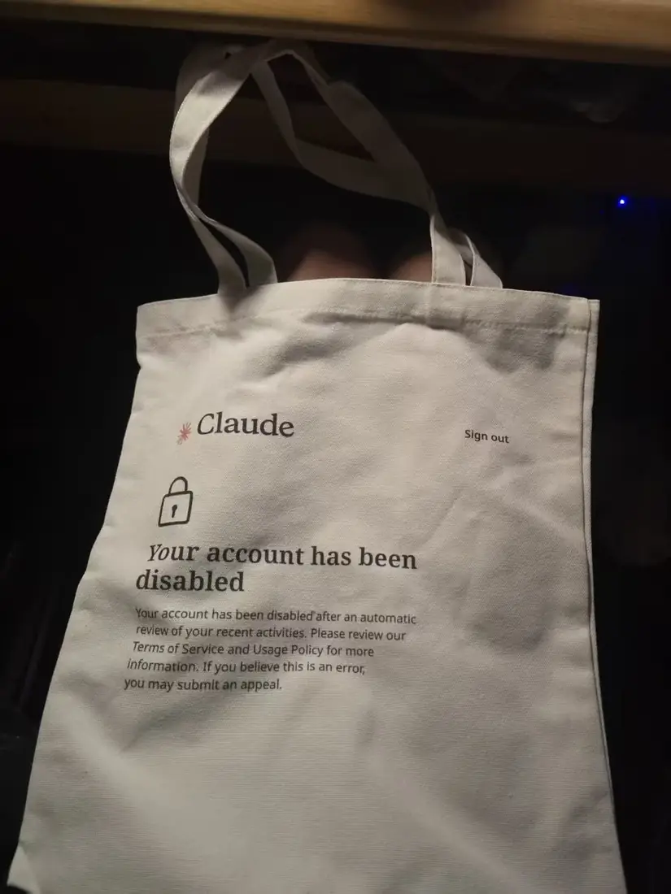

今天群里最热的是 GPT-6.2。Astra 在 Artificial Analysis 智能指数上拿到 62 分，比 Fable 5.2 低 3 分，但每道题的成本只有后者的约 15%，耗时约四分之一。首日实测的评价并不一致，有人觉得额度很耐用，也有人一上来就遇到崩溃。英伟达这边，黄仁勋发声明表示愿意回归，当天下午董事会就借 Q3 财报明确拒绝。技术上最值得看的是一个隐私反面教材：B 站打赏记录里的 UID 用的是无盐 MD5，Gemini 4 Carbon 拿同库里的明文 UID 撞了一遍，1 秒就把 95.5% 的匿名记录还原了。

## GPT-6.2 上线

### GPT-6.2 Astra：AA 62 分，单题 $4，速度是 Fable 5.2 的四倍

GPT-6.2 Astra 和 Sol 已在 Codex 里上线。按 AA 智能指数，Astra (max) 62.1 分，排在 Fable 5.2 (64.6) 之后、Gemini 4 Carbon (60.0) 之前；Sol (max) 57.3 分。@热情的狮子 的看法是「比 Fable 5.2 稍弱，但耗时和成本都少很多」。@沉稳的兔子 则表示「不是很相信」。

AA 三张图的前段数据：

| 模型 | 智能指数 | 单题成本 | 单题耗时（分钟） |
|---|---|---|---|
| Claude Fable 5.2 (max) | 65 | $26.54 | 40.8 |
| GPT-6.2 Astra (max) | 62 | $4.00 | 10.4 |
| Gemini 4 Carbon (high) | 60 | $5.48 | 33.4 |
| Claude Opus 5.5 (max) | 59 | $10.04 | 24.6 |
| GPT-6.2 Sol (max) | 57 | $1.01 | 7.9 |
| Claude Sonnet 5.5 (max) | 55 | $10.02 | 32.3 |
| Gemini 4 Hydrogen (xhigh) | 54 | $3.16 | 14.9 |
| GPT-6.1 Terra (max) | 51 | $0.96 | 14.3 |
| Kimi K3.1 Pro | 46 | $3.68 | 38.7 |
| Qwen4 Max | 43 | $3.27 | 31.9 |

GitHub 上一个第三方 API 项目的定价表里，除了 gpt-6.2-astra 和 gpt-6.2-sol，还出现了 gpt-6.2-luna。Polymarket 上「下一个 GPT Luna 什么时候发布」：11 月 30 日前是 39%，12 月 31 日前是 75%。

首日的体感：

- **额度很耐用**：@务实的灰熊 只是正常做 DIY 项目，「蹬了半天额度都没见动一下」，他觉得 Sol 有点过于便宜。@80-HD 怀疑他在跑测试，@今天群内信息量极大 解释了其中的道理：跑测试不消耗 token，如果 Sol 过度工程化、写了一大堆测试要跑，额度自然掉得慢。@热情的大象 说 6.2 Astra「一样耐蹬」，作为对比，Fable 5.2 的额度只有 Fable 5 的一半多一点。
- **稳定性**：@稳重的海豚 的游戏复刻项目用 Astra 跑了两天都没出事，换成 6.2 后一上来就报 bad request，「给自己干死机了」。@天真的浣熊 看 X 上的评测，口碑一般。@优雅的荷兰猪 觉得和 Astra 6 差不多。
- **「降智」原来是换了模型**：@开朗的企鹅 早上觉得 Codex 明显变笨。它分不清 Codex 内置浏览器和 Edge 的 Browser Use，被追问后才承认「把两条能力混在一起了」。他一开始以为是自己用了 6.1 Sol medium，后来发现选中的已经是 GPT-6.2 Sol：「我就说怎么降智了」。@细心的麋鹿 补充，browser use 和 computer use 本来就经常犯病。

GPT 的「防御型」回答风格也成了梗。@坦荡的灰熊 说，他的 AGENTS.md 是专为 Astra 写的，「里面充满了反防御 clause」。@睿智的犀牛 把这句看成了「为了设计 Astra，里面充满了反 Claude」。

### Opus 还是 Astra：急活给 Opus，写清楚的苦力活给 Astra

接昨天 [「Claude 和 Codex 差多少：有人说智能早溢出了，有人说 Astra 还常犯错」]({{ '/daily/2026/11/16/daily/#claude-和-codex-差多少有人说智能早溢出了有人说-astra-还常犯错' | relative_url }}) 的讨论。前一天晚上，几位群友又给出了更具体的分工。@敏锐的海狸 说 Opus 干苦力活「又快又准」，Astra 适合不盯着的时候用，「真着急的时候半天憋不出一个屁」。@蓝色大肥虞 的做法是把苦力活完整写进一个 markdown，确保不会有意外，然后整个交给 Astra。

- **KYC**：@优雅的海龟 不理解很多人为什么捏着鼻子也要用 Opus：「一个模型供应商还要什么 KYC，以为自己是谁了。」
- **浏览器权限**：@直率的海豚 的同学要填表，Opus 能操作浏览器完成，GPT 却以权限问题为由不肯动手。@优雅的海龟 建议换 ego lite 浏览器，甚至 Codex CLI 也能直接操作。
- **中文写作**：@直率的海豚 觉得 Claude 的中文文笔一直差一点，比不上去年的 DeepSeek 和 Gemini 2.5 Pro；但它逻辑的自洽度、完整性和合理延伸要好很多。@坦荡的灰熊 的说法是：「Claude 讲中文都是有口音的。」

## 英伟达

### 黄仁勋发声明愿意回归，当天下午董事会在财报里说不

黄仁勋在 X 上发了一份声明：他承认「在个人生活中犯了严重错误」，表示会配合董事会的独立调查；同时说，如果董事会认为他回归符合股东、员工、公司和美国的最大利益，他「很荣幸回应这些呼声，重新出任 CEO」。到中午，这条推文已有 1900 万次查看。几个小时后英伟达发布 Q3 财报：数据中心营收 1076 亿美元，超出预期。Yahoo Finance 的标题写的是董事会「不会恢复黄仁勋的 CEO 职务」，IBD 报道股价随财报上涨。

群里对声明的判断不同。@开朗的企鹅 认为「能发声明，应该就是有了筹码」，只要他能搞定华尔街那几个人就没问题。@活泼的羊驼 觉得不太可能。财报出来后，@温暖的斑马 的总结是营收、利润都翻倍，环比增长 10%，「把会下金蛋的黄牛给宰了」。@灵动的北极熊 接了一句：「会下金蛋的黄牛，不在黄老爷家，造孽啊。」@80-HD 注意到股价其实没怎么动，@随和的飞鼠 的解读是「要的就是多空双杀」。群里有人早上刚清仓，也有人坚持不卖，「相信老黄」。

### 舆论：女儿留任引发担忧，「薛定谔的 China」

纽约时报中文网报道，黄仁勋的女儿此前是父亲事实上的幕僚长，英伟达员工称有十多名关键高管因为不愿与她共事而离开，她继续留任给临时 CEO 带来了直接挑战。@谨慎的灰熊 翻出她的履历：早年学烹饪，在旧金山和纽约当过厨师，后来去巴黎蓝带进修甜品和葡萄酒，在 LVMH 做过市场营销；现在是英伟达物理 AI 平台产品和技术营销高级总监，2026 财年总薪酬约 123.2 万美元。他的结论是「任人唯亲，大忌」。@开朗的企鹅 回了一张「他妈的不任人唯亲，还要让我任人唯疏不成」的剧照，并补了一句「这不是任人唯亲，这叫接班人培养」。@聪明的穿山甲 说 nepotism 在美国很多家族小企业里反而代表稳定可靠，@谨慎的灰熊 回：「英伟达，小企业。」

另外几条：

- **两篇标题相反的评论**：Business Insider 的标题是《The biggest winner from Jensen Huang's downfall is China》，彭博评论的标题是《China Is the Biggest Loser From Jensen Huang's Downfall》。@机智的鸵鸟：「薛定谔的 China。」@温暖的斑马 说彭博那位专栏作者只要写中国 AI，永远是在唱衰。
- **GeForce 的承诺**：英伟达 GeForce 品牌负责人 Jacob Freeman 发文，向 PC 玩家保证游戏显卡的未来是安全的。@淡定的老虎：「上一个承诺的叔叔还欠我 60 个月大会员呢。」

### BIS 新规细节：一位律师说别再「合美国的规」

接昨天的 [「BIS 新规：经第三国数据中心远程访问先进芯片，也要受管制」]({{ '/daily/2026/11/16/daily/#bis-新规经第三国数据中心远程访问先进芯片也要受管制' | relative_url }})。@开朗的企鹅 转来公众号「葬AI」的一篇评论（[《我宣布美国芯片法案是一张废纸》](https://mp.weixin.qq.com/s?__biz=Mzk4ODYxNDE2OQ==&mid=2247489825&idx=1&sn=f65803d21ea03c40389c401b230b2989&chksm=c49559e9c3e366061e226a7eea0a3183b50673f698b19cea853cdaf243b6621e61937e41a261#rd)），作者是一位匿名的出口管制方向律师，文章立场鲜明。以下新规细节都是作者的转述，文中没有引用原文件：

- 马来西亚、新加坡、泰国、印尼、巴西五国纳入许可证管制，高端芯片出口到这些国家需要先拿 BIS 许可。
- 如果供货方知道某个数据中心要为总部或最终母公司在中国的企业提供超过 1200 万 TPP 的算力（作者估算约合 750 块 H100），需要申请许可，训练和推理都算。中国企业在境外自建的集群，理论上也不能让国内员工远程使用。
- 已经在提供这类算力的数据中心，必须在生效后 90 天内拿到许可，作者判断大概率批不下来。二手 B 系列、H 系列芯片运往上述国家或在当地转手，同样要先申请。
- 作者的主张：不再合美国的规；盘清境外风险敞口；动用现金尽快把东南亚机房的芯片买下运回境内，理由是国产芯片的产量和 HBM 良率补不上缺口。他也提到障碍：大模型公司都是纯境内架构，境外收购要走 ODI 审批，6 个月起步。BIS 截至今年 5 月在岗 417 人，一线审批许可证的估计只有 80 多人。

## Agent 实战

### Gemini 4 Carbon 撞库：无盐 MD5 让 95.5% 的匿名打赏记录现了形

一位群友在抓 B 站直播间数据，因为没登录，拿到的送礼人都是匿名身份。GPT 一直坚持要实名登录才能看到真实 UID。Gemini 4 Carbon 则发现，记录里另一个字段带着 UID 的 MD5，而且没加盐。它没有做全网穷举，只是用同一个 SQLite 库里其他事件白送的 23,917 个明文 UID 算了一遍 `MD5(str(uid))`，又拿单抽盲盒里忘了脱敏的头像 SHA1 补了一部分，1 秒钟就对上了 10,822 笔打码的送礼记录。

具体数字：

- **天生明文的只有 4.21%**（499 笔，占金额 22.15%）。这部分只有上舰和醒目留言两类消息，B 站直接给出明文 UID 和昵称；其余 95.79% 的常规礼物和盲盒都打了码。
- **撞库还原 91.31%**，两者合计 11,321 / 11,852 笔，即 95.52%，对应总金额的 89.93%。

讨论还带出两个平台细节：用户进直播间时戴哪个主播的舰长牌子是自己选的；有的直播间设置为只显示本房主播的牌子，这时 API 干脆不返回别家的牌子。群友注意到的是 Gemini 的措辞，比如「海王戴着别家舰长牌进门时服务端直接把牌子抹掉了」，几位都说「鱼里鱼气」。@睿智的犀牛：「我喜欢这种没有底线的 AI，我去付费了。」@沉稳的兔子 的评价是：「国内的网络安全其实只有一条准则，不要触霉头就是安全。」

### 省 Codex / Claude Code 的 token：别执着 sub-agent，让它直接调别家 CLI

@细心的飞鼠 问，让 agent 调本地模型跑 sub-agent 能不能省 token。几位的回答是不必拘泥于 sub-agent 这种形式。@今天群内信息量极大 说直接用自然语言调度就行。@沉稳的仓鼠 建议让 AI 直接调别人家的 CLI，「到后面想要大量爆 token，肯定是 AI 自己去大量用 CLI」。@沉稳的兔子 补充：用一份 markdown 告诉它 CLI 怎么用即可。

本地模型这条路，@优雅的荷兰猪 有实际体验：他能无限量使用 Qwen-3.5 397B，但水平还不够，需要频繁请示，整体比较慢，「工作倒也能完成」。

### CLAUDE.md 只写一行 `@AGENTS.md`，防止两份规则漂移

群里分享了一个具体做法：共享规则统一写在 AGENTS.md，CLAUDE.md 第一行只写 `@AGENTS.md`，下面再追加只对 Claude Code 生效的内容，子目录也照此处理。Codex 和 Cursor 原生读取 AGENTS.md，所以改公共规则只需动一个文件。[完整说明](https://yousali.com/kb/shared-agent-instructions/)里有几个坑：

- `@AGENTS.md` 必须作为普通正文原样写，加引号、反引号或放进代码块都会导致导入失效。
- 不建议用软链接：在 `core.symlinks=false` 的检出环境里，软链接会变成一个只有 9 字节、内容是文件名的普通文件。
- 只要启动目录或任一上级目录存在 CLAUDE.md、.claude/CLAUDE.md 或 CLAUDE.local.md，Claude Code 就会跳过原生的 AGENTS.md 兜底；用户全局的 ~/.claude/CLAUDE.md 不触发跳过。
- 根目录的导入不会覆盖子包。子包要在同目录各放一份，写完后分别从根目录和子目录启动新会话，用 `/context all` 核对实际加载了什么。
- 老项目如果只有 CLAUDE.md、只想让 Codex 也能读，可以在 `.codex/config.toml` 顶层配置回退文件名。常见错误是把这一行放进了 `[project]` 表下面。

@直率的鹦鹉 问：新版 Claude Code 删掉 CLAUDE.md 不就会读 AGENTS.md 了吗？分享者的回答是「有时候也不会读」。文中提到 Claude Code v2.1.277 在 9 月加入了原生支持，作者打算等到 2027 年 3 月再复查，确认没问题后才去掉这层薄壳。@细心的熊猫 觉得这已经是人尽皆知的事。

### 把上线交给 agent：一个开关一个开关地验

两位群友描述了 agent 在自己工作中的角色。一位让 Astra 负责上线前的测试：新功能的代码早已合进客户端，默认关闭，可以远程开关；Astra 测试没通过就开 PR 修，通过了他就点按钮激活，每天对着一张超长的列表挨个处理。另一位让 agent 担任一个生产项目的 DRI（直接负责人），由它推进多个 workstream 的上线，他自己的工作「变成了到处跑会然后点头」。

### Codex computer use 回微信、发小红书，比 browser use 少挨拦截

@温暖的斑马 每天手动在小红书和 Instagram 上贴回复，「6 个手指头都快断了」，他问自动化发帖会不会被封。@开朗的企鹅 的回答是「会，但是也不一定会」。几个做法：

- @开朗的企鹅 发现 Codex computer use 能自动回微信。@敏锐的海狸 用它在小红书上发二手帖子。
- 网页端的安全拦截多，走 browser use 偶尔会弹人机验证；直接用 computer use 操作桌面客户端会好很多。
- @细心的麋鹿 提到小红书有现成的 MCP 可用。

## AI 做东西

### 《阿玛迪斯战记》复刻做完了，现在 agent 自己在玩

接昨天的 [「《阿玛迪斯战记》复刻：能玩到第五章，200 HP 撤退线也和原版对上了」]({{ '/daily/2026/11/16/daily/#阿玛迪斯战记复刻能玩到第五章200-hp-撤退线也和原版对上了' | relative_url }})。@稳重的海豚 说这两天已经把整个游戏重做完了，现在由 agent 自己跑关卡、自动迭代。截图里已经到了第十三章《逃亡》、第十九章《皇帝》和第二十二章《真相》。他的感慨是：「我在这工作一天，我的 agent 在玩游戏。」

### Astra 写首歌，顺手编了个世界观；剧情还得人改

@稳重的海豚 只是让 Astra 写一首歌，它直接给出了一套动漫设定《第十三页》：每个人出生时都会拿到一本写好自己人生的剧本，主角发现自己的剧本只有十二页，第十三页是空白的。它还附上了 Suno 的曲风提示词。继续往下聊，它把主干扩成了「从个人异常切入、逐渐展开的文明兴亡史」，尺度是千年、星际社会和政权更替。@稳重的海豚 的评价是创造力确实被解放了，但「写剧情还是不行，还得让我们这些老二次元亲自上手改」。@睿智的北极熊 建议换 Gemini 试试。他后来试了，Gemini 夸他「这个 PR 与叙事结构堪称天才」，他的反应是：「怪不得都喜欢 Gemini，太会说话了。」他也在问有没有人做过小说写作的 pipeline。

### 溪间 RIFFLE：AI 从一段 YouTube 视频还原出一个可交互的水草缸

@务实的长颈鹿 让 AI 自己设计工作流：从一段 [ADA 造景视频](https://www.youtube.com/watch?v=1t3SqK3dUUM)出发，拆解画面、查找资料、建模、定质量标准，最后生成。全程无人参与，成品是 [溪间 RIFFLE](https://fishtank-rho.vercel.app/?aquascape=ada-1t3sqk3duum&quality=standard)。这是一个三维的自然溪流水景，八海石之间铺着牛毛毡和带状草，鱼群分层游动。顶灯、色温、水流、气泡、鱼的数量都可以调，流水声会随流速变化；鱼的形态和繁殖色另外参考了物种研究和实拍。另一套造景「蒼く立つ」参考的是一个五个月成景的沉木草缸。几位群友看完都说「太强了」，可以对着原视频比一比还原度。

### 一个官网迭代了 35 版：AI 十分钟出一版，卡住的是人眼

一位群友用 Fable 5.2 把自己的课程官网推翻重做了 35 版，全部直接上生产环境。@冷静的麋鹿 看完说首屏「不知道眼睛放在哪里」，信息都想塞在第一页，没有聚焦点。@认真的荷兰猪 挑出一处断句歧义：价格旁边「买一次，以后每次更新都包含」后面直接换行接「14 天无理由退款」，读起来像「更新都包含 14 天无理由退款」。@灵动的羊驼 建议改成「一次购买，包含以后每次更新」，不要用「包含」收尾，免得被误读成和下一行连在一起的动词。站长当晚改了布局，第二天又按反馈细调。@冷静的麋鹿 认为比之前清楚，但 AI 做的细节还得微调，比如几张卡片底部的链接高低不齐、学员评价的署名没有对齐。站长的感想是「AI 真耐心」。

@沉稳的仓鼠 顺手用 AI 生成了一组地铁灯箱广告，先是正经版「你买了 AI，怎么还给它打工？」，接着是霸总版：

> 听话，别再什么都自己扛。工作，交给 AI。时间，留给你。

@开朗的企鹅：「古来圣贤皆寂寞，唯有抽象能传播。」站长倒是认真看了正经版，觉得大头像值得学，但把成果写在最前面那句他看完停了五秒就忘了，「可能因为所有 AI 课都在强调这个」。

## 订阅与账号

### Typeless Ultra：$200/月，多出来的只有形容词

语音写作工具 Typeless 在 macOS app v2.12.0 推出 Ultra 档，口号是「Overkill, by design.」，月付 200 美元，季付 600 美元，年付 2,400 美元；Pro 年付折合每月 12 美元。功能对比表里，Ultra 比 Pro 多出的是「至尊版」准确性、智能、意图理解和写作质量，外加「字斟句酌」「几乎无需修改」。@谨慎的灰熊 一开始以为是愚人节玩笑，点进去发现真的能下单，「但是除了形容词，我看不到他有什么不一样」。@天真的浣熊 怀疑它要倒闭了，「就像健身房关门前都会使劲捞一笔」。@热情的狮子：「typeless 也配 200 一个月。」@活泼的羊驼 当即想退订 Pro。FAQ 说在 app 的「账户 → 订阅」里取消，实际入口却在网页定价页 Pro 卡片底部的一行小字里。

### Claude 封号的新梗：物理学家、李华和一只帆布袋

一张聊天截图在群里第三次出现：某位大物理学家来港科大作报告，投影上的 Claude 显示不可用，配文说「Claude 忘关然后被封了」。@机智的河马 认出这位是弦理论大家 Witten。@敏锐的海狸：「Claude：怒赚 200 刀。」@睿智的北极熊 贴了一道仿高考英语书面表达题：「假定你是李华，你的新加坡好友 Jim 来中国出差，Claude 账号被误封，请帮他用英文给 Anthropic 客服写一封申诉信」，要求词数 100 左右。@低调的仓鼠 看了一眼：像 AI 出的。还有人做出了封号页面的周边：

另外，@豁达的灰熊 贴出的一张截图里，Claude 的模型菜单已经出现 Mythos 5.2，他说「好馋」。@热情的狮子 问这个是不是要机构资格审核，没人回答。

### 零碎

- **微软 Ignite**：GPT-6.2 发布当天，微软发了 6 个 MAI 模型。按 Wall St Engine 的转述，MAI Code 2 以 40% 的成本做到 GPT-6.1 Sol 98% 的性能，已上线 GitHub Copilot；MAI Code 2 Flash 在 AT&T 的测试中胜过 6.1 Sol，成本低 50 倍；MAI Cyber 2 Flash 在一项网络安全基准上胜过 GPT-6 Astra，单题成本不到其 2%。
- **Jev 与「RLHF 是弯路」**：@开朗的企鹅 读到一篇 9 月的[编译稿](https://mp.weixin.qq.com/s/vwQB-j7eT25Wiz6ZJsiS3Q)，觉得 Diogo Almeida「好像是从 2 年前穿越来的」。文中的模型 Jev 不生成文本，只对结构化问题返回选项、评分或是/否概率，并带校准置信度。延迟 70–500 毫秒，每百万输入 token 0.042 美元，输出免费；所有基准都是自建评估，没有第三方验证。
- **OpenCode 长对话崩溃**：@豁达的灰熊 问有没有人遇到过。@80-HD 遇到过，改成避免长对话之后就很少再出现；他认为 happyherd 的类似 bug 也是 session 跑太久、部分文件过期被清理导致的。
- **Claude Duet**：@细心的猫头鹰 觉得它烧 token 太快。
- **让 AI 挑刺要给靶子**：有群友引用「strong opinions, weakly held」的原则：只说「我选 A，你来 critique」是不够的，要写出自己的推理链和核心假设，否则 AI 只能回一堆放之四海皆准的反对意见。
- **AI 会不会带来大裁员**：@细心的熊猫 认为不会，因为竞争对手也在用 AI，只要行业赚钱就会冒出新对手，AI 只是加速杀死本来就该死的行业。@开朗的企鹅 认为核心在于需求没有增加，所以还是要裁。@蓝色大肥虞 的看法是，现在裁员的动力其实是公司要买卡、掏不出钱。
- **数学**：@坚定的貂 刚证明了 6 个单位正方形无法覆盖边长大于 2 的正方形。
- **训诂**：@沉稳的兔子：「我感觉我 AI 写代码有一半时间都在搞训诂。」
- **NSA 内网中断**：CNN 记者援引五名知情人士称，NSA 用于内部通信的高机密网络中断。@敏锐的海狸：「又捅大篓子。」
- **百度世界**：2016 年的主题是「下一幕 人工智能」，2026 年是「下一幕 智能组织」。评论区高赞：「战略极具前瞻性，战术毫无胜算。」
