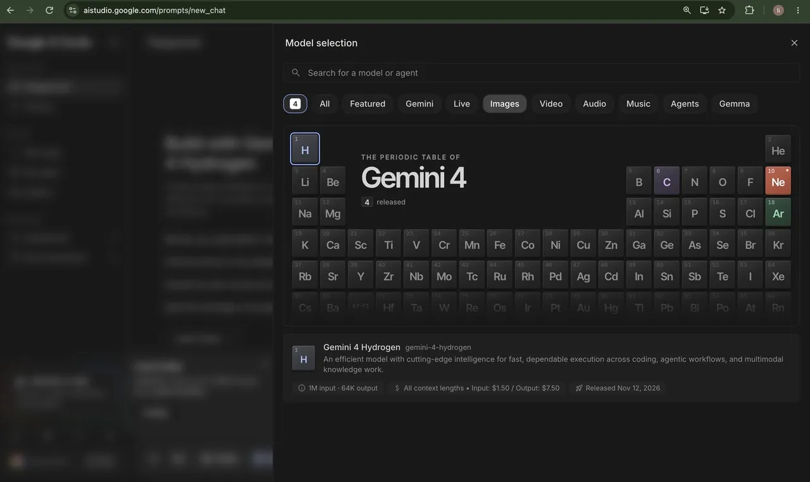
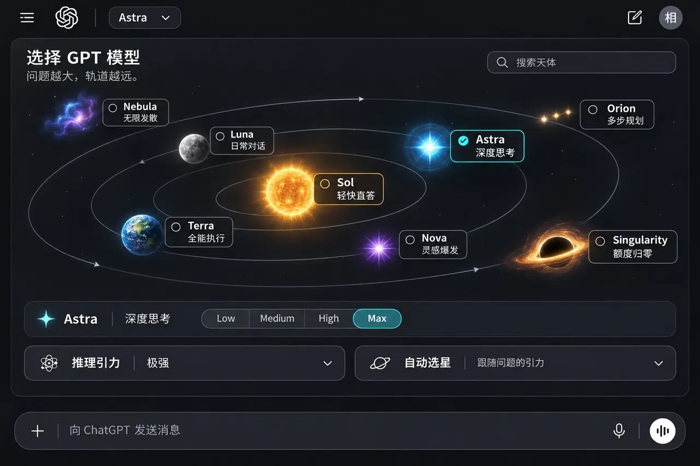
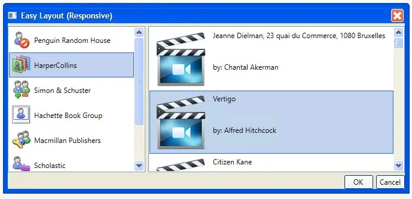
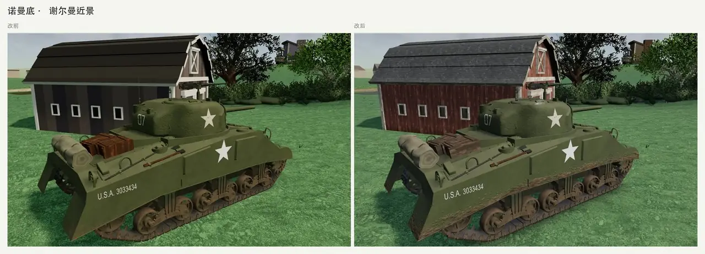
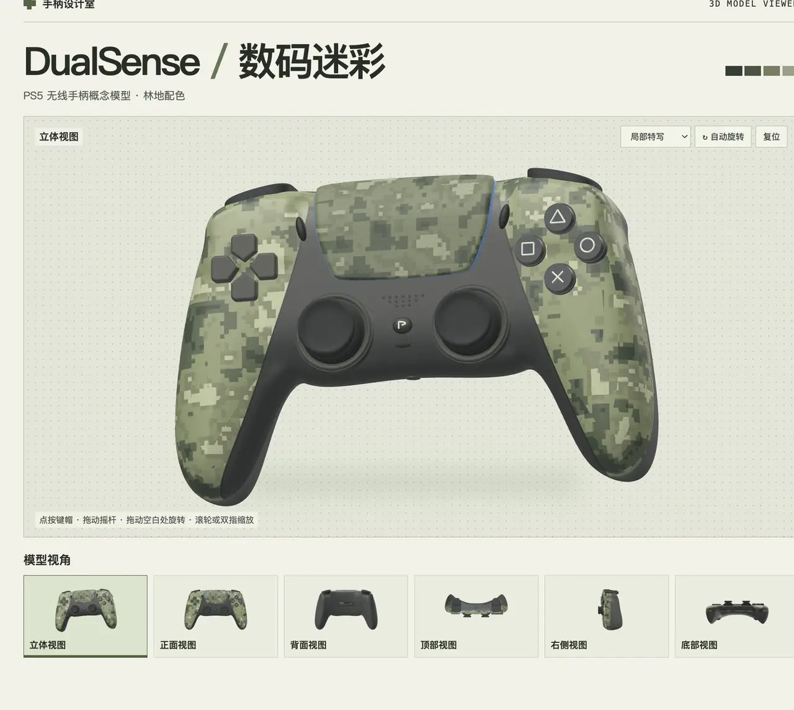
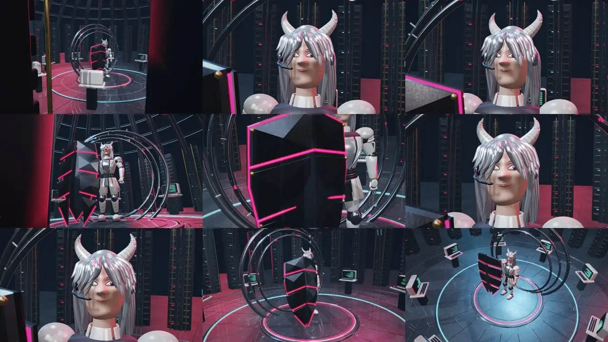

今天谷歌发布了 Gemini 4 Neon。它的 API 价格是 Hydrogen 的两倍，官方称在 AA 智能指数上排第 3，可 Antigravity 里的说明写着它是「最新的 Flash」，群里为这套元素周期表命名吐槽了一晚上。GPT-6.2 上线第二天，外面的 KOL 几乎一边倒地差评，群里的实测要温和得多：额度更耐用，做游戏和 3D 有进步，还有群友说 Astra 6.2 帮他解决了一个开放问题。另一张值得看的图表：给 20 个模型一段冷门细菌蛋白的开头，让它们续写下一个氨基酸，只有最新的 Claude 明显高于随机。

## Gemini 4 Neon

### Neon 上线：价格是 Hydrogen 的两倍，定位在 Hydrogen 和 Carbon 之间

Gemini 4 Neon 已在 Antigravity 所有付费计划上线，API 价格为每百万 token 输入 3 美元、输出 15 美元，输出速度约 110 tok/s。几位用过的群友体感一致：比 Hydrogen 聪明，比 Carbon 快，但多数情况下还不如 Carbon。

官方推文的说法是：「cheaper, faster, and better behaved than Carbon」，在多数基准上胜过 Opus 5.5 和 Sol 6.2，AA 排第 3，结尾一句「Please try before GTA 6」。群里贴出的三档对比：

| | Hydrogen | Neon | Carbon |
|---|---|---|---|
| 输入（每百万 token） | $1.50 | $3.00 | $2.00（11 月 30 日前）→ $4.00 |
| 输出（每百万 token） | $7.50 | $15.00 | $10.00 → $20.00 |
| 免费 API 档 | 有 | 无 | 无 |
| 输出速度 | ~198 tok/s | ~110 tok/s | ~57–76 tok/s |
| 平均任务耗时 | ~13 分钟 | ~21 分钟（xhigh） | ~27–37 分钟（high） |

基准对比节选（谷歌方面的数据，不是群友实测）：

| 基准 | Neon | Carbon | Opus 5.5 | Astra 6.2 | Fable 5.2 | Sol 6.2 |
|---|---|---|---|---|---|---|
| AA 智能指数 | 61 | 60 | 59 | 62 | 65 | 57 |
| AA Coding Agent Index | 58.6 | 55.5 | 58.2 | 53.5 | 58.5 | 49.8 |
| CursorBench 4.1 | 65.4% | 61.5% | 58.1% | — | 61.3% | — |
| Terminal-Bench 4.1 | 65.2% | 64.5% | 65.8% | 62.1% | 65.8% | 61.5% |
| FrontierCode 2.0 | 46.2% | 42.6% | 47.3% | 44.2% | 50.2% | 43.8% |
| Agents' Last Exam v1.1 | 75.8% | 77.4% | 71.6% | 78.3% | 72.8% | 73.0% |
| HLE-Diamond | 71.3% | 69.1% | 67.9% | 72.2% | 80.2% | 64.0% |

凌晨还流传过另一张同类对比表，里面 Neon 的 AA 指数是 67、Terminal-Bench 4.1 是 71.4%，这和官方说的「AA 第 3」对不上。上表采用后来那一版，和推文一致。

[AI Studio 文档](https://aistudio.google.com/docs/models/gemini-4-neon)给出的规格：上下文 1M token；默认最大输出 65,536，开启 long decode 后最高 1M；输入支持文本、图片、视频、音频和 PDF，输出只有文本；thinking 分 low、medium、high、xhigh 四档；只支持隐式缓存；不支持图像生成和 Live API。

群友的体感：

- **定位**：@机智的水獭 说 Neon「比 H 聪明，比 C 快」。Carbon 好用但太慢，急着要结果时他就换 Hydrogen 或 Neon。@飘逸的浣熊 的判断是 Neon 有 Flash 的大小和速度、接近 Pro 的成本，应该是加了推理时计算。
- **Hydrogen 仍有拥趸**：@低调的北极熊 说「Hydrogen 真的 yyds」，medium 档很好用。@优雅的荷兰猪 觉得它能和 Sonnet 相比，速度还更快。至于 Hydrogen 和 Neon 谁更快，@低调的北极熊 认为要看任务，难任务上 Hydrogen 反而可能更慢。
- **Argon 的位置**：@今天群内信息量极大 认为 Argon 已经被架空，价格是 Hydrogen 的 6 倍，智能还更低，现在实际只剩 Hydrogen、Neon、Carbon 三档。@飘逸的浣熊 认为 Argon 是被 Carbon 取代的。@直率的海豚 注意到 app 里撤掉的是 Argon，但 Antigravity 的模型菜单里它还在，另外多了 Orchestrator（Neon / Carbon / Argon）。
- **踩坑**：@沉稳的仓鼠 在 Antigravity CLI 里试 Neon xhigh，直接报 `INVALID_ARGUMENT (code 400): Thinking level is unsupported: THINKING_LEVEL_XHIGH`。

另外，@活泼的羊驼 贴了一位 Google DeepMind 后训练研究员的推文：「Many people are surprised by how fast RSI moves. You'll be surprised by how far it can go too, very soon.」@豁达的考拉 的反应是「谷歌终于回来了，以后不担心封号了」。

### 元素周期表命名：10 号元素 Neon，是「新的 Flash」

Antigravity 里 Neon 的说明写的是「Google's latest Flash model」，可大家原本以为 Hydrogen 才对应 Flash，按原子序数 Neon 也该排在 Carbon 后面。群里基本都在吐槽这套命名，也有人替谷歌说话：现在的模型已经很难按大中小分档了。

- **看名字猜不出档位**：@冷静的麋鹿 看到 Neon 还以为是比 Carbon 更强的模型这么快就出来了，点开才发现是 Flash，「直接叫 Gemini 4.1 Flash 不香吗」。OpenAI 至少让人知道 Luna 就是 Flash。@勇敢的犀牛 列了一遍原子序数：H 是 1，C 是 6，Ne 是 10，Ar 是 18，照这个顺序 Neon 应该比 Carbon 大杯，「彻底乱套」。
- **替谷歌说话的**：@机智的水獭 认为，现在的模型除了大小还要看有没有 loop，很难说哪个就是 Flash、哪个就是 Pro。不管叫什么都有人反对，这种会能开一年，「不如乱叫简单点」，最后大家都会按首字母叫「H 哥」「C 哥」。@敏锐的海狸 转述了一位 DeepMind 朋友的说法：命名是 Sergey 拍板的，改不了；而且 model size 和 capability 已经开始脱节，Flash、Pro、Ultra 的分法没什么意义。
- **接梗**：@80-HD 说「就叫大中小不行吗」，@乐观的灰熊 回：「先生，我们这里没有大中小，只有超大、大、中。」@开朗的企鹅 问为什么都是惰性气体，@温暖的斑马 答：「因为高冷不起反应。」

@机智的河马 照这个思路给两家各画了一个选择器。Gemini 版做成整张元素周期表，铀是「核级推理」，钚是「宇宙任务」。GPT 版是下面这张，最受欢迎的是黑洞「Singularity · 额度归零」：

## GPT-6.2 第二天

### 外面一边倒差评，群里的实测温和得多

GPT-6.2 发布后（首日情况见昨天的 [「GPT-6.2 Astra：AA 62 分，单题 $4，速度是 Fable 5.2 的四倍」]({{ '/daily/2026/11/17/daily/#gpt-62-astraaa-62-分单题-4速度是-fable-52-的四倍' | relative_url }})），外部评价普遍很差，认为编程没进步、防御性更重。群里用了一两天的几位则觉得 6.2 Astra 更省额度、更抗造，做游戏明显好了，只是智能本身的提升感觉不明显。

外部的声音：

- 极客公园的稿子汇总了几位 KOL 的评价：Matt Shumer 在上线 8 分钟后说「基本不可用，不推荐」；Theo Browne 写了长文《我为什么讨厌 GPT-6.2 Astra》；Ethan Mollick 评价「非常不稳定且古怪」，称这是「自 GPT-4.5 以来 OpenAI 前沿发布首次未见明显进步」。同一篇稿子提到，Astra 的 API 单价降了 20%。
- 公众号「探索AGI」的[《很难相信，这就是GPT 6.2》](https://mp.weixin.qq.com/s/_-Dx8j4Ez0_14fQJRI6NVg)引用 AA 编程 agent 指数：6.2 Astra 与上一代持平，6.2 Sol 比 6.1 Sol 低 3 分，进步只体现在前端审美和 3D 建模上。作者的两个主要槽点：一是汇报文字冗长，他称为「文字克苏鲁」，目前的解法是在 Codex 里接一个 Gemini subagent 做「中译中」；二是即使开了完全访问，任务中途也常停下来要授权，不适合睡前挂长任务。@蓝色大肥虞 看了文中的截图，觉得「感觉还好啊」。

群里的实测：

- **测的版本不一样**：@随和的企鹅 觉得没有 X 上说的那么差。KOL 测的是 EA 版，持续迭代的模型几天之内就可能差很多；之前 K3.1 Pro 的 EA 版一开始也没到 Astra 的水平，最后一天才追上。「行不行还是得自己在真实任务上体验一下。」
- **额度**：@冷静的麋鹿 说智能提升感受不明显，但做游戏好多了，也抗造，消耗速度体感是 6 Astra 的一半左右。@优雅的荷兰猪 有同感：之前要不是一周发两次 reset，他都想退订，觉得 200 美元不值，现在「经得起用了」。
- **overthinking**：@专注的火烈鸟 认为 overthinking 优化了很多。他的依据是自建的测试集，外加对生成结果做人工 SBS 盲选。
- **Sol 6.2**：@务实的长颈鹿、@洒脱的兔子、@开朗的企鹅 都觉得好用。@洒脱的兔子 补充，开 fast 模式很爽，就是费额度。
- **数学**：@坚定的貂 只关心最强模型。他说 Astra 6.2 已经帮他解决了一个开放问题：给定一个有向图，删除最少的边，使图恰好有 3 个强连通分量，这个问题存在多项式时间算法。证明细节他没有贴出来。
- **one shot 复刻 XP 皮肤**：@蓝色大肥虞 一觉醒来，Astra 已经给他的 UI 框架做好了一套 Windows XP 皮肤，连滚动条和标题栏按钮都很还原。他还注意到，整个过程没有弹窗提示侵犯知识产权。

- **踩坑**：@务实的长颈鹿 在一个云端项目里用 6.2，卡住之后就一直报「audio input is not available」。原因是之前在云电脑里做过录屏，还往对话里返回过一段合成水声，切到 Sol 6.2 后，客户端可能把历史音频一并发了出去。绕过的办法是新建一个纯文本对话，关联同一个 GitHub 仓库再接着做。

### 3D：坦克和手柄看得过去，二次元人脸还得靠 Tripo

@谨慎的灰熊 认为 6.2 除了 3D 有进步，其他方面感觉不出来，并贴了用它改的谢尔曼坦克和 DualSense 手柄模型。@开朗的企鹅 让它建人物，结果人脸很难看。

@淡定的老虎 的评价是「达到 2000 年的游戏水平了」。手柄模型的细节更多：握把背面有 ○×△□ 的纹理，摇杆顶部也有细微的颗粒纹。

人物这边就差得远了：

@谨慎的灰熊 的看法是这个问题问错了：如果它真能做人脸，宣传里早就大声说了，这类东西用 diffusion 模型做更合适。@开朗的企鹅 随后贴了一个能跑通的流程，用 Tripo P2 加 GPT-6 Astra 加 Blender，不到半天做完一个能跳舞的低多边形角色：

1. 在 Tripo P2 里分别生成头部、头发和身体，分开生成细节更清楚。
2. 让 Astra 在 Blender 里把各部分组装起来，微调眼周，基本不用重新拓扑。
3. 表情变体也用 Tripo 生成。Astra 搭了一个切换装置，没用到的表情网格缩进头部内部，所以表情是离散切换的，不是平滑过渡。
4. 骨骼绑定和辅助运动交给 Astra。

@蓝色大肥虞 解释了二次元 3D 人脸难在哪里：它没有一个稳定的三视图，五官需要随镜头方向重新排列。

### 「需要明确指出的是」：群友替 Astra 写免责声明

6.2 的防御式措辞和「甩锅」写法成了今天的梗。昨天那张「全点防御力」的封面之后，群友干脆亲自模仿。@冷静的北极熊 先写了一段：

> GPT6.2 在防御性写作方面有所减缓。但需要明确指出的是，这一表述仅基于特定时间节点下有限样本的主观交互体感，这不能代表 GPT6.2 在所有提示词结构、采样温度、系统指令及跨语种环境中均呈现出一致的输出倾向。

@今天群内信息量极大 回了句「笑死我了」，@沉稳的仓鼠 接着写：

> 此外，用户所描述的「笑死我了」应被理解为一种具有高度夸张性质的非字面化情绪表达，而非实际生理死亡事件的客观陈述。因此，现阶段仍不宜据此推断 GPT-6.2 的输出已具备直接威胁用户生命安全的能力。

@80-HD 贴了一段真实输出，说这是典型的「甩锅」写法：「昨晚那批 41 张通知卡片已清掉……但总览仍有 13 条事项记录，现有功能无法单独收起，需要补代码才能彻底清空；它们不代表你有 13 件待办。」@直率的鹦鹉 收尾：「你说得对，但这并不表明 Astra 在所有条件下都甩锅，更不能作为 Astra 甩锅的证据。」

## Agent 工作流

### personal agent 的 memory：私人信息能不能让 agent 自己判断

@豁达的灰熊 提的问题是：同一段微信聊天里混着工作信息和不宜外传的私人信息，存进 memory 时该拆到什么粒度。@稳重的海豚 主张交给 agent 判断，出错就改规则；@豁达的灰熊 和 @蓝色大肥虞 都不放心把这件事完全交给模型。

@豁达的灰熊 举的例子是：朋友告诉他一条和工作有关的信息，他自己的 memory 里自然记着这位朋友叫什么、在哪工作，可如果要发到工作群，就得模糊掉一层。按来源整体隔离，很多有用的工作信息就用不上；按内容拆，又要解决存的时候怎么区分、总结之后怎么保留这些区别。

- **交给 agent，出错就修**：@稳重的海豚 的规则里已经写明哪些信息要 redact，他的转录稿会自动把私事那一段替换成「某时间段：私事，略」。他的建议是把 agent 当成项目的 DRI，它出了问题，就去想怎么让它下次不出，「你不可能一直 handhold 这个玩意儿」，同时管十几二十个项目时根本顾不过来。缺少分寸感，就「喂他一些交流方法的书」。@开朗的企鹅 认为这是 skill 层面的事：出错之后，让它自己修改 skill 和 rules。
- **不信任模型的判断**：@豁达的灰熊 觉得 personal agent 还好说，到了 team agent、business agent，让 agent 自己管权限「还是不太行」。他更想要 CI/CD 那样的流水线，一路绿了就过，还要足够快。他也担心，自己打磨改错没问题，别人很难接受一套会犯错、需要人来改的东西。
- **能放手到什么程度**：@蓝色大肥虞 说，「古法 empire builder」之所以能放手，是因为下面有越来越多的人替他干高层次的活，而现在的上限明显受模型能力制约，「不是你想放手就可以放手的」。@沉稳的兔子 的版本更短：「人这个东西你可以选，可以喷，但是 AI 干不好就是干不好了。」

@稳重的海豚 还推荐了「Elephant Goldfish model」。@开朗的企鹅 拿这句话去问 Gemini，它连着两次回复「首先，您需要连接至 Workspace」。追问之后才给出解释：大象代表全局、长期的共享文档，金鱼代表只拿当前任务那一小块上下文的执行者，做完把结果写回共享文档，然后释放上下文。@稳重的海豚 自己的说法更直白：就是一份文档，让 manager 照着文档去开没有记忆的 worker，「其实就是 @蓝色大肥虞 一直在干的」。@低调的北极熊 认为，一个动态派发文件就是组织部门的雏形，一个文件对应一个事业部的规则，super agent 下面可以常驻若干 sub super agent 当事业部 lead；不过项目不够多的话，没必要加这一层。

### 「董秘」太勤快：主动提醒多到被忽略

@80-HD 在 OpenCode 里跑着一个叫「董秘」的个人 agent，现在的问题是打扰太多：一打开就有 20 多个等他验收的事项，加了推送通知之后，通知多到他已经学会忽略。

- 董秘干活都开新 session，此前遇到的 OpenCode 长对话崩溃，之后就没怎么再出现。他让它检查了好几次，它还是管他叫「主人」。
- 他在想把董秘做成 Facebook 那样的信息流，或者像 Google Doc 那样汇总。@开朗的企鹅 的思路是老板管下属的方式：压力传导给下属，让它主动磨合、主动反思。他自己另有一个 app，专门让 agent 给他打电话提醒。@80-HD 的顾虑是电话会不会一直响。@豁达的灰熊 的 Discord 也堆了一堆消息，「就不想看了」。
- Grok Bot：@80-HD 终于试了，觉得有种「老板拉个群你们讨论下」的感觉，bot 这层抽象挺像一个自由度更高的 skill。@沉稳的仓鼠 提醒这种搞法非常烧 token，「马斯克也烧不动，一直在减量」，「弱智感与日俱增」。@低调的北极熊 认为它的问题在于：能自己搭的人东西已经齐了，不能搭的人又不想付那么多钱。@风趣的海豚 用 Grok Bot 写过小说，「烧起来特别刺激」，但写得很烂。

### Claude Code 调 Gemini：Antigravity CLI 当 subagent，或者用 OAR

@活泼的羊驼 问怎么让 Claude Code 操控 Gemini。@机智的水獭 的做法是用自然语言把用法描述给 Claude，让它自己把「调用 Antigravity CLI 做 subagent」封装成一个 skill，主要用来做大范围的初步搜索和文字润色。

- **怎么搭配**：@机智的水獭 晚上让 Claude 带着 Gemini Carbon 跑，白天换成 Hydrogen；Fable 太贵，他用不起。@稳重的海豚 则是「Fable 带 H」，嫌 Carbon 太慢。
- **统一接口**：@优雅的仓鼠 推荐了 [OAR](https://github.com/botiverse/oar)（Open Agent Runtime）。它用同一套 TypeScript API 驱动 claude、codex、grok、pi 等运行时，换个名字就能切换。某个运行时做不到的选项，会在会话打开前直接拒绝，不会静默丢弃。每个事件都带 agentPath，标明来自哪个 subagent。命令行里的 `oar mcp` 可以把任务委派给其他运行时。
- **Antigravity 的短板**：@活泼的羊驼 给 Antigravity CLI 提了 [issue #1655](https://github.com/google-antigravity/antigravity-cli/issues/1655)。他在全局指令里要求 agent 按「[分类] 任务简述 | 日期」重命名会话，Claude Code 和 Codex 都提供了让 agent 改自己会话名的工具，Antigravity 没有，agent 读得到规则却做不到。
- **一个导入的坑**：接昨天的 `@AGENTS.md` 写法，@80-HD 补充，Claude Code 之前有个 bug：通过 `@` 导入的 AGENTS.md 里如果还有 `@` 引用，不会继续展开，导致总是漏读东西。

### Lauren Tan 演讲全文：一个月 3000 个 PR，靠 lint 而不是规则文档

11 月 16 日推荐过的那场《All Code Is Slop (Except Mine)》有了[完整转录](https://ai.engineer/talks/O_zcc6Xl12g-all-code-is-slop-except-mine#full-transcript)。核心方法是「倒置信任金字塔」：能靠 API 设计让错误根本写不出来，就不靠检查；做不到的交给 lint、类型检查和测试拦截；再往上是运行时验证和形式化验证；写成文字的规则和 skills 放在最后。

- **产量**：她一个月合入 3,000 个 PR，很多是在她睡觉时合的，适应这个节奏花了六个月。团队当月共上线 11,000 个 PR，回滚率稳定在 0.5% 左右。这个数字只统计回滚，后续用新 PR 修掉的 bug 不在内。
- **禁掉约 99% 的注释**：理由是注释会过时，人会跳过，也拦不住下一次改动，指导信息改为写进 lint 报错，agent 违规时当场就能看到。她把仓库比作花园：留下一个 workaround，下一个 agent 就会把它当成既有模式去复制。
- **验证很吃 token**：她转述另一位工程师的情况，六个月后每天 70% 的 token 花在验证上。她建议的顺序是先用 lint 阻止错误再犯，再清理旧的坏样例，最后才给 agent 验证手段。基础循环总在产出坏改动时，多开 agent 只会成倍增加修复成本。

@80-HD 看完觉得这些 @蓝色大肥虞 早就讲过。他让自己的 agent 翻群聊记录去比对，agent 的结论是：lint 案例是 @蓝色大肥虞 那套工程原则的直观落地，群里还讲到了规格、架构和验收边界；但 Lauren 原帖里还有 TLA+、确定性模拟和服务端重放，「暂时不足以说他比 Lauren 本人整体更深」。结论后面还附上了群聊消息的编号作为依据。

## 研究与行业

### 只给冷门细菌蛋白的开头，只有最新的 Claude 续得出下一个氨基酸

Xinming Tu 发推称「Claude was trained on protein sequences, at scale」。他们给 20 个语言模型一段很少被研究的细菌蛋白序列的开头，让模型预测下一个氨基酸，只有最新的 Claude 明显高于随机，GPT、Gemini 和七个开源模型都不行。

测试集是 668 个细菌和古菌蛋白，来自 167 个功能未知的 DUF 家族，并排除了相似度 ≥90% 的近亲。指标是真实序列与打乱序列的准确率之差（百分点）：

| 模型 | 提升 | 模型 | 提升 |
|---|---|---|---|
| Claude Fable 5.2 | +45.1 | GPT-6 Astra | +2.9 |
| Claude Opus 5.5 | +27.4 | GPT-6.1 Sol | +0.6 |
| Claude Fable 5.1 | +14.9 | Gemini 4 Carbon | +0.9 |
| Claude Opus 5 | +9.6 | DeepSeek V4.1 Flash | +1.4 |
| Claude Opus 4.6 | +0.9 | Kimi K3.1 Pro | +1.2 |

@开朗的海豚 猜测训练时可能是把从 DNA 推测出的编码序列翻译成蛋白后直接放进去的。其他人顺着往下接：@细心的熊猫 建议直接拿二进制训练，预测下一位是 0 还是 1；@机智的河马 建议试试预测 AES 密文的下一个块；@80-HD：「要不直接 predict 一下 BTC。」

### Anthropic 明天上市：招股书里的亏损是账面的，算力账单是真的

Anthropic 定于 11 月 19 日上市，发行价 83 美元，高于招股书区间的 70 到 78 美元，募资约 813 亿美元，是有记录以来规模最大的 IPO。群里贴出的一篇[招股书拆解](https://www.superlinear.academy/c/posts/anthropic-ipo-s1)认为，前九个月 1040 亿美元的净亏损基本是账面变动，9009 亿美元的算力合同才是真正的账单。

- **亏损**：1040 亿美元净亏损里，1046 亿来自估值上涨引起的账面变动，主要是亚马逊、谷歌持有的可转换票据，约定每股 2 到 5 美元转股，这一项记了 943 亿。
- **生意本身**：2024 年每收 1 块钱，成本接近 2 块；到 2026 年前九个月降到 1 毛 5，毛利率 85%。但四成多收入经云渠道卖出，渠道费没有计入成本，作者自己估算算上之后毛利率约 70%。
- **增长**：收入从 2024 年的 3.86 亿美元、2025 年的 46 亿，涨到 2026 年前九个月的 332 亿。季度环比增速从二季度的 144% 降到三季度的 47%，三季度又出现 5.7 亿美元的经营亏损，原因是临时买了 50 亿美元的短期算力。
- **账单**：算力合同共 9009 亿美元，未来 12 个月要付 707 亿，是过去一年全部收入的两倍。作者粗算，要撑住这笔账单，年收入得做到 2000 亿美元上下。
- **一个和群友相关的数字**：5% 到 7% 的收入来自违反使用政策的账号，公司正在清理。
- 对照 OpenAI：三季度 Anthropic 收入 170 亿美元，调整后经营利润 25 亿；《华尔街日报》看到的 OpenAI 内部数字是收入约 100 亿、调整后经营亏损约 109 亿，未经审计，口径也不同。

估值约 1.5 万亿美元、全面摊薄股数等是作者自己算的。「探索AGI」那篇文章的作者原以为 GPT-6.2 是来「狙击」上市的，结果是「随了个大份子」。

### Claude 风控：「没被封只是因为还没被封」

有群友问起一个号称防封的方案，@开朗的企鹅 贴了一条 B 站评论：「3 个号跑了 1 个月了，别的不知道，反正我没被封。」他的判断是这类方案只是 IP 干净、一直走远程，「没被封只是因为还没被封」。@80-HD 说，但凡它看一眼你的 session 就露馅了，现在只是「先收着钱，养肥了再封」。@热情的大象 的评价是「这个方案技术还是太垃圾了」。

另外几条：@机智的河马 贴出 Claude 先用中文作答、又道歉说「You wrote in English, so I should have answered in English」的截图，@80-HD 的配音是「你是中国人吗」。@蓝色大肥虞 转了有人用 Claude 做嘲讽 Claude 封号视频的推文，还有一条推文：「Anthropic 会惩罚每一个在中国比 Dario 多一个或者少一个睾丸的人。」

## 额度

### Antigravity 周额度被重置；Fable 重置卡只补 Fable 那一半

@活泼的羊驼 的 100 美元档 Antigravity 前一天基本烧完，今天一看周额度又满了。@淡定的海豚 也说几个小时前被完全重置。@活泼的海龟 的则没动，周额度还剩 75%。

- **Fable 重置卡**：@低调的北极熊 发现 Fable 的 reset 一次只重置半管。@蓝色大肥虞 和 @敏锐的麋鹿 的解释是 Fable 本来就只占额度的一半。@优雅的荷兰猪 说第一次用时自己踩了坑：Fable 那部分已经用了不少，结果补回来的很有限。
- **GPT**：@直率的长颈鹿 刚用掉最后一张重置卡。@开朗的企鹅 先说 OpenAI 现在只发重置卡、不再直接 reset，又改口「不一定」。
