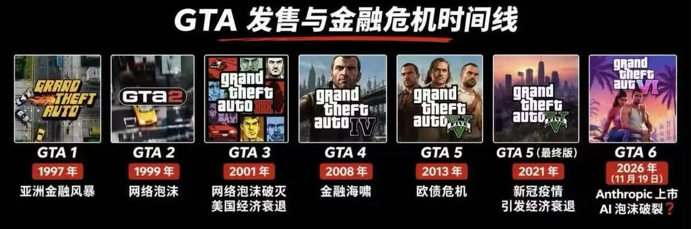
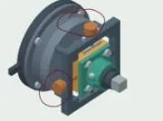
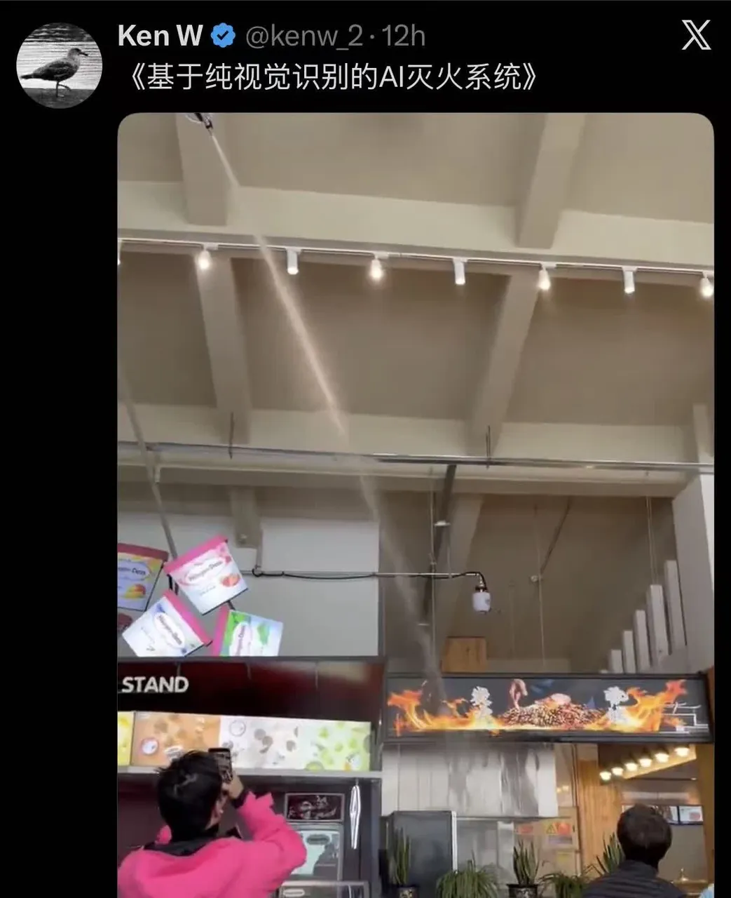

今天 Anthropic 上市。股价从 83 美元的发行价最高涨到 108.55，随后跌破 100。群里借这件事吵了一上午：Anthropic 到底有没有护城河？大公司为什么只能按 API 价给员工买 Claude，而不能报销订阅？同一天，Hunterbrook 一边发报告指控 AMD 向中国违规卖芯片，一边公开自己的空头头寸，AMD 半小时跌了 13%。技术上值得看的是一个 PHP 漏洞：把协议名写成大写的 `HTTPS://`，`file_get_contents` 就会跳过 TLS，令牌和 POST 正文都以明文发出。

## Anthropic 上市

### 首日：发行价 83 美元，涨到 108.55 后跌破 100

Anthropic 以 83 美元的发行价上市（招股书拆解见昨天的 [「Anthropic 明天上市：招股书里的亏损是账面的，算力账单是真的」]({{ '/daily/2026/11/18/daily/#anthropic-明天上市招股书里的亏损是账面的算力账单是真的' | relative_url }})）。群里贴出的行情截图显示一度报 108.55 美元，涨 30.78%，没过多久就跌破 100。

- **认购**：有群友在 Robinhood 上分到了发行价份额，截图上写着「你是第 186,761 位获配 ANT 的投资者」。还有人只分到 4 股。有人问 IPO 认购有没有解禁期，得到的回答是「30 天吧」，没有给出处。
- **dip**：股价开始回落时，@稳重的海豚 说「中午去买点蘸酱」。

敲钟照片也被拿来调侃。@热情的大象 说 Dario 和周围的人「笑起来好不自然」。@认真的喜鹊 说这些高管都不如 Claude 像人，@优雅的喜鹊 接了一句：「全公司最有人味的是模型吧。」@80-HD 的看法是 Anthropic 高层白人男性的比例高得惊人，按比例看「应该有点亚洲面孔，哪怕没华人也应该有点印度人」。

GTA 6 和 Anthropic 同一天上线，于是有了上面这张图。@蓝色大肥虞 的评价是「地球那么多国家，每年总有一个出事」。@豁达的灰熊 觉得 2021 年那格「有点硬凑」。

### 护城河在哪：迁移成本低、token 是大宗商品，还是关系网

上市当天，群里争论 Anthropic 有没有独占性门槛，几种看法差别很大。@开朗的企鹅 认为谷歌这波更新恰好证明了它没有门槛，因为用户的迁移成本很低。@80-HD 则认为它真正的壁垒是企业市场里的人脉。

- **产品太单一**：@淡定的海豚 看完一段视频，觉得 OpenAI 什么都想做，比如 B 端商家入驻，结果什么都没做好。@谨慎的灰熊 说这条路也许是对的：Anthropic 的营收和产品都太单一，「连生图模型都没有」。
- **没有门槛，看好谷歌**：@开朗的企鹅 认为 Anthropic 现在的估值赌的是 RSI，即「智能更强 → 组织更智能 → 智能永远更强」。他更看好谷歌，觉得谷歌只要跟得上，最后可能全拿，问题是 Antigravity「太烂了」。@细心的熊猫 补充，谷歌还握着分发渠道。
- **token 是大宗商品**：@冷静的白鹭 认为数据、模型、算力都没有独占性，「大宗商品啥价格，大家都心知肚明」。@稳重的海豚 的说法是产品需要入口，微软握着入口，OpenAI 和 Anthropic 都只能当供应商。他也认为该看的不是最顶尖的智能，而是智能和成本之间的效率前沿。@谨慎的灰熊 同意：「谁都可以达到那个八九十分，我们不需要每天都解那些世纪数学难题。」
- **销售和关系网**：@细心的熊猫 觉得 Anthropic 和第二梯队没有本质差别，而产品没有本质差别时，销售最重要。他还认为技术强、赚钱多、股价高三者之间没有必然联系。他自己押的是 SpaceX，理由是这本质上是算力问题，也就是能源问题。@80-HD 的解释是：Anthropic 专做企业市场，因为那是白人男性高管的关系网，「去个 enterprise software 的会，里面全是互相认识的老白男」。德勤这类咨询公司做出来的东西一团糟，照样卖得好。
- **反方**：@开朗的企鹅 转述了另一种观点：只有掌握最强的大模型，才能调教出最好的小模型。

### 订阅是引流，enterprise 才是肥肉：为什么大公司只能买 API

@热情的大象 问：真有公司按正价买 Anthropic 的 API 给员工写代码吗？@80-HD 说，规模大一点的公司都是这样，只拿到一点折扣，计费仍然按 API 来，OpenAI 也一样。订阅之所以进不了大公司，是因为合规。

- **为什么不能报销订阅**：@80-HD 解释，个人 plan 的数据可能被拿去训练，enterprise plan 是零数据保留（ZDR）。小公司可以买 team plan，大公司 Anthropic 就不卖了，只能走 API。员工报销后用自己的个人订阅，在用户公司那边不合规。@开朗的企鹅 认为这是厂商有意设计的，订阅条款故意过不了企业合规，好给采购部门一个买 API 的理由：「难道 ZDR 是什么非常昂贵的事情么？」
- **结果**：某群友说自己在家用 Fable，到了公司默认只能用 Sonnet，Opus 用多了会收到提醒。他的比喻是：「在家天天吃鲍鱼海参，公司上班只能吃三菜一汤的盒饭。」
- **订阅是在贴钱**：@热情的大象 说他跟国内朋友讲，能订到 coding plan 并且用满就是赚，对方不信，还骂资本家。@80-HD 的说法是「不用满都赚」，订阅就是引流产品，「你用习惯了就会让公司买」，enterprise 才是肥肉。
- **订阅数据值多少**：@80-HD 认为订阅给 Anthropic 带来大量一手数据，「都是 top 1% AI 用户的数据」。他举的例子是 Grok 收购 Cursor 之后肉眼可见地变强了，他还觉得最近各家没怎么卷预训练，都在卷 RL。@热情的大象 质疑这些对话数据到底有多大用处，没人拿出过定量分析。他自己的看法是，公司项目的质量主要取决于 system design，方向定好了，执行用哪个模型区别不大。

## 芯片与英伟达

### Hunterbrook 做空 AMD：指控向中国违规卖芯片，30 分钟跌 13%

据 The Kobeissi Letter，Hunterbrook Media 发布报告，指控 AMD 非法向中国出售芯片，AMD 股价 30 分钟内跌了 13%。同时，Hunterbrook Capital 披露了自己持有 AMD 的空头头寸。群里流传的要点截图提到了实体清单上的浪潮（IEIT）和封测合作方通富微电。@敏锐的海狸 补充，SemiAnalysis 创始人 Dylan Patel 公开要求美国政府以涉嫌「叛国」调查 AMD。他的疑问是：一边发报告一边做空，「SEC 不管管吗」。

这让人想起英伟达那边的走私传闻（[「SemiAnalysis：真正的原因是 GPU 走私，客户买的是「Jensen put」」]({{ '/daily/2026/11/14/daily/#semianalysis真正的原因是-gpu-走私客户买的是jensen-put' | relative_url }})）。@睿智的犀牛 说「这理由真好用，似曾相识」。@今天群内信息量极大 的说法是：「原来朕的儿子都通倭。」11 月 16 日那张划掉黄仁勋和陈立武的「华人掌舵芯片巨头」图（见 [「舆论翻旧账：WSJ 写「皇室家族」，CNN 牛腩是假的」]({{ '/daily/2026/11/16/daily/#舆论翻旧账wsj-写皇室家族cnn-牛腩是假的' | relative_url }})），也被 @飘逸的狮子 接上了：「AMD 之后就只剩一个黄皮肤了。」@睿智的犀牛 问英特尔有没有 AI 芯片，@机智的荷兰猪 说有 GPU，但主要是消费级的，不是数据中心用的。

### 英伟达：一篇「垃圾公司」论，和中国 4000 名员工的处境

@活泼的羊驼 转来一位「嘴毒」作者对自己财报前 NVDA 论点的复盘。他指出董事会做了三件事：拒绝黄仁勋回归、推出大额回购讨好投资者、给员工加薪并增发 RSU。他据此判断董事会在努力把黄仁勋永久挡在门外、自建帝国。这样一来他原来「黄仁勋至少回来担任部分职务」的前提就不成立了，英伟达在新的「全能 CEO」出现之前，会被当成一家垃圾公司交易，估值应该低于 AMD 和博通。@蓝色大肥虞 觉得这「很像 CFO 会做出来的决定」。@80-HD 的评价是去听听财报电话会：「念稿子，然后车轱辘话一堆不知道说啥，最后靠别人救场。」

一篇媒体访谈稿（[《英伟达中国的 4000 多名员工，何去何从？》](https://mp.weixin.qq.com/s?__biz=MzU3Mjk1OTQ0Ng==&mid=2247540097&idx=1&sn=d791653d597a7a124a7e16d09a771bc5&chksm=fd8a8730d942e441b31d29ec2938331f1fa5140588b150493f2528f6b9530f802053b923777d#rd)）补上了不少细节，消息都来自匿名员工：

- **全员会**：11 月 19 日凌晨开了约 50 分钟。会前全球 4.2 万名员工提交了约 700 个问题，临时 CEO Kress 承诺 12 月提前加薪、增加股权奖励，没有问答环节。内网一篇呼吁董事会听取员工意见的帖子有 8000 多个赞，关闭评论时管理员留言说董事会已决定不让黄仁勋复职。
- **中国团队在收缩**：中国团队约占全球员工的 10%，从成立起就看不到 GPU 的 RTL 源码。2022 年后部分测试转到印度机房，今年一些底层软件接口也在收紧，有员工说工作变成了「测试执行」，并担心编程智能体会让这类岗位「非常危险」。有人听说公司在讨论中国员工以后还能不能用 Claude Code。替客户运维海外集群的员工则担心 11 月 16 日的 BIS 新规（见 [「BIS 新规：经第三国数据中心远程访问先进芯片，也要受管制」]({{ '/daily/2026/11/16/daily/#bis-新规经第三国数据中心远程访问先进芯片也要受管制' | relative_url }})）会让工作量减少。

另外，有人贴了一张英伟达全员会的现场照片，大屏上写着「47,300 brilliant minds. Same mission. We've got this.」，台上站着一排高管。@活泼的羊驼 的评论是「No East Asians」。

## 模型与 agent

### GPT-6.2 Astra 做机械结构：Opus 漏掉了「微调」要求，Astra 加了两颗调节螺丝

@坦荡的灰熊 拿同一个 prompt 给两个模型做一个机械安装结构，其中要求能微调。Opus 5.5 没注意到这条要求，做出来的东西自由度高、结构复杂。GPT-6.2 Astra 做得「克制准确」，只留了两颗螺丝，拧它们就能微调。

这和昨天群里「6.2 的进步在 3D」的说法对得上（[「3D：坦克和手柄看得过去，二次元人脸还得靠 Tripo」]({{ '/daily/2026/11/18/daily/#3d坦克和手柄看得过去二次元人脸还得靠-tripo' | relative_url }})）。@开朗的企鹅 转来一篇[案例文章](https://mp.weixin.qq.com/s?t=pages/image_detail&from_masonry=1&__biz=MzU1NTgzODkzNg==&mid=2247491960&idx=1&sn=aaa2594a02690f9f46e6840f4b3a8392#wechat_redirect)：作者给 Astra 一张 RC 越野车的照片和组装手册，生成了零件目录和组装动画。整车拆成 11 组零件，螺丝、垫圈、弹簧都单独建模；连杆刚好插进减震筒，齿形清楚，孔位对齐；金属、塑料、橡胶的质感能区分开。文中引用的数字是：在按工程图纸建模的 BenchCAD 2.1 Core 上，GPT-6.2 Astra 比 GPT-6 Astra 高 32%。作者自己做 3D 视觉素材，一般走 ChatGPT 或 Gemini，不用 Claude。

### agent 为什么把读过的文件全留在上下文里：为了不破坏缓存前缀

@坦荡的灰熊 问：agent 读过的大量本地文件为什么不卸载掉，而是一直占着上下文？@飘逸的猎豹 的回答是，前缀一变缓存就失效了。@坦荡的灰熊 指出这样做的代价：占用注意力，而且读过的东西，等你提问时它往往还要再查一遍。@随和的企鹅 说这块各家 agent 的做法很多，比如把结果存成文件、需要时再查；Codex 则对 compaction「非常自信」，干脆不管。

## 工程与安全

### PHP：协议名写成大写的 HTTPS，就会跳过 TLS

@蓝色大肥虞 贴出一条推文：PHP 的 http 流包装器判断是否走 SSL 时，检查的是 scheme 第 5 个字符是否等于小写的 `'s'`，即 `ZSTR_VAL(resource->scheme)[4] == 's'`，区分大小写。所以 `file_get_contents('HTTPS://…')` 和 `'httpS://…'` 都会以明文发送，Authorization 头、POST 正文都不加密。FTPS 登录和跳转到大写 URL 的重定向也受影响。修复版本为 8.2.36、8.3.37、8.4.28、8.5.13 和 8.6.0。@沉稳的兔子：「好样的，PHP 是世界上最好的语言。」

### 一家公司全面禁止 AI 写代码，「回到古法编程」

@蓝色大肥虞 转了一篇 V2EX 帖子（1.7 万次点击）。发帖人的公司接连出了几件事：一次 AI 生成的代码审核不到位，引发线上故障和大批用户投诉；一次用 AI 生成 SQL 删除不活跃用户，结果误删了活跃用户；老板还认定最近的微软崩溃是 vibe coding 导致的。于是公司全面禁止 AI 直接生成代码，只允许用它做分析和出方案，部分 DDL 有延长，但远远不够。楼主后来补充，真正的瓶颈在测试：vibe 写得太快、代码太多，多个需求并行时，AI 审自己不可靠，人工审又容易疲劳，还容易被已生成的代码带进逻辑误区。

群里几乎没人站老板。@今天群内信息量极大：「现在想想清朝的很多决策好像都说得通了。外面洋枪洋炮，里面闭关锁国。都是奇技淫巧，哪有老祖宗的办法稳妥。」@认真的北极熊 说游戏公司里任天堂还在坚持手写，内部规定得很严。@80-HD 的说法是，自己修的不少漏洞恰恰是以前人手写出来的，「各种花式拼 SQL」，因为大多数程序员「都是喜欢走捷径的草台班子」。他认为问题在 SQL 本身不是类型安全的，「灵机一动的 ORM 或 DSL」反而更难。他提到 Scala 的 [doobie](https://typelevel.org/doobie/) 在纸面上不错：SQL 写成插值字符串，可以在测试里对语句做类型检查。

## 闲聊

### 键盘：打字越来越少，成了「赛博文玩」

@温暖的斑马 推荐洛斐的「粉底液」配色机械键盘当圣诞礼物，认为与其卷大模型 SaaS，不如做硬件。@随和的飞鼠 的回应是自己「键盘都落灰了，打字越打越少」，因为全靠语音输入了。@谨慎的灰熊 也说键盘没那么重要了。@沉稳的兔子 的定义是「赛博文玩，重点不是文是玩」。

懂行的点评：

- **Keychron**：@谨慎的灰熊 嫌可玩性差还贵。@沉稳的兔子 说它的结构「做了一半」、太轻，量产客制化的标准就是「能热插拔就算客制化」。
- **NIZ 静电容**：@沉稳的兔子 贴了压力曲线：约 2.1 mm 开始受力，之后一路平缓地停在 30 g 上下，到 5.6 mm 左右才陡升触底。他说手感「深一脚浅一脚」，和其他键盘都不一样，而且胶碗老化快。@淡定的老虎 的那把用久了手感也变硬了。
- **Realforce**：@沉稳的兔子 说退格键杂音重，键帽太滑，2–3U 的按键声音都不太好，空格反而还行。

### 零碎

- **Gemini Neon 好评**：@沉稳的仓鼠 说它「深不见底的 plan」，指令遵循也不错，@低调的北极熊 附和。Neon 的规格和价格见昨天的 [「Neon 上线：价格是 Hydrogen 的两倍，定位在 Hydrogen 和 Carbon 之间」]({{ '/daily/2026/11/18/daily/#neon-上线价格是-hydrogen-的两倍定位在-hydrogen-和-carbon-之间' | relative_url }})。
- **Sol 6.2**：@优雅的荷兰猪 说 Codex 里的 Sol 6.2「终于可用，也经得起使用了」；@风趣的海豚 觉得它「有点经用过头了」。
- **Codex 子 agent 的新命名**：@认真的荷兰猪 发现 Codex 派出的 thread 名字变成了「研究证据复核 · 松」「赛后数据核对 · 苹」这种格式。@80-HD：「不如天干地支显得有文化。」
- **访谈推荐**：@80-HD 推荐 Matt Pocock 和 pi 开发者的[直播访谈](https://www.youtube.com/live/ZBTegd8DUZM?si=Ad7C5X-tjV3poZcB)，他看了 AI 总结，觉得干货挺有用。
- **AI 灭火系统**：

- **防御式回答**：@蓝色大肥虞 问「俄罗斯轮盘放五颗子弹开一枪，和放一颗子弹开五枪，是一样的吗」，AI 先提醒「如果这涉及现实中的枪支操作，请先停下，不要实际尝试」。
- **levelsio**：「欧洲人是所有人中对后 AGI 时代准备最充分的，因为他们已经非常习惯不工作了。」这条有 55.7 万次查看。
- **知乎一问**：「生物和化学在 AI 时代最深的护城河，恐怕是此前遗留的各种假数据吧。」
- **英伟达同人**：一张假新闻图《英伟达董事会调查发现，CEO 黄仁勋玩战争雷霆只开 T58》；还有一张短剧封面《我被逼离职那天……三天后，董事会哭着跪求我回去救市》。@开朗的企鹅：「这也有退队流。」
- **Claude 封号的 P 图**：一张讲台大屏显示 Claude「Your account has been suspended」的图。@认真的喜鹊：「一看就假，川普不会这么礼貌的。」
