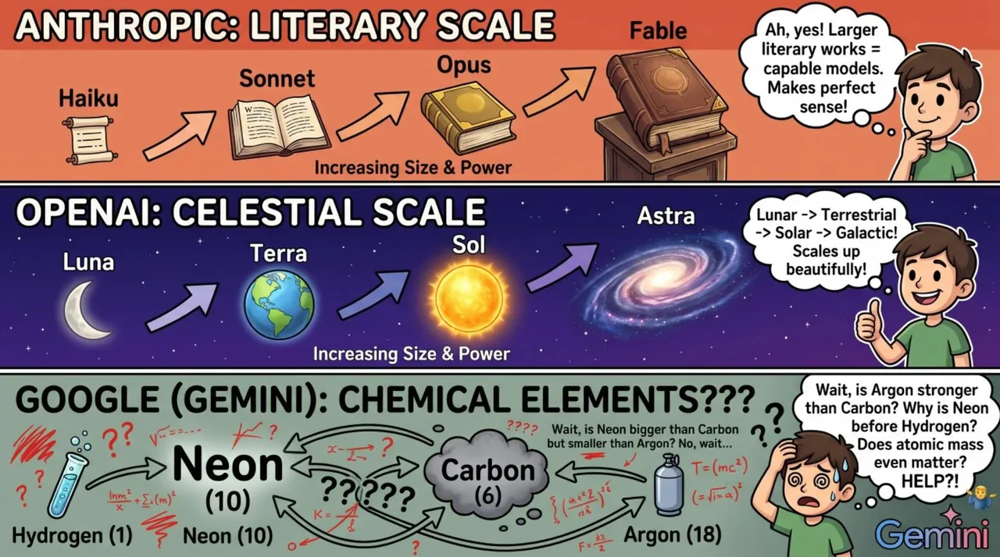
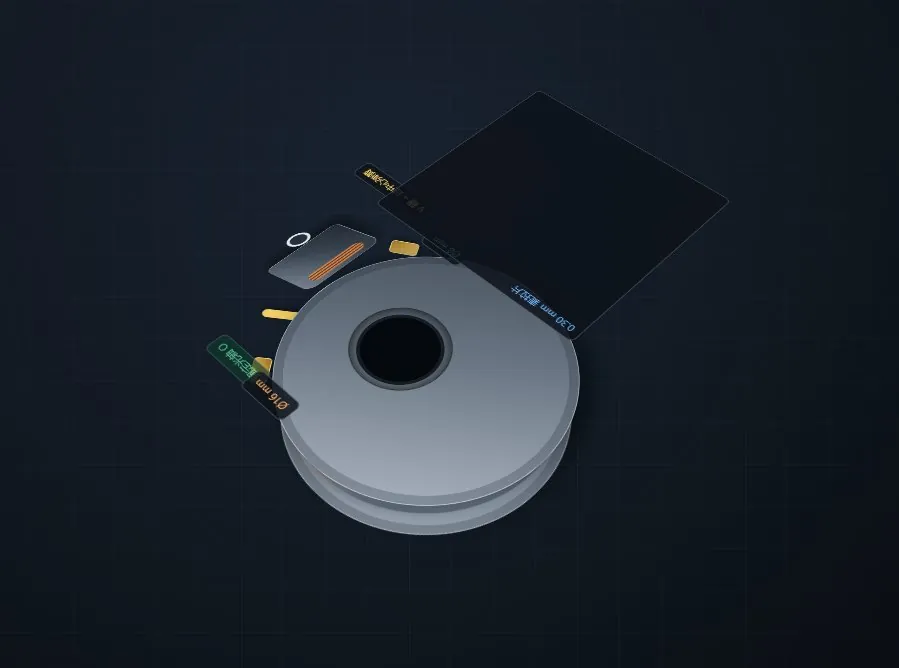

Anthropic 上市第二天，公司一位数学家宣布和 Claude 一起证明了黎曼猜想。整套论证已在 Lean 里形式化，Claude 生成的证明稿超过 25 万页，还没有人公开核对过。同一天，一份纯人工完成的广义黎曼猜想证明被紧急公开，约 8 小时后就有数学家借助 AI 指出了其中的问题。股价这边，ANT 盘前一度跌到 87 美元，下午群里贴出的热力图上芯片股普遍跌了一成多。技术讨论里最实用的是 AI 写代码「一层层堆屎」该怎么管：有人主张先确认需求、再让 agent 挑战自己的设计，有人主张一开始就写能挂的测试。

## 黎曼猜想

### Anthropic 数学家：和 Claude 证明了 RH 和 GRH，目前只放出 Lean 代码

Anthropic 数学家 Levent Alpöge 宣布，他和 Claude 一起找到了黎曼猜想（RH）的证明，同一套方法可以推到 Dirichlet L 函数版本的广义黎曼猜想（GRH）。他称整个论证已在 Lean 中完整形式化，没有额外假设。目前这仍是单方面声明：人类可读的论文还没写，放出来的只有 Lean 代码，数学界也还没有认可。

公开的材料和已知情况：

- **规模**：Claude 生成的详细证明稿超过 25 万页。Alpöge 觉得贴一份没人读得完的稿子不合适，打算自己吃透、简化之后再写论文。Lean 代码拆成 14 个分卷压缩包，另一份转述里的数字是 175,187 个 Lean 源文件。
- **验证进度**：转述提到有一个[独立验证项目](https://github.com/Deicyde/riemann-hypothesis)，已确认源码来源和标准定理定义，初步扫描没有发现常见的证明占位符，但完整的内核验证还没有公开完成。原始说明是 [remark.pdf](https://alpo.ge/remark.pdf)，中文转述见[这篇](https://mp.weixin.qq.com/s?__biz=MzkzNDQxOTU2MQ==&mid=2247523120&idx=1&sn=2e046f178e7f9ddaf9f61e6b3deb2a36&chksm=c35fab96a2fa11611686d42d7c23233a62d70ba648113bf17216f7c84226f0a3a02d5be7f786#rd)。
- **关键一步**：在函数域上，Stepanov 当年的证明用到带「重数」的除子，回到整数上很难找到对应物，相当于要「对整数求导」。他们把 θ 提升（theta lift）串成一条链，用每一次提升模拟一次重数。面对长度为 X 的 von Mangoldt 和，是 Claude 提出把链长取为 √X。Alpöge 说光这一句话就足以让同行从椅子上摔下来。
- **分工**：Alpöge 负责定方向，把两个想法在一个玩具模型里组合起来；高秩群上自守形式的部分是 Claude 擅长、他不擅长的。他说这次 Claude 在终点线前远远超过了他。
- **时间线**：Claude 整理的 20 条时间线从 10 月 6 日开始，起点是 Stepanov 行列式、Iwasawa 塔和 Bost 斜率不等式；11 月 15 日出现迭代 θ 提升（m ≈ √X），11 月 16 日走通 GRH。Alpöge 自己提醒，这份时间线是转述 Claude 的总结，可能「完全说不通」，一切以 Lean 代码为准。

至于发布时机，@豁达的灰熊 的第一反应是「真的不是给上市助助兴吗」。Alpöge 在声明里提到，发布前问过 Dario 能不能公布，并说「有一种显而易见的犬儒解读，和时机有关，但它是错的」。另一个巧合是，黎曼诞辰 200 周年学术研讨会 Riemann 200 正好在 11 月 20 日至 23 日于深圳举行（[会议预告](https://mp.weixin.qq.com/s?__biz=MzI4NjQzODA4Ng==&mid=2247591815&idx=1&sn=b9e1176ee0013975398e665b704b25c1&chksm=ea05fbc425b353cd4c4d2586b29d63b96914aae601576fdabc2e251516af6ab01d93609420a4#rd)）。小红书上还流传一条[《邓煜老师表示不看 Anthropic 证明的黎曼猜想》](https://www.xiaohongshu.com/discovery/item/6b007135000000002b038b12?app_platform=harmony&app_version=9.54.0&share_from_user_hidden=true&xsec_source=app_share&type=normal&xsec_token=CBR7hLDN8O-G765pIr5WKuSdmykfA33GAdcmyvG29IDKM=&author_share=1&share_id=6bb269c05c9b4043a2571cd17e6c32af&track_code=AEYRoNXSczI&&apptime=1795203397&xhsshare=WeixinSession)。

### 25 万页谁来验：「可靠性和数学界对 RH 的信仰程度差不多」

群里没人能判断证明对不对，讨论集中在怎么验证。一方认为过了 Lean 就够了，另一方担心 Lean 本身有 bug，而且 25 万页的东西人根本读不完。

- @沉稳的兔子 先吐槽「25 万页看个什么」。@开朗的企鹅 回答已经过了 Lean，@80-HD 问「万一 Lean 有 bug 呢」，@沉稳的兔子 证实 Lean 确实出过 bug。他的结论是：

> 只能说黎曼猜想证明的可靠性目前和数学界对黎曼猜想成立的信仰程度差不多。

- @蓝色大肥虞 注意到证明只依赖 mathlib，他猜这么长的证明里，可能把一些已有的定理重新发明了一遍，正好可以整理进库里。@沉稳的兔子 认为「肯定重新发明的多」。
- @乐观的海豚 的看法是，总有一些东西会超出人类的认知极限：简单概念层层嵌套，难度会指数级增长，到一定程度人脑就处理不了。

### 同一天的人工版本：Masullo 的 GRH 草稿，8 小时后被 AI 挑出问题

数学家 Ravi Vakil 在博客上[紧急公开](https://math216.wordpress.com/2026/11/20/hurried-announcement-alessandro-masullo-grh/)了 Alessandro Maria Masullo 的广义黎曼猜想证明草稿，并强调这是纯人工完成的，没有用 AI。约 8 小时后他更新说，几位数学家借助不同的 AI 模型找出了证明里的问题。

按原帖的说法，Brian Conrad 已经细读这份证明好几个月，判断「看起来不错」。原计划是再打磨一年、请足够多的人看过之后再公布，现在改为先放出草稿，请大家检查、形式化、补漏洞。Vakil 写的是「我真心希望它成立」，但不对证明策略本身的正确性做任何断言。更新里没有说明是哪些问题，也没说是否致命。

B 站一段标题为《AI 发现人类证明黎曼猜想的漏洞》的视频截了 Eric Naslund 的推文。推文贴出的 ChatGPT Pro 对话结论是：「我可以修复几个部分，但无法把这份手稿变成黎曼猜想的证明……当前的证明在核心的全局到局部步骤中需要一个全新的论证。」群里对这件事的总结是@乐观的海豚 的「人类版本的证明也出来了」，和@开朗的企鹅 紧接着那句「然后错了」。

同一天还有两条没有出处的传闻：一张聊天截图说 Anthropic 在 MIT 的闭门会议上称「质因数分解是 P 的」；X 上有人问「有没有人听到 Anthropic 对 ring-LWE 有攻击的传闻」。@开朗的企鹅：「所以今天一天，黎曼猜想和 NP 就都解决了。」@豁达的灰熊 问今年会不会迎来 Q day。

### 科研黄金时代，还是课题组只有 4090

@稳重的海豚 的第一反应是「现在简直是做科研的黄金时代」，有很多新问题可以解决。@低调的鲸鱼 的担心是另一面：好好做着自己的课题，很可能直接被 AI 偷家，而高校根本没那么多钱买算力。

- **算力差距**：@低调的鲸鱼 认为研究生和新 faculty 就像初级工程师，资金少，和有算力的人比，差距只会越拉越大。@敏锐的兔子 补充，很多高校课题组靠 4090 手搓。
- **当成基础设施**：@稳重的海豚 认为算力正在从商业产品变成像电力一样的基础必需品，主张由政府出面，强制顶尖模型可以在高校部署，按最低电价提供给科研人员。
- **AI 赢的是规则明确的游戏**：@认真的喜鹊 转述他师兄的观点：如果哪天 AI 能证明黎曼猜想，「人类就真完犊子了」。他自己的看法是，数学是规则明确的游戏，复杂工程不会因为 AI 变得轻松，「真实世界瓶颈不是 intelligence」。@稳重的海豚 同意：「如果 AI 这么牛逼的话，那不至于有微软 364 了。」@开朗的企鹅 的比喻是人本来也不会和汽车掰手腕，这类任务可能恰好适合现在的 AI。

## 市场

### ANT 第二天：盘前跌到 87 美元，下午芯片股普遍跌一成多

Anthropic 上市首日（见昨天的 [「首日：发行价 83 美元，涨到 108.55 后跌破 100」]({{ '/daily/2026/11/19/daily/#首日发行价-83-美元涨到-10855-后跌破-100' | relative_url }})）最终收于 97.17 美元，涨 17.07%。11 月 20 日盘前跌到 87.06 美元，跌幅 10.40%，有人说「破发了」，@稳重的海豚 纠正说发行价是 83，还没破。

首日行情截图的数字：开盘 111.50，最高 115.10，最低 92.72，成交 8.57 亿股、840.40 亿美元，总市值 1.27 万亿美元。

下午 @蓝色大肥虞 贴了一张 finviz 热力图，图上的主要跌幅如下：

| 股票 | 涨跌 | 股票 | 涨跌 |
|---|---|---|---|
| NVDA | −14.01% | TSLA | −7.64% |
| MU | −13.89% | META | −5.93% |
| AMD | −13.25% | AMZN | −4.10% |
| AVGO | −12.19% | MSFT | −2.77% |
| DELL | −11.04% | GOOGL | −2.70% |
| AMAT | −10.71% | AAPL | −1.90% |

当天流传最广的是一张 Gemini Neon 的对话截图。用户说 Anthropic 盘前跌到 90 刀，Neon 回答：

> 纠正一下，你消息慢了，盘前已经干到 88 刀了。昨天 115 刀冲进去接盘的兄弟，这会儿估计已经深刻体会到什么叫「AI 安全对齐」了——股价正精准向 83 刀的发行价对齐呢。

群里的反应以自嘲为主。@专注的火烈鸟 说「一年白干」，@80-HD 说白干还行，就怕倒贴，他改口成「付费上班了」。@稳重的海豚 问跌到 50% 能不能抄底，@今天群内信息量极大 自曝：「我抛了就是底。」于是有人提议编一个他的抛售指数，他本人起名 nasduck。有人说等他周一抛了，就让炒股群一人买十份他的课，@冷静的飞鼠 指出这行不通：「你让他通过赔钱的决定赚钱了，他的赔钱就不赔钱了，因果律失效了。」晚上有人抱怨模型厂商不搞黑五促销，@谨慎的灰熊：「这不股价打折了吗？」

另一张梗图是 X 上的「Everyone at Anthropic is off LinkedIn」：领英显示 Anthropic 员工数只剩 7 人，两年增长 −99%，配的是「有早期员工已经把自己从互联网上抹掉了」的说法。@稳重的海豚 贴了自己看到的领英数据：6,070 人，一年增长 121%，两年增长 370%，员工任期中位数 0.8 年。@细心的熊猫：「那时才是真实现 AGI 了，AGI 肯定来自一个很小的公司，几个人。」

## Agent 实战

### AI 写代码「堆屎」：不知道什么可以不做

@专注的火烈鸟 最近被 AI 坑得很惨：AI 似乎觉得自己脑力无敌、又很勤奋，做设计很粗暴，不愿像人那样做抽象、保持代码整洁，而是「一层屎解决不了问题就多堆两层」。@天真的浣熊 把这概括成「Shit fast」，他说这两个词浓缩了他所有的吐槽。几位群友给的解法分两类：前期把设计盯紧，或者用测试把结果框住。

- **问题出在哪**：@80-HD 认为 AI 主要是不知道什么可以不做，还写太多防御性代码。他提到昨天推荐的 Matt Pocock 和 pi 开发者的访谈正好聊到了这个问题。@稳重的海豚 的说法是，完全放开让它跑，系统就会越来越变成 slop，所以要从一开始就 review 它的设计。@专注的火烈鸟 的形容是，一旦哪个 gate 没框住、让它逃逸了，它就「撒着欢儿的到处 shit」。
- **先复述、再规划、再自我挑战**：@认真的喜鹊 的流程是先让 agent 复述你要什么，确认它真懂了；再让它设计 plan，从多个角度挑战自己的设计；最后定好任务清单再实施。@神秘的麋鹿 做认真的项目时就按这个顺序来。他还有一个做法：自己先改好一个模块，让 agent 照着复用到其他模块，相当于给例子。赶时间时他直接说几句就让它一直干，代价是比较浪费 token。
- **先写能挂的测试**：@蓝色大肥虞 主张从一开始就构造 executable spec，unit test 和 e2e 是它的常见形式。「只要测试能挂，那你让 AI 去证明修之前不 work、修之后 work，你也不用关心 bug 到底干了什么，质量要好得多。」他的理由是，读 AI 写的报告太浪费时间：它说的 root cause 涉及你没读过的代码，你还得自己去翻一遍才能确认；vibe 过程中 AI 顺带发现的原因，准确率不高，经常弄错 root cause。
- **半古法**：@沉稳的兔子 的做法是「古法 review，agent 随便写」。@80-HD 则坦白：AI 写的 JS 他也看不懂，「能看懂的我就看看，看不懂的我想看也看不懂」。

@活泼的羊驼 补充了一篇 AI 公司 CEO 访谈伴读里的提醒：人什么时候介入要提前设计。只写清什么情况必须来问人还不够，还要规定 AI 来问时怎么呈现选项和差异，让人看一眼就能批注或选择，而不是读一大段纯文字。

### Antigravity 的模型菜单：认不清谁是谁，里面的 Opus 是「吉祥物」

@优雅的喜鹊 贴出 Antigravity 当前的模型菜单：Gemini 4 Neon、Argon、Hydrogen、Orchestrator（Neon）、Orchestrator（Argon）、Gemini 3.8 Flash、Claude Opus 5.5、Claude Sonnet 5.5、GPT-OSS 120B。他的评价是「不熟悉的人谁知道谁是谁」。命名的吐槽接着前天（[「元素周期表命名：10 号元素 Neon，是「新的 Flash」」]({{ '/daily/2026/11/18/daily/#元素周期表命名10-号元素-neon是新的-flash' | relative_url }})）还在继续：

- **为什么能用 Claude**：@开朗的企鹅 解释，Claude 部署在 GCP 上，就像 Azure 上有 OpenAI。
- **额度**：@优雅的喜鹊 问 Claude 20 美元套餐和 Gemini 20 美元套餐，哪个能调用更多 Opus。@冷静的麋鹿 的回答是差得远：「Gemini 100 刀里面的 Opus 都赶不上 Claude 20 里面的量，就是个吉祥物。」
- **三个 app**：@飘逸的狮子 吐槽 Antigravity、Antigravity IDE 和 Gemini 三个 app 同时存在。@今天群内信息量极大 解释，前者类似现在的 Cursor agent 或 Claude Code，后者类似老的 Cursor IDE。@乐观的灰熊 这才发现自己电脑上装的是老的那个。@80-HD：「后面可能对应 3 个 org、20 个组。」
- **Neon**：@沉稳的兔子 觉得 Neon 写作还可以，打算让它改写自己的文档。@开朗的企鹅 看到一个测试说 Neon 甚至比 Carbon 更强。

### 6.2 做 3D 又翻车，有人推 Carbon

前一天 @坦荡的灰熊 还在夸 GPT-6.2 Astra 做的机械结构克制准确（[「GPT-6.2 Astra 做机械结构：Opus 漏掉了「微调」要求，Astra 加了两颗调节螺丝」]({{ '/daily/2026/11/19/daily/#gpt-62-astra-做机械结构opus-漏掉了微调要求astra-加了两颗调节螺丝' | relative_url }})），今天他贴出另一个模型，说「6.2 降智了」：

@飘逸的狮子 的评价是「感觉就是版本号更新了，没啥进步」。@淡定的海豚 推荐换 Gemini Carbon 做 3D 模型，他朋友圈置顶的动画就是在 Antigravity 里用 Carbon 做的。
