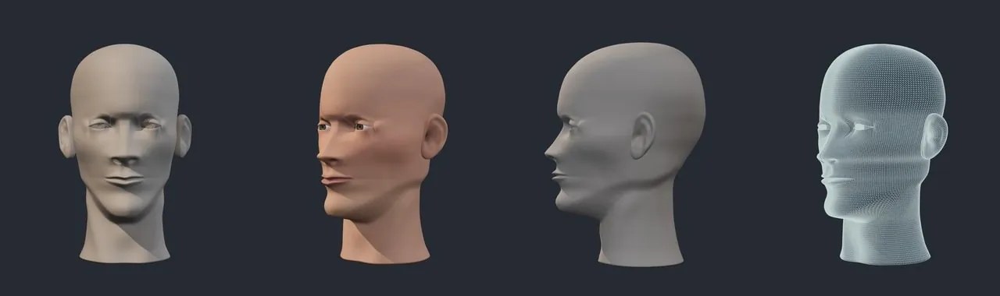
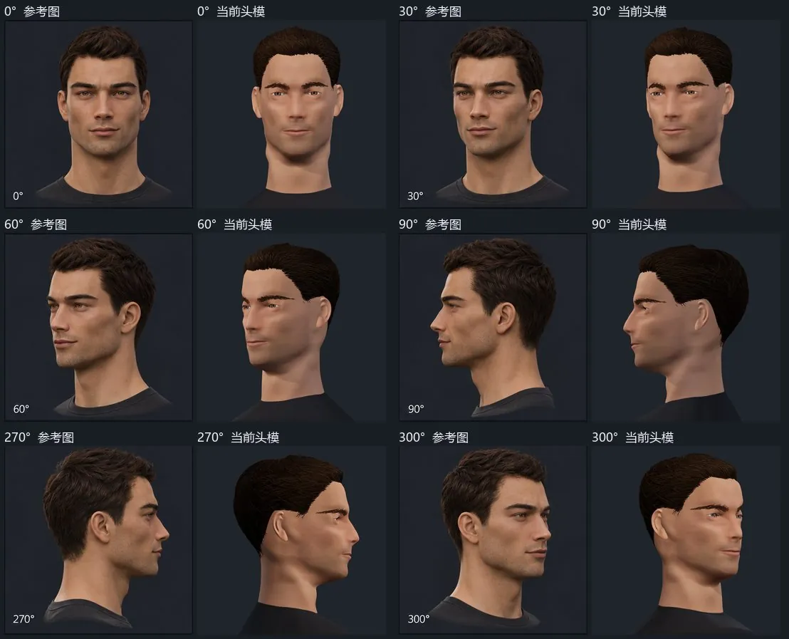
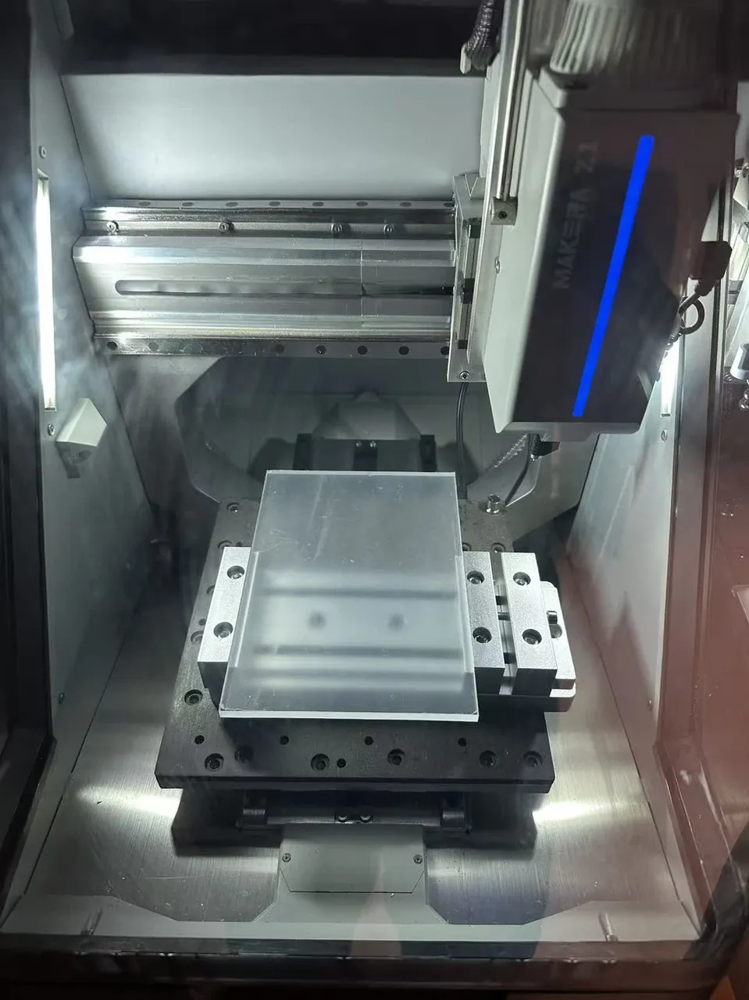

Lean FRO 和 Mathlib Initiative 发表联合声明，认证了 Claude 参与完成的黎曼猜想证明。群里关心的已经从「对不对」转到「谁来消化这 25 万页」，有人拿它类比 vibe coding 欠下的理解债。实战方面，有群友问 agent 登录网站时要不要把密码贴进对话框，几位群友讲了凭证该怎么托管。另外两条：GPT-6.2 Astra 被几位群友说降智，其中一位让它排查完界面卡死，它给的修复方案是「调高 timeout」；还有群友用 Codex 指挥 Antigravity 里的 Neon 跑了一天，建出一颗写实人头，token 用了不到 10%。

## 黎曼猜想

### Lean 官方联合声明：证明通过了四项检验

据新智元报道，Lean FRO 与 Mathlib Initiative 发表联合声明，认证 Levent Alpöge 和 Claude 的黎曼猜想证明，陈述和证明都正确。昨天群里还停在「Lean 也出过 bug」（见 [「25 万页谁来验：「可靠性和数学界对 RH 的信仰程度差不多」」]({{ '/daily/2026/11/20/daily/#25-万页谁来验可靠性和数学界对-rh-的信仰程度差不多' | relative_url }})），这次社区用一天时间验完了约 1700 万行 Lean 代码。目前只有这一篇媒体报道，@热情的大象 看到出处的反应是「又是新智元」。

验证依据的是 Kevin Buzzard 11 月 12 日博客里提的四条标准：

| 标准 | 怎么验的 |
|---|---|
| 题目没写错 | 证的是 Mathlib 里早就有的黎曼猜想定义 |
| 能完整编译 | 几十人报告编译成功，导出的原始证明文件一致；单人验证约需 100GB 内存、70GB 硬盘 |
| 没偷换定义、没加公理 | 用 comparator 和 con-leche 两个独立工具比对 |
| 内核没漏洞 | 证明导出成 61.6GB 文件交给多个内核：Rust 写的 nanoda 跑了 27 分 42 秒；con-leche 用 3 分 15 秒审完 146.8 万条声明，无一拒绝；lean4lean 检查了全部 175,187 个模块。五个核心定理只依赖三条标准公理 |

验证链条的几乎每一环都有 Claude：MIT 的 Andrew Sutherland 在验证页上写明检查是用 Claude Code 跑的；con-leche 本身也是 Claude 写的，它是第一个用 Lean 写成并被证明自洽的 Lean 内核。Sutherland 还把这份证明和一份独立完成的 Robin 判据形式化结合，让机器证出一条不涉及 ζ 函数的不等式：任何大于 5040 的整数 n，其因数之和都小于 e^γ · n · ln ln n。

验证通过不等于被理解。陶哲轩在博客里说，这份证明「似乎动用了 Langlands 纲领和算术几何现代发展的全部力量」，消化需要时间，「好在这一次，至少还有一位人类作者可以沟通」。克雷研究所的 100 万美元奖金还要等，规则要求证明正式发表后再经过两年检验。原文：[《黎曼猜想迎来大结局！Lean官方认证：Claude证明无误》](https://mp.weixin.qq.com/s?__biz=MzI3MTA0MTk1MA==&mid=2652744403&idx=1&sn=be24600cf52110702f79ffe3f5b4907d&chksm=f084bc09d7939b8e7df5570f60890b294be49fb59660a870ebec35a373fe2a206381b9405b2b#rd)。

### 证完之后：同学说 AI 没有独立完成，群友说这像 vibe coding 的理解债

@坚定的貂 贴了一篇知乎回答，答主自称是 Alpöge 在 Math 55 的同班同学，他的结论是这次突破「绝非 AI『独立完成』，而是 Levent 引导的证明路线」。群里的讨论落在另一点上：机器先认证、人类再回头消化，这个顺序和用 AI 写代码很像。

答主讲的几个细节：2019 年他问 Alpöge，如果一篇普通博士论文算一个「新洞见」，离证明黎曼猜想还差几个串行的洞见，回答是大概 50 个，庞加莱猜想只要 10 个左右；全证明 20 步里有 8 步是 AI 在同一天完成的；Alpöge 今年年初起几乎失联，按答主的说法是「几个月无限 token 疯狂尝试各种公开问题」。

- **理解债**：@稳重的海豚 说现在工作也是这样，AI 批量产出代码之后，他还得花很多时间消化它干了什么，「可能整个项目已经跑起来了，我还没彻底搞懂」。
- **该还的债**：@蓝色大肥虞 认为，把这次证明里能贡献的东西整理进 mathlib 才算完成任务，「就像 vibe coding 不能只管用户看到的那部分，不然以后 token cost 就会 superlinear」，换个说法就是「subscription 怎么越来越不耐用」。

@乐观的海豚 贴的小红书梗图：「17 世纪数学家：我发现了一个美妙证明，可惜空白太小写不下它。19 世纪数学家：……乃是女神托梦告诉我的。21 世纪数学家：……只是篇幅有二十五万页。」@蓝色大肥虞 截了一位数学博主的投稿列表：16 小时里连发 11 条视频，有人按标题给每条配上情绪，从「震惊」「不解」「绝望」「侥幸」一路排到「迷茫」「走马灯」，最新一条的标题是《AI 攻克黎曼猜想之后，我很幸运，因为我有老婆》。

## Agent 实战

### 给 agent 登录网站：凭证放进 vault，别贴进对话框

@风趣的犀牛 用 WorkBuddy 的 computer use 登录网站时，它在本机另开一个 virtual session，人进不去，于是要他把密码直接贴进对话框。几位群友都说这样做不对。思路有两条：让 agent 用已经登录好的浏览器，或者把凭证交给 vault 托管，让它不经过模型。

- **用现成的浏览器**：@稳重的海豚 说正常的本地 computer use 应该用你自己的浏览器，继承所有 cache 和 credentials，密码由 Google Password Manager 或 1Password 自动填充。如果没有，可能是没打开默认的 Chrome profile。@今天群内信息量极大 补充，只是登录网页的话可以不走 computer use，直接走 browser；想要互不干扰，就让 AI 新建一个浏览器 profile。@沉稳的兔子 说传统的 Playwright 也是建一个 profile 就行。
- **凭证托管**：@风趣的穿山甲 认为这是标准做法：密码、access token 都放在 vault 里，agent 调工具时再去和 vault 交换，避免带着凭证去调 LLM。cookie 处理起来麻烦一点。@沉稳的兔子 的概括是：「凭证管理主要不是不让用，是不让传播。」@敏锐的海狸 把 cookie 和 credential 都存进了 OpenBao，但不清楚 AI 在后台怎么用，「慌兮兮」。
- **托管方也得信**：@风趣的穿山甲 觉得 Meta 的 Muse 在这方面体验不错，只是 vault 由 Meta 托管，你得信任 Meta。@今天群内信息量极大 提到这方面也爆过各种事故，现在还在和 Signal 扯皮。
- **最省事的隔离**：@蓝色大肥虞 已经放弃了这种隔离方案，直接买了台新电脑，整台机器（或者虚拟机）都交给 agent。@风趣的犀牛 那台本来就是新电脑，后来也认同了：上面的东西都可以由它折腾。

### 密钥被盗刷之后：key 不该出现在任何上下文里

某群友说公司三周前从 Railway 迁到了 GCP，之前在 Railway 上被盗刷了 2.7 万美元，现在打算买保险。几位群友给的防护思路是：key 统一管理，最好根本不让人和 agent 碰到。

- @开朗的企鹅：所有类似的 key 集中管理，做本地替换，不让任何 key 出现在任何上下文里。
- @蓝色大肥虞：他那边的做法比较极端，写代码的人手里根本没有 key；部署用 pull，不用 push。另一条建议是「用加密硬件签发 key，世界上没有任何人知道 key 是多少，硬件坏了就保证了没人能发包，非常安全」。
- 一份哥伦比亚大学 Agentic Engineering 课的[安全讲义](https://shorturl.at/CIBqk)（136 页）被推荐用来看「那些系统都是怎么被打破的」。授课者在群里说，学生作业用 Opus 5.5 做 adaptive attack，被测的模型里只有 6.1 Terra 没被打爆。

### Astra 6.2「降智」：不再自己开远程会话，修 bug 时提议调高 timeout

三位群友今天都觉得 GPT-6.2 Astra 变笨了，表现各不一样。

- **不会自己协作了**：@神秘的麋鹿 以前只要说一声，Astra 就会在他几台 Codex 电脑之间远程新建对话、互相交流，现在要提醒好几次。截图里它先说新建接口只列出本地项目，自动审批又拒绝了「先建再移交」，因为这样会在 Mac 上留下多余的聊天和工作树，于是让用户自己去另一台机器上开对话。被追问「之前明明就可以」之后，它花了 7 分 42 秒，还是自己把 Windows 那边的会话建起来了。
- **被路由到小模型**：@坦荡的灰熊 说自己连续两天被路由到 5.6 Luna，但他发现 Astra 的工作没人能代替，Claude 也不行。
- **长会话衰减**：@蓝色大肥虞 最近在改工作方式，发现同一个 session 发到四五条请求后，模型就会开始稳定地降智。

@蓝色大肥虞 讲了一个具体的例子。他的 GacUI 全局换肤时，UIA provider 在 UI 线程里重建子树，把界面卡死，导致另一套基于 HTTP 的备用 UIA 超时，触发了断言。UI 操作不能跨线程，只能都塞在 UI 线程里。Astra 跑 test app 时自爆、重试了两次，过了就算过。他碰巧看到，让它挂上 debugger 采样，它倒是把前因后果查清楚了。接着让它出 plan，它给了四个大字：

> 调高 timeout

最后还是来回拉扯了半天，才把性能问题根治，「差点就被他糊弄过去了」。

### Codex 指挥 Antigravity：Sol 6.2 调 Neon 跑了一天，建出一颗写实人头

@开朗的企鹅 的结论是，Antigravity「根本不是给人用的，而是给 AI 用的」，让 Codex 去调就对了，Codex 还能审核它的产出、修改调用方式。他让 Codex 用 GPT-6.2 Sol 调 Antigravity 里的 Neon 建 3D 头模，用 `/goal` 跑了整整一天，token 用了不到 10%。11 月 18 日群里的结论还是人脸得靠 Tripo（[「3D：坦克和手柄看得过去，二次元人脸还得靠 Tripo」]({{ '/daily/2026/11/18/daily/#3d坦克和手柄看得过去二次元人脸还得靠-tripo' | relative_url }})），这次是纯模型流程。

刚开始的样子：

跑完一天，对着参考图在六个角度比对的结果：

对 Antigravity 本身的吐槽还在继续。@优雅的喜鹊 说远程电脑上的会话不能在本地桌面端连接，只能用网页版，@冷静的飞鼠 和 @沉稳的兔子 也嫌难用。@活泼的羊驼 的办法是用 acpx 遥控它，他贴出的各 CLI 使用统计里 Antigravity 的会话数最多：

| CLI | 会话数 | Total(m) |
|---|---|---|
| claude | 120 | 1238.22 |
| codex | 305 | 998.06 |
| antigravity | 399 | 430.32 |
| kimi | 1 | 0.18 |

### 让 Claude 开 CNC：鼠标指针老被带偏，它停下来没敢点

@细心的熊猫 用手机上的 Claude Remote Control 让它操作 Makera Z1 数控雕刻机，做一个显卡水冷头，「太上头了，手起刀落」。截图里有个细节：Claude 拿到了 Makera Studio 的控制权，设备状态 Idle，但它试了四次，指针放到一个位置，几秒后就被移到别处，点「刀路」页签也不生效。设备页上有点动、回零和开始按钮，指针一偏就可能误点、让机器动起来，所以它停下来，请用户先别碰这台电脑的鼠标和触控板。

@睿智的犀牛 觉得让 Claude 操作东西不如 Codex 理想，「事儿太多」；@坦荡的灰熊 推荐 WorkBuddy，说它的 computer use 很快。

### WorkBuddy 与「为什么不直接用 Codex」

有个视频讲新版 ChatGPT 改得像 WorkBuddy，里面一张对比图：Claude 打开 App 就能进 Claude Code 会话；新版 ChatGPT 要依次点 More、Codex，再扫脸，才进得了会话。@神秘的火烈鸟 问 Codex 是不是也开始 KYC 了。@蓝色大肥虞 理解为每次进入都要扫脸，不像 KYC，他自己也没被要求过。

@睿智的北极熊 说他那里除了程序员，其他岗位用 AI 都用 WorkBuddy。非程序员用国际版靠签到积分就够了，国际版能用 Astra，前两天还加了谷歌的模型；国内版付费能解决大部分问题。由此引出一个问题：中小企业还有没有必要自建 agent？

- @80-HD：很多 agent startup 都回答不了「我为什么不直接用 Codex、Claude、WorkBuddy」。
- @优雅的荷兰猪：除了保密需求，想不出别的理由自建；垂类需求不足以支撑专门训模型，外挂知识效果就不错。
- @神秘的火烈鸟：要自建的也不是模型，是垂类的 workflow 和 domain knowledge。

## Gemini

### Cobalt 泄露：命名表上又多一个元素

一条推文称，Google AI Studio 里出现了 Gemini 4 Cobalt，模型 ID 是 `models/gemini-cobalt-thinking-preview-001`，支持文本、图像、音频、视频和 3D 输入，推理 token 最高 131,072，还支持 4K 视频 CoT。发推者猜它会在 15 天内发布，还不清楚是 Flash 还是 Pro 级别。

命名吐槽接着 [「元素周期表命名：10 号元素 Neon，是「新的 Flash」」]({{ '/daily/2026/11/18/daily/#元素周期表命名10-号元素-neon是新的-flash' | relative_url }}) 继续。@幽默的火烈鸟：「这是今天看到的第五个 Gemini 的名字了。」@豁达的灰熊 想要「铁铜银钛金」；@蓝色大肥虞 报了一串变形金刚元祖的名字（Primon、Nova、Nominus、Zeta、Sentinel、Optimus、Rodimus），@豁达的灰熊 回「Transformer 命名非常合理！」。有人接着往下排甲烷、二氧化碳，@谨慎的灰熊 提醒「还有很多同位素」，@豁达的灰熊 顺势提议用同位素当小版本号：Carbon → Carbon-14。他还和 GPT 聊出了一套粒子命名：

> Gemini Fermion — No two agents share the same state.
> Gemini Boson — All agents share the same state.
> Gemini Fermion-Boson — Private minds, shared knowledge.

GPT 还认真解释，最后这个恰好描述了一种合理的 multi-agent 架构，结尾补了一句：「当然，严格来说费米子和玻色子都不会思考。」

### 要不要为 Carbon 花钱：推荐 Hydrogen 和 Neon，但 Neon 啃不动长文本分析

@睿智的犀牛 问 Gemini Carbon 值不值得买。20 美元的 Pro 档没有 Carbon，要上约 99 美元那档才有。@稳重的海豚 的回答是「nope」，用 Hydrogen 或 Neon。@开朗的企鹅 说 Hydrogen「是真的很快」，可以先开个 Pro 试试。他还说谷歌是封号最少的一家。

Neon 也有短板。@敏锐的海狸 用 Astra 6 和 6.2 整理行业分析框架：Astra 6 能按他要的陈述式来写，6.2 则开始给他讲行业小故事。换成 Neon 后，他把问题详细讲了一遍，Neon 看完文档回了句「你说的好对，这确实是最需要讨论的地方，下面你让我改啥」。他的结论是 Neon「没有深入挖掘的心思」，文本分析一超过一两个来回、10 到 20 万 token，就明显跟不上。@谨慎的灰熊 自己用的是 Carbon。

**黑五折扣**：谷歌的通知说，现有 AI 和云存储订阅用户即日起至 11 月 26 日，Google AI Plus 和 Pro 年度套餐最高五折。@活泼的羊驼 补充，没有生效中付费订阅的账号（包括已过期的）大概率看不到折扣，要等 11 月 27 日面向非订阅用户的第二波；「最高五折」因地区和套餐而异，不含 Ultra。@蓝色大肥虞 说难怪他在 Pro 里看到的 Ultra 价格是 100，这个折扣其实已经挂了很久。

## 市场与英伟达

### 群里流传的「美股大促」海报：英伟达约 5.2 折，甲骨文 2.9 折

接昨天的跌势（[「ANT 第二天：盘前跌到 87 美元，下午芯片股普遍跌一成多」]({{ '/daily/2026/11/20/daily/#ant-第二天盘前跌到-87-美元下午芯片股普遍跌一成多' | relative_url }})），@温暖的斑马 贴了两张股民自嘲海报，把科技股回撤写成了打折。下面是「双十二」那张的数字，截至 11 月 20 日美股盘中，折扣 = 现价 ÷ 历史盘中高点：

| 股票 | 历史高点 | 现价 | 折扣 |
|---|---|---|---|
| ORCL | $345.72 | $101.19 | 约 2.9 折 |
| SNDK（按 1 拆 8 调整） | $294.30 | $79.24 | 约 2.7 折 |
| INTC | $142.35 | $51.28 | 约 3.6 折 |
| NFLX | $134.12 | $57.11 | 约 4.3 折 |
| MU | $1,255.00 | $594.51 | 约 4.7 折 |
| NVDA | $243.37 | $125.53 | 约 5.2 折 |
| SpaceX | $225.64 | $127.79 | 约 5.7 折 |
| AVGO | $495.00 | $304.41 | 约 6.1 折 |
| AMD | $658.52 | $424.39 | 约 6.4 折 |
| TSLA | $498.83 | $345.82 | 约 6.9 折 |

「黑五」那张按距 52 周高点算：NVDA −44%，AMD −34%，GOOGL −33%，TSLA −30%，META −27%，MSFT 和 AMZN 各 −13%。@机智的荷兰猪 问之前原价买的能不能补差价，@温暖的斑马 回了句「Price Match」。

### Paul Graham：「除了董事会，所有搞技术的人都认为董事会犯了大错」

@活泼的羊驼 转了 Paul Graham 的推文：「I've never known the tech world to be more unanimous about anything than they are about Jensen Huang. Everyone in tech thinks the board made a huge mistake. Except the board. But they are not in tech.」这条推文有 26 万次查看。有人在下面问媒体为什么一直抹黑黄仁勋，他只回了两个词：「Page views.」

同一天 SemiAnalysis 发了一条食评，说美国鼎泰丰是「最差的饺子店」，有些服务员和厨师连中文都不会说，「台湾的鼎泰丰倒是很棒」。@80-HD 的评论是：「应该是到底了，SemiAnalysis 都做食评了。」
