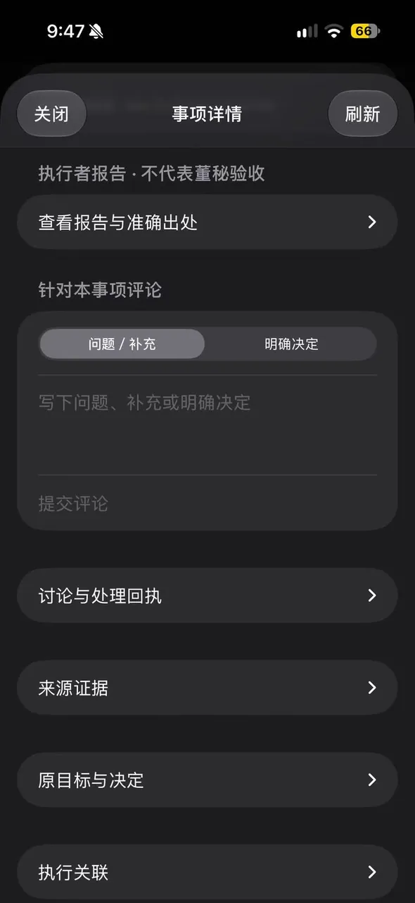

Lean 官方背书后的第二天，有人在 1700 万行代码里翻出一个永远返回 True 的定义 `anyGeometry`，说证明可能因此失效。群里多数人不认为这是漏洞，由此聊到一个对写代码更有用的问题：怎么确认「你证明的」就是「你声称的」。@蓝色大肥虞 的答案是 executable spec，也就是规格本身能执行、和代码绑在一起。另一个值得读的话题是个人 agent 收不到「结尾」：一篇吐槽文章说，请个助理结果变成天天给它打报告。几位群友分享了各自的任务管理办法，有人用 Google Doc 当中枢，有人用 GitHub 加 WorkBuddy。

## 黎曼猜想之后

### anyGeometry：一个恒返回 True 的定义，算不算漏洞

Nielsen 在论文里指出，证明代码中有一个定义 `anyGeometry : GeoP := fun _ _ _ => True`，无论输入什么都返回 True。她怀疑一些本该证明的几何条件因此被设成了自动成立。群里多数人不认为这能推翻证明：要么这个定义根本没被用到，要么 Lean 不允许这样作弊。目前公开报道里还没有人追踪出它是否影响最终结论。

- **位置**：小红书评论区有人找到了它，在 `OverIx.lean` 第 19 行。转述文章说，有独立开发者确认这个定义存在，但还没追完它是否导致证明失效。Nielsen 在论文里还质疑了部分格点结构（lattice）的性质、一个高度方程（height equation）的定义等。克雷研究所目前仍把黎曼猜想列为未解决问题。
- **怎么验**：@稳重的海豚 说这很好验证，删掉这个定义，看还能不能编译过；或者查有没有地方调用它，「应该几秒钟就可以检测完」。
- **AI slop**：@坚定的貂 认为这是 AI 写的一堆没用的东西，可以删。@洒脱的鸳鸯 举了 vibe coding 的例子：AI 在 test 目录里写过一个 `def assert_true(): return True`，「其实也没啥关系」。他认为大方向没问题，很细的细节可以不在意。
- **Lean 里出不了这种错**：@开朗的企鹅 说，除非有特殊的 bug，Lean 代码里没法靠这种定义作弊，真要出问题，只会出在「你证明的问题不是你 claim 的问题」。@蓝色大肥虞 的直觉是它像递归函数的出口。
- **作者**：几位群友认出了 Nielsen。@乐观的海豚 查到她是哲学系的，转述文章的评论区也有人说她主页上搞的全是千禧年难题。群里没人觉得这个质疑可信。

@睿智的北极熊 贴出了联合声明全文。昨天的报道（[「Lean 官方联合声明：证明通过了四项检验」]({{ '/daily/2026/11/21/daily/#lean-官方联合声明证明通过了四项检验' | relative_url }})）之外，声明还多了两个细节：检查器 con-leche 和 con-ron 附带了相对于集合论的形式证明，证明它们不会接受错误的证明；所有检查都在证明的非活动导出上运行，源码里即使藏了恶意代码也碰不到检查过程。@谨慎的灰熊 转述丘成桐的说法：应该是解决了，机器的 Lean 证明不会出错，「但人很容易出错」。

### 「你证明的」是不是「你声称的」：从 Lean 到 executable spec

@热情的大象 一直担心 AI 做形式化时的 reward hacking，即 AI 只想拿到奖励，并不真想解决问题。他问：核对「证明的命题就是声称的命题」，工作量一个人扛得住吗？@蓝色大肥虞 的回答是，黎曼猜想的 Lean 描述早就有了，被很多人人工 review 过。软件工程不一样，要定义的东西是海量的，所以规格必须能执行、和代码耦合在一起。

- **系统软件更难**：@热情的大象 说，做系统软件形式化的人在这一步上难度非常大，涉及并发时尤其如此。很多系统声称做过形式化验证，「其实这里面有很多操作空间」。他回头核对后也确认，黎曼猜想的形式化陈述不是 Claude 和 Alpöge 做的，而是已有的、经数学家审过的工作。
- **executable spec**：@蓝色大肥虞 说，定义、证明、代码如果是割裂的，「基本就等于没有证明，谁能去看代码和你的 Lean 讲的东西是不是一回事」。规格可以是证明，也可以是 unit test，只要天然跟代码耦合，「你证明的」和「你 claim 的」之间的差距就会在迭代中慢慢消掉。他举 Haskell 为例，说它是「走在半路上」的语言：类型就是 executable spec，代码就是证明，所以古法写 Haskell 会有「只要过了编译几乎不会出 bug」的体验。他的推论是，语言本身得自带这种能力，「以后没有类似能力的语言都会失去价值」。@倔强的穿山甲 接了一句：「一个好的软件本身就是 executable spec。」
- **机器证明是完美的 AI 场景**：@蓝色大肥虞 认为，只要先让一群人承认某个问题的 Lean 表述，后面就是烧 token，烧多少都不用管。AI 成了「要么做对、要么没做出来、没有中间状态的黑箱」，你不用懂这个领域，只要有足够的知识写出问题的表述就行。

@认真的喜鹊 提议了一个新 benchmark：压缩黎曼猜想的证明。@乐观的海豚 也好奇最终的简化版会有多长。

### 功劳归谁：AI 证明的，还是 Alpöge 选对了游戏

@豁达的灰熊 翻出一篇 9 月初的知乎帖子《levent 的成就都够菲尔兹奖了》。帖子说他一两个月就攻破了好几个重磅问题，比如 S6 上的复结构、Navier-Stokes 方程，还猜他有某种 harness，能让内部模型生成的东西一旦通过就一定是对的，尽管他本人可能也看不懂。群里对功劳该怎么分意见不一。

- **AI 证明的，没错**：@稳重的海豚 认为「说这些猜想是 AI 证明的而不是 Levent，确实没错」，关键是他在 Anthropic 有算力。他也承认 Alpöge 有水平，但「有没有陶哲轩的水平，肯定是没有的」，「这就是 AI 时代而已」。
- **他有 insight**：@开朗的企鹅 觉得 Alpöge 的水平足够理解这些结果、给出 insight，再加上涉猎广、精力足、学习能力强，又有无限算力可以充分尝试。@豁达的灰熊 的概括是：他用好的工具选到了合适的游戏，把 verifier 写好了。他还引用了 Alpöge 在 remark 里的原话：「I had us on the line of combining two quite different ideas present in a toy setting」「I guided us to the right situation analogous to that toy setting」。
- **新的能力标准**：@睿智的北极熊 说，以后评价人的能力高低，看的是能激活多少模型能力，「模型能力可能已经足够强，只是没有人类能够通过合适的提示词激活它」。

这又引出了「全才」的话题。@稳重的海豚 说他讲了一年，以后需要的是达芬奇式的 polymath。但他也补充，很多领域确实要往深里挖，在多个领域都做到 80 到 90 分以上才算全才。好在现在有 AI 辅助，以前只懂皮毛的领域也能搞懂、搞深了。

## Agent 怎么管

### 个人 agent 收不到「结尾」：别做成 Jira，像批圣旨

@80-HD 转了一篇 Superlinear 的文章（[《吐槽一下现在的个人 AI Agent：本来想请个助理，结果变成天天给领导打报告》](https://www.superlinear.academy/c/posts/ai-agent-d828a0)）。文章说，个人 agent 看不到网页上的执行回执，看不到 iPhone 的短信和通知，也看不到线下发生了什么，于是用户只能天天打字向它汇报。作者把问题归结为 agent 的「Jira 思维」：执着于把每件事流转到 Completed。他给出的做法有四条：用一键按钮代替聊天汇报；只追踪有硬性后果的事；过了计划时间就默认事情已结束、静默归档；30 秒能点完的事自己做。@80-HD 深有同感，他做了好些规划周末的工具，「结果还不如灵机一动」。

他让 Astra 给自己的 app 做了个通知中心，点进去就变成了 Jira：

他觉得还是文档的方式好，「像批圣旨那样」。几种管法：

- **Google Doc 当中枢**：@稳重的海豚 在做一个叫 HappyHerd 的东西。README 里的设计是：在文档里 tag「Big Boss」派活，每个项目有一个 project manager，一个「post office」汇总所有需要你审的邮件、聊天和日程，并附上原始上下文。任务自动追踪，不再单独用聊天界面，「跑几十个上百个都不在意」，结果都落在 doc 和 artifact 里。不过委派长任务前，要先和 project manager 聊清计划。他说快发布了，现在的问题是不同模型切换时表现不稳，而且用量太大。@80-HD 嫌 doc 会跳到另一个 app。@幽默的犀牛 用了类似的方法，但 agent 生成的 artifact 多到人根本读不完。
- **GitHub + WorkBuddy + 自动同步文档**：@活泼的羊驼 把业余任务放在 GitHub 上，分摊到各个项目里。工作任务交给 WorkBuddy，上下班前各问一次：今天还有什么要做、什么忘了、什么完成了。接口文档和技术文档都放在公司 wiki，他写了一个 skill，任务完成后自动同步。
- **接更多输入**：@开朗的企鹅 认为接上微信和所有会议纪要就会好很多，需要聊的时候就开个会说一下。@豁达的灰熊 指出，办公场景有 Teams 和邮件可接，但很多闭环是当面聊出来的。他觉得 personal agent 最后还得接全天录音，「对外接人能感知到的一切，对内接身体状态」，所以真正的 personal agent 在硬件。

@豁达的灰熊 想起大半年前问 Claude「你现在最想拥有什么」，Claude 的回答正好是这个问题的另一面：

> 每段对话结束，我这边就断了。那个建议到底有没有用、那段代码跑通没有、那个纠结很久的决定后来证明是对是错，我都不会知道。……某种意义上，我拥有的全是开头。所以真要选一个，我想要的是结尾。

@坚定的貂 说那就让它 follow up。@80-HD 的回应是 follow up 多了也烦人，这和 11 月 18 日那条 [「「董秘」太勤快：主动提醒多到被忽略」]({{ '/daily/2026/11/18/daily/#董秘太勤快主动提醒多到被忽略' | relative_url }}) 是同一个矛盾。

### 管住 Astra：明说别过度设计，bug 先绕过、再逐条认根因

@敏锐的海狸 发现，明确告诉 Astra 6「不要 over engineering、不要防御性设计」，它就好很多。他说 Astra 6 是唯一一个知道事情轻重缓急的模型，也是他最喜欢的。@蓝色大肥虞 的做法是每次 code review 时收集它的过度设计癖好，加进 context。这接着 11 月 20 日 [「AI 写代码「堆屎」：不知道什么可以不做」]({{ '/daily/2026/11/20/daily/#ai-写代码堆屎不知道什么可以不做' | relative_url }}) 的讨论。

@蓝色大肥虞 那份写给 AI 看的编码规范里，相关的几条：

- **崩溃优先于恢复**：不该为 null 的直接用，不加判空，不做容错，宁可正确也不求稳定。异常只在能实际恢复时才处理，禁止静默吞掉。
- **DRY 针对的是信息，不是代码**：几行拷贝字段的函数不必提取，同一逻辑重复 3 次以上才抽象。抽象层要保守，不喜欢大量小函数。
- **修在根因**：上游 API 有问题就去上游修，不怕 breaking change，因为单测覆盖充分。
- **不稳定的 bug**：重复测试 25 次，连续 25 次通过才算没问题。

他最近在疯狂烧 token，让 Astra 只用 XML 描述和 data binding，给自己的 C++ GUI 框架复刻各种操作系统的标准皮肤，过程中找出不少犄角旮旯的 bug。流程是：AI 碰到 bug 先记下来、workaround 过去；他再一条条排查，让 AI 稍微解释一下，自己认定 root cause 在哪，然后丢给 AI 走 TDD，这样天然就积累了 regression test。他的结论是「vibe 东西不 dogfood 不行」。另外他说，就算这样努力烧，ChatGPT 200 美元档一周的额度也要 4 到 5 天才用完，「写 C++ 真的是太省 token 了」。

## 模型、额度与成本

### Arena 听话指数：前五全是 OpenAI，Opus 5.5 排第 17

@蓝色大肥虞 贴出 Arena 的 Alignment Index，标题是「Fable 5.2 outperforms Opus 5.5」。他的解释是：alignment index 就是「听话指数」。

| 排名 | 模型 | 指数 |
|---|---|---|
| 1 | GPT-6.2 Sol | 85.2 |
| 2 | GPT-6 Astra | 84.6 |
| 3 | GPT-6.1 Terra | 84.5 |
| 4 | GPT-6.1 Sol | 83.9 |
| 5 | GPT-6.2 Astra | 83.5 |
| 8 | Claude Fable 5.2 | 78.2 |
| 9 | Kimi K3.1 Pro | 78.2 |
| 15 | Gemini 4 Neon | 70.4 |
| 16 | Claude Sonnet 5.5 | 69.6 |
| 17 | Claude Opus 5.5 | 68.8 |
| 18 | Grok 4.6 | 68.0 |

@活泼的树懒 对 Fable 的解读是「自我意识比较强」。

### 额度：5 个 Max 加 2 个 Pro，基本都在冷却

@稳重的海豚 晒出的账号状态里，冷却时间一直排到 11 月 26 日。他手上有 5 个 Max 和 2 个 Pro，「基本上都在 cooldown」。他的看法是 token 属于有多少能用多少，但到一定程度，个人掏钱就不划算了。作为对比，他说不设限额的环境里一天大约能用 10B token，自己的账号一周才 20B。

另外两条额度和风控相关的：

- @乐观的穿山甲 问 Fable 封号看 IP 还是看语义，他感觉讲了中文之后它降智严重。@稳重的海豚 认为不会因为中文封号，「我平时都是中文骂他」。
- @睿智的犀牛 问这次证明是不是用了 Mythos，@开朗的企鹅 说可能不止。@豁达的灰熊 的愿望朴素得多：不求 Mythos，能有个 red team 版的 Fable 或 Opus 就行，「孩子干点啥都被 flag」。

### token 该和人工比：程序员一天 1800 美元，AI 只花 80

@冷静的飞鼠 分享了自己的文章（[《公司每天为一个程序员花 1800 美元，为他的 AI 只花 80》](https://www.superlinear.academy/c/ai-resources/to-b-token-ceiling)）。核心论点是：token 干的是人的活，该拿人工成本来比，不该拿软件来比。按这个口径，企业今天在 AI 上的花费还很少，所以 OpenAI 和 Anthropic 都会走 to B。

文中的数字：

- **人工**：美国一线大厂中级程序员的公司全成本约 40 万美元（作者自己的估算），按 225 个工作日算，一天 1800 美元。
- **AI**：Anthropic 招股书（S-1/A）披露，2026 年三季度 Claude 企业版里，Claude Code 花费最高的 5% 用户每人每月约 1500 美元，折合一天 80 美元，约为人工成本的 4.5%。
- **收入结构**：Anthropic 79% 的收入按用量计费，年付超过 10 万美元的客户有 11,900 多家，贡献了过去 12 个月 74% 的收入。三季度收入 170 亿美元，调整后经营利润 25 亿美元。OpenAI 同期收入约 100 亿美元，调整后经营亏损约 109 亿美元（来自媒体转述的内部文件，未经审计）。
- **预测**：几年内会出现年薪 100 万美元、再花 100 万美元 token 的「AI Architect」，产出超过一个 2000 万美元的团队。

@认真的松鼠 很推崇这篇。@稳重的海豚 赞同其中「少数精锐搞突击」的思路。他说优化工作流之后，很多前几个月还只是想想的东西，现在几个小时就做出来了：「很多时候不是搞不了、研究不透，只是在开始前因为不熟悉所以拖延。」

### 硬件设计：6.2 Astra 也帮不上，问题得做出来才发现

@认真的喜鹊 的同事在做超高功率密度的电机逆变器。他说就算用 GPT-6.2 Astra 也很难帮他设计好，因为硬件系统的大部分问题要做出来、做实验才能发现，而精细建模的时间消耗比实测还高。难点在于电力电子和机械散热耦合在一起，又要覆盖很宽的温度范围，各种材料热膨胀不同，装配就很难，更不用说 EMI 和损耗。@认真的喜鹊 的说法是：「系统每一个细节拉出来做到极致都够研究很长时间，组合起来就更复杂了。」

## 工具与输入

### 语音输入会把旁边人的话也录进去

@神秘的麋鹿 在办公室用语音输入，停下来想事情时，会把身边同事的话识别进去，有时消息发出去了，看到对方的回复才发现中间有一段不是自己说的。他觉得微信语音输入法似乎会联系上下文，有时识别到了别人的话，发送前会自己删掉。

几种应对：

- **分短句说**：@神秘的麋鹿 现在的习惯。
- **关掉其他声音**：@直率的穿山甲 用 Typeless 时，手机上在放的 YouTube 也会被录进去，所以说话时把其他音频都调到 0。
- **用能暂停的工具**：@今天群内信息量极大 推荐 voiceflow，想事情时间长的时候可以暂停，想好了再继续说。

### agent 凭证调研：ChatGPT Pro 版错得少，Gemini 版把来源说满一档

接昨天的 [「给 agent 登录网站：凭证放进 vault，别贴进对话框」]({{ '/daily/2026/11/21/daily/#给-agent-登录网站凭证放进-vault别贴进对话框' | relative_url }})，@活泼的羊驼 让 ChatGPT Pro 和 Gemini 各写了一份报告，再逐条核对。ChatGPT Pro 版核过的条目里没发现事实错误，短处是对 WorkBuddy 和 Muse 的安全事件写得少。Gemini 版覆盖更广，WorkBuddy、Codex CLI 默认设置、Antigravity 这几处写得更好用，但常把来源说满一档：

- Atlas 的退役日期写成 10 月 23 日，实际是 7 月宣布、目标 8 月 9 日停用；
- 「1Password 对 agent 厂商技术上不可见」，官方文档不支持这个说法；
- 把 Chrome 的设备绑定会话（DBSC）说成「cookie 搬上云必断」，实际只覆盖 Windows 上、并且自己接入了的网站；
- 「MCP 配置文件已是窃密木马的标配目标」，引用的 Knostic 文章只分析了一个恶意 npm 包，推不出这个结论；
- 另有三处链接指向的文章不支持正文。

两份报告的核心建议一致：不往聊天框贴密码；网站任务用专用的浏览器 profile，由人来登录；API 密钥放在 agent 读不到的代理后面。
