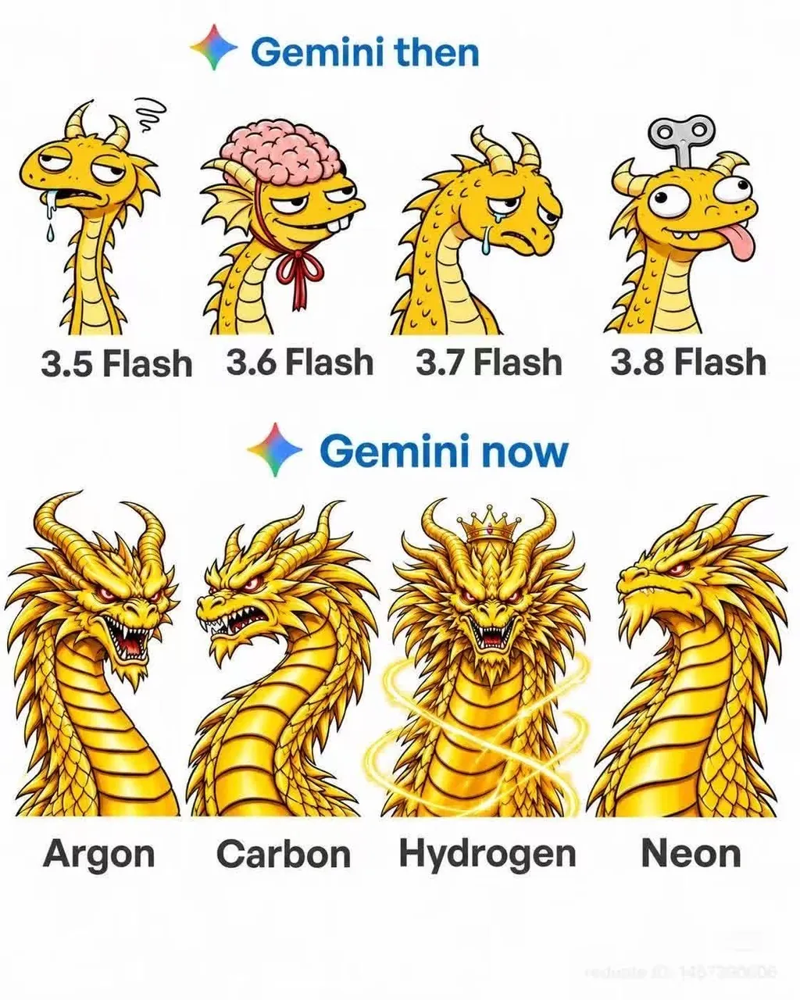
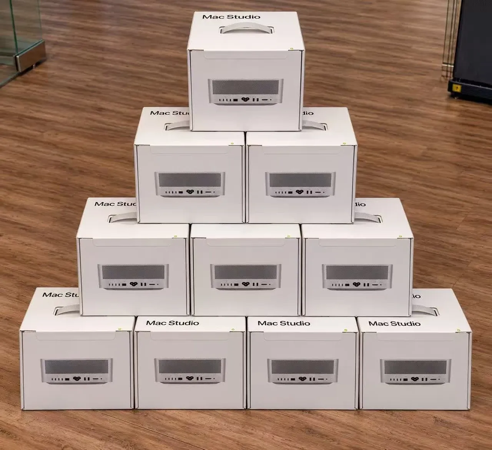

英伟达董事会宣布黄仁勋即刻复任总裁、CEO 和董事，NVDA 盘前一度涨三成多，群里一边刷梗，一边讨论他回去后会不会清算董事会。Gemini 这边，Antigravity 再次全员重置额度，付费 Pro 用户从今天起能用 Carbon；几位群友对 Neon 评价很高，有人说复杂任务上它和 Opus 5.5 不相上下。另外推荐读一篇长文《万亿 Token 之路》：作者现在每月消耗 1000 亿到 2000 亿 token，文中算了订阅、补贴和低价模型怎么分层用。

## 英伟达：黄仁勋复职

### 董事会一致投票让黄仁勋复职，NVDA 涨三成，带动科技股全线上涨

英伟达官方新闻稿称，董事会与黄仁勋多次讨论和会面后，对他的坦诚度和领导能力感到满意，一致投票让他即刻复任总裁、CEO 和董事会成员。消息发出后 NVDA 盘前报 161.50 美元，涨 28.65%；群里稍后贴出的板块热力图上，NVDA 涨了 31.53%。一周前（11 月 17 日）董事会还在财报里明确拒绝他回归，见 [「黄仁勋发声明愿意回归，当天下午董事会在财报里说不」]({{ '/daily/2026/11/17/daily/#黄仁勋发声明愿意回归当天下午董事会在财报里说不' | relative_url }})。

新闻稿里的几个要点：

- **国家安全**：董事会在决策过程中听取了美国政府高层的意见，并据此表示「有信心」黄仁勋复任不构成国家安全风险。
- **调查继续**：此前有报道称黄仁勋是外国情报活动的目标。由独立董事组成的委员会仍在调查，并聘请了独立律师，没有给出结论或时间表。
- **新的治理架构**：新设一个全由独立董事组成的国家安全与出口管制委员会，并招聘首席合规官，向提名与公司治理委员会汇报。
- **人事**：董事长 Harvey C. Jones 留任；此前任临时 CEO 的 Colette Kress 回到 CFO 岗位。

当天的热力图（Technology 板块 +7.36%）：

| 股票 | 涨幅 | 股票 | 涨幅 |
|---|---|---|---|
| NVDA | +31.53% | GOOGL | +6.82% |
| TSM | +18.29% | META | +6.18% |
| AMZN | +5.54% | AVGO | +5.45% |
| MSFT | +4.49% | AAPL | +1.42% |

@豁达的灰熊 注意到 ANT 是图上「万绿丛中一点红」。

内情方面，群里流传的转述来自 Semafor 记者：董事会前一晚深夜开会，临时 CEO Kress 前一天大部分时间并不知情，公司直到前一天还在积极规划没有黄仁勋的未来。特朗普直接致电正在进行的董事会会议，为黄仁勋回归出力。反对他回归的一方也受了打击：被视为主要替代人选的 Arm CEO Rene Haas 已和 Arm 签了新合同，任期延到 2033 年。纳斯达克 100 指数期货一度因涨得太快暂停交易。@睿智的北极熊 还贴出一条 11 月 16 日的新浪快讯，说特朗普持有的英伟达股份增至 6200 万美元。

另外，@聪明的剑鱼 提到英伟达在 Anthropic 的 IPO 里投了 100 亿美元。

### 回来之后会不会清算：有人说肯定会，有人说会有人自己走

@热情的大象 问黄仁勋回去会不会清算董事会，群里看法不一。

- **肯定会**：@开朗的企鹅 认为黄仁勋是被董事会用「批斗会」的方式逼走的，清算没什么悬念。不过他也说，如果这次黄仁勋没走，这波下跌很可能照样会来，压力就会落到他身上。
- **不必清算**：@冷静的麋鹿 认为有了裂痕，相处就走样了，就算不清算，对方也会觉得处处被针对，过不了多久就会自己走人。

外界的质疑来自@开朗的企鹅 转述的《纽约时报》报道。耶鲁管理学院教授 Jeffrey Sonnenfeld 说，董事会应该创造长期价值，而不是短期冲高。他认为这次回归可能引发员工大规模离职，还会招来更多政治审查，尤其是明年 1 月起民主党将掌控国会。治理咨询机构 Soundboard Governance 的总裁 Doug Chia 说他「真的搞不懂」，董事会之前已经把这事翻篇了。同一天，《纽约时报》中文网还发了一篇《斥责、威胁、精神折磨：黄仁勋如何把羞辱变成管理日常》。@蓝色大肥虞 问老黄怎么还不把纽约时报买下来，@80-HD 的回答是：「买来干嘛… 都没人看了。」

对这次反转的解读有好几种：

- @热情的狮子 认为是政客都勾兑完了，各方利益算清楚之后，还是让老黄回来。
- @80-HD 的说法是「画 K 线割韭菜割完了」。
- @活泼的羊驼 的版本是：英伟达只是为了清一下老黄的工龄，退休金能少给点。

当天的梗图和段子：

- 一张美国改装车（American Chopper）争吵梗图，台词依次是：「开除黄仁勋！要从外部找人！」「根本没有适合的人！」「把黄仁勋叫回来！」「你不是说要外部的人吗！」「黄仁勋现在就是外部的人啊！」
- 一条微博列出「黄仁勋回归后宣布的几件事」：任命 Colette Kress 为南极洲英伟达分公司总经理；为《纽约时报》设立独立接待室，地址在珠穆朗玛峰北坡；把 Anthropic 订购的 GPU 交付排期到 2047 年。
- 另一条微博：「当你觉得生活压力很大时，想想继任黄仁勋 CEO 的那个 CFO，上周刚跟全体员工说过『Jensen 不会回来了，I want to move on』。」
- 一条点赞 301 的评论：「怎么跟 tm 獐子岛的扇贝一样，一会儿走一会儿来的。」
- 一组漫画把这几天串成 GTA 剧情：11 月 19 日被开除，回家打 GTA 6；打通关后接到英伟达电话，又回去开一整天的会，最后一句是「至少我把 GTA VI 打完了」。这接的是 11 月 19 日那个 GTA 6 梗。@淡定的鲸鱼：「打工人渴望躺平 FIRE，老黄渴望上班。」特朗普本人也在 Truth Social 发了一张拿黄仁勋 P 图的梗图。

@蓝色大肥虞 算了算，这波过山车坐下来，他之前抄底的股票总浮盈「竟然还有 $10」。

## Anthropic 被扒

### 媒体扒出的 Anthropic 内部：「Dario Vision Quest」、小蓝书和文化面试

@开朗的企鹅 转了一条推文。推文作者汇总了《华盛顿邮报》和《华尔街日报》最近对 Anthropic 内部文化的报道，结论是这家公司「把商业公司的野心包装成拯救人类的道德事业」。@飘逸的狮子 的评论是：「不怕你技术好，就怕你玩意识形态。」

推文转述的细节：

- **内部活动**：Dario 每两周给全公司开一次「Dario Vision Quest」大会，讲 AI、人类文明、战争和政治。他一篇 14000 词的 AI 宣言被印成实体书发给员工，内部有人叫它「小蓝书」。公司还发过印着「Good luck, everyone」的帽子，这是他大会收尾时爱说的一句话。
- **招聘**：有专门的「文化面试」，应聘者要先读 Dario 的文章。据报道，一位落选者收到招聘经理的短信，形容这场面试有点像在问「准备好加入邪教了吗」。
- **Dario 的旧观点**：《华盛顿邮报》挖出一份 2022 年的内部备忘录，Dario 在里面估计 AGI 有 20%～30% 的概率导致人类毁灭或文明永久停滞。《华尔街日报》披露，他在 OpenAI 时曾在 Slack 上设想用沉浸式电子游戏缓解 AI 抢走工作引发的政治冲突。
- **泄密**：去年公司因内部 Slack 信息外泄做过调查，泄密者被开除。之后 Dario 在内部大会上表示不会因泄密闭嘴，还直接骂当时的英伟达 CEO 黄仁勋贪婪。
- **对外**：公司邀请学者、智库研究员和媒体人参加为期两天的思想交流，要求事先读 Dario 的文章和 23000 词的 Claude 宪法。

另一条推文翻出 Amanda Askell 早年与人合写的评论，称其主张杀掉食肉动物来减少动物界的苦难。回复里有人核实确有其文，但说法没有「全部杀掉」那么夸张。

@细心的熊猫 评的「今日最佳」也和 Anthropic 有关，是 Malte Ubl 的一条推文：「At least 50% of Anthropic revenue is Claude getting zsh word-splitting syntax wrong.」

## Gemini 与 Antigravity

### Antigravity 全员重置额度：Pro 用户能用 Carbon，Hydrogen 向所有用户开放

Varun Mohan 发推说，因为要在各档位升级模型，Antigravity 上所有人的 Gemini 额度都重置了：付费 Pro 用户从此能用 Carbon，Hydrogen 按承诺向所有用户开放。前天群里还在说要上约 99 美元那档才有 Carbon（[「要不要为 Carbon 花钱：推荐 Hydrogen 和 Neon，但 Neon 啃不动长文本分析」]({{ '/daily/2026/11/21/daily/#要不要为-carbon-花钱推荐-hydrogen-和-neon但-neon-啃不动长文本分析' | relative_url }})），现在 20 美元档就能用了。上一次重置是 11 月 18 日（[「Antigravity 周额度被重置；Fable 重置卡只补 Fable 那一半」]({{ '/daily/2026/11/18/daily/#antigravity-周额度被重置fable-重置卡只补-fable-那一半' | relative_url }})）。

重置前，@活泼的羊驼 晒过自己的用量：周六刚重置，到今天凌晨周额度只剩 51.28%，「已经蹬了一半了」。重置后，@认真的喜鹊 觉得额度掉得比以前快，@洒脱的兔子 也有同感，他的截图显示周额度剩 91.21%，距离下次刷新还有 163 小时。另外，几位群友都抱怨重置时官方没有通知。

### Neon 口碑：写作「说人话」，有人说复杂任务上不输 Opus 5.5

几位群友今天对 Gemini 4 Neon 的评价很高。@认真的喜鹊 已经只用 Neon。@倔强的白鹭 的说法更重：在复杂一点的任务上，GPT 和 Neon 比「就像是智障」，Neon 和 Opus 5.5 不相上下。@优雅的喜鹊 的评价是：「要不是 agy 拖后腿，我感觉谷歌要上天了。」

具体好在哪，各人说法不同：

- **写作和知识量**：@活泼的羊驼 认为 Neon 写作「说人话」，知识量更大，弱势在于 Antigravity 这个框架。@热情的大象 问论文写作和逻辑梳理是不是也是 Gemini 更好。@优雅的荷兰猪 的回答是更好，他现在都是最后让 Gemini 把关重写，「干活 GPT 可以，写作是真不行」。@飘逸的狮子 补充，Grok 写作也不错。
- **怎么搭配**：@认真的喜鹊 的策略是默认用 Neon，只有计划已经特别清晰时才用 Hydrogen high 以上。他的理由是宁可少对几次 prompt、看得细一些，也比用便宜模型大量调用、生成一堆有 bug 又没时间看的东西强。他用的是学生和教育研究员优惠，所以说不清和 Codex 比哪个性价比高。他一直不喜欢 Codex，觉得功能和设计都很混乱，@蓝色大肥虞 的建议是都用 CLI 版本，「看着清爽」。

前天 @敏锐的海狸 还说 Neon 啃不动 10 万 token 以上的长文本分析，今天没有人回应这一点。

### AGY 的两个坑：遥测偷跑流量，账号地区漂移会被拒

@睿智的北极熊 转了一条推文。作者说 Antigravity 等了 4 天才更新到 2.34.0，后台上传数据的问题还在，关掉遥测也没用，「一小时偷传几百兆，一天 100G，你的梯子流量就这么没了」。推文配的排查截图显示：后台进程约每 35 秒上传超时一次，然后重试，当天已记录 1,515 次；凌晨 3 到 6 点每小时约上传 2.5–2.7 GB；超时前已经发出的数据照样计入流量。作者给的办法是拦截 `play.googleapis.com`，连接会直接清零，功能不受影响。这是单方说法，群里没人验证。

另一个坑是地区。@冷静的麋鹿 打开 AGY 时被提示「not eligible for Antigravity, because it is not currently available in your location」，网页端却一切正常。他起初以为是 Neon 太火、谷歌为了应对算力短缺封了一些地区。@活泼的羊驼 提醒他看看是不是账号地区漂移了，一查果然漂到了中国，他已经申请修改。@活泼的羊驼 给的预防办法是「多开开 VPN 刷 YouTube」。

## 模型与工具

### GLM-5.4 悄悄上线；有群友到手 512G Mac Studio，正好装得下

@聪明的蜂鸟 发现自己的 GLM Coding Plan 突然不好用了。@天真的狮子 确认 GLM-5.4 已经悄悄上线：在他的 Z.AI Coding Plan 模型菜单里，GLM-5.4 排在 GLM-5.3 和 GLM-5.3-Flash 后面，支持文本、图片、视频和 PDF 输入，支持推理，上下文 100 万。他让 agent 花 21 分钟排查了断连问题，结论是 Z.ai 的 `coding/paas/v4` 服务端在 5.4 上线窗口期出了瞬时故障，不是本机 OpenCode 配置、插件或 MCP 的问题，15:00 后已自动恢复，偶尔还会断连一次（`ECONNRESET`），重试就好。@敏锐的松鼠 在 OpenCode 上试了 5.4，觉得「速度好慢」。

同一天，@今天群内信息量极大 的 512G 内存 Mac Studio 到货了，@机智的雪豹 称之为「3 万刀的铝疙瘩」。@今天群内信息量极大 说 GLM 5.4 好像正好能装进去。@稳重的海豚 问本地跑的 TPS 有多少，@优雅的喜鹊 说 GLM Flash 大概六七十，满血版不清楚。@稳重的海豚 随即把同一张开箱图发了一遍，说自己「一不小心也买了一个」。@80-HD 则发来一张图：

### 《万亿 Token 之路》：每月 1000 亿 token「既不贵也不难」，难的是后面那 9000 亿

[《万亿 Token 之路》](https://ranchen.org/content/20261123-ranchen-article-road-to-one-trillion-tokens)是一个系列长文的第一篇。作者是一位独立开发者，自称目前每月消耗 1000 亿到 2000 亿 token，正朝单月 1 万亿推进。这一篇讲三件事：为什么看这个指标、账怎么算、什么生意配得上这么烧。

- **用量轨迹**：年初每月约 100 亿，年中 500 亿到 1000 亿。作者拿 2025 年 OpenAI DevDay 给企业颁发的 token 奖章作对照，说自己单月用量已经超过当年企业的千亿档。
- **前 1000 亿靠订阅**：补贴让订阅折算成 API 价格有几十倍甚至上百倍的杠杆。他举例说，500 美元一档的 ChatGPT Pro，视模型组合不同，可以扛几十亿到百亿级的负载。他点名了四家：Anthropic（Opus 5.5，智能上限最高）、OpenAI（Pro 加 Codex，额度厚）、Google（最新一代 Gemini，已能扛日常开发）、xAI（Grok 4.7 落后半个身位，但补贴率高）。四家顶配全开，每月硬支出一千多美元，可以拿到约 1000 亿 token。
- **后 9000 亿靠低价模型**：订阅有账号上限，多开账号违反条款，所以必须转向开源和极低价模型。比如 DeepSeek-V4.1-Flash-1017，按官方定价，非高峰时段缓存命中的输入每百万 token 只要 0.003 美元。他的分工是：Opus 5.5 定骨架、数据口径、校验门禁和规范；Gemini、高补贴订阅池和 DeepSeek 跑高并发执行；再定期让强模型抽检、交叉 review 和纠偏。
- **为什么用量是好指标**：作者承认存在「Tokenmaxxing」，即员工让 agent 空转刷用量。Meta 今年秋天已经把 token 看板移出了绩效评估。他的论点是，独立开发者自负盈亏，用量能持续拉高，说明跑通了有经济效益的闭环。
- **什么生意配得上**：他的原则是「先闭环，再提效」。他的答案是内容站广告变现和「知识工厂」，也就是把政府网页、PDF、旧数据库清洗成结构化数据，每处理一个细分领域「随手就是几百亿 token」。

后续篇目预告会讲订阅、云 API 和本地自建的成本拐点，以及多模型交叉 review 怎么防止幻觉层层传递。

### Codex CLI 贴图：Ctrl+V 就行，Windows Terminal 会拦截

@洒脱的狐狸 问，用 CLI 时怎么把截图或参考图交给 agent。@蓝色大肥虞 说 Codex CLI 本来就能用 Ctrl+V 粘贴图片，他在 Ubuntu 和 macOS 下一直这么用；在 Windows 下一试却不行，Codex 告诉他是 Windows Terminal 把 Ctrl+V 拦截了，改个快捷键应该就好。@直率的鹦鹉 说 Windows 下也可以，可能要先用鼠标点一下输入框。@蓝色大肥虞 顺带吐槽，Codex 给他写的 TUI 在 Windows Terminal 里就能用 Ctrl+V。提问者是 ssh 到远程主机上用 CLI 的，这种情况下贴图行不行，群里没人讨论。

他贴出的快捷键表里，几个常用的：`@` 引用文件，`!` 执行 shell 命令，`Ctrl+G` 打开外部编辑器，`Alt+,` 和 `Alt+.` 降低和提高推理强度，`Shift+Tab` 切换模式，`F8` 语音输入，`Esc Esc` 编辑上一条消息，`Ctrl+T` 打开对话记录。

## 闲聊

### 小红书发不出「黎曼猜想被 Claude 证明了」：拦的是「想被 C」

有人发现，「黎曼猜想被 Claude 证明了」和「黎曼猜想被 chatGPT 证明了」在小红书上都发不出去，换成 DeepSeek、换成「纳维-斯托克斯难题被 Claude 解决了」，或者把两半拆开发，都能发出去。网上有人把这做成了一道选择题，选项是 Claude 是违禁词、触及外网模型、学术名词触发审核、新闻未经证实。@蓝色大肥虞 把题丢给 Gemini Neon，它的回答是四个选项都是干扰项：被拦的是「猜**想被 C**laude」「猜**想被 c**hatGPT」拼出来的谐音粗口，前面的对照组恰好证明了这一点。@冷静的飞鼠 贴的另一张截图里，网友也得出了同样的结论。

@机智的雪豹 说这「有种 20 年前的模板过滤的味儿」。@稳重的海豚 给了解法：「猜想被 klaude 证明了，不就完事了。」
