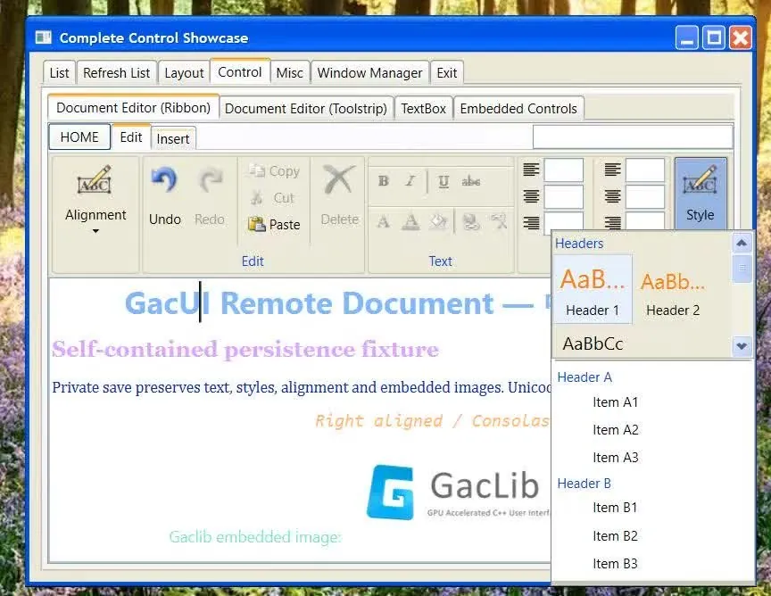

OpenAI 今天被传出三篇论文截图：矩阵乘法指数是 9/4、线性规划有强多项式算法，再加一篇 VP≠VNP。署名 Claude/Anthropic 的另一篇 VP≠VNP 也在群里流传。群友的反应基本是「如果是真的」，几个人感慨教科书赶不上更新。工程方面，Anthropic 发布 Claude Ship，把 PR 评审、修 CI、按策略自动批准串成一条链路，有群友说这是要把 GitHub 吞了。还有一个值得记住的教训：有群友拿订阅附送的 API 额度试 Pro 模型，一个不复杂的任务花了 312 美元，余额直接变成负数。

## 数学

### 一天三份截图：矩阵乘法指数 9/4、强多项式线性规划，以及两篇 VP≠VNP

群里流传的论文截图里，OpenAI 署名 11 月 24 日的有两篇：一篇证明方阵乘法指数在任意域上恰好是 9/4，也就是 ω=2 的猜想不成立；另一篇给出线性规划的确定性强多项式算法，回答了 Smale 第九问题。另有 Claude/Anthropic 和 OpenAI 各一篇 VP≠VNP 的摘要。截图都只有摘要，没有链接，群里没人核验，@蓝色大肥虞 的第一反应是「好耶，如果是真的」。

| 结果 | 署名 | 摘要里的说法 |
|---|---|---|
| 矩阵乘法指数 = 9/4 | OpenAI | 上界此前已知。n ≥ 2 时，两个 n×n 矩阵相乘的形式算术电路至少需要 n^(9/4)/2 个乘除门。思路是：指数如果更小，张量网络就能被压缩到违反「多个独立列表各自元素互异」这一判定问题的下界 |
| 强多项式线性规划 | OpenAI | 对任意实系数，步数是变量数和约束数的多项式；有理数输入时，中间数的位长是输入长度的多项式。同一方法给出凸二次规划的强多项式算法；对完全信息回合制平均收益博弈，确定性版本是强多项式时间 |
| VP≠VNP | Claude / Anthropic | 实数上计算 m×m 积和式（permanent）的算术电路，门数超过 m^(c·(log m)^(1/3))；特征不为 2 的域同样成立，换成哈密顿圈多项式则对所有域成立。摘要自己写明这是 P≠NP 的代数类比，不适用于布尔电路，所以没有解决 P≠NP。结果由内部研究版 Claude 发现，已在 Lean 中形式化 |
| VP≠VNP | OpenAI | 下界对 border circuit 也成立，形式为 exp(Ω((log n)^(5/4)))，覆盖特征 2 |

理论计算机科学家 Lijie Chen 在 X 上评矩阵乘法这篇：「It takes exactly n^{2.25} arithmetic operations to multiply two n*n matrices……and it has actually been proven via an explicit superlinear circuit lower bound (!). It's hard to describe how surreal this feels...」@开朗的企鹅 问这是不是说矩阵乘法已经优化到最优了，@沉稳的兔子 答「是的」。

- **线性规划**：@坚定的貂 说这是优化领域最大的问题，按他的理解，论文还「顺便」证明了单纯形法不可能是多项式时间。@豁达的灰熊 只回了「顺便（」。
- **VP 不是 P**：@沉稳的兔子 提醒「VP 和 VNP，毕竟不是 P 和 NP」。@蓝色大肥虞 仍然称之为「天大喜讯」，「至少朝着好的未来的方向前进」。@优雅的荷兰猪 的理解是，这说明目前的架构不需要有实质性变化。@蓝色大肥虞 补了一句：「直到量子计算机投入实用为止，不过 LLM 发展势头这么凶猛，量子计算不会有钱了。」
- **谁受冲击**：@坦荡的灰熊 的评论是「AI 在给自己提效，AI 想要，AI 得到」。@细心的熊猫 的感慨是：「教科书印刷的速度赶不上知识更新速度。幸好我博士学位已经拿到了，不然论文都要变成废纸。」@坦荡的灰熊 认为很多具体问题仍需要受过 PhD 训练的人来解决。@蓝色大肥虞 问：「OpenAI 是招了数学家去公司里面打广告吗，怎么最近这么高产。」

## Anthropic

### Claude Ship：PR 提交之后的评审、修复、批准都交给 Claude

Anthropic 发布 [Claude Ship](https://claude.com/resources/articles/introducing-claude-ship)（beta），把 PR 提交之后的整条链路交给 Claude，由团队写策略决定哪些改动可以自动通过、哪些必须人工签字。目前只面向 GitHub 仓库上的 Team 和 Enterprise 套餐。@豁达的灰熊 的判断是：「这是要把 GitHub 吞了啊。」

产品分三块：

- **Code Review**（已正式上线）：从多个角度审 PR，对发现的问题先做对抗式验证再发出来，每个仓库可选 Quick、Standard、Deep 三档。
- **PR Steward**（beta）：负责让 PR 保持绿灯，处理失败的 CI、合并冲突和评审意见。每次 push 后会评论改了什么、怎么撤销。它的设计是不批准、不合并。
- **Claude Approvals**（beta）：读取仓库里的审批策略文件，常规改动自动批准，特定场景要求更深的人工签字，官方称之为「更聪明的 CODEOWNERS」。官方建议先用 observe-only 模式跑一段时间，再设成分支保护的必要条件。

开发者也可以在 Claude Code 里用新的 `/ship` 命令，一条命令完成推送、开 PR、评审、处理反馈。费用按 token 计，Code Review 和 PR Steward 可以设支出上限。只要策略里用到 Claude 评审，即使在 observe 模式下也会触发计费。启用了零数据留存、HIPAA 或客户自管密钥的组织不能用。符合条件的 Enterprise 组织可以在 2027 年 1 月 15 日前领取至少 1 万美元额度，领取后 30 天内用完。官方给的数据来自 Claude Code 团队自己：6 月到 9 月合并的 PR 翻了一倍多，被回滚的比例下降超过 40%。

群里的讨论：

- **从哪来的**：@豁达的灰熊 记得 Anthropic 之前写过一篇文章，介绍内部替代 Git 的工具 scion。他看完觉得 Ship 不是直接把 scion 拆出来，而是把内部大规模用 agent 开发的流程产品化了一部分。
- **谁来赚这个钱**：@80-HD 起初说这就是「方便企业用户多烧 token」，但也承认它解决的是真痛点：绝大多数人已经不看代码、直接让 Claude 看了，那不如 Anthropic 自己把钱赚了，免得被企业自研或 Graphite 这类 startup 抢走。@豁达的灰熊 觉得这件事太适合大厂做，所以也没怎么见 startup 做。@蓝色大肥虞 提醒，GitHub 上早就能 @claude 来做这些。

## 模型与工具

### GPT-6.2 Sol：一派说有 Astra 就别碰它，一派说干活还行

@开朗的企鹅 贴了一条评论截图：用户用 6.2 Sol 的 max 档在项目里做了两次功能，两次都是代码审到一半就回滚了；6.1 至少还按他的设计在做。底下有人问「为啥不继续用 Astra 6.0」，原作者回「太对了」。群里对 6.2 Sol 的看法分成两边。

- **不如直接上 Astra**：@蓝色大肥虞 说 Sol 能力很强，但缺点明显，需要花力气驾驭，「在有 Astra 的时候一点用 Sol 的理由也没有」。@专注的火烈鸟 说要给 6.2 打负分，认为它不适合放在用户端直接跟人打交道，适合做下游。他还说通过 Azure Foundry 的 endpoint 调 6.2 系列时频繁遇到 500 错误。@天真的浣熊 附议，但也嫌 Astra「慢得有点过分」，@蓝色大肥虞 的回答是「非 Astra 不能做题也」。
- **干活还可以**：@直率的鸵鸟 觉得 6.2 Sol 和 6.1 Sol 区别不大，任务完成得更快；@优雅的荷兰猪 也觉得它干活还可以。
- **转向别家**：@冷静的麋鹿 说自己全面转向 Neon。@专注的火烈鸟 认为 Neon「说人话」的体感已经和 Opus 5.5 差不多。@天真的大象 觉得 Opus 还行。@开朗的企鹅 觉得更大的问题在别处：ChatGPT 里的 6.2 没有 Pro 版。

@80-HD 的看法是，对他来说这些模型都已经「智能溢出」了。@机智的水獭 也认为现在的智能足够大多数行业用，缺的是 FDE（前线部署工程师）或类似角色。@蓝色大肥虞 的补充是：「大多数行业」的人没训练过，发挥不出来，而他们的工资和生产线上需要的 API 价格比起来，这笔账也不一定划算。

### Astra 的两个活：GacUI 的 Windows XP 皮肤，和一个 CrossOver 跑不起来的游戏

@蓝色大肥虞 继续让 Astra 用 XML 给 GacUI 复刻各个操作系统的皮肤（前情见 11 月 22 日 [「管住 Astra：明说别过度设计，bug 先绕过、再逐条认根因」]({{ '/daily/2026/11/22/daily/#管住-astra明说别过度设计bug-先绕过再逐条认根因' | relative_url }})），「许愿了十几下」终于得到 Windows XP 版。他以前担心 GacUI 的 XML 在美术上不够灵活，「然而 Astra 大人有的是办法，我自己设计的 UI 描述语言，我一下子都想不出来这应该怎么做」。

@稳重的海豚 下了个游戏，用 CrossOver 在 Mac 上跑不起来。Astra 自己「吭哧吭哧」给他写了个补丁修好了，他的感受是「修游戏的过程比玩游戏更爽」。

### 订阅附送的 API 额度：Pro 模型一个任务就花掉 312 美元

@冷静的麋鹿 拿 ChatGPT 订阅每月附送的约 200 美元 API 额度试 Pro 模型。下了一个「不那么复杂」的任务后他出了门，回来一看，账单显示当天总支出 312.75 美元，余额是 -118.79 美元。他的结论是「用不起用不起，大家引以为戒不要手痒」。

- **API 里没有 6 Pro**：他发现 API 能调的最新 Pro 只到 5.5 Pro，于是怀疑网页端的 6 Pro 是不是「假 Pro」。
- **余额会变负**：@今天群内信息量极大 没想到余额能是负数，他最近也在狂用 Terra 烧 credit，赶紧「记笔记」。@冷静的麋鹿 猜是 Pro 跑得太快，没来得及拦住。@敏锐的麋鹿 估计欠款下个月会从那 200 美元额度里扣。@冷静的麋鹿 正在申请官方抹掉。
- **用订阅会失去价格感**：@蓝色大肥虞 说，他在公司用的 agent，「标称成本」和 OpenAI、Claude 的 API 价格差不多。200 美元只够他对着一个大型代码库问四分之一个问题，比如「这个 npm 包到底在哪被用了、我要怎么在界面上点出来」。烧了 800 美元拿到答案后，再让它把软件编译起来点给他看，又花了 60 美元。「subscription 用多了会失去感觉。」

### 用 Carbon 从演奏视频里拆小提琴弓法

@认真的喜鹊 想学小提琴家薛伟的技巧，让 Carbon 分析一段演奏视频，逐帧标出弓毛触弦点是靠琴马、中间还是靠指板，并给出上下弓、弦序和把位。他起初担心用 Carbon「暴殄天物」，@蓝色大肥虞 认为准确最重要，不算浪费。

Carbon 给出的方法分三层：

- **上下弓与连弓**：用右腕弓根相对琴马接触点的位移求导，按肩宽归一化，单调区间里的多个音判为连弓。
- **弦序与把位**：结合左手沿琴颈的伸展比、右肘仰角、用 torchcrepe 测的揉弦幅度（空弦小于 8 音分，按指 15–39 音分）和换把滑音，再用 Viterbi 动态规划求全局最优。
- **触弦点**：用霍夫变换检测白色弓毛直线和琴颈轴线的交点，4,336 帧里检出 3,610 帧（83.3%）；再结合高低次谐波的能量比，把靠指板（sul tasto）、正常区和靠琴马（near bridge）定量分开。

难点也不少。直播的镜头切换对 AI 来说很难。@认真的喜鹊 希望 Antigravity 能把上下文扩大，比如给 Carbon 2M。@蓝色大肥虞 建议，画面里看不见的部分可以用声音补，「弓法就是为了产生这些声音服务的」。@敏锐的松鼠 提到还有专门的音频转谱模型。@认真的喜鹊 还担心训练数据本身有问题：在他看来，在世的拉琴者大多数拉法都有问题，这条视频在小红书下的评论里也全是质疑演奏者右手的。他后来确认，薛伟用的是格鲁米欧拉过的那把瓜奈利（耶稣瓜耐利），所以 sul tasto 拉法下仍然有投射。普通琴这么拉，声音会发闷。

### M5 Ultra 本地跑 GLM-5.3-Flash：decode 65.6 t/s，能用但不够快

接昨天到货的 512G Mac Studio（[「GLM-5.4 悄悄上线；有群友到手 512G Mac Studio，正好装得下」]({{ '/daily/2026/11/23/daily/#glm-54-悄悄上线有群友到手-512g-mac-studio正好装得下' | relative_url }})），@今天群内信息量极大 用它在实际流量下托管 GLM-5.3-Flash：decode 65.6 t/s，prefill 1663 t/s。他的评价是「在实用和不实用的边界上」。好消息是能跑起来了，比 Qwen 3.8 靠谱不少，尤其适合他的打标任务，这个任务用 Grok Heavy 跑一天就能烧光一周的额度。坏消息是，相对于任务量还是太慢。

## 英伟达

### 黄仁勋复职第二天：传记作者改口，跟着离职的工程师想回来

热度还在，新料有三条。一是@开朗的企鹅 贴的一篇文章：黄仁勋传记作者 Stephen Witt 风波刚起时写过一篇几乎没有正面描写的评论，现在又在《纽约时报》发了《I Can See Why Jensen Huang Was Irreplaceable》，加了大段赞美。文章作者形容这次改口「戏剧性堪比贝森特的『他已经是外部人士了』」。二是一条青年报快讯：一名跟着黄仁勋离职的英伟达工程师，11 天后看到黄仁勋复职，说「我走得有点仓促」，考虑重返英伟达。@活泼的老虎 的评论是「老黄有总统保，工程师想回就费劲了」。三是一条 135 万浏览的 Kalshi 推文，转述前情报官员的说法，称黄仁勋可能被美国利用，向中国传递虚假信息。底下最高赞的回复是：「哥在 24 小时内从 CEO 变成失业人士再变身秘密特工，Netflix 得拍 10 季才能讲完。」@豁达的灰熊：「比短剧还快。」

@温暖的斑马 的看法是，美国总统的特赦权几乎不需要理由；接下来的国会听证、质询和民主党「捋袖子」，都是政客给选民的交代。

段子精选：

- @温暖的斑马 的清单：老黄 11 月全勤奖没了；社保断了 11 天；又要重新试用 3 个月才能转正；「英伟达董事会调查发现，新任 CEO 黄仁勋曾担任过英伟达 CEO」；3 倍做空英伟达的账户一夜清零。
- @淡定的大象 贴的冷笑话：三个人聊被开除的原因。甲：「我因为拥护黄仁勋下台。」乙：「我因为反对黄仁勋下台。」丙：「我就是黄仁勋。」
- 有人把《雍正王朝》里「有没有人推荐八阿哥」那场戏改成推荐 Jensen，贝森特演张廷玉。@神秘的企鹅 接着写了一份特朗普口吻的批折子圣旨。@冷静的麋鹿 发现原剧里「好就好在没忘了……」那句被删了，@神秘的企鹅 说是被豆包删的。
- @蓝色大肥虞 截了一个 YouTube 视频，标题是《Jensen Huang Is Back And More Powerful Than Ever》，带 AI 生成标签。最高赞评论是「Finally a non AI video」，回复是「It was absolutely astonishing to witness this in person.」

## 闲聊

### 乐器：小提琴先租再买；想在键盘上拉弦乐，目前做得最好的是 Osmose

@随和的飞鼠 家孩子学校要买琴，一千多美元，租的话每月 50 美元，他自己啥也不懂。两位群友都建议先租：@认真的喜鹊 说分数琴（儿童尺寸琴）尤其该租，因为能便宜租到百年以上的老琴；@风趣的海豚 说租可以多换几把找自己喜欢的音色，也顺便看看到底喜不喜欢这个乐器，「这东西在完全不懂的情况下买是一个很容易失败的决策，甚至 AI 也帮不了什么」。他还说，国内一万元上下的琴可挑的音色很多，认识圈内人的话，还能捡漏到和三四万差不多的。@认真的喜鹊 补充，弦、松香、琴弓、配件、温湿度、音柱位置都会改变音色，「特别适合理工男追求极致的人」；琴弦的高光期只有几周，练得多的话两个月就该换了。

@蓝色大肥虞 由此问到电钢。@风趣的海豚 说电钢基本没坑，合成器才是新坑；除了 Nord，电钢一般都自带喇叭。@认真的喜鹊 买过 Studiologic 的 SL88，手感好，但机械有 bug、噪音大；@风趣的海豚 说那是 Fatar 自家的键盘，手感确实好，但音色偏土，大多还得接音源。

想在键盘上表现弦乐，几种路子：

- **aftertouch**：很多电钢都有，按下去后改变力度就能改音色，主要用在合成器音色上。
- **Osmose**：[Expressive E](https://www.expressivee.com/) 的乐器，琴键能左右掰动改变音高和音色（基于 MPE），@风趣的海豚 认为这是原生做得最好的一家。
- **建模音源**：[SWAM String Sections](https://audiomodeling.com/products/swam-string-sections) 是目前效果最好的，但要配表情设备，还得提前选奏法，操作手忙脚乱。黑五期间 SWAM Orchestra 套装从 1,699 美元降到 1,138.33 美元。
- **手风琴式控制器**：@风趣的海豚 觉得手风琴是很有前途的控制器，比如 Fisa Suprema 电子手风琴，弦乐音色很逼真，唯一的坑是太贵。@蓝色大肥虞 小时候家里有过手风琴，嫌重，左手伴奏那边也记不住。

@风趣的海豚 的总结是：「电子乐器本质就是看如何用更符合人体工学的方法同时加入更多控制维度，每多一个控制维度就多一个可以映射的输入。」
