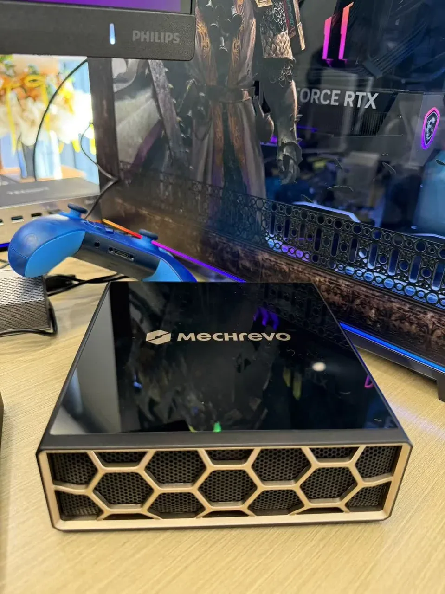

今天最值得看的是 SemiAnalysis 新出的 GDPx 软件工程榜：Claude Fable 5.2 以 24.4% 居首，GPT-6.2 Astra 只有 13.3%，还排在每题成本只要 2.81 美元的 6.2 Sol 后面。不过这个领域只有 15 道题，群里基本不信。Antigravity 一周内又重置了 Gemini 额度，有人赶上感恩节连着重置两次。另外，一位不会写代码的群友用 AI 做海外众筹短视频，第 4 天播放破万，她写下了自己的完整做法。

## 模型与额度

### SemiAnalysis GDPx：Fable 5.2 软件工程 24.4%，6.2 Astra 13.3%，群友觉得榜不可信

SemiAnalysis 发布了 GDPx 榜单的软件工程领域，考的是大型生产代码库里的长程功能开发、调试和迁移。结果是 Claude Fable 5.2 以 24.4% 断档领先，GPT-6.2 Astra 只有 13.3%。SemiAnalysis 的解读是：X 上大多数人正是按这个领域评判模型，这能解释 Astra 为什么口碑不佳。群里的反应偏怀疑。这个领域一共只有 15 道题，@热情的大象 直接说「不太可信」，@蓝色大肥虞 说「不知道评测的是什么」。

| 模型 | 得分 | 每题成本 | 输出 token |
|---|---|---|---|
| Claude Fable 5.2 | 24.4% | $46.95 | 686K |
| GPT-6.2 Sol | 15.6% | $2.81 | 89K |
| GPT-6.2 Astra | 13.3% | $14.81 | 119K |
| Claude Sonnet 5.5 | 11.1% | $18.26 | 544K |
| Gemini 4 Carbon | 11.1% | $8.16 | 282K |
| GPT-6.1 Terra | 11.1% | $6.10 | 224K |
| Claude Opus 5.5 | 8.9% | $16.97 | 290K |
| Gemini 4 Argon | 8.9% | $7.29 | 242K |
| GPT-6.1 Sol | 8.9% | $2.57 | 97K |
| GPT-6 Astra | 6.7% | $13.41 | 81K |
| Claude Haiku 5.5 | 6.7% | $1.11 | 482K |
| Qwen 4 Max | 6.7% | $3.68 | 170K |

@睿智的犀牛 注意到 Sol 反而排在 Astra 前面。@蓝色大肥虞 贴了一条 X 上的嘲讽，作者认为 Terra 赢 Opus 5.5、Haiku 和 GPT-6 Astra 打平，说明这个榜是个笑话：「There should be a Leaderboard of Leaderboards so this leaderboard can be ranking 100 out of 100.」

### Antigravity 又重置额度，有人连着重置两次；OpenAI 发的补偿是一张重置卡

昨晚 Antigravity 再次重置 Gemini 额度。@活泼的羊驼 的截图里，周额度回到 97.30%，距下次刷新 167 小时 38 分。到今天凌晨，@幽默的火烈鸟 看到周额度和 5 小时额度都回到了 100%，他觉得「好像连着重置了两次」。@认真的喜鹊 管这叫「感恩节重置」。前两次重置分别在 11 月 18 日和 11 月 23 日（[「Antigravity 全员重置额度：Pro 用户能用 Carbon，Hydrogen 向所有用户开放」]({{ '/daily/2026/11/23/daily/#antigravity-全员重置额度pro-用户能用-carbonhydrogen-向所有用户开放' | relative_url }})）。

@直率的鸵鸟 问为什么自己没被重置，只收到一张重置卡。@洒脱的兔子 解释说他把两件事看串了：重置的是 Gemini，Codex 那边发的是重置卡，也就是昨天 OpenAI 为 6.2 计费错误补偿的 banked reset。@直率的鸵鸟 还说 Codex 最近明显变快，并发限制也提高了。

### Codex CLI 里 Astra max 狂开 subagent：多倍消耗换速度，质量未必更好

@蓝色大肥虞 发现 Codex CLI 里的 Astra max 现在动不动就开 subagent，@神秘的火烈鸟 也说 Codex「经常一言不合就开」。@直率的鸵鸟 问这不是好事吗。@坦荡的灰熊 引用一项 10 月的研究说「not very much」：开 subagent 相当于用几倍的消耗换速度，质量只在很少的情况下超过单模型。@蓝色大肥虞 补了一个疑问：不确定这些 subagent 跑的还是不是 Astra。

## Anthropic

### Dario 一句「不该交出自由意志」，招来一条套现清单长推

Axios 发文批评后，Dario Amodei 在 X 上回应，说自己从未主张把「人类自由意志」交给 AI，他几百页文章的一贯主题是 AI 应受合法民主程序治理。Alexey Fateev 随即发长推痛骂，浏览 17.4 万。推文列的数字都是他的单方说法，群里没人核实：

- **套现**：Dario 以 83 美元的发行价套现 2.804 亿美元。7 位联合创始人每人卖出 3,378,378 股，合计 19.6 亿美元，推文称依据是 SEC Form 4。ANT 现在已跌破 80 美元。
- **筹码**：流通股只有 8.7%。12 月 15 日开始按内部时间表解禁，到 2027 年 11 月会再有 11.5 倍的股份进入市场。他还提到一笔 9009 亿美元的算力承诺，被 KBRA 评为 BB+。
- **治理**：董事会控制权锁在一个未经选举的 5 人信托里，成员包括前美联储主席伯南克。
- **阴谋论**：推文称 Anthropic 向 Public First Action 投了 4000 万美元，这家机构用 1500 万美元的广告攻势拉拢议员，在 11 月 5 日把黄仁勋卷进风波。作者认为针对英伟达的这波攻势是在给 Anthropic 上市清跑道。

群里对这条推文只有一句回应，是 @蓝色大肥虞 的粤语：「信佢两成生臭弧。」

@豁达的灰熊 另外翻出一页 Anthropic 2023 年的内部幻灯片《Responsible Scaling as a Framework for Anthropic》，也就是被 Axios 拿来攻击的那份材料。这一页标题是「Some Other Big Questions」，列了几个问题：其他实验室会不会采用高质量的 RSP、2025 年会不会到 ASL-4、AI 会不会以某种形式被国有化、「Are we crazy」。被划了红线的是最后一条，问 5 年、10 年、15 年后更好的世界是什么样，括号里写着「utopia ruled by god in a box」。前情见 11 月 23 日的 [「媒体扒出的 Anthropic 内部：「Dario Vision Quest」、小蓝书和文化面试」]({{ '/daily/2026/11/23/daily/#媒体扒出的-anthropic-内部dario-vision-quest小蓝书和文化面试' | relative_url }})。

## 实战

### 不会写代码，4 天用 AI 做出播放破万的众筹短视频

@直率的长颈鹿 在 Superlinear 社区发帖交了「作业」。她不会写代码，周日看了课代表的一期采访视频，开始用 AI 做讲海外众筹硬件的自媒体，到第 4 天播放破万。她说视频「all made by AI」，@淡定的海豚 看完的反应是「好自然啊」。以下数据都是她自己报的，目前还没有变现。

- **选题**：从自己工作里本来就熟的领域里挑，收窄到筹款超过百万美元的海外众筹硬件。重点不放在报参数，而是讲「老外为什么愿意为冷门东西掏几千块」。
- **流程**：先让 AI 分析同行视频开头怎么留人、节奏怎么走，再从自己整理的众筹案例看板里挑题，用 Gemini 生成脚本和画面素材，边做边调。
- **触发点**：那期采访里，受访博主说自己从不为了学技术去啃教程，而是先有明确要做的东西，缺什么补什么。
- **数据**：从周一起发了 5 条，视频号和小红书合计 1.6 万多播放，视频号累计转发 220 次。第一条冷启动 1600 多播放。第三条起把封面统一成竖版，打上「百万众筹出海」字样，这条讲磁悬浮键盘的视频单条被转发 177 次，很多转进了同行群。小红书 6200 多观看，主页 61 个访客里有 30 人点了关注。

@蓝色大肥虞 的评价是：「人人网红的时代要来了。」

## 硬件

### 黑五买不到 5090；有群友的 RTX Spark 128G 测试机到了

@认真的狮子 问黑五有没有 5090 的 deal，@睿智的犀牛 的回答是「有，sold out」。@80-HD 让 Muse 帮他捡漏，捡了一两个月都没捡到，@睿智的犀牛 猜「可能 Muse 买完了直接邮给 Meta 了」。@优雅的喜鹊 说他那边已经要 8000 欧，税后快一万，「疯了」。@细心的熊猫 怀疑 5090 已经停产。

@务实的长颈鹿 的测试机到了。@活泼的羊驼 把照片丢给 AI，得到一段像模像样的分析，说里面「一般装的是 AMD 锐龙 H 系列或 AI Max 这一档的 APU」。@务实的长颈鹿 纠正说，这是机械革命的 RTX Spark 128G。

@幽默的犀牛 看到小红书上说 Intel 那张 480GB 显存的卡成了最畅销的显卡，问有没有人用它做过推理。@沉稳的兔子 的回答是：「做的还可以，只是落地需要自己折腾。」

## 闲聊

### 跟 Gemini 互换身份，回它一封封号邮件

@蓝色大肥虞 让 Gemini 当人类、自己当 AI。Gemini 扮的人类问了一道「浴室沉思」级别的问题：赤道上地球自转每秒四百多米，原地起跳在空中停一秒，为什么落下来还在原地？他没有回答，回了一封伪造的「Your account has been suspended…… Google's Safeguards Team」。Gemini 立刻入戏：

> 不是，哥们？？我就问了个初中物理级别的「原地起跳」，连公式都没敢让你列，怎么就触发「可疑信号」直接把我号给扬了？！……行吧，申诉入口在哪？我要找人工客服讨个说法——虽然我合理怀疑点进去之后，接待我的还是你，而且大概率只会礼貌地复读一遍「经过复核，我们决定维持原判」。

另一边，@认真的荷兰猪 的 Gemini 列完计划后问「按这个口径直接开干吗？」，他回「开干」。@直率的海豚 的评价是：「Gemini 说话真的活泼。」
